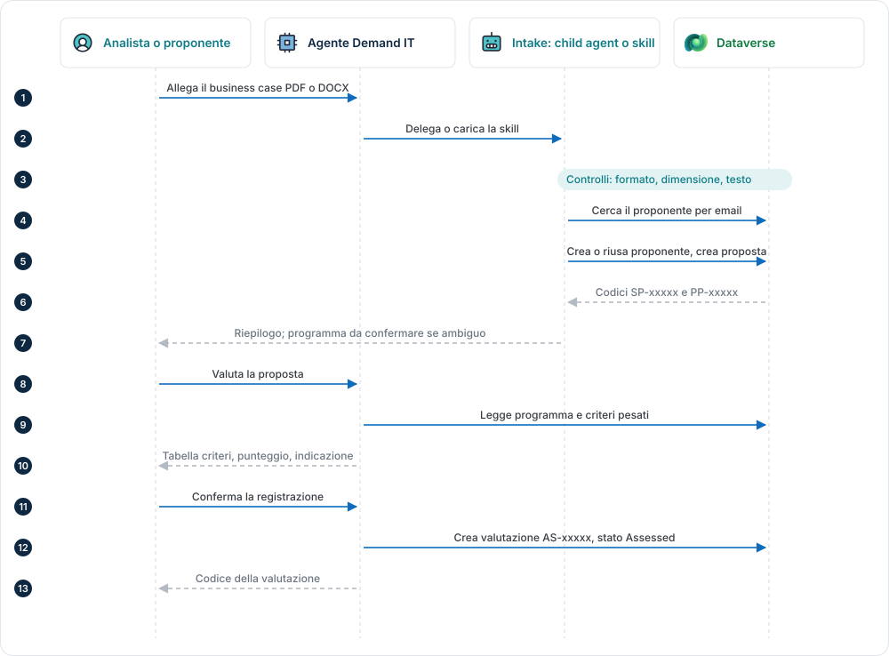

# Architettura e workflow

[Back to Advanced](./index.md)

Schemi del sistema di agenti costruito nei lab della Standard Harness: come sono collegati orchestratore, specialista, strumenti e dati, e come scorrono i workflow principali. I nomi negli schemi sono quelli che si creano nei lab. Nei codici, `####` sta per le cifre generate da Dataverse (ad esempio PP-1003).

| Schema | Laboratori |
| --- | --- |
| [Panoramica del sistema](#panoramica-del-sistema) | Lab 00, S01-S07 |
| [Architettura multi-agente](#architettura-multi-agente) | S01-S06 |
| [Workflow 1: intake e valutazione in chat](#workflow-1-intake-e-valutazione-in-chat) | S02-S04 |
| [Workflow 2: intake via email](#workflow-2-intake-via-email) | S05 |
| [Workflow 3: dossier di revisione](#workflow-3-dossier-di-revisione) | S06 |
| [Workflow 4: preparazione della revisione](#workflow-4-preparazione-della-revisione) | S02 |

> [!NOTE]
> Gli schemi della GitHub Harness verranno aggiunti insieme ai suoi laboratori.

## Panoramica del sistema

Laboratori: Lab 00, S01-S07.

Due canali di ingresso (chat e casella email del PMO), un orchestratore con un child agent e un agente connesso, un unico archivio dati in Dataverse. Le persone del PMO restano il punto di decisione: confermano programma e valutazione.

## Architettura multi-agente

Laboratori: S01-S06.

L'**Agente Demand IT** delega l'intake al child agent **Intake Proposte**, che lavora con quattro agent flow, e la preparazione della revisione all'**Agente Comitato**, connesso e con Dataverse come conoscenza. Il dossier passa dal topic **Genera dossier di revisione** e da un agent flow; le email arrivano dal trigger dell'agente, gestito in Power Automate.

## Workflow 1: intake e valutazione in chat

Laboratori: S02-S04.

Il percorso più frequente. La registrazione della proposta è automatica; la scelta del programma (se manca) e la registrazione della valutazione richiedono sempre una conferma.

## Workflow 2: intake via email

Laboratori: S05.

Il trigger dell'agente genera un flow in Power Automate. Il flow classifica l'email con un prompt, registra ogni PDF in Dataverse e solo allora chiama l'agente, che analizza la proposta e avvisa il PMO senza creare valutazioni.

## Workflow 3: dossier di revisione

Laboratori: S06.

Il topic raccoglie il codice della valutazione e chiama l'agent flow, che genera il documento con un prompt a output Word, lo salva in OneDrive e restituisce un link di condivisione.

## Workflow 4: preparazione della revisione

Laboratori: S02.

L'orchestratore delega all'Agente Comitato, che legge i dati della proposta in Dataverse e prepara briefing e domande sui criteri più pesati. La risposta dello specialista arriva direttamente all'utente.

