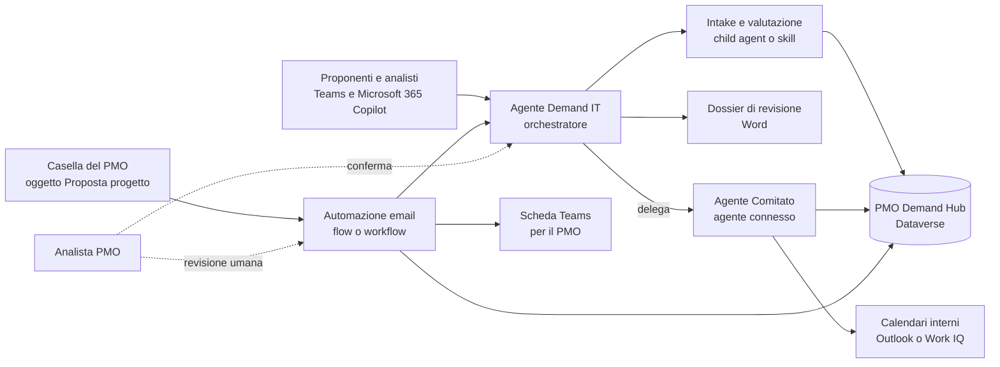
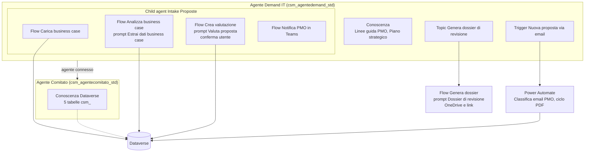
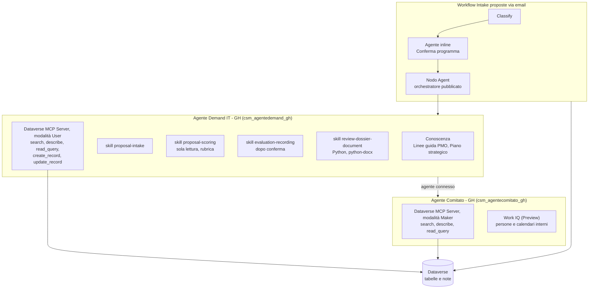
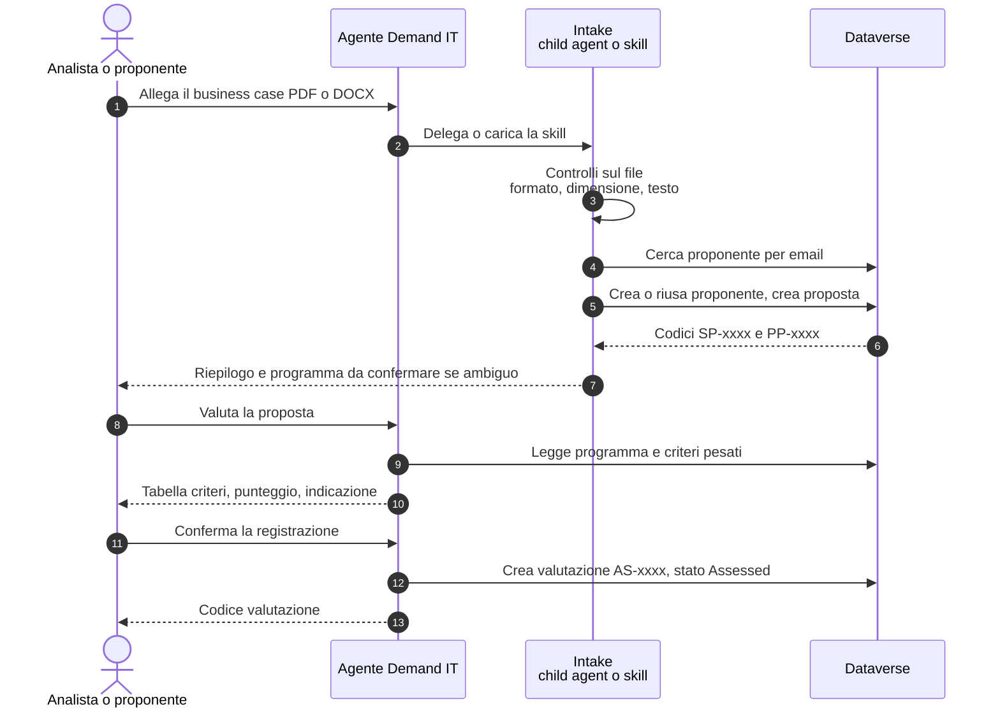
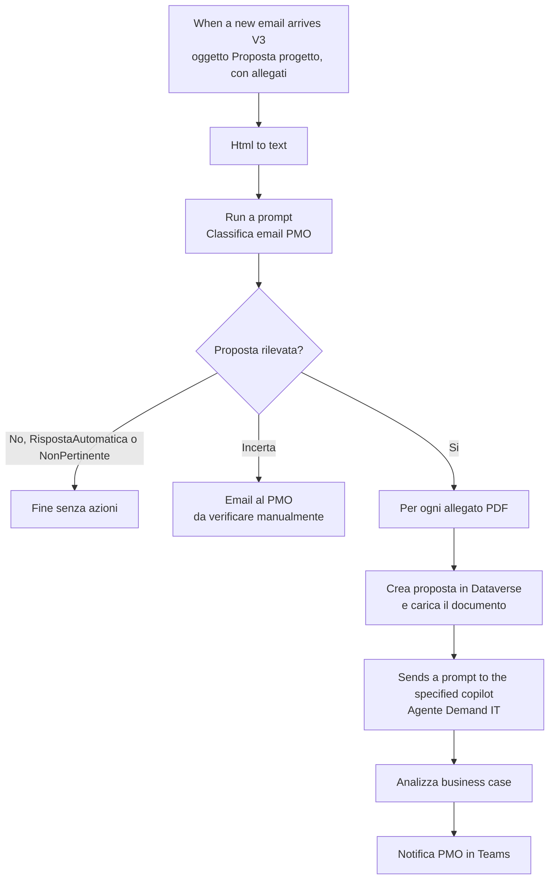
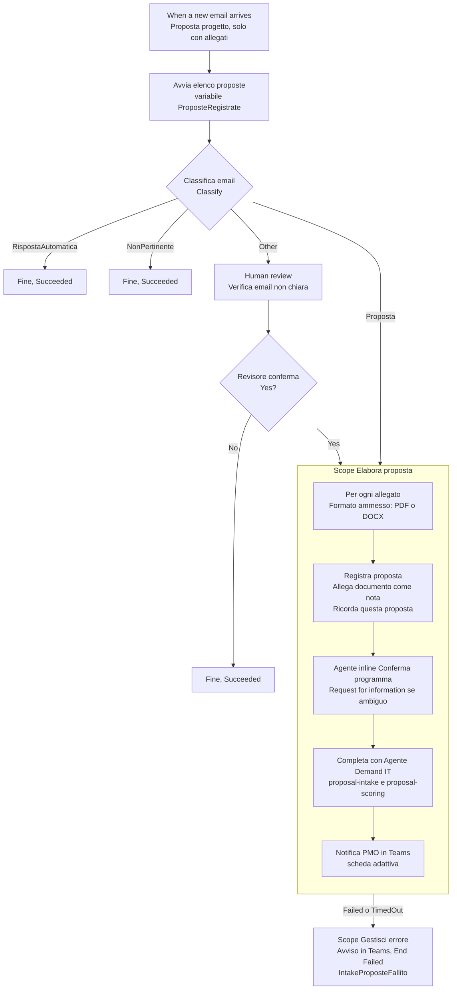
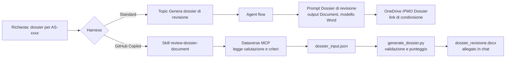
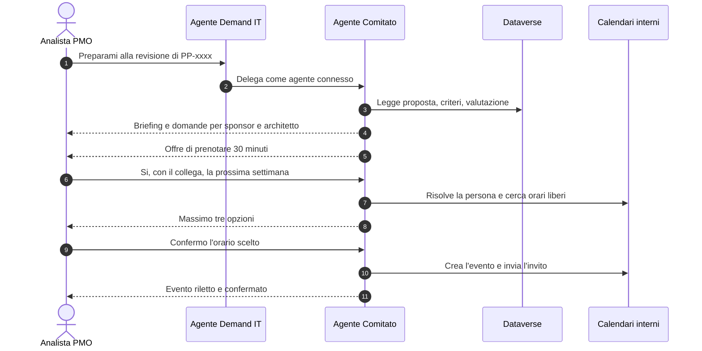

# Architettura e workflow

[Back to Advanced](./index.md)

Schemi del sistema di agenti del caso pratico: come sono collegati orchestratore, specialista, strumenti e dati nelle due harness, e come scorrono i quattro workflow principali. I diagrammi sono in Mermaid e GitHub li mostra come immagini. Nei codici, `xxxxx` sta per le cifre generate da Dataverse (ad esempio PP-1003).

| Schema | Harness | Laboratori |
| --- | --- | --- |
| [Panoramica del sistema](#panoramica-del-sistema) | Entrambe | Lab 00, S01-S08, G01-G11 |
| [Architettura multi-agente: standard harness](#architettura-multi-agente-standard-harness) | Standard | S01-S06 |
| [Architettura multi-agente: GitHub Copilot harness](#architettura-multi-agente-github-copilot-harness) | GitHub Copilot | G01-G10 |
| [Workflow 1: intake, valutazione e registrazione in chat](#workflow-1-intake-valutazione-e-registrazione-in-chat) | Entrambe | S02-S04, G02, G05 |
| [Workflow 2a: intake via email, standard harness](#workflow-2a-intake-via-email-standard-harness) | Standard | S05 |
| [Workflow 2b: intake via email, GitHub Copilot harness](#workflow-2b-intake-via-email-github-copilot-harness) | GitHub Copilot | G07-G09 |
| [Workflow 3: dossier di revisione](#workflow-3-dossier-di-revisione) | Entrambe | S06, G06 |
| [Workflow 4: preparazione e pianificazione della revisione](#workflow-4-preparazione-e-pianificazione-della-revisione) | Entrambe | G03, G10 |

## Panoramica del sistema

Harness: **Entrambe**. Laboratori: Lab 00, S01-S08, G01-G11.

Due canali di ingresso (chat e casella email del PMO), un orchestratore, uno specialista connesso e un unico archivio dati in Dataverse. Le persone del PMO restano il punto di decisione: confermano programma, valutazione e invito.

## Architettura multi-agente: standard harness

Harness: **Standard**. Laboratori: S01-S06.

L'orchestratore delega l'intake a un child agent che lavora con prompt e agent flow, e la preparazione della revisione a un agente connesso con Dataverse come conoscenza. Il dossier passa da un topic e da un flow; le email arrivano da un trigger dell'agente gestito in Power Automate.

## Architettura multi-agente: GitHub Copilot harness

Harness: **GitHub Copilot**. Laboratori: G01-G10.

Al posto di child agent, topic e flow per ogni operazione: skill caricate su richiesta e il Dataverse MCP Server con strumenti limitati. Lo specialista connesso legge in sola lettura con autenticazione Maker e pianifica con Work IQ. Il workflow email chiama sia un agente inline sia l'orchestratore pubblicato.

## Workflow 1: intake, valutazione e registrazione in chat

Harness: **Entrambe**. Laboratori: S02-S04, G02, G05.

Il percorso più frequente. La registrazione della proposta è automatica, la scelta del programma (se ambigua) e la registrazione della valutazione richiedono sempre una persona. Il punteggio segue una rubrica fissa: il modello assegna i livelli, i numeri sono calcolati.

## Workflow 2a: intake via email, standard harness

Harness: **Standard**. Laboratori: S05.

Il trigger dell'agente genera un flusso Power Automate. Qui si classifica l'email con un prompt, si registra ogni PDF e solo allora si chiama l'agente, che analizza la proposta e avvisa il PMO senza creare valutazioni.

## Workflow 2b: intake via email, GitHub Copilot harness

Harness: **GitHub Copilot**. Laboratori: G07-G09.

Tutto nel workflow di Copilot Studio. Classify smista, uno Scope raccoglie l'elaborazione, gli agenti leggono i documenti dalle note e una persona interviene in due punti: quando l'email non è classificabile e quando il programma è ambiguo. Un blocco di catch avvisa il PMO se qualcosa fallisce.

## Workflow 3: dossier di revisione

Harness: **Entrambe**. Laboratori: S06, G06.

Le due harness producono lo stesso documento in modi diversi. Nella standard harness il layout è un modello Word con segnaposto; nella GitHub Copilot harness è scritto in codice Python, che ricalcola anche i punti e segnala incoerenze.

## Workflow 4: preparazione e pianificazione della revisione

Harness: **Entrambe** per la preparazione, **GitHub Copilot** per la pianificazione. Laboratori: S02, G03, G10.

Nel percorso standard l'Agente Comitato prepara briefing e domande (S02) ma non pianifica la sessione: la parte con calendari e inviti è trattata solo in G10.

L'orchestratore delega allo specialista, che prepara briefing e domande sui criteri più pesati e propone fino a tre orari con persone interne. L'invito parte solo dopo la conferma di un orario preciso.

