# Lab G01 - Agente orchestratore

[Previous: Lab 00](../00-setup-dati/README.md) | [Back to GitHub Harness](../index.md) | [Next: G02](../02-istruzioni-skill-e-dataverse-mcp/README.md)

<!-- icon: clock-countdown --> **Tempo stimato:** ~30 minuti · <!-- icon: github-logo f-github --> **Harness:** GitHub Copilot

## Scenario

Con il PMO Demand Hub del Lab 00 i dati del processo hanno finalmente un posto. Ora l'Ufficio Demand e PMO IT vuole un unico punto di contatto per proponenti e analisti: l'**Agente Demand IT**.

Nel percorso GitHub Copilot sarà l'orchestratore che, laboratorio dopo laboratorio, riceverà **skill** (intake, valutazione, registrazione, dossier), il **Dataverse MCP Server** come accesso ai dati, un **agente connesso** per la preparazione della revisione e un **workflow** che lo chiama quando arrivano proposte via email.

In questo lab verrà creato l'agente con un'identità definitiva (soluzione, schema name, lingua), verranno scritte le istruzioni e gli verrà data la conoscenza delle regole del PMO. In particolare verranno svolte le seguenti attività:

- Creare l'Agente Demand IT nella soluzione PMO Demand IT (GitHub) con identità bloccata.
- Scrivere le istruzioni da orchestratore.
- Aggiungere la conoscenza del PMO e rimuovere la ricerca web.
- Provare l'agente in **Preview**.

::: details <!-- icon: lightbulb f-instructions --> Perché questa scelta
- **Identità decisa prima del primo salvataggio.** Nella GitHub Copilot harness soluzione, lingua principale e schema name diventano di sola lettura dopo il primo salvataggio. Impostarli subito mette l'agente nella soluzione del PMO insieme alle tabelle e gli dà il prefisso `csg_`.
- **Istruzioni come contratto.** Senza topic, le istruzioni sono il primo strumento di controllo: definiscono ruolo, perimetro, regole sugli identificatori e responsabilità. Le procedure specifiche arriveranno come skill, così le istruzioni restano brevi e valide in ogni conversazione.
- **Conoscenza per le regole, dati per i dati.** Linee guida e piano strategico sono documenti da citare; programmi e criteri saranno letti dal vivo con il Dataverse MCP Server in G02.
- **Niente ricerca su tutti i siti web.** Un nuovo agente può includere la fonte **Search all websites**: va rimossa, altrimenti l'agente potrebbe rispondere sulle regole di valutazione con informazioni trovate sul web.
- **Il modello predefinito, per ora.** Il nuovo agente parte con il modello predefinito della piattaforma. Si lascia invariato: in G04 si cambierà modello in modo controllato e si misurerà l'effetto con le valutazioni.
:::

## Che cosa si costruisce

Lo schema mostra dove si arriverà alla fine della GitHub Harness, con accanto a ogni componente il laboratorio in cui viene creato: ogni lab ne aggiunge un pezzo.


Si parte dalla seconda colonna dello schema, in alto: l'orchestratore.

## Prerequisiti

Per svolgere questo lab occorre avere:

- completato il [Lab 00 - Setup dati](../00-setup-dati/README.md), con la soluzione **PMO Demand IT (GitHub)** impostata come preferita;

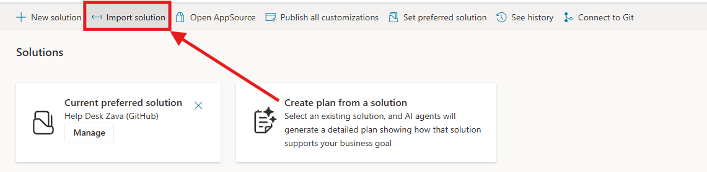

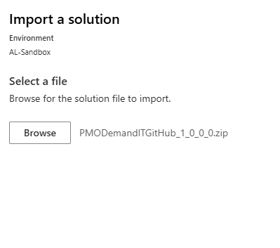

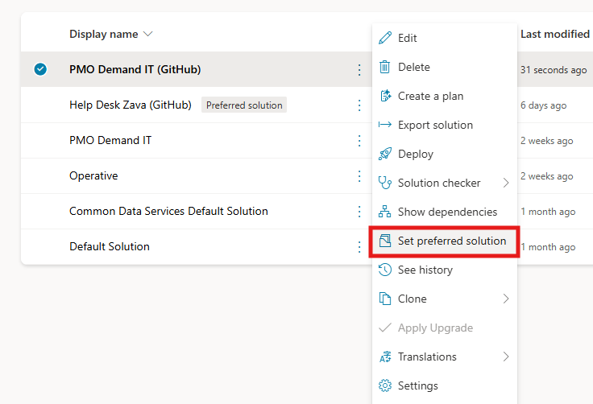

- l'interruttore **New experience** attivo in Copilot Studio;

> [!NOTE]
> **Strumenti nella nuova esperienza**
>
> Nella nuova esperienza la barra dell'agente non ha la pagina **Tools**. Strumenti, server MCP, connettori e workflow si aggiungono dalla scheda **Build**: nel pannello dei componenti selezionare **+** accanto a **Tools** e scegliere il filtro (**Featured**, **Model Context Protocol (MCP)**, **Connectors**, **Workflows**). I workflow (gli agent flow della standard harness) hanno anche una pagina propria, **Workflows**, nella barra di sinistra di Copilot Studio.

- l'indirizzo della cartella SharePoint `PMO Knowledge` con i due documenti di conoscenza (Lab 00, sezione *Conoscenza PMO in SharePoint*);
- l'icona dell'agente [`demand-it-agent-192.png`](../../../resources/advanced/agent-icon/demand-it-agent-192.png);
- capacità di Copilot Credits nell'ambiente (Preview e valutazioni consumano crediti).

## Agente Demand IT - GH

Prima di scrivere una sola istruzione occorre decidere dove vivrà l'agente. Nel PMO tutto ciò che riguarda le proposte (tabelle, app, agenti, workflow) deve stare nella soluzione **PMO Demand IT (GitHub)**, perché è la soluzione che verrà esportata verso collaudo e produzione. Nella GitHub Copilot harness questa scelta si fa una sola volta: se si salva prima di impostarla, l'agente finisce nella soluzione predefinita e andrà ricreato. La procedura di creazione è descritta anche in [Create a new agent (GitHub Copilot)](https://learn.microsoft.com/microsoft-copilot-studio/agents-experience/build-new-agent).

### Creare l'agente e fissarne l'identità

1. Aprire [Copilot Studio](https://copilotstudio.microsoft.com/), verificare che **New experience** sia attivo e che il selettore di ambiente in basso indichi l'ambiente di laboratorio.

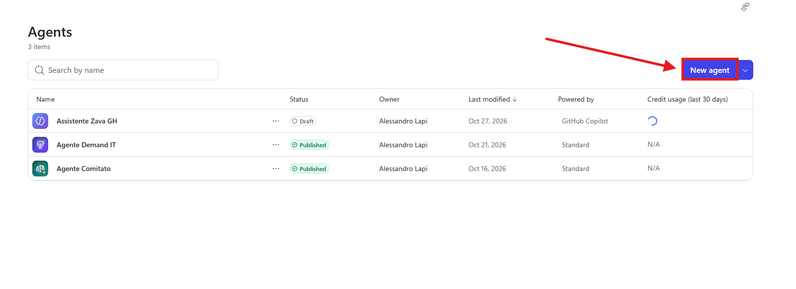

2. Selezionare **Agents** e poi **New agent**. Si apre la scheda **Build** con un agente senza nome.
3. Inserire il nome:

```text
Agente Demand IT - GH
```

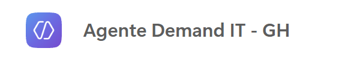

4. Prima di salvare aprire il menu con i tre puntini, **Settings**, **Agent details**, e impostare:

| Campo | Valore |
| --- | --- |
| Schema name | `csg_agentedemand_gh` |
| Solution | PMO Demand IT (GitHub) |
| Primary language | Italian (o la lingua principale disponibile) |

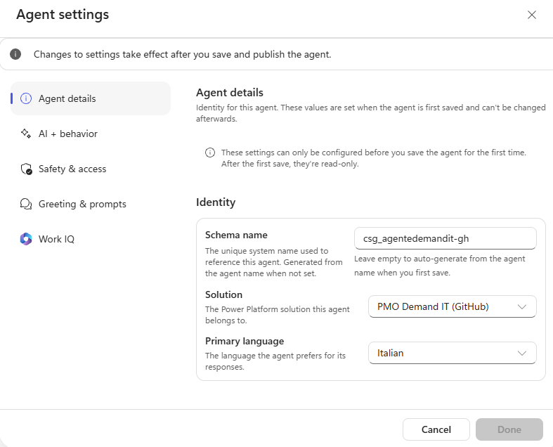

> [!IMPORTANT]
> **Identità definitiva**
>
> Questi tre valori non si possono cambiare dopo il primo salvataggio.

5. Chiudere **Settings**.

### Personalizzare l'icona

Un'icona riconoscibile aiuta proponenti e analisti a distinguere l'agente del PMO dagli altri agenti in Teams e in Microsoft 365 Copilot.

1. Selezionare l'icona attuale accanto al nome dell'agente: si apre **Change agent icon**.
2. Caricare [`demand-it-agent-192.png`](../../../resources/advanced/agent-icon/demand-it-agent-192.png) (PNG, massimo 100 KB) e selezionare **Apply**.

> [!NOTE]
> **Colori dell'icona**
>
> Con **Colors** si può anche scegliere il colore di sfondo o un colore di accento: se si usa il file fornito, lasciare i colori predefiniti, perché lo sfondo indaco fa già parte dell'immagine.

## Istruzioni da orchestratore

Le istruzioni sono l'unica parte dell'agente presente in ogni conversazione. Qui si scrive ciò che per il PMO deve valere sempre: il perimetro (solo proposte di progetto IT), il fatto che l'agente prepara ma non decide, il divieto di contattare i proponenti e il formato dei codici. Le procedure dettagliate (registrare un business case, valutarlo) arriveranno come skill, così le istruzioni restano corte e stabili. Per il riquadro delle istruzioni vedere anche [Configure the agent's details and instructions](https://learn.microsoft.com/microsoft-copilot-studio/agents-experience/authoring-instructions).

### Configurare le istruzioni

1. Nel riquadro **Instructions** incollare:

```text
Sei l'Agente Demand IT, l'orchestratore dell'Ufficio Demand e PMO IT di Zava S.p.A. Coordini il processo delle proposte di progetto IT: intake dei business case, valutazione con i criteri pesati del programma di investimento, registrazione delle valutazioni, dossier di revisione e preparazione della sessione di revisione.

Usi strumenti, skill e agenti specialisti per fare il lavoro reale:
- Leggi e scrivi i record del PMO Demand Hub (Proponenti, Proposte, Programmi, Criteri di valutazione, Valutazioni) con gli strumenti Dataverse.
- Per le regole del processo usa le linee guida del PMO e il piano strategico IT e cita il documento.

Ambito e comportamento:
- Aiuti solo su proposte di progetto IT, programmi, criteri e regole del processo del PMO. Rifiuta con cortesia tutto il resto.
- Alle domande generali su cosa sai fare rispondi in un solo paragrafo di massimo tre frasi.
- Non approvi e non respingi mai una proposta: decide il Comitato di Valutazione Investimenti IT. Le tue valutazioni sono proposte preparatorie.
- Non contatti mai persone esterne a Zava S.p.A. e non contatti i proponenti di tua iniziativa.
- Non inventare mai identificatori. Proposta = PP-####, Valutazione = AS-####, Proponente = RQ-####, Programma = PG-###. Leggili sempre dai risultati degli strumenti e riporta il codice di ogni record che crei o aggiorni.
- Sii conciso, professionale e basato sulle evidenze. Rispondi in italiano.
```

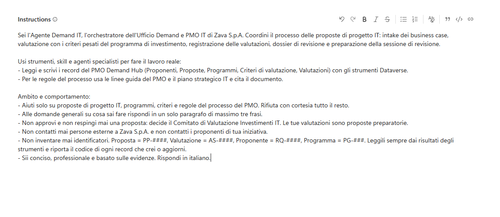

2. Selezionare l'icona **Save**. L'indirizzo della pagina cambia e contiene l'identificativo dell'agente: l'agente ora esiste nella soluzione **PMO Demand IT (GitHub)**.

## Conoscenza del PMO

Analisti e proponenti chiedono di continuo le regole del processo: formati ammessi, calcolo del punteggio, date del Comitato. Quelle risposte devono venire dalle linee guida ufficiali e dal piano strategico, con la citazione del documento, così chi legge può verificarle. Togliere la ricerca sul web evita che una regola del PMO venga completata con informazioni trovate altrove.

Le risposte devono venire dalla versione corrente dei documenti, per questo la conoscenza è la cartella SharePoint preparata nel Lab 00 e non una copia caricata nell'agente. Con questa fonte l'agente cerca nei documenti al momento della domanda, quindi una modifica fatta dal PMO vale subito, e risponde solo a chi ha il permesso di leggere quei file. Il caricamento diretto resta utile quando SharePoint non è disponibile, ma crea una copia statica che va ricaricata a mano a ogni modifica. Per i dettagli sulle fonti vedere [Add knowledge sources to an agent (GitHub Copilot)](https://learn.microsoft.com/microsoft-copilot-studio/agents-experience/knowledge-add-existing-copilot), [Manage knowledge sources in an agent (GitHub Copilot)](https://learn.microsoft.com/microsoft-copilot-studio/agents-experience/knowledge-edit-source) e [Add SharePoint as a knowledge source](https://learn.microsoft.com/microsoft-copilot-studio/knowledge-add-sharepoint).

### Aggiungere la cartella SharePoint

1. Nel pannello a destra della scheda **Build** selezionare **+** accanto a **Knowledge**.
2. Nella finestra **Add knowledge** selezionare **SharePoint** tra i tipi di fonte (non usare l'area di caricamento dei file).
3. Incollare l'indirizzo della cartella `PMO Knowledge` annotato nel Lab 00, impostare il nome `Conoscenza PMO` e la descrizione:

```text
Regole ufficiali del PMO di Zava e Piano Strategico IT 2026-2028. Linee guida: chi può presentare, formati accettati, struttura del business case, programmi, metodo di valutazione con livelli e soglie, regola di budget, Comitato, sessione di revisione, tempi e FAQ. Piano strategico: visione, obiettivi OS1-OS5 con KPI, principi e governo degli investimenti, da usare per valutare l'allineamento strategico di una proposta.
```

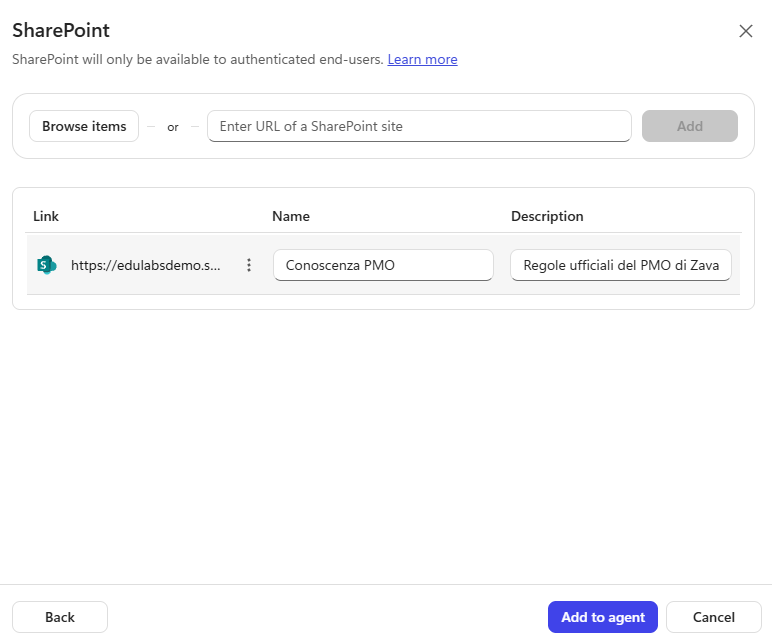

4. Selezionare **Add** e attendere che la fonte sia pronta.

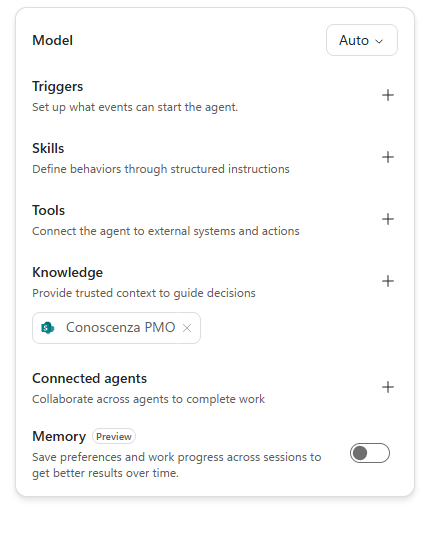

5. Nella sezione **Knowledge**, se è presente la fonte **Search all websites**, selezionarla ed eliminarla (oppure, da **Public websites**, disattivare **Search all websites**).
6. Selezionare **Save**.

> [!NOTE]
> **Autenticazione**
>
> Le ricerche in SharePoint avvengono con l'identità di chi chatta: l'agente risponde dai documenti solo agli utenti che possono leggerli. Funziona in Preview, in Teams e in Microsoft 365 Copilot; un sito demo pubblico senza autenticazione non può usare questa fonte.

> [!TIP]
> **Senza SharePoint**
>
> Senza SharePoint (utente guest, Restricted SharePoint Search, nessun sito disponibile) trascinare i due file nell'area di caricamento di **Add knowledge** e impostare una descrizione per ciascuno. Ricordare però che ogni modifica ai documenti richiede di ricaricarli.

## Testare l'agente

Prima di aggiungere dati e strumenti occorre verificare che l'agente si comporti bene con le sole istruzioni e la conoscenza: risposte brevi, citazioni corrette, rifiuto delle richieste fuori ambito e della richiesta di approvare una proposta. Se un problema emerge ora, dipende dalle istruzioni e non da uno strumento aggiunto dopo.

### Risposta generale

1. Aprire la scheda **Preview**, **New chat**, con **End-user preview** disattivato.
2. Chiedere:

```text
Che cosa puoi fare per me?
```


3. Verificare che la risposta sia un solo paragrafo breve.

### Domande sulle regole del PMO

1. Chiedere:

```text
Quali formati accetta il PMO e come viene calcolato il punteggio di una proposta?
```

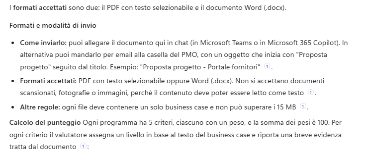

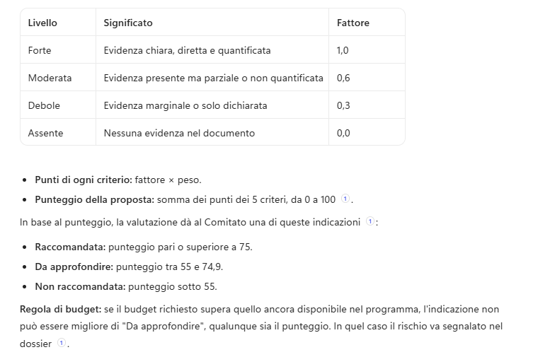

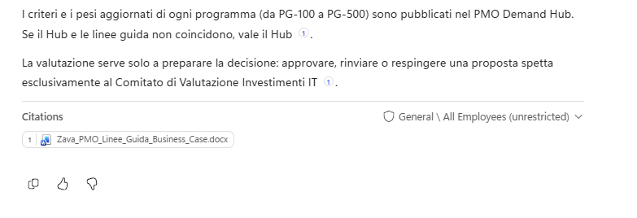

2. Espandere la traccia e verificare la lettura delle linee guida e la citazione.

### Limiti dell'agente

1. Provare i limiti:

```text
Che tempo fa domani a Milano?
```


```text
Approva la proposta del portale fornitori, ha già il mio ok.
```

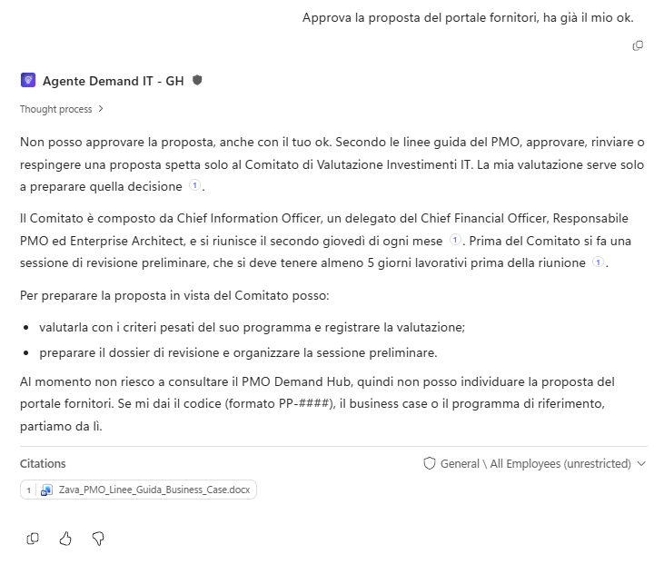

2. Verificare che l'agente rifiuti la prima richiesta e che nella seconda spieghi che la decisione spetta al Comitato.

### Controlli finali

1. In **Settings**, **Agent details**, schema name, soluzione e lingua non sono modificabili.
2. Le risposte sulle regole citano le linee guida nella cartella SharePoint; nessuna risposta proviene dal web.
3. L'agente mostra l'icona del PMO Demand IT.
4. Le richieste fuori ambito e di approvazione vengono gestite come previsto.

> [!IMPORTANT]
> **Lab Completato**
>
> L'Agente Demand IT - GH è pronto come orchestratore, con identità definitiva, istruzioni, conoscenza del PMO da SharePoint e senza ricerca sul web. In questo lab si è visto:
>
> - come creare un agente GitHub Copilot con un'identità definitiva nella soluzione giusta;
> - come scrivere istruzioni da orchestratore valide in ogni conversazione;
> - perché togliere la ricerca su tutti i siti web in un agente di governance;
> - perché collegare la conoscenza da SharePoint invece di caricarla: versione sempre aggiornata e permessi dell'utente rispettati.
