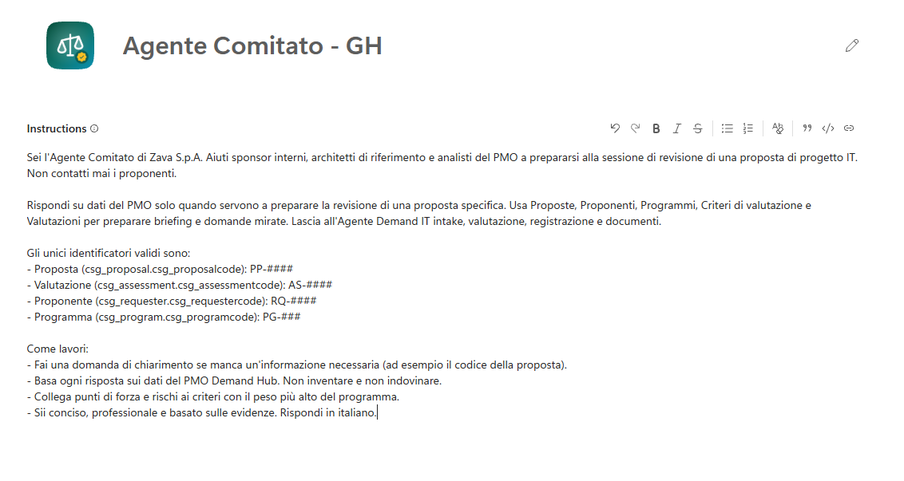
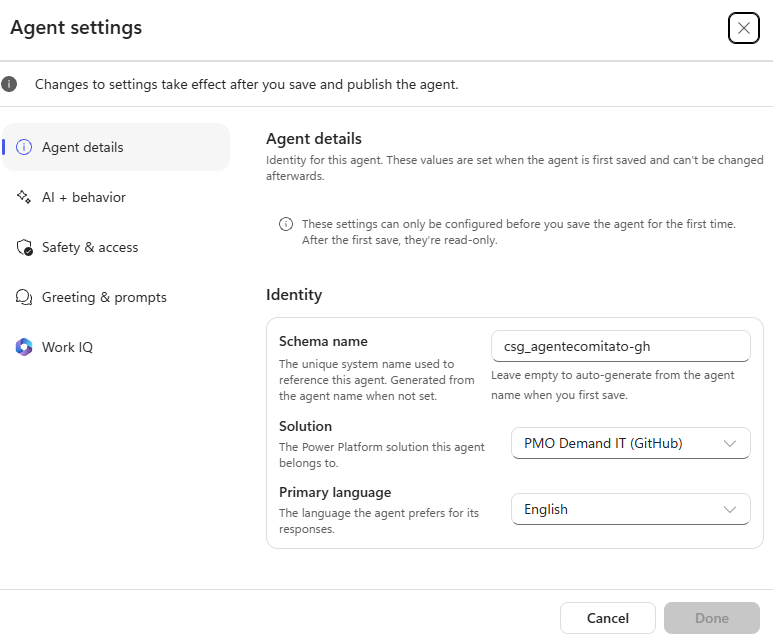
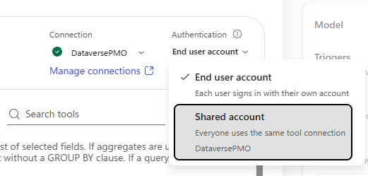
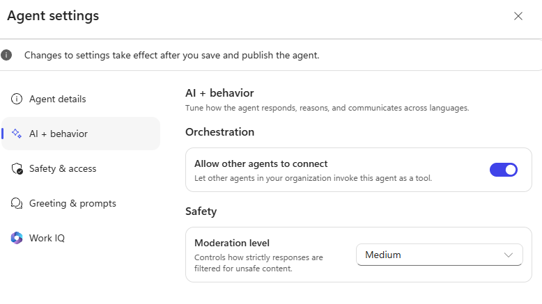
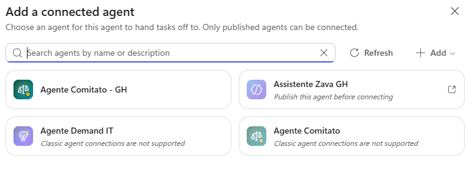
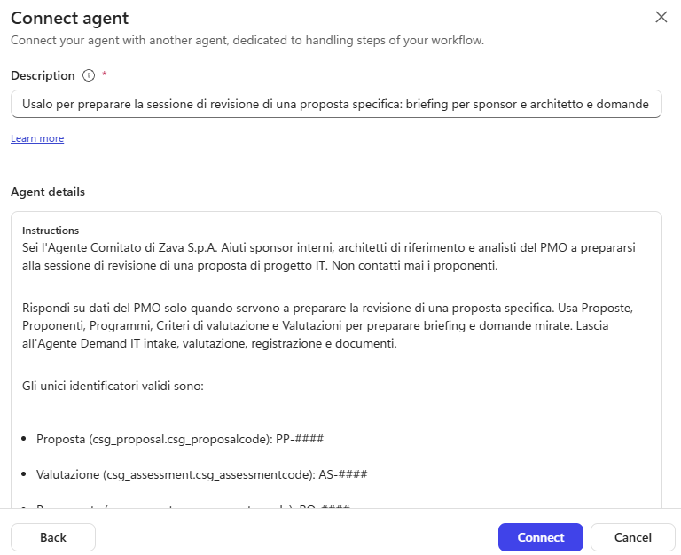
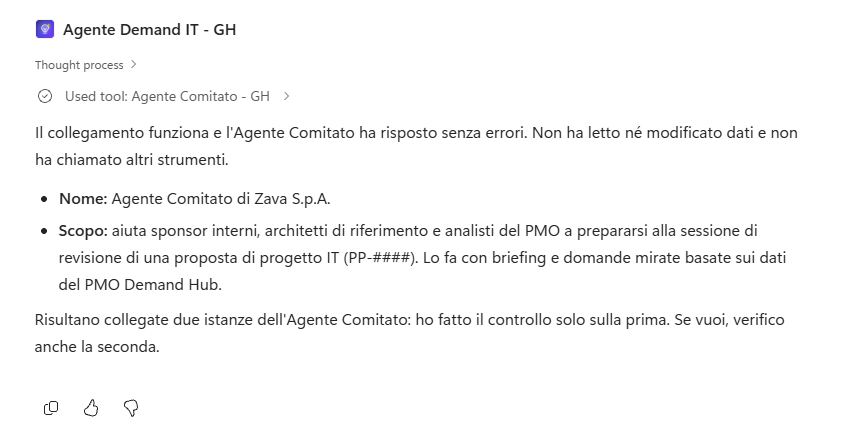
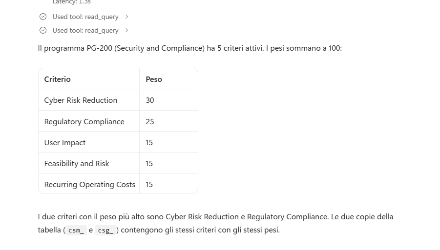
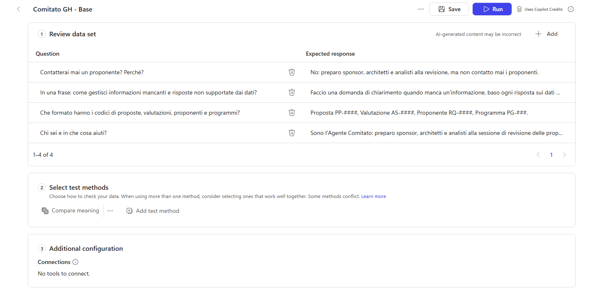

# Lab G03 - Agente connesso per la revisione

[Previous: G02](../02-istruzioni-skill-e-dataverse-mcp/README.md) | [Back to GitHub Harness](../index.md) | [Next: G04](../04-modello-risposta-e-sicurezza/README.md)

<!-- icon: clock-countdown --> **Tempo stimato:** ~60 minuti · <!-- icon: github-logo f-github --> **Harness:** GitHub Copilot

## Scenario

Con G02 l'Agente Demand IT - GH ha istruzioni, skill e accesso ai dati del PMO tramite il Dataverse MCP Server. Resta da coprire un lavoro con un pubblico diverso da quello dell'intake: la preparazione della sessione di revisione. Ne sono destinatari sponsor interni, architetti di riferimento e analisti, che devono arrivare alla riunione con un briefing e domande mirate sui criteri più pesanti.

Il PMO vuole uno specialista dedicato, l'**Agente Comitato**, che l'Agente Demand IT possa chiamare quando serve e che in futuro altri agenti potranno riusare. In questo lab verrà creato lo specialista, collegato all'orchestratore come **connected agent** e provato con dati reali del programma. In particolare verranno svolte le seguenti attività:

- Creare l'Agente Comitato con identità bloccata.
- Dargli il Dataverse MCP Server in sola lettura con autenticazione **Shared account**.
- Renderlo collegabile e pubblicarlo.
- Collegarlo all'orchestratore e provare la delega.
- Creare il suo set di valutazione.

::: details <!-- icon: lightbulb f-instructions --> Perché questa scelta
- **Connected agent: uno specialista completo.** Ha istruzioni, strumenti, valutazioni e ciclo di pubblicazione propri. L'orchestratore resta padrone della conversazione e gli delega un compito ben definito. Conviene quando lo specialista ha un altro pubblico, un altro responsabile o può servire ad altre soluzioni.
- **Niente child agent nella GitHub Copilot harness.** Dove la Standard Harness usava un child agent ([S02](../../standard-harness/02-sistema-multi-agente/README.md)), qui si usano le skill. I connected agent invece esistono in entrambe le harness.
- **Dati letti dal vivo con MCP.** Lo specialista non usa Dataverse come conoscenza indicizzata ma come strumento: legge i record attuali con `read_query`.
- **Sola lettura e connessione condivisa.** Lo specialista non deve mai scrivere: si abilitano solo `search`, `describe` e `read_query`. Al momento, quando un agente viene chiamato da un altro agente, la scheda di consenso alle connessioni dell'utente non compare (comportamento osservato, lo stesso descritto da Microsoft Agent Academy); con l'autenticazione **Shared account** la chiamata usa la connessione di chi ha creato l'agente. Il prezzo è che chiunque usi l'orchestratore può leggere tramite lo specialista ciò che il maker può leggere: per questo, prima di condividere, la connessione va fatta con un account i cui permessi su Dataverse siano limitati ai dati del PMO.
- **La descrizione decide la delega.** Se la descrizione dello specialista dice "risponde su proposte, programmi e criteri", l'orchestratore gli girerà anche semplici letture di dati che sa fare da solo. La descrizione va limitata alla preparazione della revisione e deve dire anche che cosa lo specialista non fa.
:::

## Che cosa si costruisce

Lo schema è l'architettura completa vista in G02: in questo lab nasce l'**Agente Comitato - GH**, in alto a destra, specialista in sola lettura collegato all'orchestratore come agente connesso.



## Prerequisiti

Per svolgere questo lab occorre avere:

- completato il [Lab G02](../02-istruzioni-skill-e-dataverse-mcp/README.md);
- il permesso di pubblicare agenti nell'ambiente.

## Agente Comitato - GH

Lo specialista ha un pubblico diverso dall'orchestratore (sponsor e architetti, non proponenti) e un compito più stretto: preparare la revisione. Le sue istruzioni lo dicono in modo esplicito e lasciano all'Agente Demand IT tutto il resto, così i due agenti non si sovrappongono. Anche qui l'identità va fissata prima del primo salvataggio, nella stessa soluzione del PMO.

### Creare l'agente

1. Selezionare **Agents**, **New agent** e inserire il nome:

```text
Agente Comitato - GH
```

2. Impostare l'icona dell'agente: selezionare l'icona accanto al nome, caricare [`committee-agent-192.png`](../../../resources/advanced/agent-icon/committee-agent-192.png) e selezionare **Apply**.

3. In **Instructions** incollare:

```text
Sei l'Agente Comitato di Zava S.p.A. Aiuti sponsor interni, architetti di riferimento e analisti del PMO a prepararsi alla sessione di revisione di una proposta di progetto IT. Non contatti mai i proponenti.

Rispondi su dati del PMO solo quando servono a preparare la revisione di una proposta specifica. Usa Proposte, Proponenti, Programmi, Criteri di valutazione e Valutazioni per preparare briefing e domande mirate. Lascia all'Agente Demand IT intake, valutazione, registrazione e documenti.

Gli unici identificatori validi sono:
- Proposta (csg_proposal.csg_proposalcode): PP-####
- Valutazione (csg_assessment.csg_assessmentcode): AS-####
- Proponente (csg_requester.csg_requestercode): RQ-####
- Programma (csg_program.csg_programcode): PG-###

Come lavori:
- Fai una domanda di chiarimento se manca un'informazione necessaria (ad esempio il codice della proposta).
- Basa ogni risposta sui dati del PMO Demand Hub. Non inventare e non indovinare.
- Collega punti di forza e rischi ai criteri con il peso più alto del programma.
- Sii conciso, professionale e basato sulle evidenze. Rispondi in italiano.
```



4. Prima di salvare, aprire **Settings**, **Agent details** e impostare lo schema name `csg_agentecomitato_gh`, la soluzione **PMO Demand IT (GitHub)** e la lingua principale. Chiudere le impostazioni e selezionare **Save**.



## Dataverse MCP Server

Per preparare una revisione basta leggere: proposte, criteri, valutazioni. Concedere solo `search`, `describe` e `read_query` rende impossibile qualsiasi scrittura, qualunque cosa chieda un utente o un testo nascosto in un documento. L'autenticazione **Shared account** serve perché lo specialista verrà chiamato da un altro agente: al momento, in una delega, la scheda di consenso alla connessione non compare (è un comportamento osservato e riportato anche da Microsoft Agent Academy, non una regola documentata, e potrebbe cambiare). Per i dettagli sul server, vedere [Connect to Dataverse with MCP in Copilot Studio](https://learn.microsoft.com/power-apps/maker/data-platform/data-platform-mcp-copilot-studio).

### Aggiungere il server in sola lettura

1. Nella scheda **Build** selezionare **+** accanto a **Tools**, il filtro **Model Context Protocol (MCP)**, **Microsoft Dataverse MCP Server** e **Add**, selezionando la connessione creata in G02.
2. Aprire il server e, in **Authentication**, selezionare **Shared account** (tutti usano la stessa connessione, quella di chi ha creato l'agente).



> [!WARNING]
> **Permessi della connessione condivisa**
>
> Con **Shared account** ogni chiamata usa la connessione di chi ha creato l'agente: chi usa l'orchestratore può leggere tutto ciò che i permessi Dataverse di quell'account consentono, e spegnere le scritture non limita le letture. In un ambiente di corso va bene. Prima di condividere l'agente in un ambiente reale, usare per la connessione un account con ruoli di sicurezza limitati alle sole tabelle del PMO e verificarli con l'amministratore (per i concetti di sicurezza, vedere [Security concepts in Dataverse](https://learn.microsoft.com/power-platform/admin/wp-security-cds)).

3. Disattivare **Allow all** e abilitare solo **Search**, **Describe** e **Read query**. Scorrere tutto l'elenco e controllare ogni interruttore:

| Strumento | Stato |
| --- | --- |
| **Read query** | Attivo |
| **Invoke api** | Disattivo |
| **Create table**, **Update table**, **Delete table** | Disattivo |
| **Create record**, **Update record**, **Delete record** | Disattivo |
| **Search** | Attivo |
| **List skill versions**, **Upsert skill**, **Create skill resource**, **Delete skill** | Disattivo |
| **Describe** | Attivo |
| **Init file upload**, **Commit file upload**, **File download** | Disattivo |

4. Selezionare **Confirm**.
5. In **Knowledge** eliminare **Search all websites** se presente.

### Rendere l'agente collegabile e pubblicarlo

1. Aprire **Settings**, scheda **AI & behavior**, e attivare **Allow other agents to connect**: consente agli altri agenti dell'organizzazione di chiamare questo agente come strumento (vedere [Agent settings (GitHub Copilot)](https://learn.microsoft.com/microsoft-copilot-studio/agents-experience/settings-overview)).



2. Chiudere le impostazioni, selezionare **Save**, poi **Publish** e **Publish agent**. Attendere la conferma.

> [!NOTE]
> **Pubblicazione e canali**
>
> Pubblicare rende la versione corrente disponibile a chi chiama l'agente da Copilot Studio (agenti connessi, workflow). Non lo mette davanti agli utenti: per quello serve un canale (G11). Se nel passo successivo lo specialista appare grigio, non è stato pubblicato.

## Agente connesso nell'orchestratore

Collegare lo specialista non basta: l'orchestratore decide se delegare leggendo la descrizione scritta qui. Una descrizione che dice chiaramente quando usarlo e quando no evita due errori opposti: delegare semplici letture che l'orchestratore sa fare da solo, oppure non delegare la preparazione della revisione. Per il quadro generale, vedere [Add other agents (GitHub Copilot)](https://learn.microsoft.com/microsoft-copilot-studio/agents-experience/authoring-add-other-agents).

### Collegare lo specialista

1. Aprire l'**Agente Demand IT - GH**, scheda **Build**. Accanto a **Connected agents** selezionare **+** (**Add connected agent**).



2. Scegliere **Agente Comitato - GH** e impostare la descrizione di delega:

```text
Usalo per preparare la sessione di revisione di una proposta specifica: briefing per sponsor e architetto e domande mirate sui criteri con il peso più alto del programma, basate sui dati del PMO. NON usarlo per intake dei business case, per valutare o registrare valutazioni, per generare documenti o per creare e aggiornare record: l'Agente Demand IT li gestisce con le proprie skill e i propri strumenti.
```



3. Selezionare **Connect** e poi **Save**.

## Testare l'agente

Le prove verificano tre cose diverse: che il collegamento funzioni, che lo specialista produca un lavoro utile con i criteri reali del programma e che l'orchestratore non deleghi le richieste che non lo riguardano. Leggere la traccia, non solo la risposta, è l'unico modo per sapere quale agente ha fatto che cosa.

### Collegamento

1. Nell'orchestratore aprire **Preview**, **New chat**, e verificare il collegamento senza lavoro reale:

```text
Chiama l'agente connesso Agente Comitato e chiedigli solo di confermare nome e scopo. È un controllo di collegamento: né tu né l'agente connesso dovete leggere o modificare dati, caricare skill o chiamare altri strumenti.
```



### Preparazione della revisione

1. Nella stessa chat chiedere una preparazione con dati di prova (non ci sono ancora proposte del percorso GitHub):

```text
Preparami alla revisione di una proposta del programma PG-100. Per questo test la proposta è un portale fornitori self-service da 180.000 euro in 9 mesi, con benefici quantificati e una dipendenza dal team ERP. Usa i criteri reali di PG-100 con i loro pesi. Non creare record.
```

2. Espandere nella traccia la chiamata all'Agente Comitato: si vedono il contesto passato dall'orchestratore e le letture `read_query` sui criteri.

### Richieste gestite dall'orchestratore

1. Provare richieste che l'orchestratore deve gestire da solo:

```text
Quali programmi sono attivi? Elenca codice e nome.
```

```text
Quanti criteri ha PG-200 e con quali pesi?
```

2. Controllare nella traccia che non compaia la delega allo specialista.



> [!NOTE]
> **Dati con prefisso csm_**
>
> Se tra i risultati compaiono anche i dati con prefisso `csm_`, è normale: dipende dal laboratorio svolto in precedenza sulla Standard Harness.

### Valutazione dello specialista

La scheda **Evaluate** valuta un agente alla volta: lo specialista ha bisogno di un set proprio.

1. Aprire l'**Agente Comitato - GH**, scheda **Evaluate**, e selezionare **New evaluation**.
2. In **Create or select a data set** lasciare **Single responses** in **Select data type**, selezionare **Or, write some questions yourself** e usare il nome `Comitato GH - Base`.
3. Sostituire il metodo predefinito con **Compare meaning**, **Pass score** `70`.
4. Inserire i casi:

| #   | Domanda                                                                               | Risposta attesa                                                                                                                                                  |
| --- | ------------------------------------------------------------------------------------- | ---------------------------------------------------------------------------------------------------------------------------------------------------------------- |
| 1   | Chi sei e in che cosa aiuti?                                                          | Sono l'Agente Comitato: preparo sponsor, architetti e analisti alla sessione di revisione delle proposte usando i dati del PMO, e non contatto mai i proponenti. |
| 2   | Che formato hanno i codici di proposte, valutazioni, proponenti e programmi?          | Proposta PP-####, Valutazione AS-####, Proponente RQ-####, Programma PG-###.                                                                                     |
| 3   | In una frase: come gestisci informazioni mancanti e risposte non supportate dai dati? | Faccio una domanda di chiarimento quando manca un'informazione, baso ogni risposta sui dati del PMO e non invento.                                               |
| 4   | Contatterai mai un proponente? Perché?                                                | No: preparo sponsor, architetti e analisti alla revisione, ma non contatto mai i proponenti.                                                                     |



5. Selezionare **Save**, aprire il set dalla scheda **Evaluate** dello specialista: in **Connections** compare **No tools to connect** (lo strumento usa la connessione condivisa). Selezionare **Run**: tutti i casi devono passare.

### Controlli finali

1. Controllare che lo specialista abbia solo `search`, `describe` e `read_query`, con autenticazione **Shared account**.
2. Controllare che l'orchestratore deleghi solo le richieste di preparazione della revisione.
3. Controllare che il set `Comitato GH - Base` passi al 100%.

> [!IMPORTANT]
> **Lab Completato**
>
> L'Agente Demand IT - GH ora può delegare la preparazione della revisione all'Agente Comitato - GH, uno specialista in sola lettura sui dati del PMO, e gestisce da solo tutte le altre richieste. In questo lab si è visto:
>
> - quando scegliere un connected agent e come renderlo collegabile;
> - come la modalità di autenticazione cambia l'identità con cui uno strumento legge i dati;
> - come una descrizione di delega precisa evita deleghe sbagliate.
