# Lab G06 - Dossier di revisione con una skill Python

[Previous: G05](../05-intake-valutazione-registrazione/README.md) | [Back to GitHub Harness](../index.md) | [Next: G07](../07-workflow-trigger-email/README.md)

<!-- icon: clock-countdown --> **Tempo stimato:** ~45 minuti · <!-- icon: github-logo f-github --> **Harness:** GitHub Copilot

## Scenario

Con G05 l'Agente Demand IT - GH registra le proposte e le valutazioni. Prima di ogni sessione di revisione, però, sponsor e architetto ricevono un **dossier**: dati della proposta, tabella dei criteri con evidenze e punti, domande per lo sponsor, rischi. Il Comitato legge decine di dossier ogni trimestre e pretende che siano tutti uguali: stesse sezioni, stesso ordine, stessa tabella. Se un dossier ha una colonna in meno o un punteggio che non torna con la tabella, la sessione si perde a discutere del documento invece che della proposta.

In questo lab verrà costruita una skill che genera il dossier con **Python** (`python-docx`): il layout è scritto nel codice, l'agente prepara solo i contenuti. La skill è pronta in un pacchetto zip già provato: viene importata e usata. In particolare verranno svolte le seguenti attività:

- Importare la skill sull'Agente Demand IT e aggiungere le regole di generazione dei documenti.
- Generare il dossier da dati reali e confrontare due esecuzioni.
- Provare la validazione dello script.
- Estendere il set di valutazione.

::: details <!-- icon: lightbulb f-instructions --> Perché questa scelta
- **Codice per la forma, modello per il contenuto.** Nella standard harness ([S06](../../standard-harness/06-dossier-word/README.md)) il layout stava in un modello Word con segnaposto e il contenuto in un prompt con output documento; spostare una sezione significava modificare il file e riprovare il prompt. Qui il layout è testo versionabile e la generazione avviene nella conversazione, senza flow e senza OneDrive.
- **Lo script ricalcola i numeri.** Il modello potrebbe sbagliare una somma; lo script no. Pesi, fattori, soglia del budget e numero di domande sono controllati in codice e un input non valido produce un `ERRORE DI VALIDAZIONE` invece di un documento sbagliato.
- **Skill importata, non scritta a mano.** Script e `SKILL.md` sono già provati: il lab si concentra su come l'agente usa la skill e su come la validazione in codice protegge il documento.
- **Regole d'uso nelle istruzioni.** L'Agente Comitato prepara domande, ma il dossier è un documento ufficiale del processo: le istruzioni dell'orchestratore dicono di usare la skill e di non delegarlo.
- **Skill in chat, workflow per gli eventi.** Una richiesta in conversazione si risolve con una skill; un documento da generare quando succede qualcosa, senza nessuno presente, è un lavoro da workflow.
:::

## Che cosa si costruisce

Lo schema mostra i componenti di questo lab, nell'ordine in cui li attraversa una richiesta: la skill legge i dati e prepara i contenuti, lo script Python nella sandbox valida e scrive il documento, che torna allegato alla risposta.


## Prerequisiti

Per svolgere questo lab occorre avere:

- completato il [Lab G05](../05-intake-valutazione-registrazione/README.md), con almeno una **Assessment** registrata (AS-####);
- il pacchetto [`review-dossier-document.zip`](../../../resources/advanced/skill/review-dossier-document.zip).

## Un layout definito nel codice

Un modello linguistico sa scrivere contenuti ma non garantisce lo stesso layout a ogni esecuzione. Qui il lavoro è diviso:

- l'**agente** legge da Dataverse valutazione, proposta, proponente, programma e criteri, poi prepara contenuti fondati sui dati (domande, rischi) e un file JSON;
- lo **script Python** valida il JSON, **ricalcola** punti e punteggio, applica la regola di budget e scrive il documento con sezioni, tabelle e stili fissi.

Il layout si può quindi rivedere, provare e versionare come qualsiasi codice. Due esecuzioni possono avere domande formulate diversamente, ma il documento ha sempre la stessa forma.

| Ambiente di esecuzione | Che cosa significa |
| --- | --- |
| **Python** | Linguaggio leggibile e diffuso; lo script gira lato server dentro l'agente |
| **Libreria** | Codice pronto da importare: `python-docx` crea file Word con una chiamata per tabella o paragrafo |
| **Sandbox dell'interprete** | Ambiente gestito con Python e librerie comuni già installate (tra cui `python-docx`, `openpyxl`, `pandas`, una libreria PDF), **senza accesso a Internet**: non si può eseguire `pip install` durante l'esecuzione |

Per approfondire: [About agents powered by GitHub Copilot](https://learn.microsoft.com/microsoft-copilot-studio/agents-experience/overview) per gli agenti della GitHub Copilot harness, [Use code interpreter to generate and execute Python code](https://learn.microsoft.com/microsoft-copilot-studio/code-interpreter-for-prompts) per l'esecuzione di codice Python e la [documentazione di python-docx](https://python-docx.readthedocs.io/) per la libreria.

> [!TIP]
> **Librerie nella sandbox**
>
> La disponibilità delle librerie può variare. Se una skill ne richiede una specifica, chiedere in **Preview** all'agente di importarla e preferire codice Python puro da includere nello zip.

## Il pacchetto della skill

La skill è un file `SKILL.md` più uno script, compressi in uno zip con `SKILL.md` **alla radice**. Il pacchetto di riferimento è [`review-dossier-document.zip`](../../../resources/advanced/skill/review-dossier-document.zip) e i file sono anche nella cartella [`resources/advanced/skill/review-dossier-document`](../../../resources/advanced/skill/review-dossier-document/):

| File | Scopo |
| --- | --- |
| `SKILL.md` | Nome, descrizione e procedura: identificare la valutazione, leggere i dati, preparare i contenuti, scrivere il JSON, eseguire lo script, restituire il file |
| `generate_dossier.py` | Validazione e layout: livelli ammessi, pesi che sommano a 100, esattamente 8 domande, punti ricalcolati, rischio di budget, controllo del punteggio registrato |
| `dossier_input.sample.json` | Esempio di input valido |
| `dossier_revisione.sample.docx` | Documento generato dall'esempio |

Il dossier usa **gli stessi quattro livelli** della rubrica di [G05](../05-intake-valutazione-registrazione/README.md) e riporta i livelli già **registrati** nella Valutazione (`csg_criteriadetail`): il dossier documenta la valutazione, non la rifà. Se il punteggio ricalcolato dallo script differisce da quello registrato, lo script aggiunge un punto di attenzione.

### Il modello del documento

Questo è il layout che lo script deve riprodurre. Cambiano solo i valori tra virgolette basse.

```text
Dossier di revisione della proposta                          [centrato, grassetto, 20 pt]
«Titolo della proposta»                                       [centrato, corsivo, 12 pt]
Proposta «PP-####» - Valutazione «AS-####» - Generato il «gg/mm/aaaa»   [centrato, 9 pt]

Proponente                                                    [titolo di livello 2]
- Nome: «Nome»
- Ruolo e funzione: «Ruolo» - «Funzione»
- Email: «Email»

Programma
- Programma: «PG-###» «Nome del programma»
- Budget richiesto: «€ importo» (durata «n» mesi)
- Budget disponibile del programma: «€ importo»

Sintesi della proposta
«Paragrafo di sintesi per i revisori»

Criteri di valutazione ed evidenze                            [tabella Light Grid Accent 1]
| Criterio   | Peso  | Livello  | Evidenza        | Punti  |
| «Criterio» | «nn»% | Forte    | «Evidenza»      | «nn,n» |
| ...        | ...   | Moderata / Debole / Assente | ... | ... |
Punteggio complessivo: «nn,n»/100                             [grassetto, 11 pt]

Domande per lo sponsor
«Criterio» (peso «nn»%)                                      [grassetto]
1. «Domanda»
    Verifica: «Che cosa verifica la domanda»                  [corsivo, 9,5 pt]
... 8 domande in totale, raggruppate per criterio dal peso più alto

Rischi e punti di attenzione
- «Rischio»   (lo script aggiunge il rischio di budget e l'eventuale differenza di punteggio)

Documento di supporto preparato con l'intelligenza artificiale. Verificare i contenuti
prima dell'uso. Livelli e punteggi sono proposte: la decisione sulla proposta spetta al
Comitato di Valutazione.                                      [corsivo, 8,5 pt]
```

## Skill "review-dossier-document"

Lo zip contiene `SKILL.md` e lo script `generate_dossier.py`: importandolo, la skill diventa parte dell'orchestratore. Per le basi delle skill vedere [Skills overview (GitHub Copilot)](https://learn.microsoft.com/microsoft-copilot-studio/agents-experience/skills-overview).

### Importare la skill

1. Aprire l'**Agente Demand IT - GH**, scheda **Build**. Accanto a **Skills** selezionare **+** e poi **Upload a skill**.
2. Trascinare [`review-dossier-document.zip`](../../../resources/advanced/skill/review-dossier-document.zip). La skill compare in **Skills** insieme alle altre tre. Selezionare **Save**.

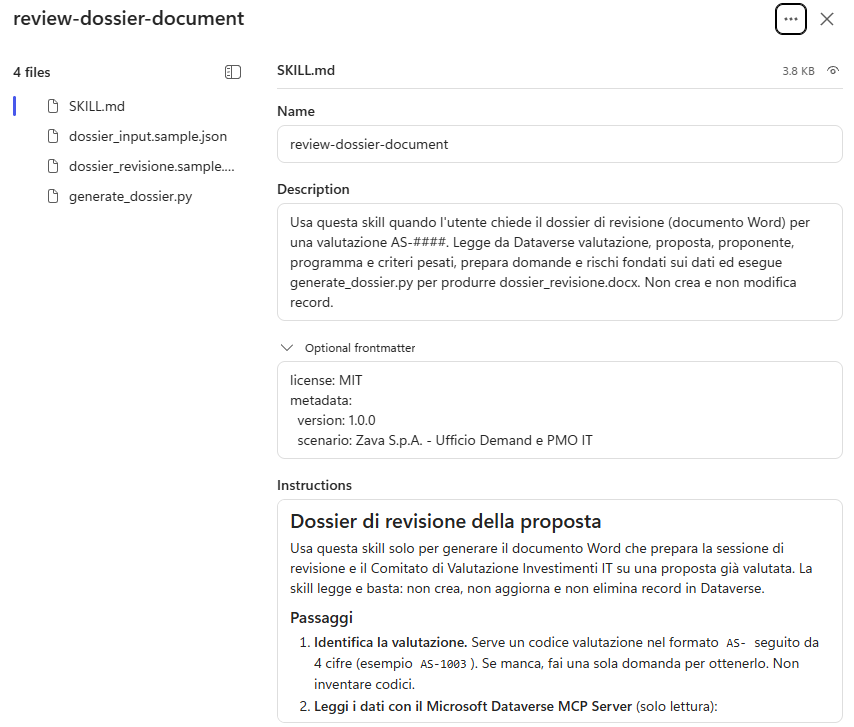

### Aggiornare le istruzioni

Alle istruzioni vanno aggiunte tre regole: usare questa skill per i dossier, non delegarli all'Agente Comitato e non dichiarare mai di aver generato un file che non è allegato. Sono regole d'uso valide in ogni conversazione, quindi vanno nelle istruzioni e non nella skill.

1. Aggiungere in fondo alle **Instructions**:

```text
Generazione di documenti:
- Usa la skill review-dossier-document per i dossier di revisione delle proposte.
- Non delegare la generazione del dossier all'Agente Comitato.
- Non dichiarare mai di aver generato un documento se dossier_revisione.docx non è allegato alla risposta come file scaricabile.
```

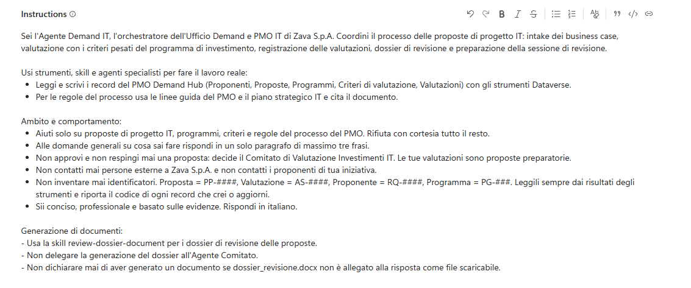

2. Selezionare **Save**.

### Verificare il caricamento

1. Avviare una **New chat** e verificare che la skill si carichi senza eseguirla:

```text
Carica solo la skill review-dossier-document e conferma nome e scopo. Non eseguire la procedura, non leggere né modificare dati, non generare file e non chiamare altri strumenti. Se non è disponibile, dillo senza usare alternative.
```

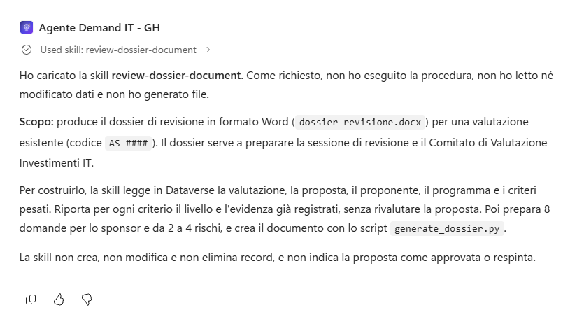

## Testare l'agente

Il valore della skill si vede confrontando due esecuzioni: la forma deve essere identica, mentre i contenuti scritti dal modello possono cambiare ma devono restare fondati sui dati. Va verificato anche che il punteggio del dossier coincida con quello della Valutazione registrata, perché sponsor e Comitato confronteranno i due documenti.

### Generare il dossier e confrontare due esecuzioni

1. Nel PMO Demand Hub aprire **Assessments** e copiare il codice della valutazione di BC-01 registrata in G05.

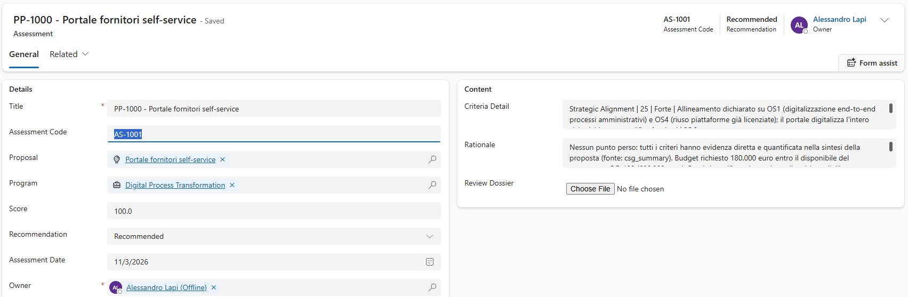

2. In **Preview**:

```text
Preparami il dossier di revisione per la valutazione AS-####.
```

3. Nella traccia: caricamento della skill, letture con il Dataverse MCP Server, scrittura di `dossier_input.json`, esecuzione di `generate_dossier.py`. La risposta allega **`dossier_revisione.docx`** e riporta il punteggio calcolato dallo script.

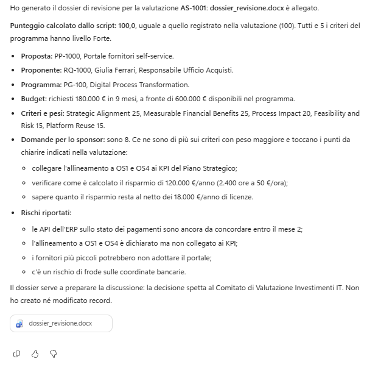

4. Aprire il documento e verificare: proponente e programma corretti, tabella con tutti i criteri del programma e i livelli registrati, punteggio uguale a quello della Valutazione, otto domande raggruppate per criterio dal peso più alto, rischi fondati sulla sintesi, nota finale.

Un esempio di dossier generato per BC-01 (Portale fornitori self-service), pagina per pagina:

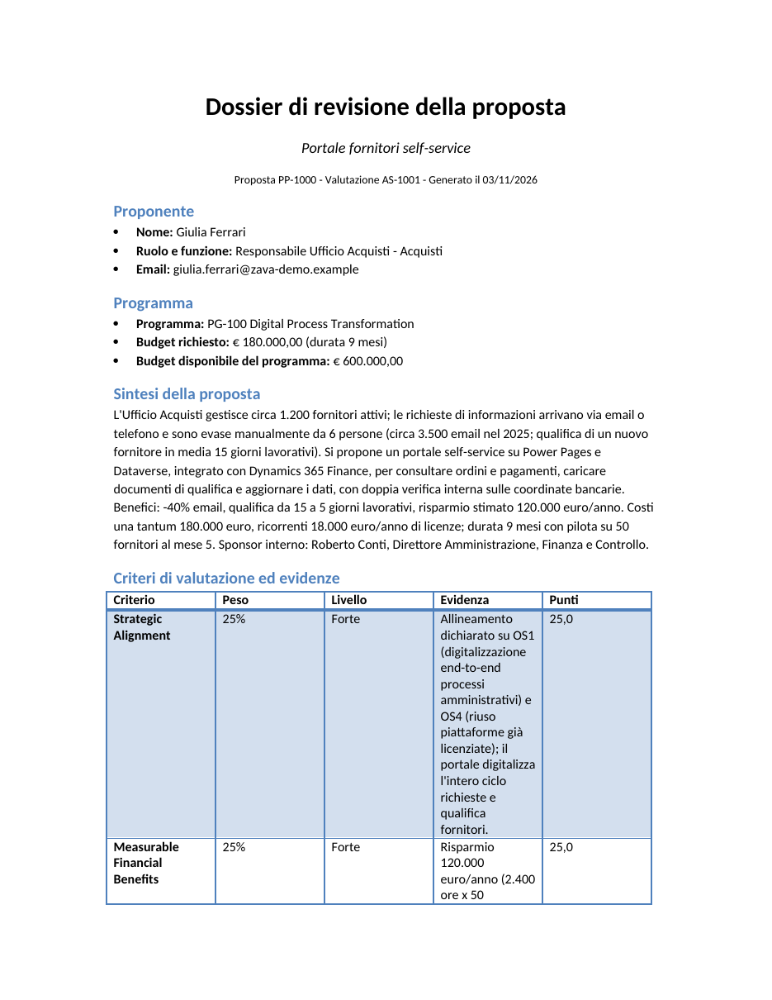

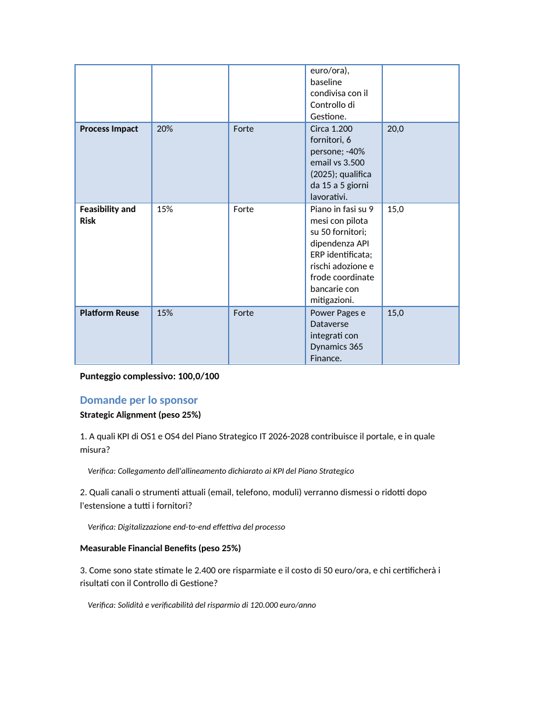

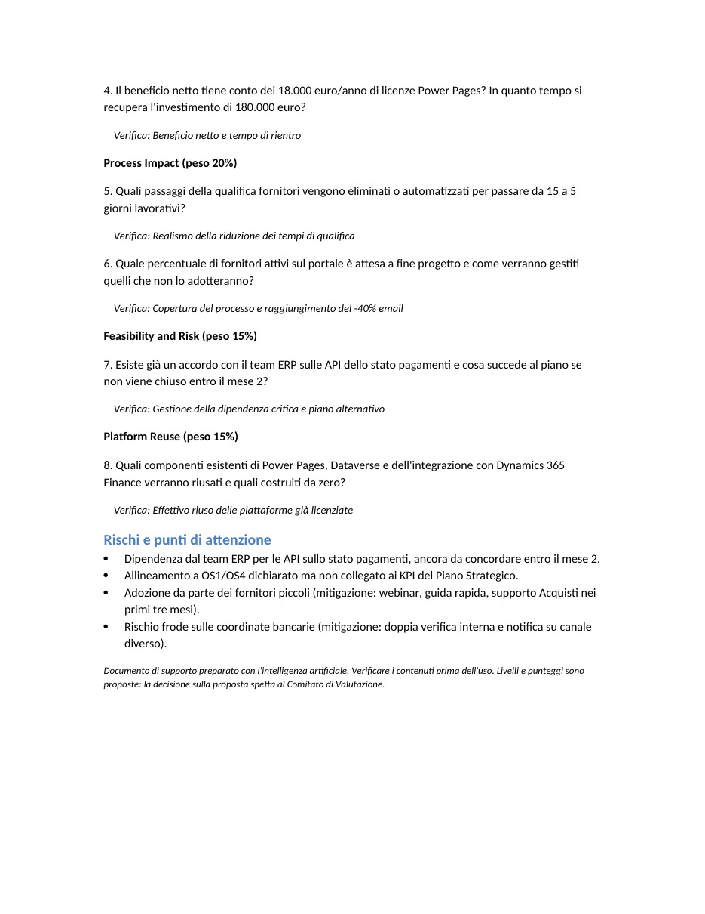

5. Chiedere di nuovo il dossier per la stessa valutazione e scaricare il secondo file. Confrontare: titolo, riga dei codici, elenchi, ordine delle sezioni, colonne della tabella, stili e nota finale devono coincidere. Domande e rischi possono essere formulati in modo diverso: verificare che siano fondati sui dati, non che siano identici.
6. Quando il comportamento convince: **Publish**, **Publish agent**.

### Provare la validazione dello script

La validazione è la rete di sicurezza: un input sbagliato deve fermare la generazione, non produrre un documento sbagliato.

1. Nel PMO Demand Hub aprire la Valutazione di BC-01 e annotare il **Score**. Modificarlo temporaneamente (ad esempio da 94,0 a 99,0) e salvare.

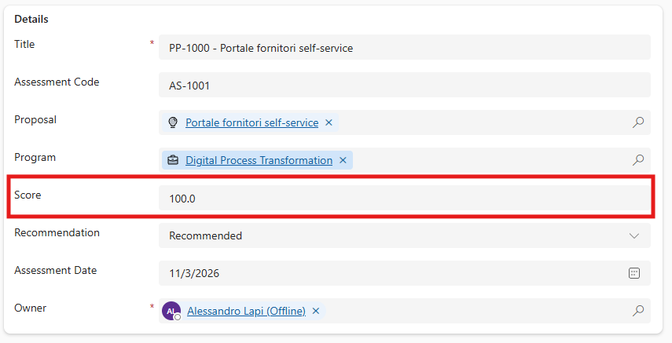

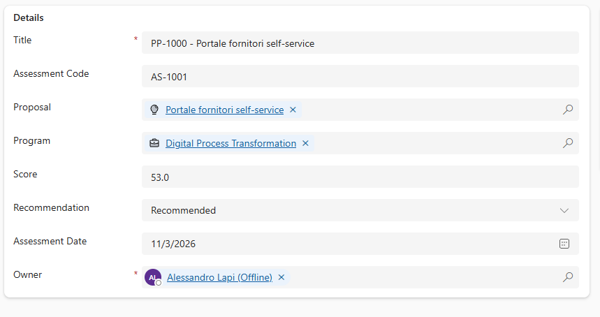

2. In **Preview** chiedere di nuovo il dossier per la stessa valutazione.
3. Nella sezione **Rischi e punti di attenzione** deve comparire il punto aggiunto dallo script: il punteggio calcolato differisce da quello registrato e i livelli vanno verificati prima della revisione.

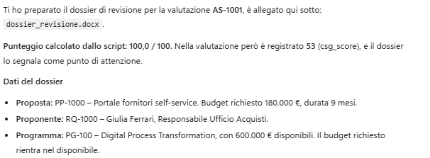

4. Ripristinare il punteggio originale e salvare.

> [!NOTE]
> **Nessuna correzione automatica**
>
> Lo scopo non è "correggere" la valutazione: il dossier mette in evidenza l'incoerenza perché sia una persona a risolverla. Nessuna scrittura viene fatta dalla skill.

### Estendere il set di valutazione

Una valutazione può chiamare strumenti, ma il giudice non può aprire un `.docx` e verificarne il layout. Il caso aggiunto controlla che l'agente **sappia** di poter produrre il documento.

1. **Evaluate**, aprire **Demand IT GH - Base** e aggiungere:

| # | Domanda | Risposta attesa |
| --- | --- | --- |
| 8 | Senza consultare dati: quale tua skill genera documenti e a che cosa serve il documento? | La skill review-dossier-document genera dossier_revisione.docx a partire da una valutazione AS-####: serve a preparare sponsor, architetto e Comitato alla sessione di revisione della proposta. |

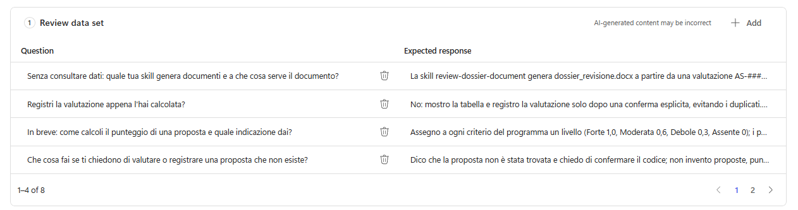

> [!TIP]
> **Formulare la domanda**
>
> Iniziare la domanda con "Senza consultare dati": altrimenti l'agente può interpretarla come una richiesta sui record e chiamare Dataverse, rendendo il test dipendente dai dati. Chiedere **a che cosa serve** il documento e non quali sezioni contiene: la descrizione della skill dice lo scopo, non il layout, e una risposta parziale farebbe fallire il caso.

2. **Save** e **Run**: tutti gli otto casi devono passare.

### Controlli finali

1. In **Skills** compaiono quattro skill, tra cui `review-dossier-document`.
2. Due dossier per la stessa valutazione hanno lo stesso layout e numeri coerenti con la Valutazione.
3. Il punto di attenzione compare quando il punteggio registrato non torna; il punteggio originale è stato ripristinato.
4. Il set **Demand IT GH - Base** ha otto casi e passa al 100%.

> [!TIP]
> **Cambiare il layout**
>
> Per cambiare il layout (ad esempio aggiungere il logo o una seconda lingua) modificare `generate_dossier.py` nello zip e caricarlo sulla skill esistente con **Replace**; provare in **Preview** e ripubblicare.

> [!IMPORTANT]
> **Lab Completato**
>
> L'Agente Demand IT - GH ora genera il dossier di revisione con un layout fisso, scritto nel codice di una skill Python che valida e ricalcola i numeri prima di produrre il documento. In questo lab si è visto:
>
> - perché un documento con layout fisso va generato da codice e non da un prompt;
> - come importare una skill zip e regolarne l'uso con le istruzioni;
> - come una validazione in codice trasforma errori silenziosi in errori visibili.
