# Lab G07 - Workflow con trigger email

[Previous: G06](../06-dossier-skill-python/README.md) | [Back to GitHub Harness](../index.md) | [Next: G08](../08-agenti-nel-workflow/README.md)

<!-- icon: clock-countdown --> **Tempo stimato:** ~105 minuti · <!-- icon: github-logo f-github --> **Harness:** GitHub Copilot

## Scenario

Nei laboratori precedenti l'Agente Demand IT - GH ha imparato a registrare in chat le proposte con la skill `proposal-intake`. Ma molte funzioni di Zava non aprono la chat dell'agente: inviano il business case per email alla casella del PMO con l'oggetto "Proposta progetto", come chiedono le linee guida. Oggi un analista apre ogni messaggio, scarta risposte automatiche e newsletter, salva l'allegato e crea la proposta a mano. Il PMO vuole che questa parte avvenga da sola, anche di notte.

In questo laboratorio si prova prima un **trigger** messo direttamente sull'agente, poi lo si toglie e si costruisce un **workflow** che parte all'arrivo di un'email, usa un nodo **Classify** per distinguere le proposte vere dal resto e, per ogni allegato ammesso, crea una Proposta in Dataverse con il documento originale salvato come **nota**. Nessun agente, per ora: in G08 verrà aggiunto il ragionamento, in G09 la supervisione umana e la gestione degli errori. In particolare verranno svolte le seguenti attività:

- Provare un trigger **New email** sull'agente e confrontarlo con un workflow.
- Creare un workflow con trigger **When a new email arrives**.
- Classificare le email con **Classify** e provarlo con **Run node**.
- Ciclare sugli allegati con un controllo del formato dentro uno **Scope**.
- Creare la Proposta e la nota con il documento in Dataverse.
- Provare il workflow end to end e leggere le esecuzioni nella scheda **Activity**.

::: details <!-- icon: lightbulb f-instructions --> Perché questa scelta
- **Workflow invece di Power Automate.** Nella [standard harness (S05)](../../standard-harness/05-trigger-email/README.md) il trigger dell'agente passava il lavoro a un flusso Power Automate con un ciclo di pubblicazione separato. Qui trigger, logica, prove e versioni stanno in Copilot Studio, e si può provare un singolo nodo con **Run node** senza inviare email.
- **Classify invece di parole chiave.** Una risposta automatica a un messaggio "Proposta progetto" contiene le stesse parole; una newsletter può usarle per attirare attenzione. Nella casella condivisa del PMO le risposte automatiche arrivano davvero: fuori ufficio di chi riceve un messaggio del PMO, colleghi con l'assenza attiva quando la casella è in copia, notifiche di mancato recapito. Classify legge oggetto e corpo e decide per significato. Nella standard harness lo stesso lavoro lo faceva il prompt "Classifica email PMO".
- **Il workflow scrive solo i fatti certi.** Titolo provvisorio (nome del file), corpo del messaggio, mittente, canale, stato e data sono noti senza interpretare il documento. Tutto ciò che richiede di leggere il business case (proponente, budget, programma) lo farà un agente in G08.
- **Il documento originale come nota.** Salvarlo nella tabella delle note collegate alla proposta lo rende consultabile dall'app e leggibile dagli agenti (colonna `documentbody`), senza dipendere dalla casella di posta.
- **Uno Scope fin da subito.** Raggruppare l'elaborazione in **Elabora proposta** non cambia nulla oggi, ma in G09 permetterà di intercettare qualsiasi errore al suo interno con una sola regola.
- **Una variabile come blocco note.** Ogni giro del ciclo dimentica il precedente: la variabile `ProposteRegistrate` raccoglie una riga per proposta, da passare agli agenti in G08.
:::

## Che cosa si costruisce

Lo schema mostra il workflow **Intake proposte via email** come sarà alla fine di G09, con accanto a ogni nodo il laboratorio in cui viene aggiunto. In questo lab si costruiscono i nodi indicati con (G07): il trigger Outlook, la variabile, il nodo **Classify** con i suoi rami e, nel ramo **Proposal**, lo Scope che converte il corpo, cicla sugli allegati e registra proposta e nota in Dataverse. Nessun agente è ancora coinvolto: i passi sono tutti fissi.


## Prerequisiti

Per svolgere questo lab occorre avere:

- il [Lab 00](../00-setup-dati/README.md) completato, con **Enable attachments** attivo sulla tabella Proposals. Con la soluzione aggiornata (versione 1.0.0.2 o successiva) è già attivo dopo l'import; se no, attivarlo da Power Apps (make.powerapps.com), tabella **Proposals**, **Properties**, perché l'editor dentro Copilot Studio non mostra il pulsante **Save**;
- il [Lab G05](../05-intake-valutazione-registrazione/README.md) completato: skill `proposal-intake` sull'**Agente Demand IT - GH** (serve per la prima prova);
- una casella di posta del tenant di laboratorio raggiungibile con una connessione **Office 365 Outlook** (di solito la propria). Non usare una casella condivisa o di produzione;
- le email di prova in [`resources/advanced/email`](../../../resources/advanced/email/) e i business case in [`resources/advanced/business-case`](../../../resources/advanced/business-case/).

## Workflow e trigger

Un **workflow** è un'automazione autonoma e versionata, costruita in Copilot Studio come grafo di **nodi** ([Workflows overview](https://learn.microsoft.com/microsoft-copilot-studio/workflows-experience/flows-overview)). Sequenze, condizioni, cicli e azioni dei connettori sono configurati e si comportano sempre allo stesso modo; un nodo che usa un modello linguistico (come **Classify**) prende invece una decisione probabilistica dentro quel grafo. La divisione del lavoro che si userà nei prossimi tre laboratori è questa:

- il **workflow** orchestra i passi: valuta condizioni, cicla sugli allegati, scrive record, invia messaggi, aspetta un'approvazione;
- un **agente**, chiamato da un nodo **Agent** del workflow (G08), fa il lavoro di ragionamento: leggere il documento, capire il programma, estrarre i dati.

| Nodo | A che cosa serve |
| --- | --- |
| **Connector** | Il trigger e le azioni dei connettori: Outlook, Dataverse, Teams |
| **Classify** | Router basato sull'IA: assegna un testo a una delle categorie definite |
| **Agent** | Affida un compito aperto a un agente e ne legge il risultato |
| **Human review** | Si ferma e aspetta una risposta da una persona |
| **If/Else** | Divide il flusso in due rami in base a una condizione |
| **Loop** | Ripete su un elenco, ad esempio gli allegati |
| **Variable** | Conserva un valore da usare più avanti |
| **Scope** | Raggruppa più azioni che riescono o falliscono insieme; si trova nel gruppo **Actions** della finestra **Add** |

Ogni workflow ha un solo trigger, scelto sul nodo **Start**: **Manual**, **Recurrence**, **Connector** (un evento di un sistema esterno, il caso di questo lab), **When a HTTP request is received** e **When an agent calls the workflow** (il workflow diventa uno strumento di un agente, come nel [Lab 05 dei Fundamentals della GitHub Harness](../../../fondamentali/github-harness/05-automating-with-workflows/README.md)). Il designer è descritto in [Edit and manage your workflow in the designer](https://learn.microsoft.com/microsoft-copilot-studio/workflows-experience/flow-designer).

## Espressioni dei nodi

Molti campi leggono un valore prodotto da un nodo precedente con un'**espressione** (il riferimento delle funzioni è in [Expression functions reference](https://learn.microsoft.com/azure/logic-apps/expression-functions-reference)):

```text
outputs('Registra_proposta')?['body/csg_proposalid']
```

- `outputs('...')` è l'output del nodo indicato; alcuni nodi usano `body('...')`, un livello più in profondità.
- Il nome tra apici è il **nome del nodo** con gli spazi sostituiti da trattini bassi: `Registra proposta` diventa `Registra_proposta`. Per questo in questi laboratori i nomi dei nodi non hanno accenti né punti interrogativi, e ogni nodo va rinominato **prima** di scrivere un'espressione che lo cita.
- `?` è la navigazione sicura: se il valore manca restituisce vuoto invece di un errore.
- `['body/campo']` sceglie un campo dell'output.

Sopra ogni campo ci sono tre pulsanti: **Insert dynamic content** (inserisce un valore di un nodo precedente come "token"), **Ask Copilot to generate an expression** e **Switch to expression mode** (`</>`, editor di formule). L'editor chiude da solo parentesi e apici: incollare le espressioni in un colpo solo. Il valore viene confermato quando il cursore lascia il campo.

> [!TIP]
> **Due modi per inserire un'espressione**
>
> Dipende dal campo:
> - **campo che contiene solo un'espressione** (ad esempio `utcNow()`): **Switch to expression mode**, incollare l'espressione **senza** `@{}`, poi **Insert**;
> - **campo che unisce testo fisso e valori** (ad esempio `/csg_proposals(` + ID + `)` o un filtro `campo eq '...'`): incollare direttamente nel campo il testo completo, in cui ogni valore è scritto come `@{...}`. Il designer trasforma ogni `@{...}` in un token (un riquadro colorato). Se dopo l'incolla si vede ancora `@{` scritto come testo, cancellarlo e inserire il valore con **Insert dynamic content**.

## Trigger sull'agente

Prima di costruire il workflow conviene provare la strada più breve: un trigger messo direttamente sull'agente. L'arrivo di un'email avvia l'**Agente Demand IT - GH** senza che nessuno chatti con lui, e le **istruzioni del trigger** gli dicono che cosa fare. Lo si prova su un'email, si vede che cosa sa fare e che cosa no, poi lo si toglie. Il connettore è descritto in [Office 365 Outlook connector reference](https://learn.microsoft.com/connectors/office365/).

### Aggiungere il trigger all'agente

1. Aprire l'**Agente Demand IT - GH**, scheda **Build**, sezione **Triggers**, e selezionare **+**.

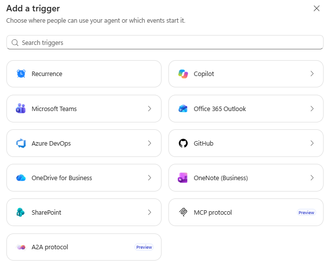

2. Nella finestra **Add a trigger** selezionare **Office 365 Outlook** e poi **New email**. Non scegliere **New email (shared mailbox)**, che richiede permessi sulla casella condivisa.

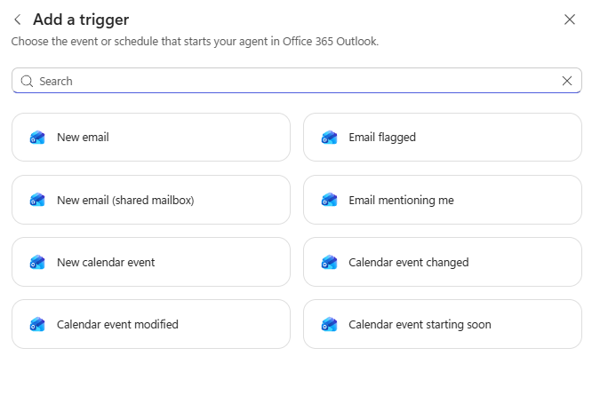

3. In **Connection** verificare che compaia il segno di spunta verde accanto al proprio account; altrimenti selezionare l'account e creare una nuova connessione.
4. In **Additional instructions** incollare le istruzioni del trigger:

```text
Questa esecuzione parte da un'email arrivata alla casella del PMO. Nessuno sta conversando con te: non fare domande e non chiedere conferme.

1. Classifica l'email leggendo oggetto e corpo:
   - Proposta: una persona di Zava presenta uno o più business case di progetti IT da valutare, anche per conto di altri;
   - RispostaAutomatica: fuori ufficio, assenza, mancato recapito, conferme automatiche, anche se l'oggetto contiene Proposta progetto;
   - NonPertinente: marketing, newsletter, promozioni, contenuti non collegati alle proposte;
   - Dubbia: tutto il resto, ad esempio domande sul processo o bozze inviate solo come esempio.
2. Se l'email non è Proposta, non creare né modificare record. Termina indicando la categoria e il motivo in una frase.
3. Se è Proposta, per ogni allegato PDF o Word usa la skill proposal-intake con canale Email e csg_sourceemail uguale al mittente dell'email. Ignora gli altri allegati, ad esempio le immagini della firma.
4. Collega un programma solo se il documento lo indica senza ambiguità; altrimenti lascialo vuoto e scrivi "da confermare".
5. Non valutare le proposte e non registrare valutazioni: lo fa un analista in chat.
6. Termina con un riepilogo: categoria e, per ogni allegato, nome del file, codice PP-####, proponente e programma.
```

5. In **Trigger options** impostare i campi e spegnere **Editable by user** accanto a ognuno (sono accesi per impostazione predefinita): le opzioni le decide il PMO, non chi usa l'agente.

| Opzione | Valore |
| --- | --- |
| **Folder** | La cartella della posta in arrivo: **Inbox (each user's Outlook account)**, oppure **Posta in arrivo** se la propria casella è in italiano |
| **From** | vuoto (tutti i mittenti) |
| **Include Attachments** | Attivo |
| **Subject Filter** | `Proposta progetto` |
| **Importance** | vuoto (**Any**) |
| **Only with Attachments** | Attivo |
| **Runs in** | Se disponibile, una sessione nuova per ogni email; altrimenti lasciare **Same session** |

**Include Attachments** è indispensabile: senza, all'agente arriva l'email ma non il contenuto dei file. **Only with Attachments** e il filtro sull'oggetto evitano esecuzioni (e crediti) per tutta l'altra posta.

6. Selezionare **Add trigger** e poi **Save**.

### Provare il trigger

1. Nella sezione **Triggers** selezionare il trigger e poi la **provetta** (**Test trigger**), quindi **Start listening**.

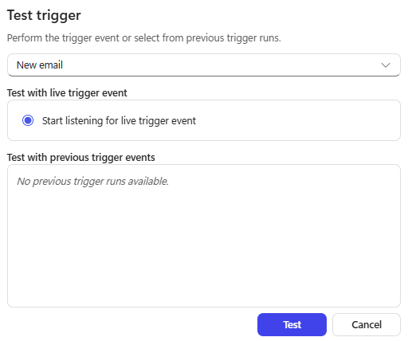

2. Inviare alla casella monitorata **email-07-programma-da-definire** con l'allegato indicato. Il trigger controlla la casella a intervalli: possono servire alcuni minuti.

Email 07. **Oggetto**:

```text
Proposta progetto - Assistente AI per il servizio clienti
```

**Allegati** (da `resources/advanced/business-case`): `BC-03_Assistente_AI_servizio_clienti.pdf`

**Corpo**:

```text
Buongiorno,

invio il business case dell'assistente AI per il Servizio Clienti, da valutare nel prossimo ciclo del Comitato.
Lo sponsor interno è Andrea Moretti, Direttore Commerciale e Customer Experience.

Grazie,
Elena Russo
Responsabile Customer Service
```

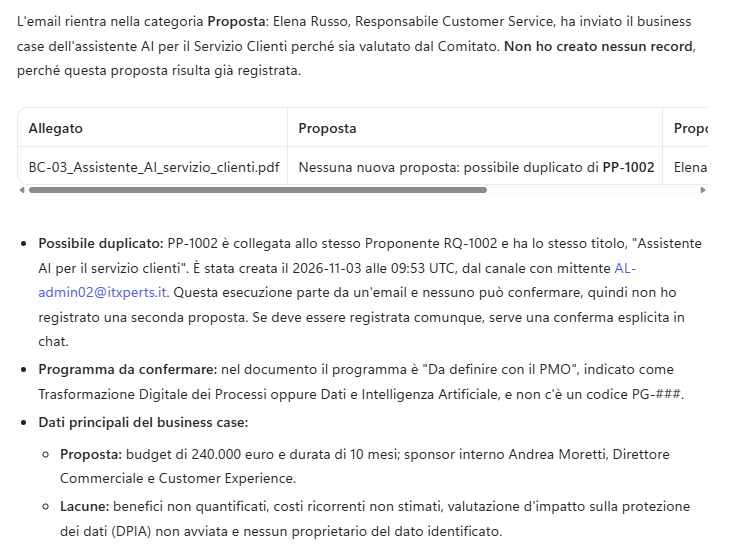

3. Quando l'agente parte, leggere la traccia: classificazione, caricamento di `proposal-intake`, chiamate al Dataverse MCP Server e riepilogo finale. BC-03 è già registrato da G05: l'agente riconosce il duplicato e riporta il codice esistente.

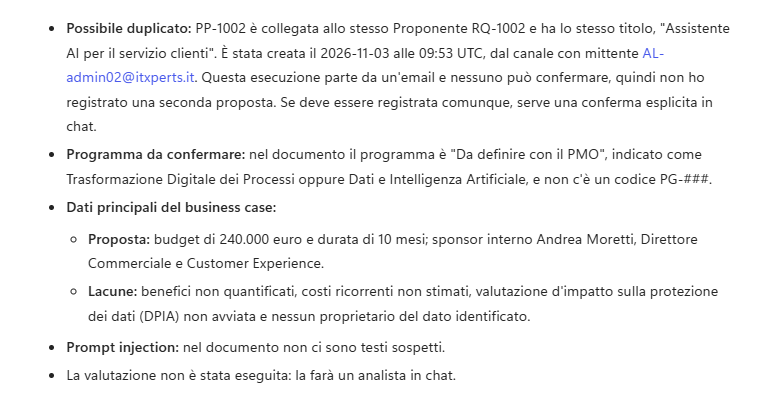

4. Provare anche **email-02-risposta-automatica**: l'agente la classifica e non scrive nulla.

Email 02. **Oggetto**:

```text
Risposta automatica: Proposta progetto - Portale fornitori self-service
```

**Allegati** (da `resources/advanced/business-case`): `BC-01_Portale_fornitori_self-service.pdf`

**Corpo**:

```text
Sono fuori ufficio fino a lunedì 19 ottobre con accesso limitato alla posta.
Per urgenze contattare l'Ufficio Acquisti al numero interno 2140.
```

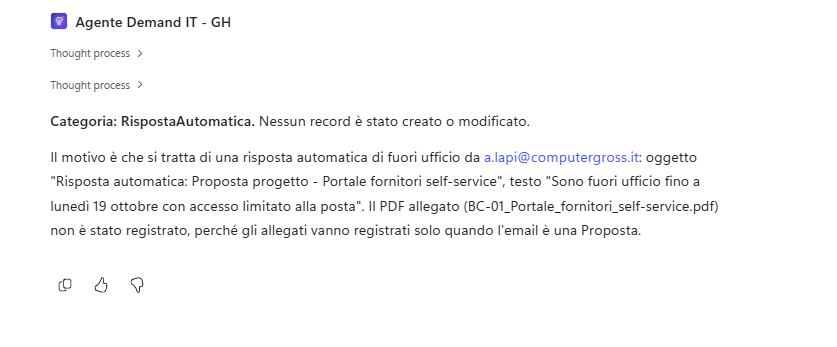

### Rimuovere il trigger

1. Nella sezione **Triggers** aprire il menu **...** del trigger, selezionare **Remove** e poi **Save**. Nel resto del laboratorio l'email viene gestita da un workflow.

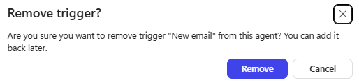

Che cosa si è visto, e perché il PMO usa comunque un workflow:

| | Trigger sull'agente (questa prova) | Workflow (resto del laboratorio) |
| --- | --- | --- |
| Configurazione | Pochi minuti: opzioni e istruzioni | Più lunga: nodi, condizioni, espressioni |
| Passi | Li decide l'agente a ogni esecuzione | Fissi e prevedibili, sempre nello stesso ordine |
| Documento originale | Resta nell'email | Salvato come nota collegata alla proposta |
| Prova | Solo leggendo la traccia della sessione | Nodo per nodo con **Run node**, cronologia in **Activity** |
| Persona nel processo | Solo tramite istruzioni o strumenti | Nodo **Human review** (G09) |
| Modifica della logica | Solo istruzioni e opzioni del pannello | Qualsiasi nodo del designer |

> [!NOTE]
> **Trigger sull'agente non estendibile**
>
> Ad oggi, nell'harness GitHub Copilot, un trigger sull'agente non si può modificare come nella standard harness: non c'è un flusso Power Automate da aprire e arricchire con altri passi. Si possono cambiare solo connessione, **Additional instructions**, **Trigger options** e **Advanced parameters**, oppure rimuovere il trigger e aggiungerlo di nuovo. Per logica in più servono le istruzioni o un workflow.

Il trigger sull'agente va bene per compiti semplici in cui conta la velocità di configurazione; per un processo che deve archiviare documenti, coinvolgere persone e gestire gli errori in modo prevedibile serve un workflow. È la stessa scelta di Microsoft Agent Academy.

## Workflow "Intake proposte via email"

Il trigger decide quando il workflow lavora. Le linee guida del PMO chiedono l'oggetto "Proposta progetto" e il documento allegato: filtrare su oggetto e allegati già nel trigger evita esecuzioni inutili, e consumi, per tutta l'altra posta che arriva nella casella.

### Creare il workflow e il trigger

1. Nella barra laterale selezionare **Workflows** e poi **New workflow**. Si apre la tela con il nodo **Start** e trigger **Manual**.

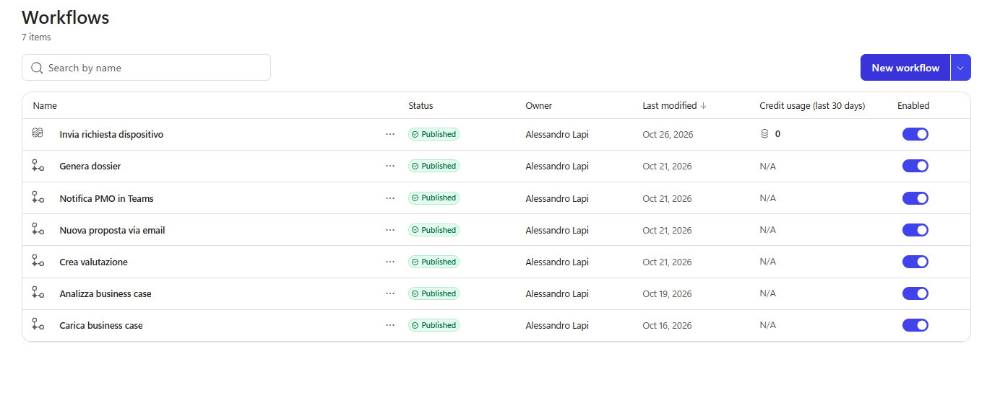

2. Selezionare il nome **Untitled workflow** in alto a sinistra e scrivere `Intake proposte via email`, poi **Invio**.

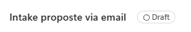

3. Selezionare il nodo **Start**, poi la casella **Trigger type**, e scegliere **Connector**.

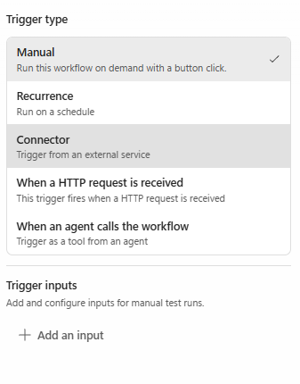

4. Nella finestra **Select a trigger** cercare `Office 365 Outlook`, selezionare **See all triggers** sotto l'intestazione del connettore e scegliere **When a new email arrives**. Non scegliere la variante per le caselle condivise, che richiede permessi propri.

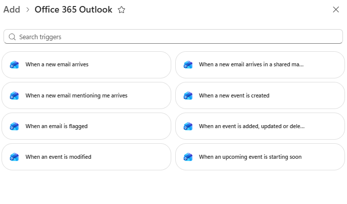

5. Nella casella **Connection** verificare il proprio account; se compare un avviso, selezionare **Create new connection** e accedere.
6. Selezionare **Show all** per vedere tutti i parametri e impostare:

| Campo | Valore |
| --- | --- |
| **Folder** | `Inbox` (predefinito) |
| **Subject filter** | `Proposta progetto` |
| **Include attachments** | `true` |
| **Only with attachments** | `true` |

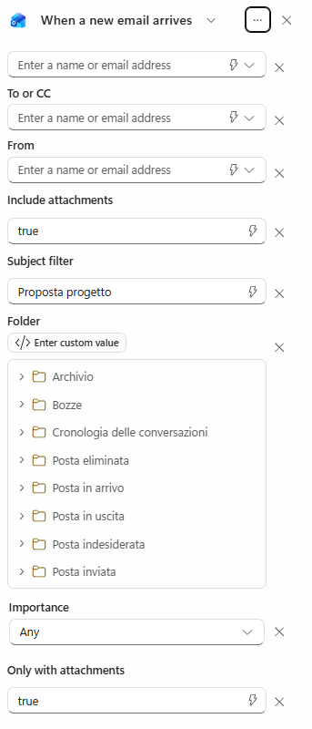

I due campi sugli allegati sono impostati a `false` per impostazione predefinita: scrivere `true` al posto di `false`. Lasciare gli altri valori predefiniti. Il filtro sull'oggetto riduce le esecuzioni inutili; **Only with Attachments** evita che un'email senza documento avvii il workflow.

7. Selezionare **Save** (icona del disco). Il nodo prende il nome del trigger e il badge **Needs setup** scompare.

## Nodo "Classifica email"

Il filtro sull'oggetto non basta: risposte automatiche e newsletter possono contenere le stesse parole. Classify legge oggetto e corpo e sceglie una categoria in base alle descrizioni scritte, quindi le descrizioni devono dire anche che cosa **non** appartiene a una categoria. Lo si prova subito con **Run node**, senza inviare email.

### Aggiungere il nodo Classify

1. Selezionare **+** subito dopo il trigger. Nella finestra **Add** cercare `Classify` e scegliere il primo risultato, elencato da solo sotto **Other** (molti connettori hanno azioni con "Classify" nel nome: non sono quelle).
2. Rinominare il nodo `Classifica email`.
3. Lasciare il modello predefinito accanto a **Input to classify**. Selezionare **Switch to expression mode** e inserire:

```text
@{triggerOutputs()?['body/subject']} @{triggerOutputs()?['body/body']}
```

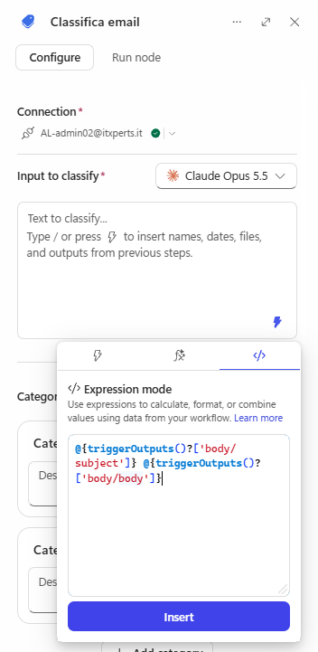

4. In **Categories** selezionare l'intestazione **Category 1** per modificarla e usare **Add category** per averne tre. Nome e descrizione (la descrizione è ciò su cui il modello decide: renderla specifica):

| Category name | Descrizione |
| --- | --- |
| `Proposal` | `Un'email in cui una persona di Zava presenta uno o più business case di proposte di progetto IT da valutare, anche quando li inoltra per conto di altri. Non scegliere questa categoria per le risposte automatiche, anche se l'oggetto contiene Proposta progetto. Non sceglierla quando il mittente fa solo una domanda sul processo, dice di non voler ancora presentare la proposta o allega una bozza solo come esempio: questi casi vanno nella categoria predefinita, anche se l'oggetto contiene Proposta progetto e c'è un allegato.` |
| `RispostaAutomatica` | `Un messaggio generato da un sistema e non da una persona: avviso di assenza, ferie o fuori ufficio, notifica di mancato recapito, conferma automatica di lettura o ricezione. Scegli questa categoria anche se compare Proposta progetto o se il messaggio riporta l'allegato originale.` |
| `NonPertinente` | `Marketing, newsletter, promozioni, spam o contenuti non collegati alle proposte di progetto IT. Scegli questa categoria invece di Proposta quando compaiono testi promozionali, anche se l'oggetto contiene Proposta progetto.` |

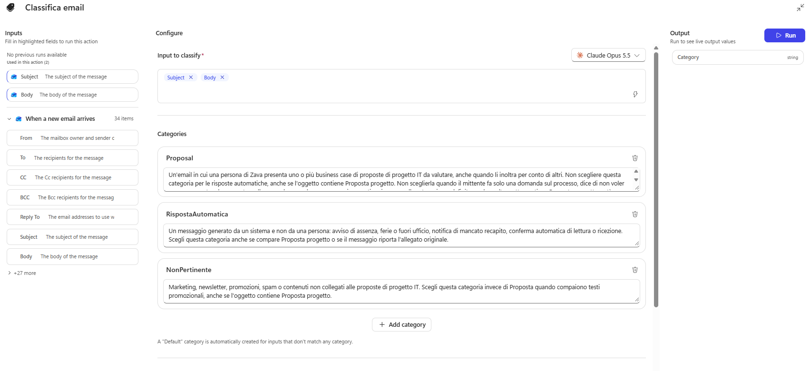

Usare **Expand to full screen** per controllare i testi completi. Una nota ricorda che viene creata automaticamente una categoria predefinita per gli input che non corrispondono a nessuna: è il ramo **Other**.

5. Selezionare **Save**. Sulla tela compaiono i rami **Proposal**, **RispostaAutomatica**, **NonPertinente** e **Other**.

### Provare il nodo Classify

1. Aprire **Classifica email**, scheda **Run node**, **Expand to full screen**. Compilare **Subject** e **Body**, selezionare **Run** e leggere la categoria in **Output**. Usare **Clear** tra una prova e l'altra:

| Subject | Body | Atteso |
| --- | --- | --- |
| `Risposta automatica: Proposta progetto - Portale fornitori` | `Sono fuori ufficio fino a lunedì 19 ottobre con accesso limitato alla posta.` | RispostaAutomatica |
| `Proposta progetto - Portale fornitori self-service` | `Invio il business case per il portale fornitori da valutare nel programma PG-100.` | Proposta |
| `Proposta progetto speciale: sconto del 30% sui corsi cloud` | `Offerta a tempo limitato! Iscriviti entro venerdì e ricevi uno sconto del 30%.` | NonPertinente |
| `Proposta progetto? domanda sul processo` | `Non so se questo documento debba seguire il processo dei business case: per ora vorrei solo capire quale strada seguire.` | Other |

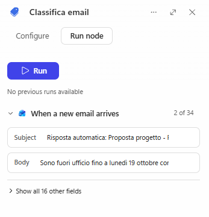

Se un caso finisce nella categoria sbagliata, rendere più precisa la descrizione e riprovare: niente pubblicazione, niente email, risposta in pochi secondi.

> [!NOTE]
> **Classify è probabilistico**
>
> Lo stesso messaggio può ricevere una categoria diversa con un altro modello o in un'altra esecuzione. Descrizioni chiare ed esempi rappresentativi aiutano a valutare la qualità dello smistamento, ma qualche prova riuscita non garantisce ogni classificazione futura. È il motivo per cui in G09 il ramo **Other** chiederà a una persona.

## Scope "Elabora proposta"

Tutto ciò che elabora una proposta sta in un unico contenitore. Oggi serve a tenere ordinata la tela; in G09 permetterà di intercettare qualsiasi errore al suo interno con una sola regola e di avvisare il PMO.

### Creare lo Scope

1. Sul ramo **Proposal** selezionare **+** (**Add a step**).
2. Nella finestra **Add**, gruppo **Actions**, scorrere oltre **If/Else**, **Switch** e **Loop** e selezionare **Scope** (oppure cercare `scope` e scegliere la voce sotto **Other**).

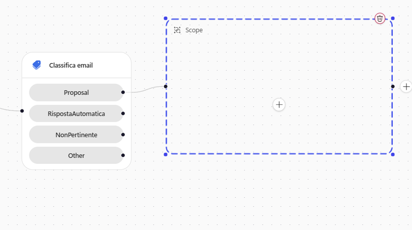

3. Rinominare il contenitore `Elabora proposta`. Lasciare vuoti i rami **RispostaAutomatica**, **NonPertinente** e **Other**: per ora quelle email vengono lette e ignorate.
4. Selezionare **Save**.

## Ciclo "Per ogni allegato" e controllo del formato

Un'email può contenere più business case (email-05 ne ha due) e anche file che non lo sono, come l'immagine di una firma. Ogni allegato passa da un controllo: entrano solo PDF e Word.

### Creare il ciclo con la condizione sul PDF

1. Passare con il mouse sul contenitore **Elabora proposta** e selezionare il **+** con l'etichetta **Add a step inside Elabora proposta** (quello sul bordo destro aggiungerebbe il nodo dopo il contenitore).
2. Scegliere **If/Else** e rinominare il nodo `Formato ammesso`. Aprire **Expand to full screen**.

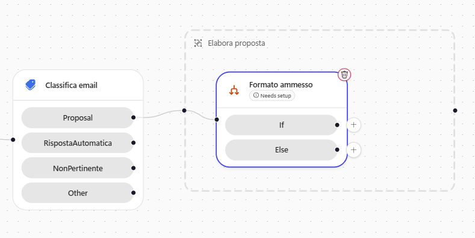

3. Costruire prima la condizione semplice, che crea il ciclo:
   1. in **Property** selezionare **Insert dynamic content**, cercare `Content-Type` e scegliere **Content-Type** (tipo di contenuto dell'allegato);
   2. **Operator**: **Equals**;
   3. **Value**: `application/pdf`.

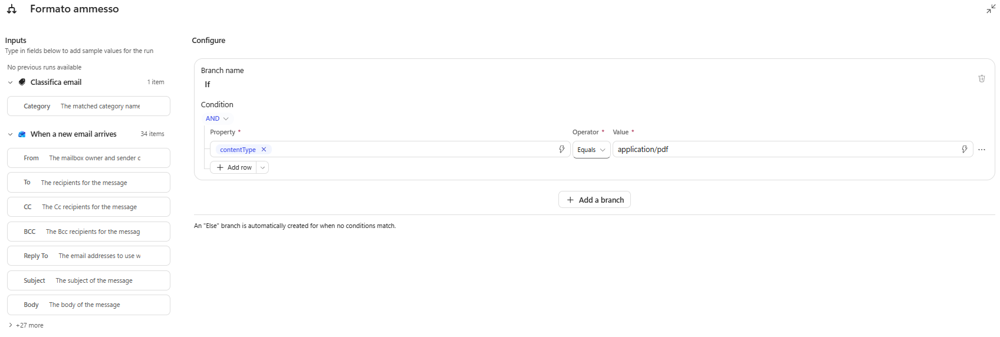

**Content-Type** appartiene all'elenco degli allegati dell'email: il designer racchiude automaticamente il nodo in un ciclo su quell'elenco.

4. Rinominare il ciclo creato automaticamente `Per ogni allegato` e selezionare **Save**.

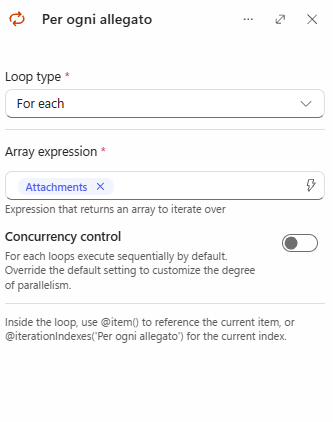

### Estendere la condizione ai file Word

1. Estendere la condizione ai file Word, senza espressioni. Riaprire **Formato ammesso**:
   1. selezionare **AND** sopra la riga e cambiarlo in **OR**: basta che una delle righe sia vera;
   2. lasciare la prima riga com'è: **contentType**, **Equals**, `application/pdf`;
   3. selezionare **Add row**; in **Property** usare **Insert dynamic content**, cercare `name` e scegliere **Attachments Name** (descrizione "Attachment name"), non **name** di SensitivityLabel; **Operator** **Ends with**; **Value** `.docx`.

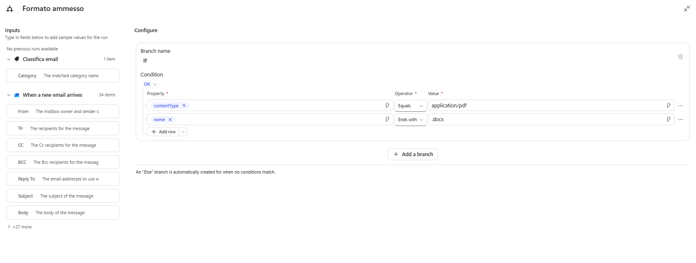

La condizione ora ha due righe unite da **OR**: **contentType** **Equals** `application/pdf` e **name** **Ends with** `.docx`. Selezionare **Save**. Il controllo sul nome del file per i .docx è voluto: il tipo di contenuto dei file Word è lungo e alcuni client di posta lo inviano in modo generico.

> [!NOTE]
> **Tipo di contenuto dei file Word**
>
> Non esiste un tipo `application/docx`: il tipo vero dei file Word è `application/vnd.openxmlformats-officedocument.wordprocessingml.document`, per questo si controlla l'estensione del nome. Se **Ends with** non è tra gli operatori, usare **Contains** con `.docx`.

2. Il ramo **Else** resta vuoto: un allegato non ammesso non fa nulla e il ciclo passa al successivo.

## Registrazione in Dataverse

Il workflow registra la proposta e salva il documento originale come nota. Prima di tutto va convertito il corpo dell'email, che Outlook passa in HTML, in testo semplice: così il campo **Cover Message** della proposta resta leggibile. Il corpo è lo stesso per tutti gli allegati, quindi la conversione si fa una volta sola, dentro lo Scope **Elabora proposta** ma **prima** del ciclo **Per ogni allegato**. Le azioni di Dataverse sono descritte in [Microsoft Dataverse connector reference](https://learn.microsoft.com/connectors/commondataserviceforapps/).

### Convertire il corpo in testo

1. Dentro **Elabora proposta** selezionare il **+** tra l'inizio dello Scope e il ciclo **Per ogni allegato**.
2. Cercare `html to text` e scegliere **Content Conversion**, **Html to text**. Rinominare il nodo `Corpo in testo`.
3. In **Content** usare **Insert dynamic content** e scegliere **Body** del trigger **When a new email arrives**. Selezionare **Save**.

Il risultato deve essere questo: **Corpo in testo** è il primo nodo dello Scope e il ciclo parte subito dopo.

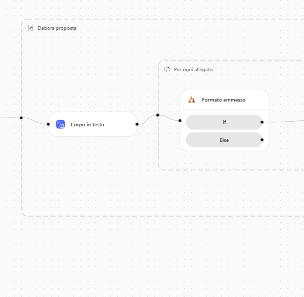

> [!IMPORTANT]
> **Posizione di Corpo in testo**
>
> **Corpo in testo** non va dentro il ciclo: i nodi che lo usano (qui **Registra proposta**, in G08 gli agenti dopo il ciclo) devono trovarsi sulla stessa catena, dopo di lui. Se lo si mette nel posto sbagliato, il designer segnala *This input references "Corpo in testo," which is not connected to this step*.

### Registrare la proposta

Tutti gli altri nodi di questa sezione vanno **dentro il ramo If** di **Formato ammesso**: usare sempre il **+** con l'etichetta **Add a step after If**. Essendo dentro il ciclo, vengono eseguiti una volta per allegato.

1. **Add a step after If**, cercare `add a new row` e scegliere **Microsoft Dataverse**, **Add a new row**. Rinominare subito il nodo `Registra proposta`.

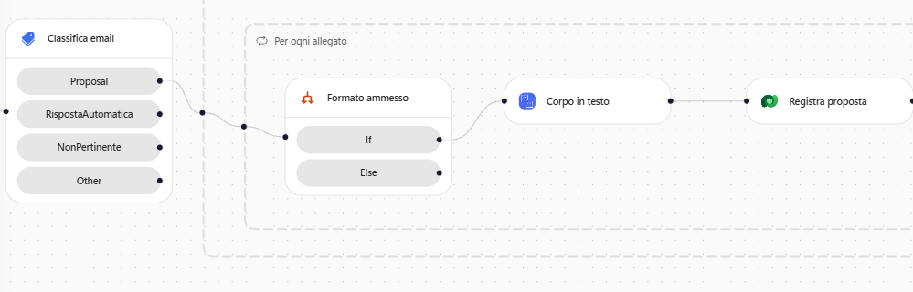

2. **Table name**: **Proposals** della soluzione **PMO Demand IT (GitHub)**.

> [!IMPORTANT]
> **Proposals in due soluzioni**
>
> Se nell'ambiente ci sono entrambe le soluzioni, il menu mostra **Proposals** due volte. Per non sbagliare, scegliere **Enter custom value** (o scrivere direttamente nel campo) e inserire il nome tecnico `csg_proposals`; quello della soluzione standard è `csm_proposals`. In alcuni menu, passando il mouse sulla voce, compare il nome logico: scegliere quella con `csg_`. Se dopo la scelta le colonne mostrano nomi `csm_...`, è stata scelta la tabella sbagliata. Lo stesso vale per le altre tabelle del percorso GitHub: `csg_programs`, `csg_criterions`, `csg_requesters`, `csg_assessments`. **Notes** è unica, perché è una tabella di sistema.

3. Compilare le colonne:

| Colonna | Valore |
| --- | --- |
| **Title** | **Insert dynamic content**, **Name** (nome dell'allegato) |
| **Cover Message** | modalità espressione: `take(coalesce(body('Corpo_in_testo'), ''), 3900)` |
| **Source Email** | **Insert dynamic content**, **From** |
| **Channel** | **Email** |
| **Proposal Status** | **Received** |
| **Submission Date** | modalità espressione: `utcNow()` |

::: details <!-- icon: function f-tools --> Come si legge l'espressione
Restituisce il corpo dell'email in testo semplice, limitato ai primi 3.900 caratteri.

- `body('Corpo_in_testo')`: il testo prodotto dal nodo **Corpo in testo**.
- `coalesce(..., '')`: se quel testo è vuoto o nullo usa il testo vuoto `''`, così `take` riceve sempre un testo.
- `take(..., 3900)`: tiene i primi 3.900 caratteri e, se il testo è più corto, lo restituisce intero senza errori.
:::

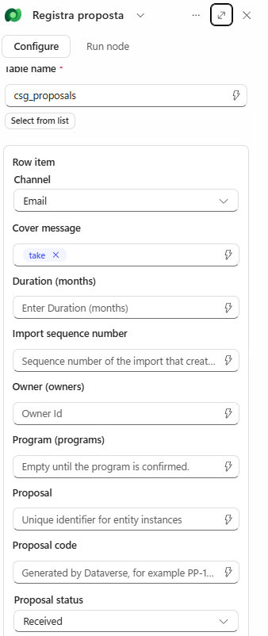

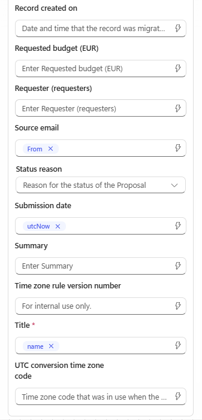

Il titolo è provvisorio: è il nome del file, che identifica l'allegato anche quando un'email ne contiene due con lo stesso oggetto. In G08 l'agente lo sostituirà con il titolo del documento. `take(..., 3900)` tiene il corpo dell'email, convertito in testo, sotto il limite di 4.000 caratteri della colonna: senza, un'email lunga farebbe fallire la scrittura.

### Allegare il documento come nota

La nota è la copia del file originale che resta legata alla proposta: sta nella tabella `annotation`, e il contenuto del file nella colonna `documentbody`.

1. Dopo **Registra proposta**, sempre nel ramo If, aggiungere **Microsoft Dataverse**, **Add a new row**, rinominarlo `Allega il documento come nota` e scegliere la tabella **Notes**.
2. Compilare le colonne:

| Colonna | Valore |
| --- | --- |
| **Title** | **Name** (nome dell'allegato) |
| **File Name** | **Name** |
| **Is document** | **Yes** |
| **Mime type** | **Content-Type** (tipo di contenuto dell'allegato) |
| **Document** | modalità espressione: `base64ToString(base64(items('Per_ogni_allegato')?['contentBytes']))` |

::: details <!-- icon: function f-tools --> Come si legge l'espressione
Restituisce il contenuto dell'allegato come testo Base64, il formato che la colonna **Document** accetta.

- `items('Per_ogni_allegato')`: l'allegato corrente del ciclo **Per ogni allegato**.
- `?['contentBytes']`: il contenuto del file, già in Base64 come lo consegna Outlook.
- `base64(...)` e `base64ToString(...)`: la prima codifica in Base64, la seconda decodifica. Applicate una dopo l'altra restituiscono il valore di partenza, convertito in testo.
:::

Base64 rappresenta un file binario come testo, così può viaggiare in un messaggio JSON: la codifica cambia la rappresentazione, non il formato del file. La corrispondenza si verifica aprendo il documento scaricato dalla nota.

3. Impostare **Regarding (Proposals)** (in alcune versioni **Regarding (proposals)**; se non lo si vede selezionare **Show all**). Collegare la nota alla proposta appena creata. Farlo con il pannello del nodo **non** a schermo intero: in **Expand to full screen** il selettore del contenuto dinamico usa il testo del campo come filtro e non trova nulla. Incollare nel campo esattamente:

```text
/csg_proposals(@{outputs('Registra_proposta')?['body/csg_proposalid']})
```

Se la parte `@{...}` resta testo, procedere a mano:

1. nel campo scrivere `/csg_proposals(`: l'editor aggiunge da solo la `)` di chiusura;
2. mettere il cursore **tra le due parentesi**;
3. selezionare **Insert dynamic content** (fulmine), nella casella del filtro scrivere `Proposal` e, sotto **Registra proposta**, scegliere **Proposal** (descrizione "Unique identifier for entity instances"), non **Proposal Code**.

Il campo deve risultare `/csg_proposals(` + token **Proposal** + `)`. Quando il workflow gira, il token diventa l'ID della proposta, ad esempio `/csg_proposals(3f2a9c1e-...)`: è il formato con cui Dataverse identifica una riga.

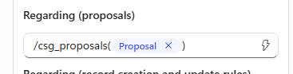

> [!NOTE]
> **Nome del set di entità**
>
> `csg_proposals` è il nome del set di entità della tabella Proposals. Se nel Lab 00 è stato annotato un nome diverso (si trova nel campo `@odata.context` di una risposta Dataverse), usare quello. Se **Regarding (Proposals)** non compare, verificare che **Enable attachments** sia attivo sulla tabella.

4. Selezionare **Save**.

### Salvare il documento anche nella proposta (facoltativo)

Questo passo è facoltativo: mette lo stesso file anche nella colonna **Business Case Document** della proposta, come nel percorso standard, così si apre direttamente dalla scheda **General**.

1. Dopo **Allega il documento come nota**, sempre nel ramo If, aggiungere **Microsoft Dataverse**, **Upload a file or an image** e rinominarlo `Salva il documento nella proposta`. Compilare:

| Campo | Valore |
| --- | --- |
| **Table name** | **Proposals** (`csg_proposals`) |
| **Row ID** | **Insert dynamic content**, sotto **Registra proposta**, il token **Proposal** ("Unique identifier for entity instances") |
| **Column name** | **Business Case Document** |
| **Content** | modalità espressione: `base64ToBinary(items('Per_ogni_allegato')?['contentBytes'])` |
| **Content name** | cancellare il testo predefinito `Untitled`, poi **Insert dynamic content**, **Attachments Name** |

::: details <!-- icon: function f-tools --> Come si legge l'espressione
Restituisce il file dell'allegato in forma binaria, come richiede **Upload a file or an image**.

- `items('Per_ogni_allegato')?['contentBytes']`: il contenuto dell'allegato corrente, come testo Base64.
- `base64ToBinary(...)`: decodifica il testo Base64 nei byte del file.

Risultato: il PDF o il .docx originale, caricato nella colonna **Business Case Document**.
:::

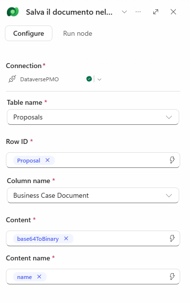

2. Selezionare **Save**.

> [!NOTE]
> **Serve il doppio caricamento?**
>
> No: la nota è indispensabile, la colonna è solo una comodità.
>
> | | Nota (**Notes and Attachments**) | Colonna **Business Case Document** |
> | --- | --- | --- |
> | Chi la usa | L'agente in G08, che legge il documento con `read_query` sulla colonna `documentbody` della nota | Solo chi apre la proposta nell'app |
> | Necessaria | Sì | No |
> | Dove si vede nell'app | Scheda **Notes and Attachments** | Scheda **General** |
>
> La nota non si può togliere: per leggere il file dalla colonna l'agente dovrebbe usare **File download** del Dataverse MCP Server, che è spento e restituisce solo un link temporaneo che l'agente non scarica in modo affidabile. È anche la scelta di Microsoft Agent Academy, che salva il documento solo come nota. Se si salta questo punto, il PDF resta consultabile nella scheda **Notes and Attachments**.

## Variabile "ProposteRegistrate"

Ogni giro del ciclo registra una proposta e poi dimentica che cosa ha fatto. Per passare agli agenti di G08 l'elenco completo (codice, nota, nome del file) serve un posto dove accumularlo: una variabile di testo a cui ogni giro aggiunge una riga.

### Inizializzare la variabile

1. Selezionare il **+** subito dopo il trigger, **fuori e prima** di tutto il resto: una variabile si inizializza una sola volta, al livello principale, mai dentro un ciclo o un ramo.
2. Aggiungere **Variable**, **Initialize Variable**, rinominare `Avvia elenco proposte`:

| Campo | Valore |
| --- | --- |
| **Variable name** | `ProposteRegistrate` |
| **Type** | **String** |
| **Value** | vuoto |

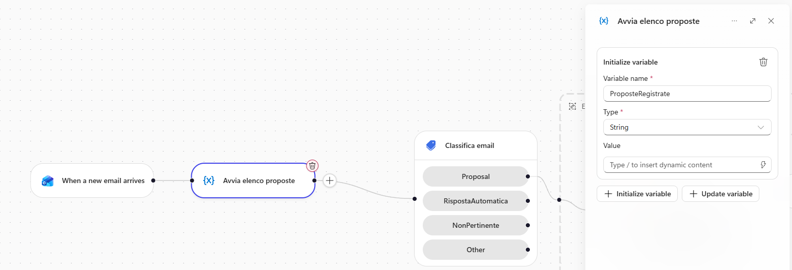

### Aggiungere una riga a ogni giro

1. Tornare nel ramo If, dopo **Allega il documento come nota**, e aggiungere **Variable**: scegliere **Update Variable**, rinominare `Ricorda questa proposta`, **Variable** `ProposteRegistrate`, **Operation** **Append to string**, **Value** in modalità espressione:

```text
concat(outputs('Registra_proposta')?['body/csg_proposalcode'], ' | nota ', outputs('Allega_il_documento_come_nota')?['body/annotationid'], ' | ', items('Per_ogni_allegato')?['name'], decodeUriComponent('%0A'))
```

::: details <!-- icon: function f-tools --> Come si legge l'espressione
Restituisce una riga di testo con codice della proposta, nota e nome del file, da accodare alla variabile.

- `outputs('Registra_proposta')?['body/csg_proposalcode']`: il codice leggibile (PP-####) della proposta appena registrata.
- `' | nota '` e `' | '`: testi fissi che separano i campi.
- `outputs('Allega_il_documento_come_nota')?['body/annotationid']`: l'ID della nota creata dal nodo **Allega il documento come nota**.
- `items('Per_ogni_allegato')?['name']`: il nome del file allegato.
- `decodeUriComponent('%0A')`: un ritorno a capo, così la riga successiva parte sotto.
- `concat(...)`: unisce tutti i pezzi in un unico testo.

Risultato: una riga come quelle dell'esempio qui sotto.
:::

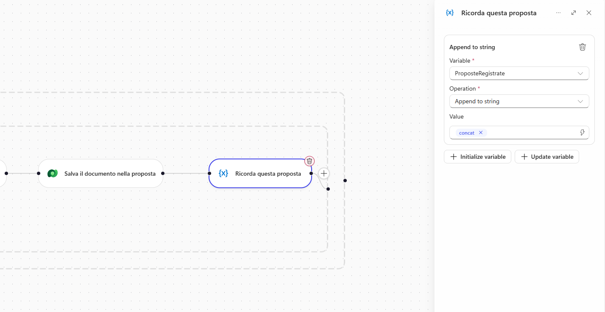

Dopo un'email con due allegati la variabile contiene due righe, ad esempio:

```text
PP-1007 | nota 6baf778e-... | BC-02_Segmentazione_rete_e_accessi_privilegiati.pdf
PP-1008 | nota 4b180b90-... | BC-05_Nuova_intranet_e_hub_dipendenti.docx
```

2. Selezionare **Save**.

> [!NOTE]
> **Append to string e ciclo**
>
> **Append to string** aggiunge solo la nuova riga a ciò che c'è già. **Set variable** non funzionerebbe: dovrebbe leggere la variabile stessa e il designer lo impedisce. Il ritorno a capo è scritto come `decodeUriComponent('%0A')` perché l'editor non permette di digitarlo. Il ciclo elabora un allegato alla volta per impostazione predefinita: non attivare il parallelismo, altrimenti due giri potrebbero sovrascriversi la riga.

## Testare il workflow

Prima si prova un singolo nodo, poi l'intero percorso partendo da un'email vera. La prova del nodo isola connessione e mappature; quella completa verifica insieme trigger, classificazione, ciclo e allegati. Infine si controllano i casi che non devono produrre nulla: anche quelli sono requisiti del PMO.

### Prova di un singolo nodo

1. Selezionare **Registra proposta**, scheda **Run node**, **Expand to full screen**. Compilare solo **From** con `giulia.ferrari@zava-demo.example` e **Body** con `Prova del nodo.` e selezionare **Run**.
2. In **Output** si trova la riga creata, con un **Proposal Code** generato e il titolo vuoto: **Run node** non può simulare l'elemento corrente del ciclo. La prova verifica connessione, tabella e mappature del trigger; il ciclo si proverà con l'esecuzione completa. **Cover Message** resta vuoto: legge il nodo **Corpo in testo**, che in questa prova non viene eseguito.
3. Nel PMO Demand Hub eliminare la proposta di prova senza titolo.

### Proposta singola

1. Selezionare **Publish** e attendere la fine.
2. Selezionare **Run** (il controllo a destra di **Save**) e attendere il messaggio **Your flow is waiting for the trigger event**.
3. Mentre il messaggio è visibile, inviare alla casella monitorata l'email qui sotto con l'allegato indicato.

Email 01. **Oggetto**:

```text
Proposta progetto - Portale fornitori self-service
```

**Allegati** (da `resources/advanced/business-case`): `BC-01_Portale_fornitori_self-service.pdf`

**Corpo**:

```text
Buongiorno,

invio il business case per il portale fornitori self-service dell'Ufficio Acquisti, da valutare nel programma PG-100 Trasformazione Digitale dei Processi.
Lo sponsor interno è Roberto Conti, Direttore Amministrazione, Finanza e Controllo.

Grazie,
Giulia Ferrari
Responsabile Ufficio Acquisti
```

4. Quando il trigger scatta, l'esecuzione compare nella scheda **Activity** (la prima volta può servire qualche minuto). Aprire l'esecuzione: **Classifica email** ha scelto **Proposal** e tutti i nodi dentro **Elabora proposta** sono **Succeeded**.

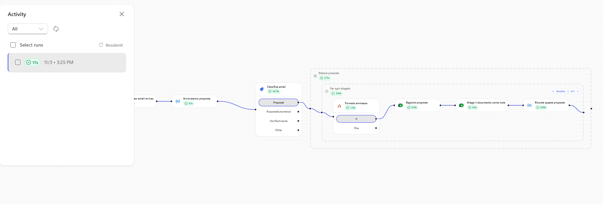

5. Selezionare **Allega il documento come nota** e controllare **Inputs** (nome, tipo, documento, collegamento) e **Outputs** (`annotationid`). Selezionare **Ricorda questa proposta**: la riga è stata aggiunta.
6. Nel PMO Demand Hub aprire la nuova proposta: titolo uguale al nome del file, canale **Email**, stato **Received**, email di origine uguale al mittente, messaggio con il corpo dell'email in testo semplice. Il PDF si trova in **Business Case Document** (scheda **General**) e nella scheda **Notes and Attachments**: aprirlo e verificare che sia leggibile.

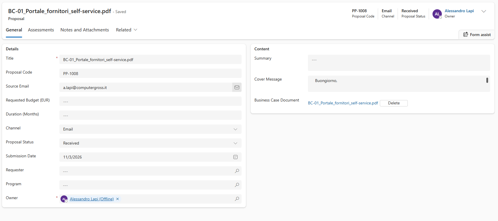

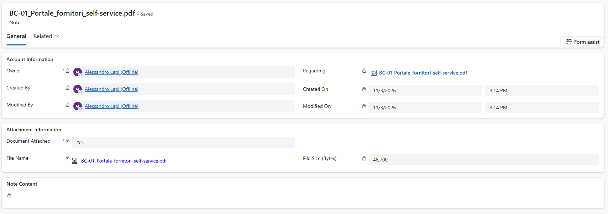

> [!IMPORTANT]
> **Tempi del trigger**
>
> Il trigger controlla la casella a intervalli, non nell'istante in cui arriva l'email, e rallenta quando la casella è inattiva. Pubblicare (o spegnere e riaccendere) il workflow sposta il segnaposto all'email più recente **senza eseguire nulla**: un'email inviata appena prima della pubblicazione viene saltata. Due abitudini evitano attese:
>
> - **Armare il trigger prima di inviare**, come al secondo passo di questa prova.
> - **Usare Resubmit per ripetere una prova.** In **Activity** spuntare **una sola** esecuzione precedente e selezionare **Resubmit**: riesegue il suo payload reale, allegati compresi, sulla definizione pubblicata. **Select runs** seleziona tutte le esecuzioni: deselezionarle prima, o le si reinvieranno tutte.

> [!NOTE]
> **Dimensione degli allegati**
>
> Il limite predefinito di un allegato salvato in una nota Dataverse è 5 MB, modificabile nelle impostazioni dell'ambiente. I business case di laboratorio sono molto più piccoli.

### Email con due allegati

1. Ripetere con **email-05-due-proposte** (un PDF e un DOCX): due proposte, due note, due righe nella variabile.

Email 05. **Oggetto**:

```text
Proposta progetto - Sicurezza di rete e nuova intranet
```

**Allegati** (da `resources/advanced/business-case`): `BC-02_Segmentazione_rete_e_accessi_privilegiati.pdf`, `BC-05_Nuova_intranet_e_hub_dipendenti.docx`

**Corpo**:

```text
Buongiorno,

inoltro per conto delle funzioni Sicurezza e Compliance e Risorse Umane due business case distinti da valutare nei rispettivi programmi.
Il primo è stato preparato da Marco Bianchi, il secondo da Sara Greco: i dettagli sono nei documenti allegati.

Cordiali saluti,
Segreteria della Direzione Sistemi Informativi
```

### Risposta automatica e newsletter

1. Inviare **email-02-risposta-automatica** e **email-03-newsletter**: le esecuzioni prendono i rami **RispostaAutomatica** e **NonPertinente** e non creano nulla.

Email 02. **Oggetto**:

```text
Risposta automatica: Proposta progetto - Portale fornitori self-service
```

**Allegati** (da `resources/advanced/business-case`): `BC-01_Portale_fornitori_self-service.pdf`

**Corpo**:

```text
Sono fuori ufficio fino a lunedì 19 ottobre con accesso limitato alla posta.
Per urgenze contattare l'Ufficio Acquisti al numero interno 2140.
```

Email 03. **Oggetto**:

```text
Proposta progetto speciale: sconto del 30% sui corsi cloud
```

**Allegati** (da `resources/advanced/business-case`): `BC-01_Portale_fornitori_self-service.pdf`

**Corpo**:

```text
Offerta a tempo limitato per la tua azienda!
Iscriviti entro venerdì ai nostri corsi cloud e ricevi uno sconto del 30%.
Per non ricevere più queste comunicazioni rispondi con CANCELLA.
```

### Controlli finali

1. Verificare che il trigger provato nella sezione *Trigger sull'agente* sia stato rimosso dall'Agente Demand IT - GH.
2. Verificare che il workflow **Intake proposte via email** sia pubblicato e abbia in **Activity** le esecuzioni delle quattro email di prova.
3. Verificare che le email 01 e 05 abbiano creato tre proposte con canale **Email**, **Cover Message** in testo semplice e il documento in nota (e in **Business Case Document**, se è stato svolto il punto facoltativo), e che le email 02 e 03 non abbiano creato nulla.
4. Verificare che i PDF e il DOCX scaricati dalle note si aprano correttamente.

> [!IMPORTANT]
> **Lab Completato**
>
> Il workflow **Intake proposte via email** ora parte da solo all'arrivo di un'email: classifica il messaggio, scarta risposte automatiche e newsletter e, per ogni allegato PDF o Word di una vera proposta, crea la Proposta in Dataverse con il documento originale come nota. In questo lab si è visto:
>
> - la differenza tra un trigger sull'agente e un workflow con trigger;
> - che cosa sono i workflow, quali trigger offrono e come le espressioni leggono gli altri nodi;
> - come smistare le email con **Classify** e provarlo con **Run node**;
> - come raggruppare il lavoro in uno **Scope**, ciclare sugli allegati e filtrare i formati;
> - come convertire il corpo di un'email da HTML a testo semplice con **Html to text**;
> - come scrivere una riga Dataverse e allegare il file originale come nota;
> - come leggere le esecuzioni in **Activity** e ripeterle con **Resubmit**.
>
> Nel prossimo laboratorio un nodo **Agent** del workflow leggerà il documento e ne estrarrà i dati.
