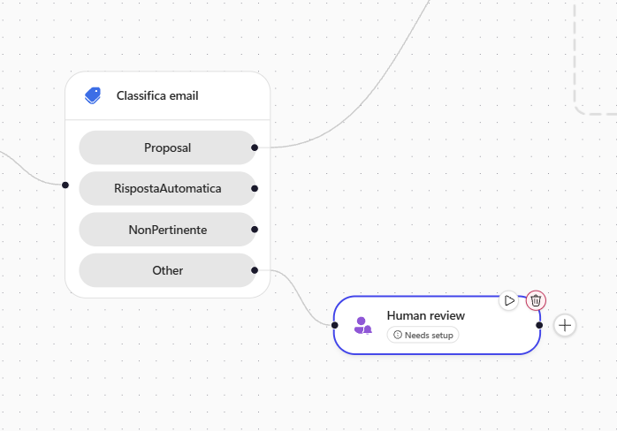
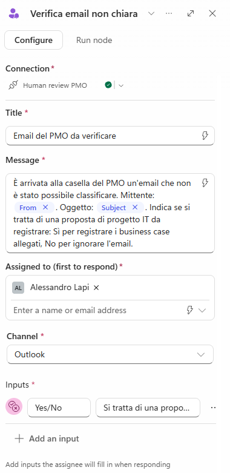
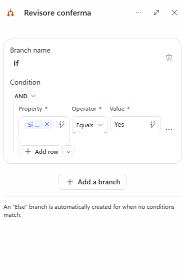
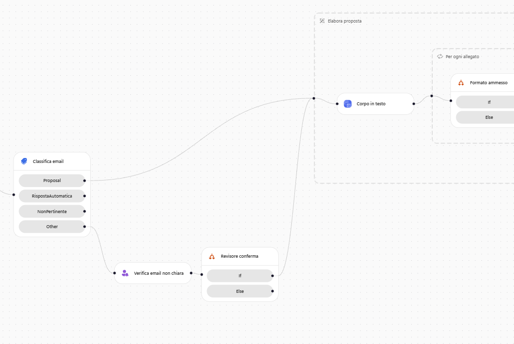
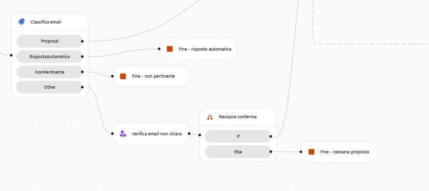
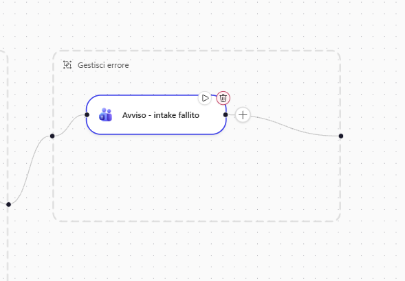
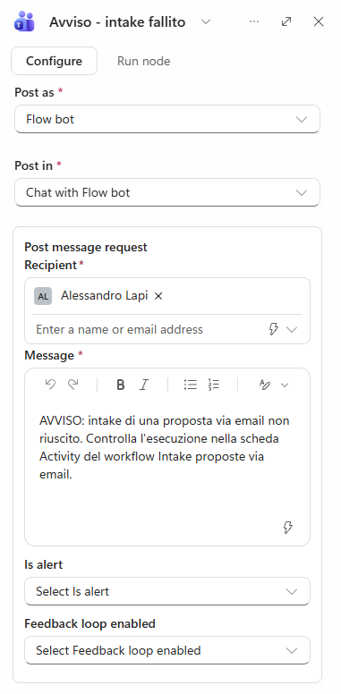
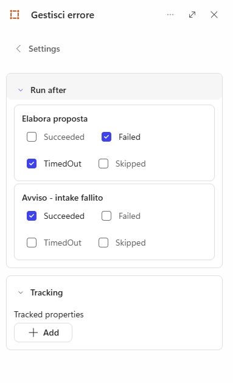
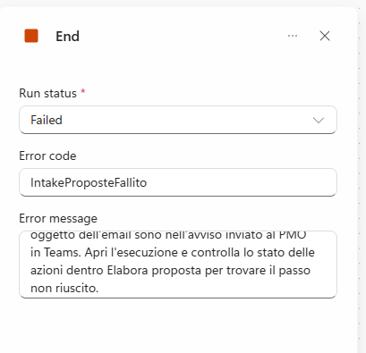

# Lab G09 - Supervisione umana e percorsi alternativi

[Previous: G08](../08-agenti-nel-workflow/README.md) | [Back to GitHub Harness](../index.md) | [Next: G10](../10-pianificazione-revisione/README.md)

<!-- icon: clock-countdown --> **Tempo stimato:** ~75 minuti · <!-- icon: github-logo f-github --> **Harness:** GitHub Copilot

## Scenario

Il workflow registra le proposte, legge i documenti, conferma il programma e avvisa il PMO. Funziona sul **percorso felice**: un'email chiara con un business case leggibile. Ma la casella del PMO riceve anche messaggi che Classify non sa collocare ("non so se questo documento debba seguire il processo dei business case"), e prima o poi una scrittura su Dataverse fallirà per un permesso cambiato o un servizio non disponibile. Oggi, in entrambi i casi, nessuno se ne accorge.

In questo lab viene aggiunta una **revisione umana** per le email non classificabili, vengono chiusi in modo esplicito i rami che non devono fare nulla e si costruisce un **try/catch** che avvisa il PMO in Teams e segna l'esecuzione come fallita. Poi si rompe di proposito un passo per vedere che l'allarme funziona.

::: details <!-- icon: lightbulb f-instructions --> Perché questa scelta
- **Il ramo Other non deve perdere nulla.** Un'email che Classify non sa collocare potrebbe essere una proposta vera scritta male. Ignorarla significa perdere una richiesta di investimento; registrarla sempre significa riempire Dataverse di falsi positivi. Una persona decide in pochi secondi. Nella Standard Harness ([Lab S05](../../standard-harness/05-trigger-email/README.md)) lo stesso caso produceva un'email "da verificare manualmente" senza riprendere il processo; qui la risposta del revisore fa proseguire o fermare l'esecuzione stessa.
- **Rami chiusi in modo esplicito.** Quando lo Scope **Elabora proposta** diventa raggiungibile da due percorsi, i rami che non vi arrivano devono terminare con un nodo **End**: altrimenti il compilatore li considera incompleti e segna l'esecuzione come fallita anche per una semplice risposta automatica.
- **Un catch per tutto lo Scope.** Uno Scope è **Failed** se fallisce una qualunque azione al suo interno: un solo blocco "Gestisci errore", eseguito solo in caso di errore, copre scrittura della proposta, nota, agenti e scheda Teams.
- **Fallire in modo visibile.** Dopo l'avviso, il nodo **End** con stato **Failed** e un codice leggibile fa comparire l'esecuzione tra quelle fallite, nei filtri e nel monitoraggio. Un errore intercettato ma registrato come successo è peggio di un errore non gestito.
- **Provare l'allarme rompendo qualcosa.** Un catch mai eseguito è un'ipotesi, non una garanzia.
:::

## Che cosa si costruisce

Lo schema è lo stesso di G07: in questo lab si aggiungono i nodi indicati con (G09), cioè la revisione umana sul ramo **Other**, i nodi **End** che chiudono i rami inattivi e lo Scope **Gestisci errore** che avvisa il PMO e fa fallire l'esecuzione.



## Prerequisiti

Per svolgere questo lab occorre avere:

- completato il lab G08: workflow **Intake proposte via email** pubblicato con i due nodi Agent e la scheda Teams;
- una casella di prova sotto il proprio controllo. Il workflow pubblicato continua a controllare la casella ed elabora ogni email con "Proposta progetto" nell'oggetto;
- le email di prova [`email-04-richiesta-ambigua.txt`](../../../resources/advanced/email/email-04-richiesta-ambigua.txt) e [`email-01-proposta-singola.txt`](../../../resources/advanced/email/email-01-proposta-singola.txt).

## Gestire i percorsi alternativi

Per il quadro generale sui workflow vedere [Workflows overview](https://learn.microsoft.com/microsoft-copilot-studio/workflows-experience/flows-overview).

### Logica deterministica e probabilistica

Due tipi di logica sbagliano in modi diversi e richiedono tecniche diverse:

| Logica deterministica | Logica probabilistica |
| --- | --- |
| Scrivere una riga, salvare un file, inviare una scheda | Classificare un'email, confermare un programma |
| Riprovare l'errore temporaneo, segnare l'esecuzione come fallita, avvisare una persona | Chiedere a una persona **prima** di agire quando l'evidenza è ambigua |
| Si prova **rompendola di proposito** | Si prova **con input scomodi** |

### Chi decide di coinvolgere una persona

Ci sono due modi di coinvolgere una persona, che differiscono per **chi decide** che serve:

| | Nodo **Human review** (questo laboratorio) | **Request for information** (agente inline, G08) |
| --- | --- | --- |
| Chi decide di chiedere | **Chi costruisce il workflow**: è un passo su un ramo | **L'agente**, mentre ragiona |
| Quando scatta | Ogni volta che il ramo viene eseguito | Solo quando l'agente giudica ambigua l'evidenza |
| Testo della domanda | Fisso, scritto da chi costruisce il workflow | Scritto dall'agente per il caso specifico |
| Ideale per | Una situazione che si sa nominare ("non riesco a classificare l'email") | Una valutazione che non si può elencare in anticipo |

## Nodo "Verifica email non chiara"

Il ramo **Other** raccoglie le email che Classify non sa collocare. Sono poche, ma possono essere proposte vere scritte male: invece di ignorarle, il workflow chiede a una persona del PMO, con una domanda fissa e una risposta Sì o No. Per il funzionamento del nodo vedere [Request information from human review](https://learn.microsoft.com/microsoft-copilot-studio/flows-request-for-information).

### Aggiungere il nodo

1. Aprire il workflow. Sul ramo **Other** sotto **Classifica email** selezionare **+** (**Add a step after Other**), poi **Human review** nel gruppo **Actions**. Il nodo viene aggiunto subito.



2. Selezionare il nodo: la casella **Connection** mostra **Human review** collegata. Se è il primo utilizzo, la connessione viene creata ora (è la stessa di G08).
3. Rinominare il nodo:

```text
Verifica email non chiara
```

### Scrivere la richiesta al revisore

1. Compilare i campi del nodo:

| Campo | Valore |
| --- | --- |
| **Title** | `Email del PMO da verificare` |
| **Assigned to (first to respond)** | scrivere il proprio nome e **selezionarlo dai risultati**: deve diventare un elemento con le iniziali |
| **Channel** | **Outlook** (predefinito) |

2. In **Message** incollare:

```text
È arrivata alla casella del PMO un'email che non è stato possibile classificare.

Mittente: @{triggerOutputs()?['body/from']}
Oggetto: @{triggerOutputs()?['body/subject']}

Indica se si tratta di una proposta di progetto IT da registrare:
- Sì: il workflow registra i business case allegati.
- No: l'email viene ignorata.
```

3. Controllare che mittente e oggetto siano diventati token (**From** e **Subject**). Se sono rimasti testo, cancellarli e inserirli con **Insert dynamic content**.

### Aggiungere la domanda Sì o No

1. Selezionare **Add an input** e scegliere il tipo **Yes/No**. Compare una riga con due campi.
2. Nel **primo campo** (il nome dell'input, cioè la domanda che il revisore vede) scrivere:

```text
Si tratta di una proposta da registrare?
```

3. Nel **secondo campo** (la descrizione, che di base mostra `Select yes or no`) scrivere:

```text
Sì per registrare i business case allegati, No per ignorare l'email
```



> [!IMPORTANT]
> **Nome dell'input**
>
> Il nome dell'input è quello che servirà nella sezione *Condizione "Revisore conferma"* per leggere la risposta: scriverlo esattamente così. Il tipo di un input non si cambia: se si sceglie il tipo sbagliato, eliminare la riga dal menu delle opzioni e aggiungerla di nuovo.

4. Selezionare **Save**.

## Condizione "Revisore conferma"

La risposta del revisore deve cambiare il percorso: Sì riporta l'email nell'elaborazione normale, No la chiude. Collegare il ramo allo Scope esistente evita di duplicare la logica; chiudere esplicitamente i rami che non vi arrivano evita che una semplice risposta automatica venga registrata come esecuzione fallita.

### Decidere in base alla risposta

1. Dopo **Verifica email non chiara** aggiungere **If/Else** e rinominarlo `Revisore conferma`.
2. Impostare la condizione:

| Campo | Valore |
| --- | --- |
| **Property** | **Insert dynamic content**, output **Si tratta di una proposta da registrare?** di **Verifica email non chiara** |
| **Operator** | **Equals** |
| **Value** | `Yes` |



> [!IMPORTANT]
> **Yes e non true**
>
> Scrivere `Yes`, non `true`. L'input è di tipo Sì/No, ma in esecuzione il nodo restituisce la **stringa** `"Yes"` o `"No"`: un confronto con il booleano `true` viene accettato dal designer e pubblicato, ma è sempre falso e il ramo non parte mai, senza alcun errore.

3. Collegare il ramo **If** al lavoro esistente: trascinare dal punto di uscita sul bordo destro di **Revisore conferma** al bordo sinistro dello Scope **Elabora proposta**. Lo Scope è ora raggiungibile da due percorsi: la categoria **Proposal** e la conferma del revisore.



### Chiudere i rami inattivi

Ora **Elabora proposta** si trova dopo un punto di unione. I rami **RispostaAutomatica**, **NonPertinente** e il ramo **Else** del revisore non vi arrivano: senza una fine esplicita il compilatore aggiunge un'interruzione nascosta e segna l'esecuzione come **Failed** (`PartialJoinNotReached`). Chiuderli:

1. **Add a step after Else** di **Revisore conferma**, cercare `End` e scegliere **End** sotto **Other**. **Run status**: **Succeeded**. Rinominare `Fine - nessuna proposta`.
2. Ripetere sul ramo **RispostaAutomatica** (`Fine - risposta automatica`) e sul ramo **NonPertinente** (`Fine - non pertinente`).



3. Selezionare **Save** e poi **Publish**.

## Scope "Gestisci errore"

Oggi, se la scrittura di una proposta fallisce, l'esecuzione si ferma e nessuno lo sa: il proponente crede di aver presentato la proposta, il PMO non la vede. Un blocco **Gestisci errore** che parte solo quando lo Scope fallisce avvisa il PMO in Teams e registra l'esecuzione come fallita, con un codice ricercabile. Per le pratiche generali di gestione degli errori vedere [Handle errors and exceptions in Azure Logic Apps](https://learn.microsoft.com/azure/logic-apps/error-exception-handling).

### Guardare le protezioni già presenti

1. Selezionare **Registra proposta**, menu delle opzioni, **Settings**. Nella sezione **Networking**, senza modificare nulla:

| Impostazione | Valore | Significato |
| --- | --- | --- |
| **Retry policy** | **Default** | Gli errori temporanei vengono già ritentati |
| **Timeout (ISO-8601)** | **PT1H** | Un'ora è il limite prima di abbandonare l'azione |
| **Pagination** | disattivo | Legge solo la prima pagina di risultati |
| **Async pattern** | attivo | Le chiamate lunghe vengono interrogate fino alla fine |

2. Tornare al pannello del nodo con la freccia accanto a **Settings**.

### Creare il blocco e l'avviso

1. Passare con il mouse su **Elabora proposta** e selezionare il **+** sul bordo destro (**Add a step after Elabora proposta**). Cercare `scope` e scegliere **Scope** sotto **Other**. Rinominarlo `Gestisci errore`.
2. Dentro **Gestisci errore** (**Add a step inside Gestisci errore**) cercare `post message` e scegliere **Microsoft Teams**, **Post message in a chat or channel** (vedere [Microsoft Teams connector reference](https://learn.microsoft.com/connectors/teams/)). Rinominare `Avviso - intake fallito`:



| Campo         | Valore                                                                                                                                        |
| ------------- | --------------------------------------------------------------------------------------------------------------------------------------------- |
| **Post as**   | **Flow bot**                                                                                                                                  |
| **Post in**   | **Channel**                                                                                                                                   |
| **Team**      | **Zava PMO**                                                                                                                                  |
| **Channel**   | **Proposte**                                                                                                                                  |
| **Message**   | `AVVISO: intake di una proposta via email non riuscito. Controlla l'esecuzione nella scheda Activity del workflow Intake proposte via email.` |

Stesso team e canale della scheda di G08: il PMO legge gli avvisi dove legge già le proposte.



3. Selezionare **Save**.

### Eseguire il blocco solo in caso di errore

1. Per far partire il catch solo in caso di errore, selezionare il contenitore **Gestisci errore**, menu delle opzioni, **Settings**, sezione **Run after**. Modificare **solo** la prima scheda, intitolata **Elabora proposta** (la seconda riguarda l'avviso interno):

| Stato | Impostazione |
| --- | --- |
| **Succeeded** | deselezionato (è selezionato per impostazione predefinita) |
| **Failed** | selezionato |
| **TimedOut** | selezionato |
| **Skipped** | deselezionato |



2. Tornare indietro e selezionare **Save**.

### Terminare con End Failed

1. Dopo **Avviso - intake fallito** (**Add a step after Avviso - intake fallito**) aggiungere **End**:

| Campo          | Valore                  |
| -------------- | ----------------------- |
| **Run status** | **Failed**              |
| **Error code**   | `IntakeProposteFallito` |
| **Error message** | il testo seguente       |

```text
Il workflow Intake proposte via email non ha completato lo Scope Elabora proposta. Mittente e oggetto dell'email sono nell'avviso inviato al PMO in Teams. Apri l'esecuzione e controlla lo stato delle azioni dentro Elabora proposta per trovare il passo non riuscito.
```

I campi **Error code** e **Error message** compaiono solo con stato **Failed** e accettano solo testo fisso, senza contenuto dinamico: per questo mittente e oggetto stanno nell'avviso in Teams e non qui.



2. Selezionare **Save**.

> [!TIP]
> **Il catch come ultimo passo**
>
> Tenere **Gestisci errore** come ultimo passo del ramo. Un passo che segue un passo **Skipped** viene a sua volta saltato: in un'esecuzione sana il catch è saltato e tutto ciò che sta dopo verrebbe saltato, con l'esecuzione comunque **Succeeded**. Se un giorno servirà un passo dopo il catch, nel suo **Run after** selezionare sia **Succeeded** sia **Skipped**: è la parte "finally" dello schema.

## Testare il workflow

Si provano entrambe le risposte del revisore con la stessa email, inviata due volte: la prima si risponde No, la seconda Sì. Così si confrontano due esecuzioni identiche che differiscono solo per la decisione umana. Il workflow non offre **Resubmit**, quindi per ripetere un'esecuzione si invia di nuovo l'email.

### Risposta No

1. Inviare alla casella monitorata l'email qui sotto con [`BC-03_Assistente_AI_servizio_clienti.pdf`](../../../resources/advanced/business-case/BC-03_Assistente_AI_servizio_clienti.pdf) allegato (il trigger parte solo con allegati).

Email 04. **Oggetto**:

```text
Proposta progetto? domanda sul processo
```

**Allegati** (da [`resources/advanced/business-case`](../../../resources/advanced/business-case/)): `BC-03_Assistente_AI_servizio_clienti.pdf`

**Corpo**:

```text
Ciao,

non so se questo documento debba seguire il processo dei business case oppure se basta una richiesta al servizio IT.
Vi allego una bozza su cui il nostro team sta ancora lavorando: per ora vorrei solo capire quale strada seguire.

Elena Russo
Responsabile Customer Service
```

2. In **Activity** aprire l'esecuzione: **Classifica email** ha scelto **Other** e **Verifica email non chiara** è **Waiting**, come i passi successivi. L'esecuzione resta così finché una persona non risponde: non è bloccata e non scade da sola.
3. Nella casella indicata in **Assigned to** trovare la richiesta (controllare anche **Altra posta** e **Posta indesiderata**). La scheda mostra titolo, messaggio con mittente e oggetto, la domanda e il pulsante **Submit**.
4. Selezionare **No** e **Submit** sulla scheda (rispondere all'email non riprende l'esecuzione; se i pulsanti non rispondono, selezionare **Mostra contenuto**).
5. In **Activity** l'esecuzione termina **Succeeded**: **Fine - nessuna proposta** è verde, **Elabora proposta** e tutto il suo contenuto sono **Skipped**. Nel PMO Demand Hub non c'è una nuova proposta.

### Risposta Yes

1. Inviare di nuovo alla casella monitorata l'**email 04** di sopra, con lo stesso oggetto, corpo e allegato.
2. Quando arriva la nuova richiesta, rispondere **Yes** e selezionare **Submit**.
3. Questa volta **Fine - nessuna proposta** è **Skipped** ed **Elabora proposta** esegue tutto il percorso: proposta registrata, agente inline (che per BC-03 potrebbe chiedere anche il programma: rispondere **PG-300**), Agente Demand IT e scheda in Teams.
4. Selezionare **Revisore conferma** e leggere **Inputs**: `{ "expressionResult": true }`.
5. Se BC-03 era già nel PMO Demand Hub da G05 o G08, l'agente lo segnala come possibile duplicato nel risultato: eliminare la proposta appena creata e tenere quella precedente.

> [!NOTE]
> **Agente in attesa di una risposta**
>
> Un nodo Agent pubblica il registro delle attività solo quando **termina**: un agente in attesa di una risposta umana non mostra nulla. Non annullare l'esecuzione per "vedere che cosa sta facendo": annullarla cancella il registro. Dare la risposta che sta aspettando.

### Risposte automatiche e newsletter

1. Controllare in **Activity** che le esecuzioni di risposte automatiche e newsletter (le email 02 e 03 di G07, se inviate) terminino **Succeeded** con il rispettivo nodo **End**.

### Errore dentro Elabora proposta

Un sistema di allarme mai provato è solo un'ipotesi. Si rompe di proposito un'espressione dentro lo Scope, si verifica che l'avviso arrivi e che l'esecuzione risulti fallita con il codice previsto, poi si ripristina il valore corretto.

1. Dentro **Elabora proposta** selezionare **Registra proposta**. In **Title** rimuovere il token **Name**, passare in modalità espressione e inserire:

```text
int('not-a-number')
```

Confermare con **Insert**. L'espressione è valida, quindi si salva e si pubblica; in esecuzione non si può convertire `not-a-number` in numero e l'azione fallisce con `InvalidTemplate` prima di chiamare Dataverse.

2. Selezionare **Save** e **Publish**. Lo stato passa da **Draft** a **Published**; se resta **Draft**, aprire l'**Health Center** e risolvere ciò che segnala.
3. Armare il trigger e inviare l'email qui sotto con il PDF di BC-01 ([`BC-01_Portale_fornitori_self-service.pdf`](../../../resources/advanced/business-case/BC-01_Portale_fornitori_self-service.pdf)): il testo è una proposta chiara, così Classify sceglie **Proposal** e l'errore viene solo dall'espressione.

Email 01. **Oggetto**:

```text
Proposta progetto - Portale fornitori self-service
```

**Allegati** (da [`resources/advanced/business-case`](../../../resources/advanced/business-case/)): `BC-01_Portale_fornitori_self-service.pdf`

**Corpo**:

```text
Buongiorno,

invio il business case per il portale fornitori self-service dell'Ufficio Acquisti, da valutare nel programma PG-100 Trasformazione Digitale dei Processi.
Lo sponsor interno è Roberto Conti, Direttore Amministrazione, Finanza e Controllo.

Grazie,
Giulia Ferrari
Responsabile Ufficio Acquisti
```

4. In **Activity** aprire l'esecuzione:
   - **Elabora proposta** e **Registra proposta** sono **Failed**;
   - **Avviso - intake fallito** ed **End** sono **Succeeded**;
   - **Gestisci errore** è **Cancelled**, perché **End** termina il contenitore dopo l'avviso;
   - l'esecuzione complessiva è **Failed** con codice `IntakeProposteFallito`.
5. Selezionare **Registra proposta**, **Run Details**: compare `InvalidTemplate`. **Inputs** e **Outputs** sono vuoti perché l'espressione è fallita prima che il connettore ricevesse dati.
6. In Teams, nel canale **Proposte** del team **Zava PMO**, si trova il messaggio di avviso.

### Ripristinare il passo

1. In **Title** passare in modalità espressione, sostituire l'espressione con quella seguente e selezionare **Insert**:

```text
items('Per_ogni_allegato')?['name']
```

Il campo mostra di nuovo il token **Name**.

2. Selezionare **Save** e **Publish**.
3. Controllare che il titolo di **Registra proposta** sia stato ripristinato e che il workflow sia pubblicato.

> [!NOTE]
> **Workflow da lasciare pubblicato**
>
> Lasciare il workflow pubblicato: G10 e G11 non lo usano, ma l'end to end finale sì. Quando non serve più, aprire **Workflows**, menu della riga **Intake proposte via email**, **Turn off**: lo stato torna **Draft** e un nuovo **Publish** lo riattiva.

> [!IMPORTANT]
> **Lab Completato**
>
> Il workflow ora chiede a una persona quando non sa classificare un'email e prosegue o si ferma in base alla risposta, chiude esplicitamente i rami che non devono fare nulla e, se un passo dello Scope fallisce, avvisa il PMO in Teams e registra l'esecuzione come fallita. In questo lab si è visto:
>
> - come fermare un workflow per una revisione umana e decidere in base alla risposta;
> - perché i rami che non arrivano a un punto di unione vanno chiusi con **End**;
> - come costruire un try/catch con **Scope** e **Run after** e registrare l'errore in modo visibile;
> - come provare la gestione degli errori rompendo un passo di proposito e leggendo l'esecuzione.
