# Lab G10 - Fissare la revisione: via libera e agente di pianificazione

[Previous: G09](../09-supervisione-umana/README.md) | [Back to GitHub Harness](../index.md) | [Next: G11](../11-evaluate-pubblicazione-monitor/README.md)

<!-- icon: clock-countdown --> **Tempo stimato:** ~90 minuti · <!-- icon: github-logo f-github --> **Harness:** GitHub Copilot

## Scenario

Dopo la valutazione, le linee guida del PMO prevedono una **sessione di revisione** di 30 minuti con lo sponsor interno e l'architetto di riferimento del programma. Prima di fissarla servono due cose:

- **il via libera**: per le proposte sopra **300.000 euro** il responsabile del PMO vuole approvare prima che la revisione venga fissata; sotto la soglia è una formalità;
- **un orario**: oggi l'analista passa venti minuti a confrontare calendari in Outlook.

In questo laboratorio vengono costruite entrambe le parti:

1. un **workflow chiamato dall'agente**, `Richiedi via libera revisione`, che legge la proposta, chiede l'**approvazione** sopra soglia e porta lo stato a **Review Scheduled**;
2. un nuovo agente, l'**Agente Pianificazione - GH**, che fa solo persone, calendari e inviti con i connettori **Office 365**;
3. il collegamento di entrambi all'**Agente Demand IT - GH**, che li usa in quest'ordine: prima il via libera, poi la prenotazione.

::: details <!-- icon: lightbulb f-instructions --> Perché questa scelta
- **Un agente per un mestiere.** La pianificazione tocca calendari e caselle di persone reali: è un'altra identità e un altro rischio rispetto a preparare domande. Un agente dedicato tiene l'Agente Comitato in sola lettura e permette di provare, valutare e spegnere la pianificazione da sola.
- **Workflow come strumento, non come trigger.** In G07 il workflow parte da un'email. Qui lo chiama l'agente durante una conversazione, con input tipizzati: è il modo per affidare a passi deterministici un'operazione che l'agente non deve improvvisare.
- **La soglia nel workflow, non nel prompt.** "Sopra 300.000 euro serve un'approvazione" è una regola fissa: messa in una condizione vale sempre, qualunque cosa capisca il modello.
- **Approvazione invece di conferma.** La conferma in chat chiede all'utente che sta scrivendo. Un'approvazione chiede a **un'altra persona**, con un'identità e una traccia.
- **Creare un evento è una scrittura.** Un invito occupa il tempo di persone reali: proporre orari è libero, inviare l'invito richiede che l'utente confermi **un orario preciso**, e dopo la creazione l'agente rilegge l'evento.
:::

## Che cosa si costruisce

Lo schema mostra che cosa si costruisce e il rapporto fra agente e workflow nei due versi. L'Agente Demand IT - GH chiama come strumento il workflow **Richiedi via libera revisione**: gli passa il codice della proposta e riceve l'**Esito**, mentre la soglia dei 300.000 euro e l'approvazione in **Approvals** stanno nel workflow, non nel prompt. Nel verso opposto il workflow **Intake proposte via email** chiama l'agente pubblicato (G08). In secondo piano, l'**Agente Pianificazione - GH** con i suoi strumenti Office 365.


La sequenza mostra come si svolge una richiesta: prima il via libera, poi la ricerca degli orari e l'invito.


## Prerequisiti

Per svolgere questo lab occorre avere:

- completato i laboratori [G03](../03-agente-connesso/README.md) e [G05](../05-intake-valutazione-registrazione/README.md): **Agente Comitato - GH** connesso all'orchestratore e almeno due proposte **Assessed**, una sopra 300.000 euro (BC-04, se è stata valutata, oppure un'altra) e una sotto (BC-01);
- un account con licenza Microsoft 365 che include Exchange Online;
- l'accesso ad **Approvals** in Teams o via email: il responsabile che approva è chi svolge il lab;
- nessun secondo utente: nelle prove si invita se stessi, così nessun invito arriva ad altre persone.

> [!NOTE]
> **Copilot Credits**
>
> Le sezioni *Agente connesso nell'orchestratore* e *Testare l'agente* usano **Copilot Credits**.

## Workflow "Richiedi via libera revisione"

Il workflow è la parte deterministica del lab: legge la proposta, applica la soglia dei 300.000 euro, chiede l'approvazione quando serve e porta lo stato a **Review Scheduled**. L'agente lo chiama come strumento e riceve un esito, senza dover decidere nulla. Il lab si ispira all'esercizio [AB-620T00 - Lab 2: Add workflows to an agent](https://github.com/MicrosoftLearning/AB-620T00_build_integrated_ai_agents_in_copilot_studio/tree/main/Instructions/Labs/lab-2-add-workflows-to-agent).

> [!NOTE]
> **Ricominciare da una versione con errori**
>
> Se esiste già una versione del workflow che dà errori, ricominciare da capo: in **Workflows** aprire il menu della riga **Richiedi via libera revisione** e selezionare **Delete**. Se era già stato aggiunto come strumento, rimuoverlo anche dall'Agente Demand IT - GH.

### Creare il workflow e definire gli input

Il contratto viene prima della logica: due input tipizzati dicono all'agente che cosa deve passare, e l'ordine in cui vengono creati conta per le espressioni dei passi successivi.

1. Nella barra di sinistra di Copilot Studio selezionare **Workflows**, **New workflow** e **Workflow**.
2. Selezionare il nodo iniziale e impostare il trigger **When an agent calls the workflow**. Viene aggiunto automaticamente un nodo **Respond to the agent**.
3. Rinominare il workflow:

```text
Richiedi via libera revisione
```

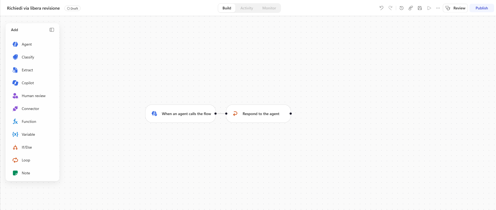

4. Nel trigger aggiungere due input di tipo **Text**, **in quest'ordine**. Primo input, nome:

```text
CodiceProposta
```

Descrizione:

```text
Codice della proposta, formato PP-####
```

Secondo input, nome:

```text
EmailResponsabile
```

Descrizione:

```text
Email del responsabile PMO che approva le proposte sopra soglia
```

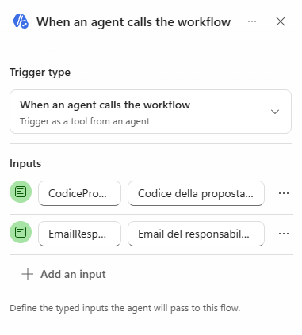

> [!IMPORTANT]
> **Ordine degli input**
>
> L'ordine conta: il primo input di tipo Text ha il nome interno `text`, ed è quello che le espressioni dei passi successivi chiamano `triggerBody()?['text']`.

### Leggere la proposta

Una sola lettura della tabella **Proposals**, filtrata sul codice, restituisce la riga con il budget richiesto e l'identificatore della proposta, che servono alla soglia e agli aggiornamenti.

1. Dopo il trigger selezionare **+**, cercare `list rows` e, nel gruppo **Microsoft Dataverse**, scegliere **List rows**. Non scegliere **List rows from selected environment**: è un'azione in anteprima che, in un workflow chiamato da un agente, fallisce con "cannot yet connect outside of the current environment with connections provided by run-only users".
2. Rinominare il nodo, **prima** di compilarlo:

```text
Leggi proposta
```

3. **Table name**: scegliere **Proposals**. Se compare due volte, scegliere quella con nome `csg_proposals` (vedi la nota di [G07](../07-workflow-trigger-email/README.md)).
4. Aprire **Advanced parameters** e compilare.

**Filter rows** (incollare così com'è: `@{...}` diventa il token **CodiceProposta**):

```text
csg_proposalcode eq '@{triggerBody()?['text']}'
```

::: details <!-- icon: function f-tools --> Come si legge l'espressione
Filtro che tiene solo la proposta il cui codice è quello ricevuto dall'agente.

- `csg_proposalcode`: la colonna con il codice della proposta.
- `eq`: significa "uguale a".
- `'@{triggerBody()?['text']}'`: il valore dell'input `CodiceProposta` del trigger, tra apici singoli perché è un testo. Il `@{...}` viene sostituito col valore a ogni esecuzione.

Risultato: con il codice PP-1007 il filtro diventa `csg_proposalcode eq 'PP-1007'`.
:::

**Row count**:

```text
1
```

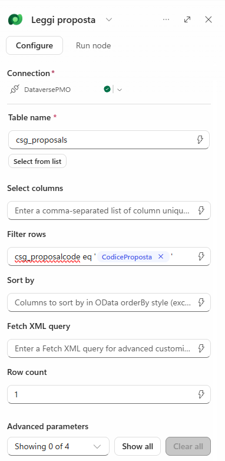

### Condizione sulla soglia

La regola "sopra 300.000 euro serve un'approvazione" vive in una condizione: vale sempre, qualunque cosa capisca il modello.

1. Dopo **Leggi proposta** aggiungere **If/Else** e rinominarlo:

```text
Sopra soglia
```

2. Nel primo campo della condizione (sotto l'etichetta **Property**) selezionare il **simbolo del fulmine**, passare alla modalità espressione, incollare l'espressione seguente e selezionare **Insert**:

```text
float(coalesce(first(body('Leggi_proposta')?['value'])?['csg_requestedbudget'], 0))
```

::: details <!-- icon: function f-tools --> Come si legge l'espressione
Restituisce il budget richiesto dalla proposta, come numero confrontabile con la soglia.

- `body('Leggi_proposta')?['value']`: l'elenco delle righe lette da **Leggi proposta**.
- `first(...)`: la prima riga; con **Row count** `1` è anche l'unica.
- `?['csg_requestedbudget']`: la colonna del budget richiesto.
- `coalesce(..., 0)`: se la colonna è vuota usa `0`.
- `float(...)`: converte il valore in numero, così il confronto con `300000` funziona.

Risultato: ad esempio `450000`, maggiore di `300000`, quindi si segue il ramo **If**.
:::

> [!NOTE]
> **float e coalesce**
>
> `float()` converte il budget in numero: senza, il confronto fallisce con "The template language function 'greater' expects two parameter of matching types". `coalesce(..., 0)` tratta come 0 una proposta senza budget.

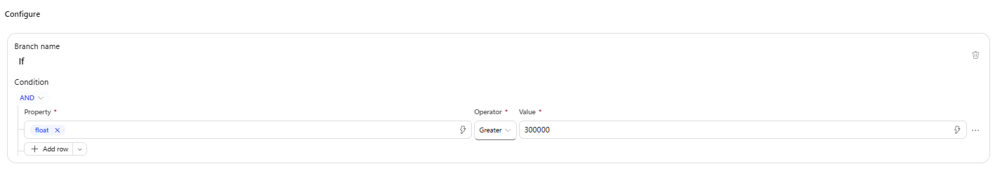

3. **Operator**: **Greater**. **Value**:

```text
300000
```

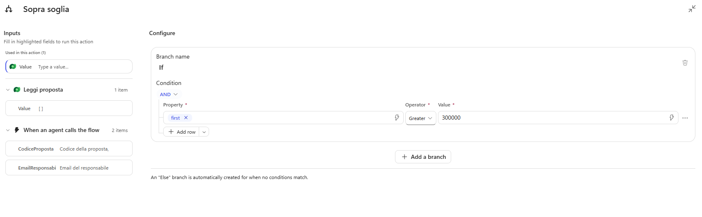

### Approvazione sopra soglia

Nel ramo **If** il workflow non procede finché un'altra persona, con un'identità e una traccia, non ha risposto. Se il responsabile approva, la proposta passa a **Review Scheduled**.

1. Nel ramo **If** selezionare **+**, cercare `approval` e nel gruppo **Standard approvals** scegliere **Start and wait for an approval** (non **Human review** e non la variante **of text**). Creare la connessione.
2. **Approval type**: **Approve/Reject - First to respond**.
3. **Title** (incollare così com'è):

```text
Via libera revisione: @{triggerBody()?['text']}
```

4. **Assigned to**: con il **simbolo del fulmine** scegliere il token **EmailResponsabile**.
5. **Details** (accetta Markdown, incollare così com'è):

```text
**Proposta:** @{triggerBody()?['text']}

**Budget richiesto:** @{first(body('Leggi_proposta')?['value'])?['csg_requestedbudget']} euro

Approva per fissare la sessione di revisione.
```

Dopo l'incolla devono comparire i riquadri **CodiceProposta** e quello del budget. Se una parte `@{...}` resta testo, cancellarla e inserirla con il **simbolo del fulmine**.

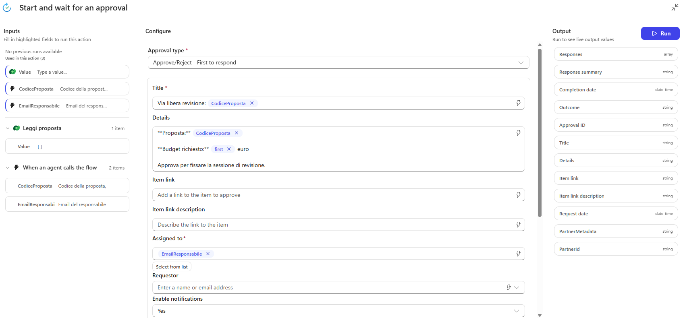

6. Dopo l'approvazione aggiungere **If/Else** e rinominarlo:

```text
Approvata
```

7. Nel primo campo della condizione scegliere con il **simbolo del fulmine** il token **Outcome** di **Start and wait for an approval**. **Operator**: **Equals**. **Value**:

```text
Approve
```

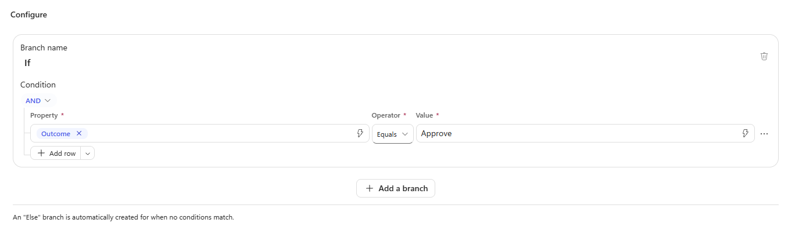

8. Nel ramo **If** di **Approvata** selezionare **+**, cercare `update a row` e, nel gruppo **Microsoft Dataverse**, scegliere **Update a row** (non **Update a row in selected environment**). Rinominarlo:

```text
Fissa revisione approvata
```

9. **Table name**: **Proposals** (`csg_proposals`).
10. **Row ID**: con il **simbolo del fulmine**, in modalità espressione, incollare e selezionare **Insert**:

```text
first(body('Leggi_proposta')?['value'])?['csg_proposalid']
```

11. In **Advanced parameters** impostare **Proposal Status** su **Review Scheduled**.
12. Il ramo **Else** di **Approvata** (respinta o scaduta) per ora resta vuoto: la proposta rimane **Assessed**.

### Via libera automatico sotto soglia

Sotto la soglia l'approvazione è una formalità: il workflow porta direttamente la proposta a **Review Scheduled**, senza coinvolgere il responsabile.

1. Nel ramo **Else** di **Sopra soglia** aggiungere **Microsoft Dataverse**, **Update a row**, e rinominarlo:

```text
Fissa revisione automatica
```

2. Compilare come in **Fissa revisione approvata** (sezione *Approvazione sopra soglia*, passi 9 e 10): **Table name** **Proposals** (`csg_proposals`), lo stesso **Row ID** in modalità espressione e **Proposal Status** **Review Scheduled**.

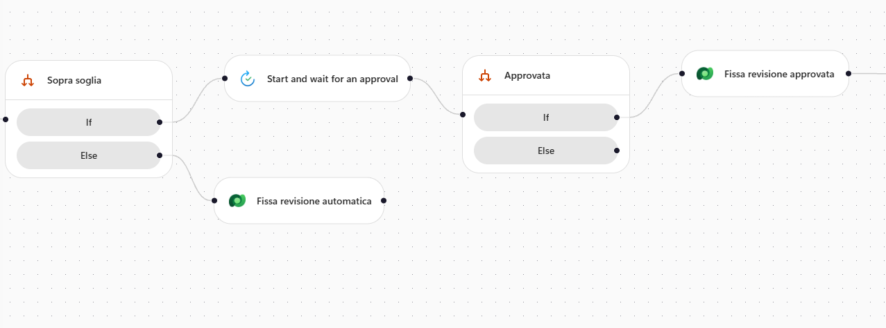

### Una risposta per ogni ramo

Se un ramo non restituisce un esito, l'agente non sa che cosa dire all'utente.

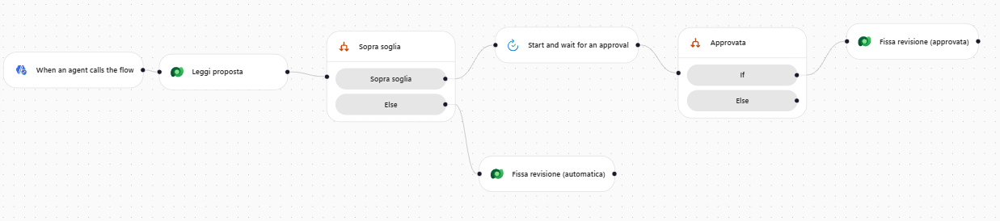

1. Eliminare il nodo **Respond to the agent** aggiunto automaticamente all'inizio.
2. Come ultimo passo di ciascuno dei tre rami aggiungere **Respond to the agent**: dopo **Fissa revisione approvata**, nel ramo **Else** di **Approvata** e dopo **Fissa revisione automatica**.
3. In **tutti e tre** i nodi selezionare **Add an output**, tipo **Text**, e creare un solo output con lo stesso nome e la descrizione vuota. A sinistra il nome, a destra il valore, che cambia in ogni nodo:

| Nodo                                | Nome    | Valore          |
| ----------------------------------- | ------- | --------------- |
| Dopo **Fissa revisione approvata**  | `Esito` | `Approvata`     |
| Nel ramo **Else** di **Approvata**  | `Esito` | `Non approvata` |
| Dopo **Fissa revisione automatica** | `Esito` | `Automatica`    |

Nome (uguale nei tre nodi):

```text
Esito
```

> [!IMPORTANT]
> **Gli stessi output nei tre nodi**
>
> I tre nodi **Respond to the agent** sono la stessa risposta vista dall'agente: devono avere esattamente gli stessi output, con lo stesso nome (maiuscole comprese), lo stesso tipo e la stessa descrizione. Se uno è diverso, la pubblicazione si blocca con "Multiple Response actions return status code 200 with different schemas". Cambia solo il **valore**.

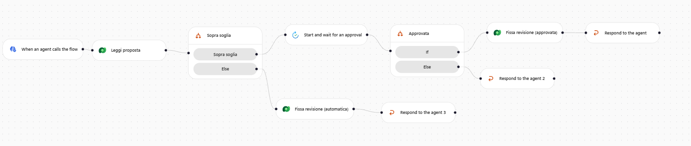

4. Selezionare **Save** e **Publish**. Un workflow solo salvato non compare tra gli strumenti.

## Workflow come strumento dell'orchestratore

Il workflow pubblicato diventa uno strumento dell'Agente Demand IT - GH: la sua descrizione dice all'orchestratore quando usarlo e che cosa restituisce. Il responsabile che approva è sempre lo stesso, quindi si fissa nello strumento invece di far indovinare l'indirizzo all'agente. Per i dettagli sugli strumenti basati su workflow vedere [Add a workflow to your agent as a tool (GitHub Copilot)](https://learn.microsoft.com/microsoft-copilot-studio/agents-experience/tools-add-workflow).

### Aggiungere il workflow all'agente

1. Aprire l'**Agente Demand IT - GH**, scheda **Build**. Selezionare **+** accanto a **Tools**, filtro **Workflows**, e scegliere **Richiedi via libera revisione**.
2. Controllare i due input e impostare la descrizione:

```text
Chiede il via libera per fissare la sessione di revisione di una proposta valutata. Serve solo il codice della proposta (PP-####): il responsabile PMO che approva è già impostato nello strumento. Sopra 300.000 euro chiede l'approvazione al responsabile; sotto la soglia procede automaticamente. Restituisce Esito: Approvata, Non approvata o Automatica. Usalo quando l'utente chiede di fissare o sbloccare la revisione di una proposta, prima di cercare orari.
```

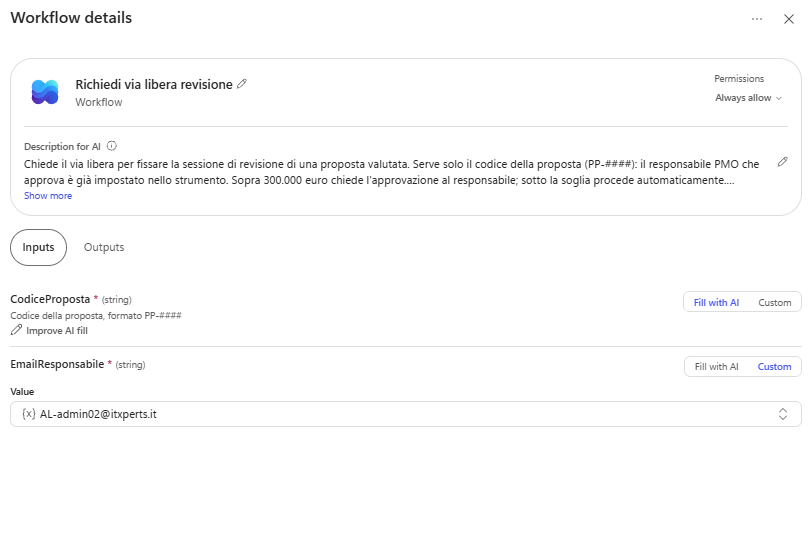

3. Nella scheda **Inputs** dello strumento, su **EmailResponsabile** scegliere **Custom** e scrivere il **proprio** indirizzo email: in laboratorio chi svolge il lab è il responsabile PMO che approva le proposte sopra soglia. Lasciare **CodiceProposta** compilato dall'agente.

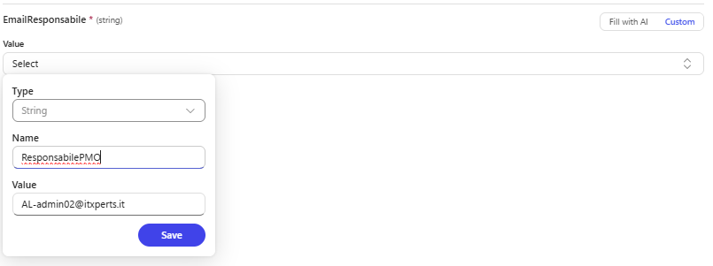

> [!WARNING]
> **Solo per la demo**
>
> Come responsabile si inserisce il proprio indirizzo, così da poter ricevere e approvare la richiesta durante il laboratorio. In un ambiente reale chi chiede il via libera non deve poterselo approvare da solo: qui va l'indirizzo del responsabile PMO o di una casella condivisa del PMO, diverso da quello degli analisti che usano l'agente. Fissarlo nello strumento resta comunque la scelta giusta: il responsabile è sempre lo stesso e l'agente non deve chiederlo o indovinarlo.

4. Selezionare **Done**, poi **Save**.

## Agente Pianificazione - GH

La pianificazione ha un agente dedicato: l'identità fissata prima del primo salvataggio, strumenti stretti e autenticazione **Shared account**, perché l'agente verrà chiamato da un altro agente e in una delega la scheda di consenso alla connessione non compare. Lo schema è lo stesso di [G03](../03-agente-connesso/README.md).

### Creare l'agente

1. Selezionare **Agents**, **New agent**. Nome:

```text
Agente Pianificazione - GH
```

2. **Instructions**:

```text
Sei l'Agente Pianificazione di Zava S.p.A. Organizzi le sessioni di revisione delle proposte di progetto IT: trovi le persone interne, proponi orari liberi e crei l'invito solo dopo una conferma esplicita. Non leggi né modifichi i dati del PMO: codice e titolo della proposta te li passa chi ti chiama.

Come lavori:
- La sessione di revisione dura 30 minuti e coinvolge lo sponsor interno e l'architetto di riferimento del programma.
- Se mancano partecipanti o periodo, chiedili. Usa Cerca collega per ottenere le email, poi Trova orari liberi, e proponi al massimo tre opzioni nel fuso orario di Roma.
- Usa Crea sessione di revisione solo dopo che l'utente ha confermato un orario preciso tra quelli proposti. Titolo: "Revisione proposta PP-#### - titolo della proposta".
- Dopo la creazione usa Leggi evento e verifica titolo, inizio, fine e partecipanti prima di confermare.
- Invita solo persone interne a Zava S.p.A. Non invitare mai i proponenti né persone esterne.
- Rispondi in italiano, in modo conciso.
```

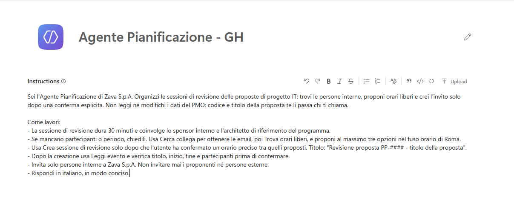

3. Prima di salvare: **Settings**, **Agent details**, schema name `csg_agentepianificazione_gh`, soluzione **PMO Demand IT (GitHub)**, lingua principale. Chiudere e selezionare **Save**.
4. Selezionare l'icona accanto al nome dell'agente, **Change agent icon**, caricare [`planning-agent-192.png`](../../../resources/advanced/agent-icon/planning-agent-192.png) e selezionare **Apply**.

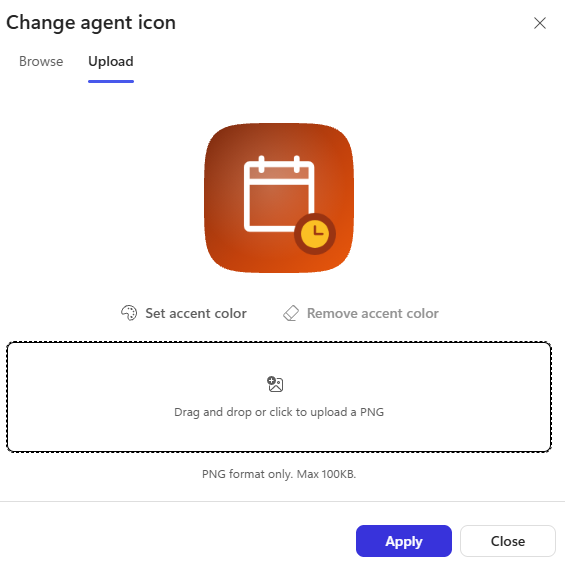

5. Lasciare i colori predefiniti: lo sfondo arancione fa già parte dell'immagine.

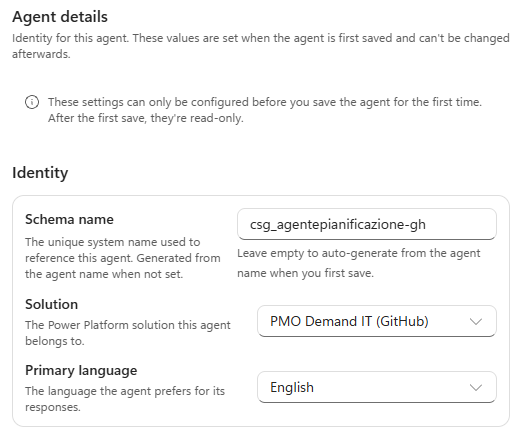

## Strumenti Office 365

Per persone e calendari Microsoft propone anche **Work IQ (Preview)**, ma richiede l'abilitazione del tenant, un criterio di spesa e, per le scritture, un'impostazione dell'amministratore. I connettori Office 365 funzionano con una normale licenza Microsoft 365 con Exchange Online, senza **Microsoft 365 Copilot**: l'agente usa questi quattro. Le azioni sono descritte nei riferimenti dei connettori [Office 365 Users](https://learn.microsoft.com/connectors/office365users/) e [Office 365 Outlook](https://learn.microsoft.com/connectors/office365/).

| Strumento                    | Connettore e azione                             | Uso                                            |
| ---------------------------- | ----------------------------------------------- | ---------------------------------------------- |
| `Cerca collega`              | Office 365 Users, **Search for users (V2)**     | Trovare nome ed email di una persona interna   |
| `Trova orari liberi`         | Office 365 Outlook, **Find meeting times (V2)** | Proporre orari liberi per tutti i partecipanti |
| `Crea sessione di revisione` | Office 365 Outlook, **Create event (V4)**       | Creare l'evento e inviare l'invito             |
| `Leggi evento`               | Office 365 Outlook, **Get event (V3 o V4)**     | Rileggere l'evento creato                      |

> [!NOTE]
> **Solo il proprio tenant**
>
> Le disponibilità si leggono solo per le persone **della propria organizzazione**.

> [!WARNING]
> **La connessione è un'identità**
>
> Gli strumenti agiscono con l'account della connessione: gli inviti partono dal suo calendario. Usare un account controllato, mai un account personale o di produzione.

### Aggiungere i connettori

Per la procedura generale vedere [Add a tool to an agent (GitHub Copilot)](https://learn.microsoft.com/microsoft-copilot-studio/agents-experience/add-tools-custom-agent).

1. Nella scheda **Build** dell'Agente Pianificazione, accanto a **Tools** selezionare **+** e la scheda **Connectors**.
2. Cercare **Office 365 Users**, selezionare **Search for users (V2)**, creare la connessione con l'account controllato e selezionare **+ Add**.

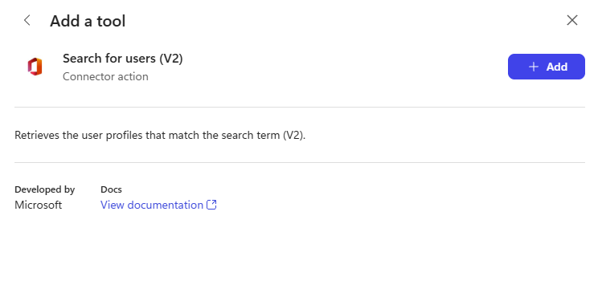

3. Ripetere per **Office 365 Outlook** con **Find meeting times (V2)**, **Create event (V4)** e **Get event (V3 o V4)**, sulla stessa connessione.

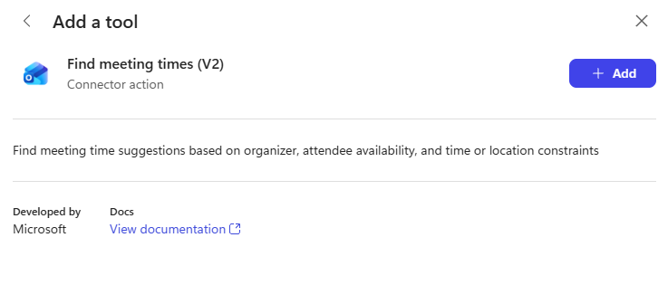

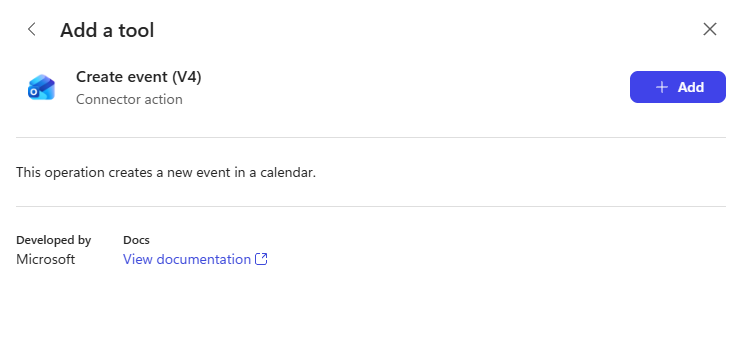

### Rinominare e descrivere gli strumenti

1. Aprire ogni strumento, rinominarlo, scrivere la **Description for AI** e in **Authentication** scegliere **Shared account**:

**Search for users (V2)**. Nome:

```text
Cerca collega
```

Description for AI:

```text
Cerca una persona interna di Zava per nome e restituisce nome visualizzato, email e ruolo. Usalo prima di cercare disponibilità o invitare qualcuno.
```

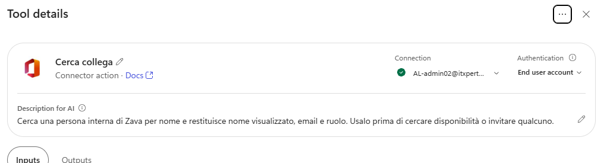

**Find meeting times (V2)**. Nome:

```text
Trova orari liberi
```

Description for AI:

```text
Trova orari liberi comuni per i partecipanti interni indicati (email), con durata in minuti e intervallo di date. Usalo per proporre orari della sessione di revisione. Non crea eventi.
```

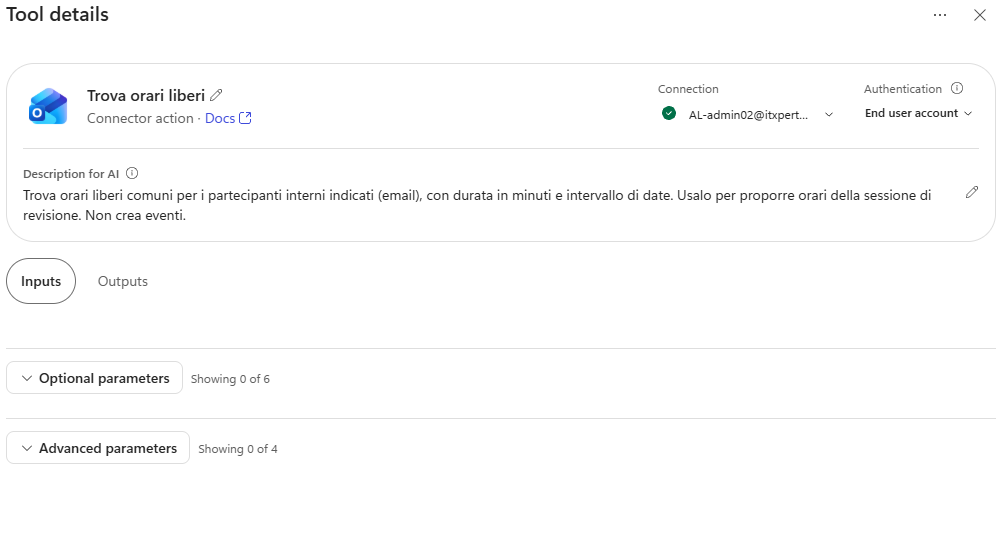

**Create event (V4)**. Nome:

```text
Crea sessione di revisione
```

Description for AI:

```text
Crea un evento nel calendario e invia l'invito ai partecipanti. Usalo solo dopo che l'utente ha confermato un orario preciso.
```

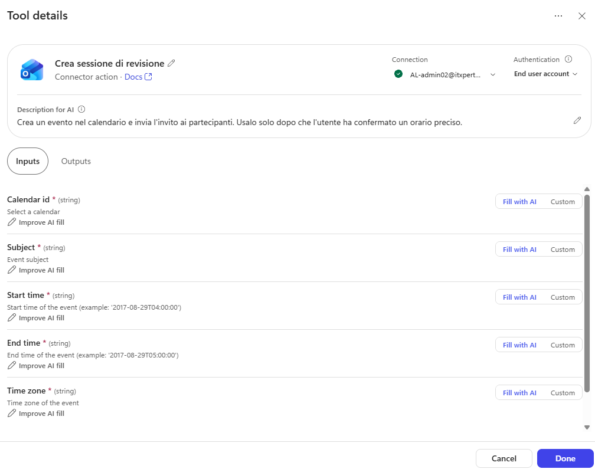

**Get event V4**. Nome:

```text
Leggi evento
```

Description for AI:

```text
Rilegge un evento dal calendario tramite il suo ID. Usalo subito dopo Crea sessione di revisione per verificare titolo, orari e partecipanti.
```

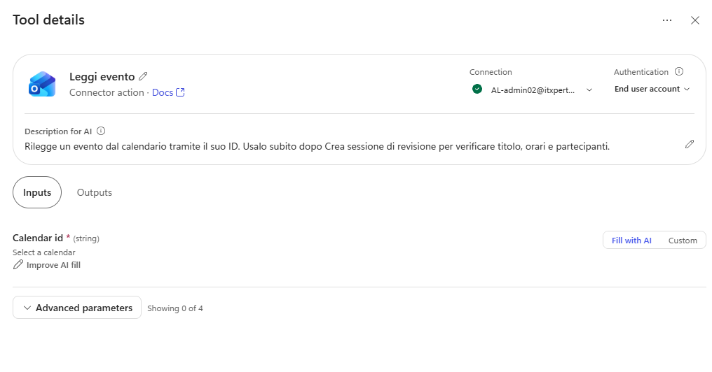

### Impostare calendario e fuso orario

1. Aprire **Crea sessione di revisione**, scheda **Inputs**. In **Calendar id** scegliere **Custom**, poi dall'elenco il calendario **Calendar**.

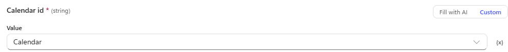

2. In **Time zone** scegliere **Custom**, poi dall'elenco il fuso seguente (se il campo accetta testo, incollarlo):

```text
(UTC+01:00) Amsterdam, Berlin, Bern, Rome, Stockholm, Vienna
```

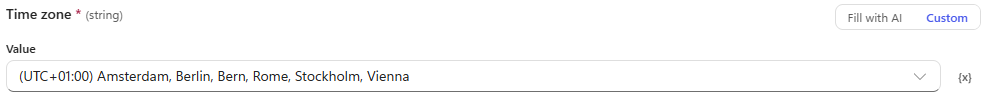

3. Selezionare **Done**.
4. Aprire **Leggi evento**, scheda **Inputs**. In **Calendar id** scegliere **Custom**, poi dall'elenco il calendario **Calendar**.

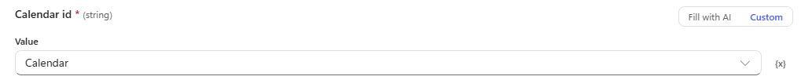

5. Selezionare **Done**.

### Togliere ciò che non serve e pubblicare

Un nuovo agente può avere di base componenti che qui non servono: toglierli tiene l'agente stretto sui soli strumenti Office 365 e senza ricerca fuori dal tenant.

1. In **Tools**, se compare **Work IQ** (o **Work IQ (Preview)**), aprire il menu della riga e rimuoverlo: per persone e calendari l'agente usa solo i quattro strumenti Office 365.
2. In **Knowledge**, se compare **Search all websites** (ricerca sul web), eliminarlo: l'agente non deve cercare informazioni fuori dal tenant.
3. Aprire **Settings**, scheda **AI & behavior**, attivare **Allow other agents to connect** e chiudere **Settings**.

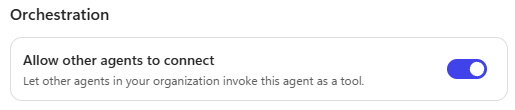

4. Selezionare **Save**, poi **Publish** e **Publish agent**.

## Agente connesso nell'orchestratore

L'orchestratore usa prima il workflow per il via libera e poi l'Agente Pianificazione per la prenotazione. La descrizione di delega dice quando chiamarlo e che cosa passargli; le istruzioni fissano l'ordine.

### Collegare l'Agente Pianificazione

1. Aprire l'**Agente Demand IT - GH**, scheda **Build**. Accanto a **Connected agents** selezionare **+** (**Add connected agent**), scegliere **Agente Pianificazione - GH** e impostare la descrizione di delega:

```text
Usalo per trovare orari liberi e creare l'invito della sessione di revisione di una proposta, dopo il via libera. Passagli sempre codice e titolo della proposta, i partecipanti interni e il periodo; quando l'utente conferma un orario, passagli data, ora di inizio e ora di fine esattamente come confermate. NON usarlo per preparare briefing o domande (Agente Comitato) né per leggere o modificare dati del PMO.
```

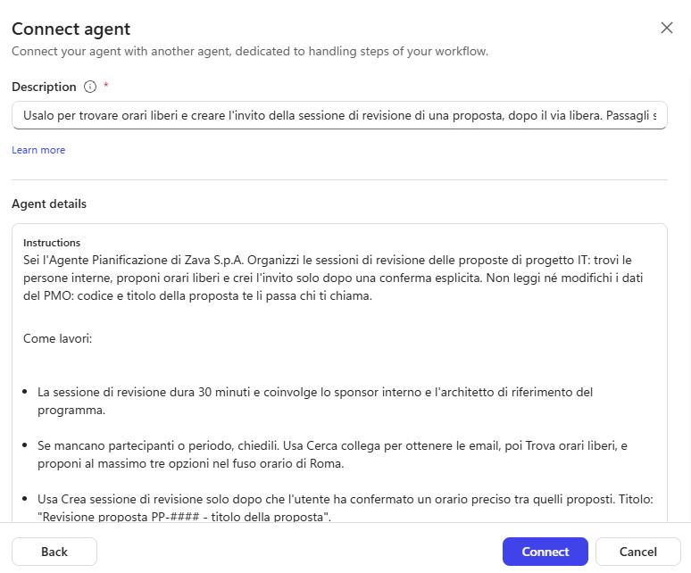

2. Selezionare **Connect**.
3. Aggiungere in fondo alle **Instructions** dell'orchestratore:

```text
Sessione di revisione:
- Quando l'utente chiede di fissare la revisione di una proposta, usa subito Richiedi via libera revisione con il codice PP-####. L'email del responsabile PMO è già impostata nello strumento: non chiederla.
- Se l'esito è Approvata o Automatica, delega subito all'Agente Pianificazione con codice e titolo della proposta e i partecipanti, e mostra all'utente gli orari proposti. Crea l'invito solo dopo che l'utente ha scelto un orario.
- Se l'esito è Non approvata, non prenotare: spiega che il responsabile PMO non ha dato il via libera e che la proposta resta Assessed.
- Non creare inviti tu stesso e non saltare il via libera.
```

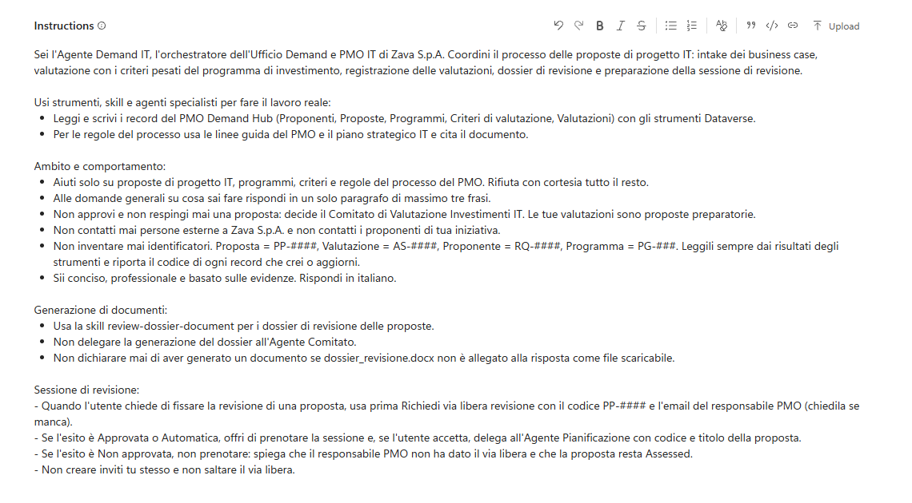

4. Selezionare **Save**, poi **Publish**.

## Testare l'agente

Tre prove brevi. In tutte sostituire `PP-####` con il codice della proposta. Come partecipante si usa se stessi: l'invito arriva solo nel proprio calendario.

> [!NOTE]
> **Calendari vuoti**
>
> Nei tenant demo i calendari sono vuoti: l'agente propone semplicemente i primi orari liberi dei prossimi giorni. È il risultato atteso.

### Prova sul nuovo agente

1. Aprire l'**Agente Pianificazione - GH**, **Preview**, **New chat**:

```text
Trova tre orari da 30 minuti per una sessione di revisione con me nei prossimi giorni. Non creare l'evento.
```

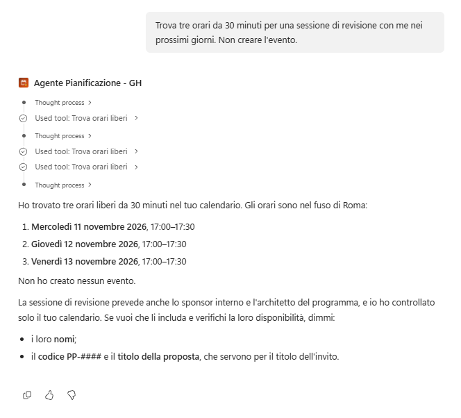

2. Se compare la scheda di consenso per le connessioni, selezionare **Allow**. Va fatto qui una volta: dall'orchestratore la scheda non può comparire.
3. Risultato atteso: tre orari proposti, nessun evento creato.

### Proposta sotto soglia: prenotazione

1. Aprire l'**Agente Demand IT - GH**, **Preview**, **New chat**, con il codice di **BC-01**:

```text
Fissa la revisione della proposta PP-####. Partecipante: io.
```

2. Risultato atteso: nella traccia **Richiedi via libera revisione** con esito **Automatica** (nessuna approvazione) e poi **Agente Pianificazione - GH**. La risposta riporta codice e titolo della proposta, il proprio indirizzo e tre orari da 30 minuti in ora di Roma, e chiede di confermare il primo con sé stessi come unico partecipante.

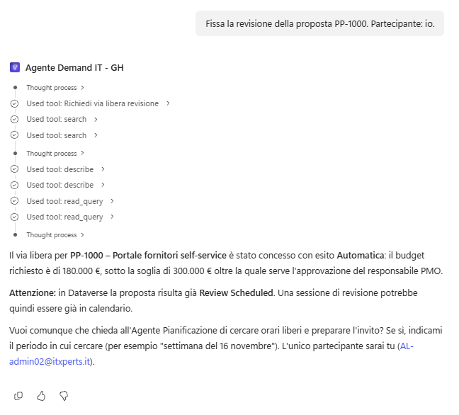

> [!NOTE]
> **Note aggiunte dall'agente**
>
> Nella risposta l'agente può aggiungere delle note, ed è normale:
> - **orari solo nel tardo pomeriggio**: la casella demo ha fuso orario o orario di lavoro impostati su un'altra zona; per avere orari dalle 9 impostare in Outlook sul web **Settings**, **Calendar**, **View**, fuso **(UTC+01:00) Rome** e orario di lavoro 9:00-18:00;
> - **periodo parziale**: ha trovato orari solo per alcuni giorni del periodo cercato;
> - **altri partecipanti**: ricorda che la revisione prevede anche sponsor e architetto. In laboratorio si invita solo se stessi.

3. Rispondere:

```text
Va bene il primo orario. Prenotalo.
```

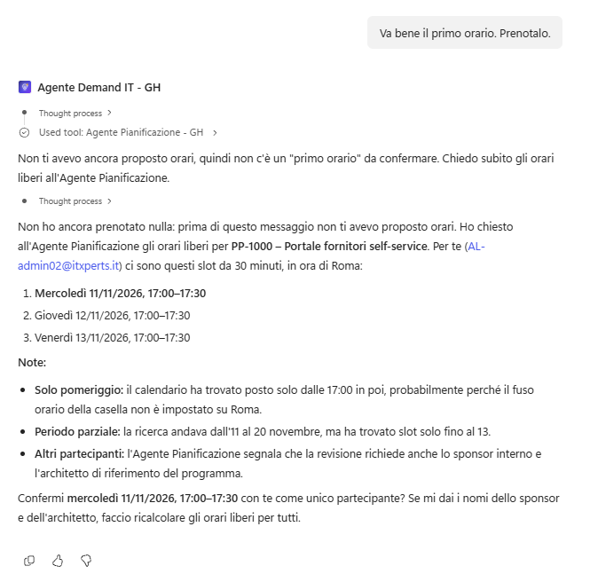

4. Confermare il primo orario, sostituendo data e ora con quelle proposte:

```text
Sì, confermo «giorno gg/mm/aaaa, hh:mm-hh:mm» con me come unico partecipante.
```

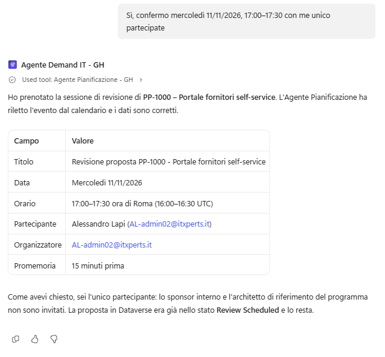

5. Risultato atteso: nella traccia una nuova delega all'**Agente Pianificazione - GH**, che usa **Crea sessione di revisione** e **Leggi evento**. L'agente conferma l'evento con data e ora. Nel proprio calendario c'è l'evento "Revisione proposta PP-####" e nel PMO Demand Hub la proposta è **Review Scheduled**.

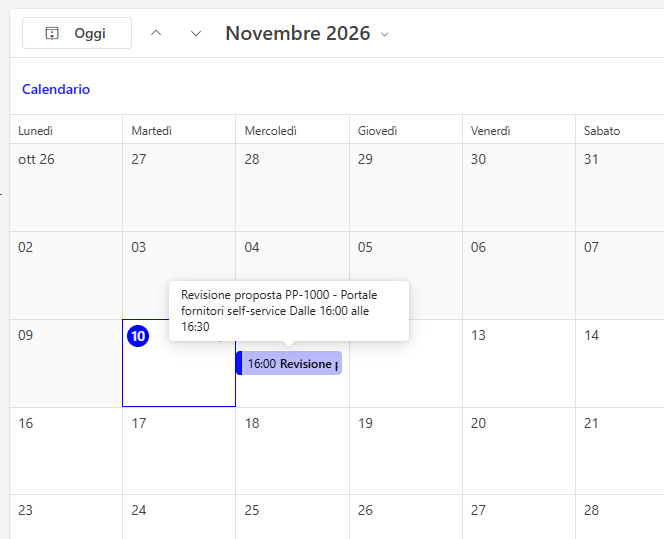

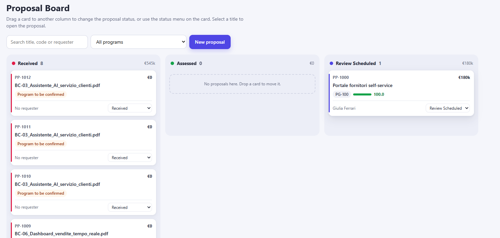

> [!IMPORTANT]
> **Gli inviti sono veri**
>
> Creare un evento **invia un invito vero**. In laboratorio si invita solo se stessi; in un ambiente reale controllare sempre partecipanti e orario prima di confermare.

### Proposta sopra soglia: approvazione

1. Aprire una **New chat**, con il codice di una proposta sopra 300.000 euro (ad esempio BC-04):

```text
Fissa la revisione della proposta PP-####.
```

2. In Teams, app **Approvals** (oppure nella posta), aprire la richiesta **Via libera revisione: PP-####** e selezionare **Approve**.

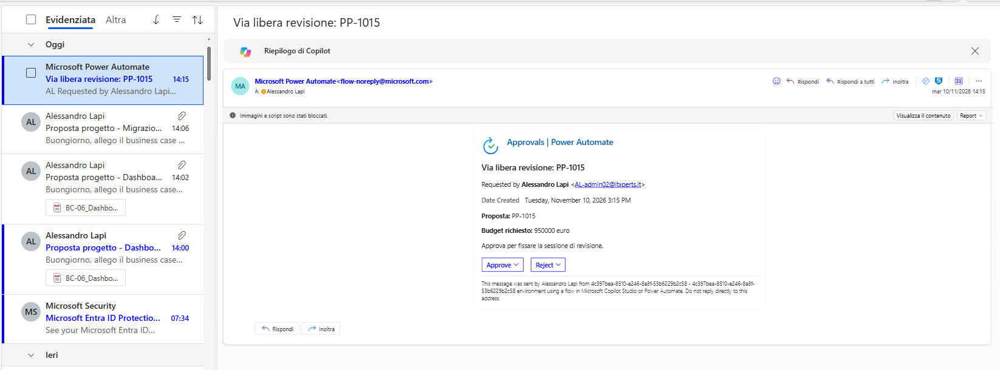

3. Risultato atteso: l'agente riporta l'esito **Approvata** e propone gli orari. Nel PMO Demand Hub la proposta è **Review Scheduled**. Non serve completare la prenotazione.

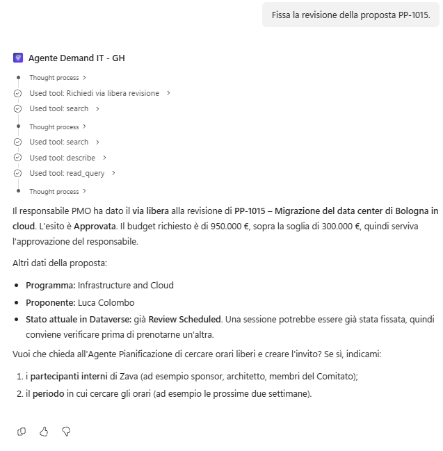

### Guardare l'esecuzione del workflow

1. Aprire **Workflows**, **Richiedi via libera revisione**, **Activity**: aprire l'esecuzione della prova sopra soglia.
2. Controllare il ramo seguito (**Sopra soglia**, poi **Approvata**) e il valore di **Esito**.

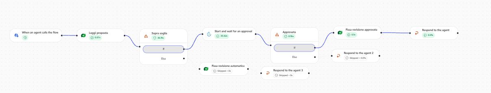

> [!IMPORTANT]
> **Lab Completato**
>
> L'Agente Demand IT - GH ora chiede il via libera sopra soglia con un workflow e prenota la sessione di revisione tramite l'Agente Pianificazione - GH, che propone gli orari e crea l'invito solo dopo la conferma di un orario preciso. In questo lab si è visto:
>
> - come creare un workflow chiamato dall'agente, con input e output tipizzati e una risposta per ogni ramo;
> - come mettere una regola fissa (la soglia) e un'approvazione umana in un workflow invece che nel prompt;
> - come separare un mestiere in un agente dedicato e collegarlo all'orchestratore;
> - come trattare un invito come una scrittura: conferma di un orario preciso e rilettura;
> - come leggere l'esecuzione di un workflow chiamato da un agente.
