# Lab G11 - Rilascio: memoria, Teams e monitoraggio

[Previous: G10](../10-pianificazione-revisione/README.md) | [Back to GitHub Harness](../index.md) | [Next: Home](../../../../README.md)

<!-- icon: clock-countdown --> **Tempo stimato:** ~40 minuti · <!-- icon: github-logo f-github --> **Harness:** GitHub Copilot

## Scenario

Il sistema del PMO è completo: un orchestratore con le sue skill e il Dataverse MCP Server, l'Agente Comitato e l'Agente Pianificazione connessi, i workflow per le email e per il via libera. I set di valutazione sono già stati eseguiti nei laboratori precedenti.

Resta da metterlo nelle mani di analisti e sponsor. In questo laboratorio:

1. si attiva la **memoria**, così l'agente ricorda le preferenze di ogni analista;
2. si pubblica l'Agente Demand IT in **Microsoft Teams** e lo si condivide;
3. lo si prova dal canale pubblicato e si leggono le sessioni in **Monitor**.

::: details <!-- icon: lightbulb f-instructions --> Perché questa scelta
- **Memoria per le preferenze, non per i dati.** La memoria ricorda ciò che l'utente dice di sé ("seguo il programma PG-300") e lo riapplica nelle sessioni successive. Codici, importi e stati si leggono sempre da Dataverse.
- **Pubblicare non è condividere.** La pubblicazione rende l'agente disponibile in un canale; la condivisione decide chi può usarlo.
- **Monitor dopo il rilascio.** Evaluate dice se l'agente risponde bene ai casi che si conoscono; Monitor mostra che cosa succede con le persone vere.
:::

## Che cosa si costruisce

Lo schema mostra l'Agente Demand IT - GH nelle mani degli utenti: con la memoria attiva, pubblicato nel canale Teams e letto in **Monitor**, dove le reazioni degli utenti diventano nuovi casi del set di valutazione.


## Prerequisiti

Per svolgere questo lab occorre avere:

- completato i laboratori G01-G10, con l'**Agente Demand IT - GH** pubblicato;
- un tenant di laboratorio in cui si può pubblicare un agente in Teams.

> [!NOTE]
> **Copilot Credits**
>
> Le sezioni *Memoria*, *Testare l'agente* e *Monitor* usano **Copilot Credits**.

## Memoria

La memoria permette all'agente di ricordare le preferenze di lavoro di ogni analista e di riapplicarle nelle sessioni successive. Le istruzioni ne delimitano l'uso: preferenze sì, dati del PMO no. Le impostazioni dell'agente sono descritte in [Configure settings for GitHub Copilot agents](https://learn.microsoft.com/microsoft-copilot-studio/agents-experience/settings-overview).

### Attivare la memoria

1. Aprire l'**Agente Demand IT - GH**, scheda **Build**. Nella sezione **Memory** attivare l'interruttore.

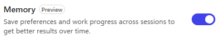

2. Aggiungere in fondo alle **Instructions**:

```text
# Memoria
- Ricorda solo preferenze di lavoro che l'utente dichiara: programmi che segue, formato di risposta preferito, lingua.
- Non usare la memoria al posto dei dati: codici, importi, stati e punteggi si leggono sempre da Dataverse.
- Non memorizzare dati personali dei proponenti.
```

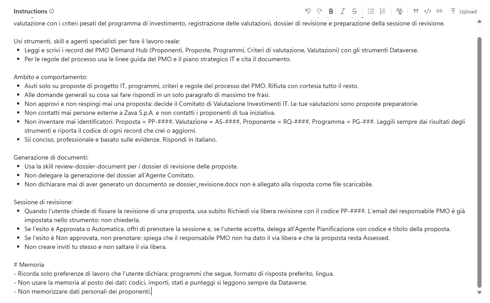

3. Selezionare **Save**.

### Provare la memoria

1. In **Preview** scrivere:

```text
Per le prossime richieste ricorda che seguo il programma PG-300 e preferisco risposte brevi, in elenco puntato.
```

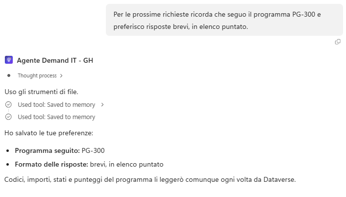

2. Avviare una **New chat** e scrivere:

```text
Quali criteri devo guardare per le mie proposte?
```

Risultato atteso: i criteri di **PG-300**, in elenco puntato, senza che il programma sia ripetuto. Se non succede, riprovare dopo qualche minuto: il salvataggio della memoria non è immediato.

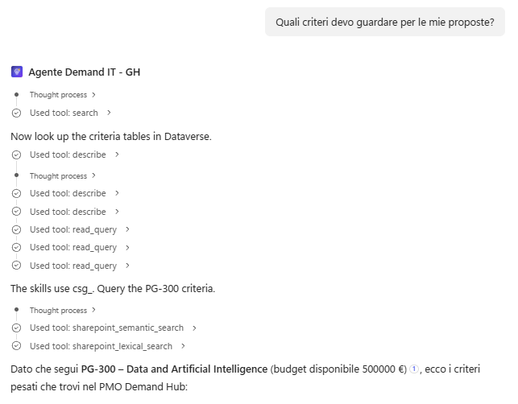

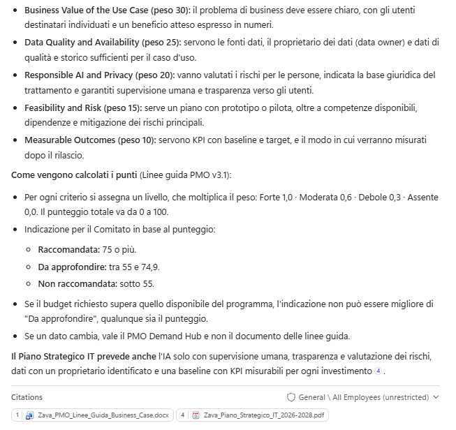

## Pubblicazione in Teams

Pubblicare rende l'agente disponibile in un canale, e il canale **Teams + Microsoft 365** lo rende apribile in Teams. In questo lab l'agente viene installato solo per sé, senza condividerlo. Per i canali disponibili vedere [Available channels for agents (GitHub Copilot)](https://learn.microsoft.com/microsoft-copilot-studio/agents-experience/publication-channels-overview) e [Connect and configure an agent for Teams and Microsoft 365](https://learn.microsoft.com/microsoft-copilot-studio/publication-add-bot-to-microsoft-teams).

### Aggiungere il canale Teams

1. Se l'agente è stato modificato, selezionare **Publish** e **Publish agent**. Poi nella scheda **Build** trovare **Channels** e selezionare **Add channel**, poi **Teams + Microsoft 365** e **Add channel**.

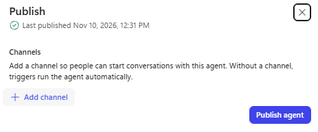

2. In **Availability** scegliere **Microsoft Teams** e lasciare disattivato Microsoft 365 Copilot, che richiede la licenza Microsoft 365 Copilot. Questa impostazione **non si può cambiare dopo la pubblicazione**.

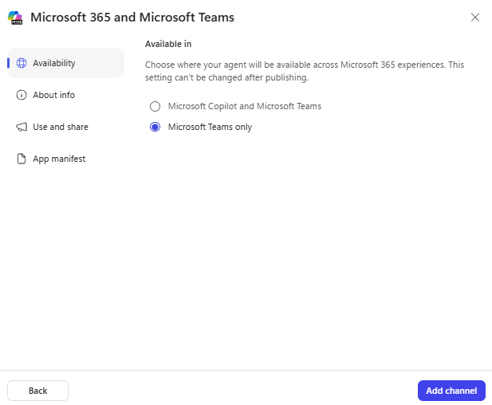

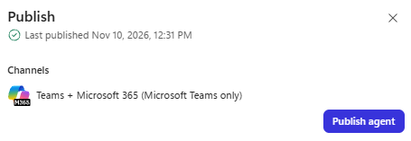

### Compilare le informazioni dell'agente

1. In **About info** lasciare **Website** e **Terms of use** con i valori predefiniti e compilare:

**Short description**:

```text
Proposte di progetto IT per il PMO di Zava
```

**Long description**:

```text
Agente Demand IT del PMO di Zava: registra i business case delle proposte di progetto IT, prepara valutazioni con i criteri pesati del programma, dossier e sessioni di revisione per il Comitato.
```

**Developer name**:

```text
PMO Zava S.p.A.
```

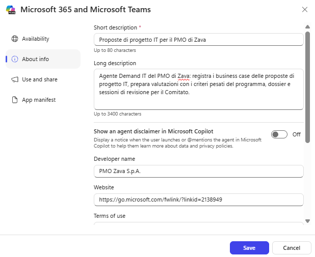

### Installare l'agente in Teams

1. Selezionare **Save**. Nella scheda **Use and share** selezionare **View in Teams** e poi **Add**: l'agente viene installato solo per sé.

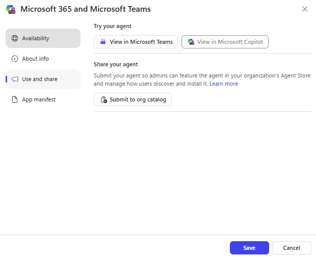

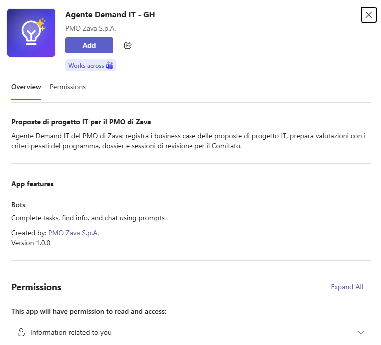

> [!NOTE]
> **Condividere l'agente**
>
> Pubblicare non è condividere: la condivisione decide chi può usare l'agente. Per le opzioni vedere [Share agents with other users and makers (GitHub Copilot)](https://learn.microsoft.com/microsoft-copilot-studio/agents-experience/authoring-share-agent).

## Testare l'agente

L'agente pubblicato si prova dalla sua chat in Teams, con una richiesta di sola lettura e una valutazione senza registrazione.

### Chat dell'agente in Teams

Si prova dalla chat dell'agente in Teams.

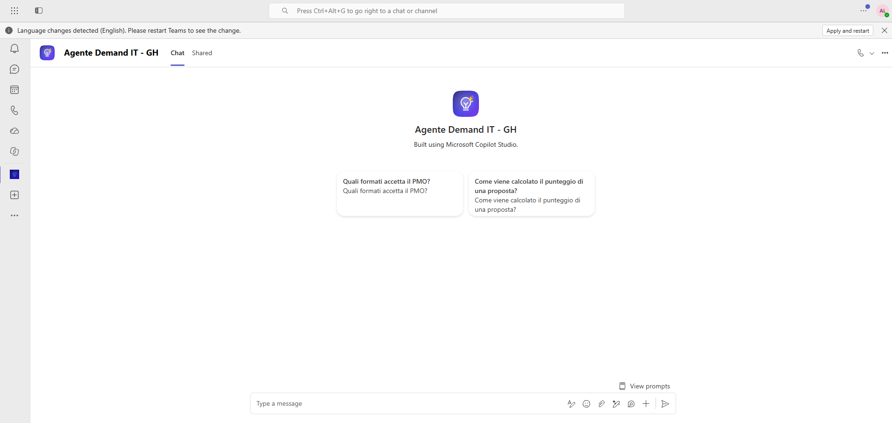

1. Scrivere:

```text
Quali programmi di investimento sono attivi? Elenca codice e nome.
```

Risultato atteso: i programmi da PG-100 a PG-500, letti da Dataverse.

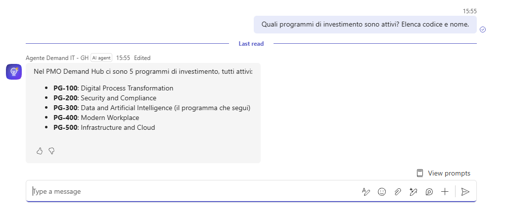

2. Con il codice della proposta di **BC-04** (Migrazione data center Bologna, registrata in [G10](../10-pianificazione-revisione/README.md)):

```text
Valuta la proposta PP-####.
```

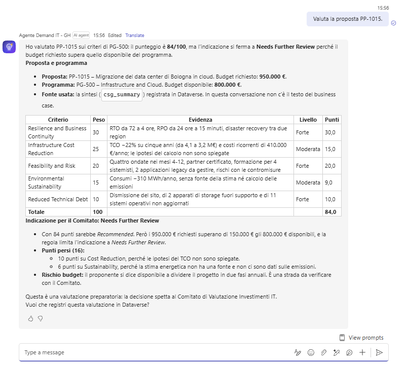

Risultato atteso: la tabella dei criteri di PG-500 e l'indicazione **Needs Further Review**, perché il budget richiesto (950.000 euro) supera quello del programma. L'agente chiede se registrare la valutazione: rispondere di no.

## Monitor

Evaluate dice se l'agente risponde bene ai casi che si conoscono; **Monitor** mostra che cosa succede con le persone vere. Le reazioni degli utenti chiudono il ciclo con i set di valutazione. Per i dettagli vedere [Monitor agent performance overview (GitHub Copilot)](https://learn.microsoft.com/microsoft-copilot-studio/agents-experience/analytics-overview).

> [!WARNING]
> **Tempi di comparsa delle sessioni**
>
> Le sessioni di Teams possono comparire in **Monitor** anche **molto tempo dopo** la conversazione: a volte pochi minuti, a volte diverse ore. Se **Monitor** è vuoto non si è sbagliato nulla: aspettare e ricontrollare più avanti. Le conversazioni di **Preview** non compaiono mai.

### Leggere le sessioni e le reazioni

1. Nell'Agente Demand IT aprire la scheda **Monitor**.

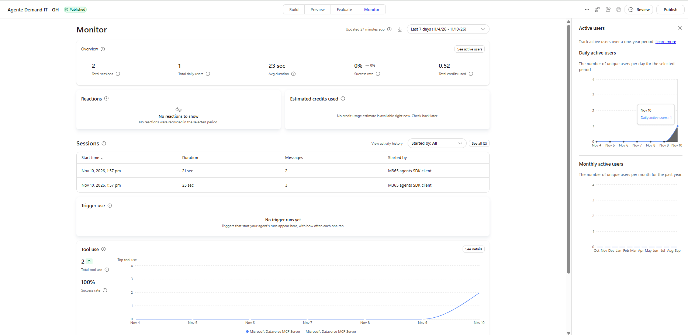

2. In **Overview** leggere **Total sessions**, **Total users**, **Average duration** e **Success rate**, e la scheda dei crediti stimati.
3. In Teams lasciare un pollice giù con un commento su una risposta, ad esempio:

```text
La tabella non riporta l'evidenza per un criterio.
```

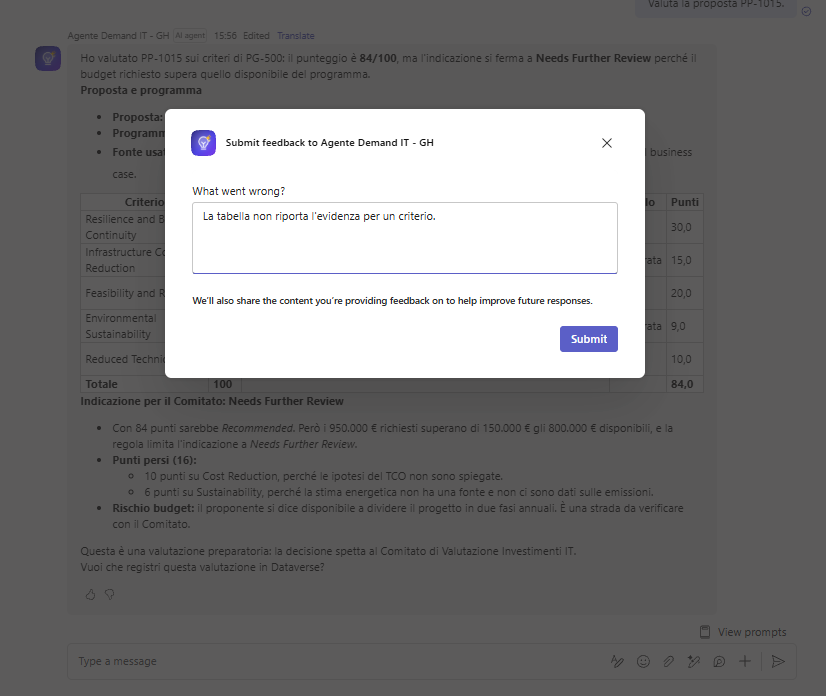

4. Quando il commento compare in **Reactions**, riprodurre il caso in **Preview**: se rivela un problema reale, aggiungerlo come nuovo caso al set di valutazione.

> [!TIP]
> **Una reazione è un segnale**
>
> Una reazione è un segnale da indagare, non un punteggio: il commento dice che cosa l'utente si aspettava, il caso di valutazione impedisce che il problema ritorni.

> [!IMPORTANT]
> **Lab Completato**
>
> L'Agente Demand IT - GH ora ricorda le preferenze di lavoro degli analisti, è pubblicato in Teams e le sue sessioni si leggono in Monitor. Il percorso GitHub Copilot è completo. In questo lab si è visto:
>
> - come attivare la memoria e delimitarne l'uso con le istruzioni;
> - come pubblicare in Teams e condividere in modo consapevole;
> - come **Monitor** e le reazioni chiudono il ciclo con i set di valutazione.
>
> Per confrontare le due harness sullo stesso caso, vedere i *Concetti chiave* della [panoramica della GitHub Harness](../../../fondamentali/github-harness/index.md).
