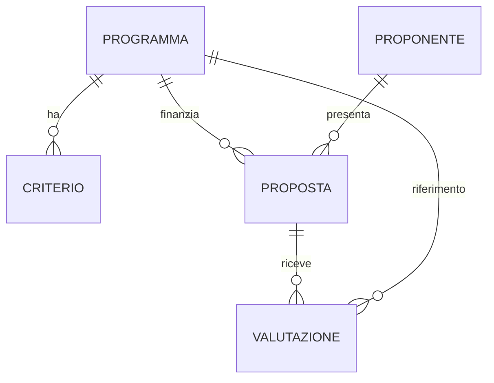

# Modello dati del PMO Demand Hub

[Back to Advanced](./index.md)

Il modello dati è condiviso dai due percorsi e si crea nel laboratorio [00 - Setup dati](./standard-harness/00-setup-dati/README.md). Questo documento è il riferimento dei nomi logici: le skill, i prompt e i flow li usano in modo esplicito.

> [!TIP]
> Se nel tuo ambiente un nome logico risulta diverso (ad esempio perché lo schema name è stato generato automaticamente), annota quello reale e usalo nei laboratori. Puoi verificarlo in Power Apps aprendo la tabella e la scheda **Columns**.

## Publisher e soluzione

| Elemento | Valore |
| --- | --- |
| Publisher | CSM Solutions (`CSMSolutions`), prefisso `csm`, prefisso dei valori di scelta `77000` |
| Soluzione | PMO Demand IT (`PMODemandIT`), impostata come soluzione preferita |
| App model-driven | PMO Demand Hub |

## Relazioni

## Tabelle e colonne

### Programma (`csm_program`)

| Colonna | Nome logico | Tipo | Note |
| --- | --- | --- | --- |
| Name | `csm_name` | Testo (colonna primaria) | Nome del programma |
| Program Code | `csm_programcode` | Testo, 10 caratteri, obbligatorio | PG-100 ... PG-500, caricato da CSV |
| Description | `csm_description` | Più righe di testo | Ambito del programma |
| Available Budget (EUR) | `csm_availablebudget` | Numero intero | |

### Criterio di valutazione (`csm_criterion`)

| Colonna | Nome logico | Tipo | Note |
| --- | --- | --- | --- |
| Name | `csm_name` | Testo (colonna primaria) | Nome del criterio |
| Description | `csm_description` | Più righe di testo | Che cosa significa evidenza forte |
| Weight | `csm_weight` | Numero intero | I pesi di un programma sommano a 100 |
| Program | `csm_program` | Lookup a Programma | |

### Proponente (`csm_requester`)

| Colonna | Nome logico | Tipo | Note |
| --- | --- | --- | --- |
| Name | `csm_name` | Testo (colonna primaria) | Nome e cognome del proponente |
| Requester Code | `csm_requestercode` | Numerazione automatica, prefisso RQ, 4 cifre, seed 1000 | Esempio RQ-1000 |
| Email | `csm_email` | Email | Chiave di deduplica |
| Role | `csm_role` | Testo | |
| Department | `csm_department` | Testo | |

### Proposta (`csm_proposal`)

| Colonna | Nome logico | Tipo | Note |
| --- | --- | --- | --- |
| Title | `csm_title` | Testo (colonna primaria) | |
| Proposal Code | `csm_proposalcode` | Numerazione automatica, prefisso PP, 4 cifre, seed 1000 | Esempio PP-1000 |
| Summary | `csm_summary` | Più righe di testo, 4.000 caratteri | |
| Cover Message | `csm_message` | Più righe di testo, 4.000 caratteri | Testo della chat o dell'email |
| Source Email | `csm_sourceemail` | Email | Chi ha inviato il documento |
| Requested Budget (EUR) | `csm_requestedbudget` | Numero intero | |
| Duration (Months) | `csm_durationmonths` | Numero intero | |
| Channel | `csm_channel` | Scelta: Chat (770000000), Email (770000001) | |
| Proposal Status | `csm_proposalstatus` | Scelta: Received (770000000), Assessed (770000001), Review Scheduled (770000002) | Diverso dalla colonna di sistema Status |
| Submission Date | `csm_submissiondate` | Solo data | |
| Requester | `csm_requester` | Lookup a Proponente | |
| Program | `csm_program` | Lookup a Programma | Vuoto finché il programma non è confermato |
| Business Case Document | `csm_businesscasedocument` | File | Usato dal percorso standard |
| Note e allegati | tabella `annotation` | Abilitazione **Enable attachments** | Usato dal workflow del percorso GitHub Copilot |

### Valutazione (`csm_assessment`)

| Colonna | Nome logico | Tipo | Note |
| --- | --- | --- | --- |
| Title | `csm_title` | Testo (colonna primaria) | Esempio "PP-1002 - Portale fornitori self-service" |
| Assessment Code | `csm_assessmentcode` | Numerazione automatica, prefisso AS, 4 cifre, seed 1000 | Esempio AS-1000 |
| Proposal | `csm_proposal` | Lookup a Proposta | |
| Program | `csm_program` | Lookup a Programma | |
| Score | `csm_score` | Numero decimale, 1 cifra decimale | Da 0 a 100 |
| Criteria Detail | `csm_criteriadetail` | Più righe di testo, 10.000 caratteri | Una riga per criterio: Criterio, Peso, Livello, Evidenza, Punti |
| Rationale | `csm_rationale` | Più righe di testo, 4.000 caratteri | |
| Recommendation | `csm_recommendation` | Scelta: Recommended (770000000), Needs Further Review (770000001), Not Recommended (770000002) | Indicazione per il Comitato, non decisione |
| Assessment Date | `csm_assessmentdate` | Solo data | |

## Perché il modello è fatto così

- **Codici leggibili con numerazione automatica.** Le persone (e gli agenti) si scambiano codici come PP-1003, non GUID. Dataverse genera il codice: l'agente non deve inventarlo, deve solo rileggerlo. Le istruzioni di entrambi i percorsi insistono su questo punto perché un codice inventato è uno degli errori più dannosi in un processo di governance.
- **Criteri come righe, non come testo.** Pesi e descrizioni sono dati: si possono cambiare senza modificare l'agente, e il grounding legge sempre la versione aggiornata.
- **Budget come numero intero.** Evita la complessità delle colonne valuta (tasso di cambio, valuta di transazione) e basta per confronti e regole.
- **Programma vuoto finché non è confermato.** Se una proposta può ricadere su due programmi, la scelta spetta a una persona: lasciare il campo vuoto rende visibile lo stato "da confermare".
- **Due modi di conservare il documento.** La colonna File serve al percorso standard (l'agent flow carica e riscarica il PDF per il prompt). Le note (tabella `annotation`) servono al workflow del percorso GitHub Copilot, perché il contenuto della nota è leggibile con una query del Dataverse MCP Server. Nel percorso che non usi, la colonna rimane semplicemente vuota.
- **Stato proposta come scelta personalizzata.** La colonna di sistema Status (Attivo, Inattivo) rimane disponibile per archiviare i record; lo stato del processo ha valori propri.

## Regole di valutazione

| Livello | Fattore |
| --- | --- |
| Forte | 1,0 |
| Moderata | 0,6 |
| Debole | 0,3 |
| Assente | 0,0 |

- Punti del criterio = fattore x peso; punteggio = somma dei punti (da 0 a 100).
- Indicazione: Recommended da 75; Needs Further Review da 55 a 74,9; Not Recommended sotto 55.
- Se il budget richiesto supera il budget disponibile del programma, l'indicazione non può essere migliore di Needs Further Review.
