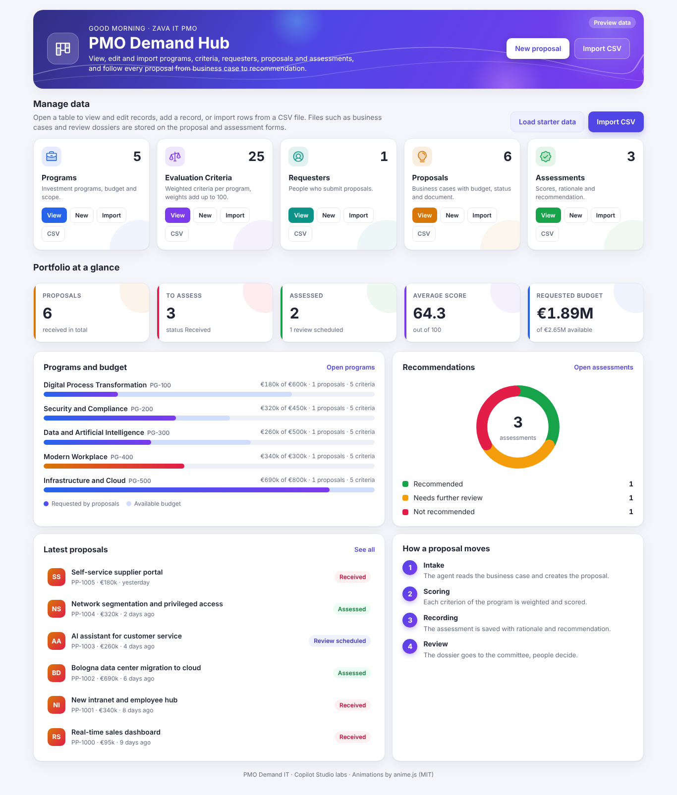
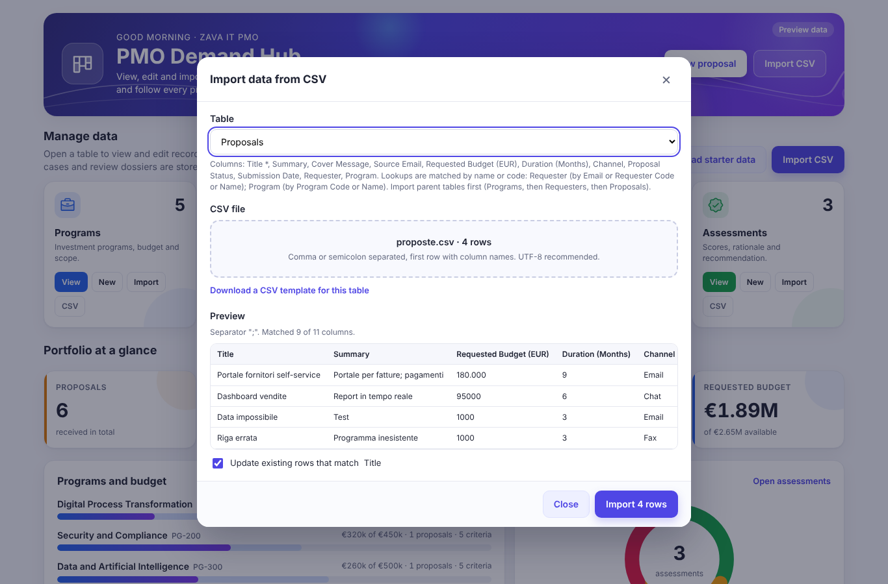
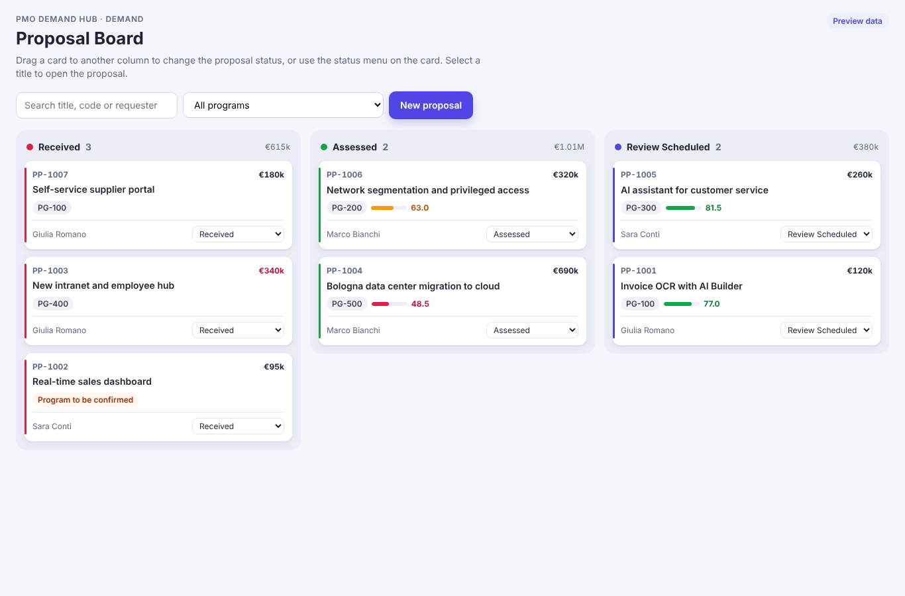

# Lab 00 - Setup dati: il PMO Demand Hub

Previous: Start | [Back to Standard Harness](../index.md) | [Next: S01](../01-agente-orchestratore/README.md)

<!-- icon: clock-countdown --> **Tempo stimato:** ~45 minuti · <!-- icon: toolbox f-standard --> **Harness:** standard

## Scenario

Zava S.p.A. è una società tecnologica italiana con 420 dipendenti, sede a Milano e uffici a Torino, Bologna e Roma. Ogni anno le funzioni aziendali (Acquisti, Vendite, Risorse Umane, Servizio Clienti, IT Operations, Sicurezza) propongono nuovi progetti IT. Le proposte vengono finanziate attraverso cinque **programmi di investimento**, ciascuno con un budget e con criteri di valutazione propri.

Il processo è gestito dall'**Ufficio Demand e PMO IT** e oggi funziona così:

- le proposte arrivano in una casella email condivisa, in formati diversi, spesso senza tutte le informazioni richieste;
- un analista apre ogni documento, lo registra in un foglio Excel e lo assegna a un programma;
- la valutazione con i criteri pesati viene fatta a mano, con interpretazioni diverse da analista ad analista;
- per ogni proposta valutata si prepara un dossier per il Comitato (circa due ore di lavoro);
- la sessione di revisione con lo sponsor e l'architetto di riferimento si organizza con molti scambi di email.

I problemi sono noti: tempi di presa in carico lunghi, valutazioni poco confrontabili, dossier con strutture diverse, poco tempo per l'analisi vera e propria. Nei laboratori di questo percorso il PMO affida la parte ripetitiva a un sistema di agenti, guidato dall'**Agente Demand IT**, e lascia le decisioni alle persone coinvolte nel processo:

| Attore | Ruolo nel processo | Interagisce con |
| --- | --- | --- |
| Proponente | Responsabile di funzione che presenta il business case | Agente Demand IT (chat) oppure email |
| Analista PMO | Verifica, conferma il programma, conferma la registrazione della valutazione | Agente Demand IT, PMO Demand Hub, Teams |
| Sponsor interno | Dirigente che risponde della proposta | Sessione di revisione |
| Architetto di riferimento | Valuta gli aspetti tecnici per il programma | Agente Comitato, sessione di revisione |
| Comitato | Decide | Dossier di revisione |

Il primo passo non riguarda ancora gli agenti. Oggi i dati del processo sono sparsi tra la casella email e un foglio Excel: serve prima un archivio comune e strutturato, che persone e agenti possano leggere e scrivere.

Questo archivio è il **PMO Demand Hub**, e il corso lo fornisce già pronto, come Agent Academy fa per l'Hiring Agent: una soluzione Dataverse con le cinque tabelle del processo (Programmi, Criteri di valutazione, Proponenti, Proposte, Valutazioni) e l'app model-driven **PMO Demand Hub** per consultarle, modificarle e importare dati. In questo laboratorio si legge prima con attenzione che cosa contiene la soluzione: nomi logici, codici automatici, scelte e relazioni sono quelli che gli agenti useranno in tutti i laboratori successivi. Poi la soluzione viene importata, vengono caricati i dati di partenza (cinque programmi di investimento con i loro criteri pesati) e viene preparata in SharePoint la cartella con i documenti di conoscenza del PMO. In particolare verranno svolte le seguenti attività:

- Capire tabelle, colonne, scelte e relazioni del modello dati.
- Conoscere l'app **PMO Demand Hub**: home page, import CSV e Proposal Board.
- Importare la soluzione **PMO Demand IT**.
- Caricare i cinque programmi e i 25 criteri di valutazione.
- Preparare la cartella SharePoint della conoscenza PMO.

Ogni record del PMO Demand Hub ha un codice leggibile: Proposta `PP-####`, Valutazione `AS-####`, Proponente `RQ-####`, Programma `PG-###`. Gli agenti leggono questi codici dai risultati degli strumenti e non li inventano mai. I codici del proprio ambiente saranno diversi da quelli degli esempi: nelle prove si controlla la forma, non il valore.

::: details <!-- icon: lightbulb f-instructions --> Perché queste scelte
- **Una soluzione pronta invece del modello costruito a mano.** Il centro del corso sono gli agenti, non il designer delle tabelle. Importare la soluzione richiede pochi minuti e garantisce che nomi logici e valori delle scelte siano esattamente quelli citati da prompt, skill e flow dei laboratori: non resta nessun errore di battitura da scoprire quando un agente fallisce una scrittura.
- **Dataverse invece di una lista SharePoint o di un Excel.** Il processo ha relazioni (una proposta ha un proponente, un programma, una o più valutazioni), regole sui tipi di dato e codici univoci. Dataverse le gestisce in modo nativo, rispetta la sicurezza per ruolo e agenti, prompt e flow lo leggono e scrivono con il connettore Dataverse.
- **Codici con numerazione automatica.** Persone e agenti si scambiano codici leggibili (PP-1003), non GUID. Il codice lo genera Dataverse, così l'agente non ha mai motivo di inventarlo: rilegge quello assegnato al salvataggio.
- **Criteri come righe di una tabella.** Pesi e descrizioni sono dati che il PMO può cambiare senza toccare gli agenti. Il grounding legge sempre la versione aggiornata.
- **Nomi logici decisi esplicitamente.** Prompt, skill e flow citano i nomi logici delle colonne (`csm_requestedbudget`, `csm_proposalstatus`...) e i valori numerici delle scelte. Nella soluzione sono fissati una volta per tutte: le istruzioni dei laboratori si possono copiare così come sono.
- **Scelte locali e lookup veri.** Canale, stato e raccomandazione sono scelte proprie della colonna, con i valori numerici del publisher (770000000, 770000001...); i collegamenti tra tabelle sono lookup, non testi con un codice, così un agente non può collegare una proposta a un programma che non esiste.
- **Budget come numero intero.** Evita le colonne di tipo valuta (tasso di cambio, valuta della transazione) ed è sufficiente per confronti e regole.
- **Programma vuoto finché non è confermato.** Quando una proposta potrebbe rientrare in due programmi decide una persona: un lookup vuoto rende visibile lo stato "da confermare".
- **Il documento in una colonna File.** Il business case resta sul record della proposta: il flow carica il PDF nella colonna **Business Case Document** e lo riscarica quando il prompt deve leggerlo.
- **Proposal Status come scelta personalizzata.** Lo stato di sistema (Active, Inactive) resta disponibile per archiviare; lo stato del processo ha valori propri.
:::

## Che cosa contiene la soluzione

Non c'è niente da costruire, ma prima di scrivere il primo agente conviene leggere il modello: ogni prompt, flow e skill dei laboratori successivi cita queste tabelle, questi nomi logici e questi valori. Dopo l'importazione si possono ritrovare nel proprio ambiente: aprire la soluzione, selezionare una tabella e poi **Columns**; la colonna **Logical name** (o **Name**) mostra il nome logico.

| Componente | Nome | Contenuto |
| --- | --- | --- |
| Tabelle | 5 tabelle con prefisso `csm_` | Program, Evaluation Criterion, Requester, Proposal, Assessment, con moduli e viste |
| App model-driven | **PMO Demand Hub** (`csm_PMODemandHub`) | Navigazione in tre gruppi, home page e Proposal Board |
| Risorse web | `csm_/pmo/...` | Home page e Proposal Board (HTML, CSS, JavaScript), anime.js 4.2.2, icone delle tabelle, logo e icona dell'app, tema personalizzato |
| Publisher | **CSM Solutions** (`CSMSolutions`) | Prefisso `csm`, prefisso delle scelte `77000` |

### Tabelle e relazioni

| Tabella | Nome logico | Colonna primaria | Collegata a (lookup) |
| --- | --- | --- | --- |
| Program | `csm_program` | Name (`csm_name`) | - |
| Evaluation Criterion | `csm_criterion` | Name (`csm_name`) | Program |
| Requester | `csm_requester` | Name (`csm_name`) | - |
| Proposal | `csm_proposal` | Title (`csm_title`) | Requester, Program |
| Assessment | `csm_assessment` | Title (`csm_title`) | Proposal, Program |

Tutte le relazioni sono lookup molti a uno. Eliminare un programma o una proposta non elimina le righe collegate: il lookup su criteri, proposte o valutazioni rimane vuoto. Le tabelle hanno un proprietario (colonna **Owner**), quindi la sicurezza per ruolo di Dataverse vale anche per gli agenti.

### Program

Il programma di investimento è il punto di partenza di ogni valutazione: decide quali criteri si applicano e quale budget è disponibile. Criteri, proposte e valutazioni lo citano con un lookup. Il codice PG-### è inserito dal PMO (arriva dal piano degli investimenti), per questo è un testo obbligatorio e non un numero automatico.

| Colonna | Nome logico | Tipo e regole |
| --- | --- | --- |
| Name | `csm_name` | Testo, obbligatorio |
| Program Code | `csm_programcode` | Testo, obbligatorio, massimo 10 caratteri |
| Description | `csm_description` | Testo su più righe |
| Available Budget (EUR) | `csm_availablebudget` | Numero intero, minimo 0 |

### Evaluation Criterion

I criteri sono il cuore della valutazione e cambiano più spesso degli agenti: il PMO può modificare un peso o una descrizione senza toccare istruzioni, prompt o skill. Tenerli come righe collegate al programma permette agli agenti di leggere sempre la versione in vigore.

| Colonna | Nome logico | Tipo e regole |
| --- | --- | --- |
| Name | `csm_name` | Testo, obbligatorio |
| Description | `csm_description` | Testo su più righe |
| Weight | `csm_weight` | Numero intero da 0 a 100; i pesi di un programma sommano a 100 |
| Program | `csm_program` | Lookup a **Program** |

### Requester

Lo stesso dipendente può presentare più proposte nel corso dell'anno. Una tabella separata, con l'email come chiave di deduplica, evita di ricopiare nome, ruolo e funzione in ogni proposta e permette di vedere lo storico di chi propone.

| Colonna | Nome logico | Tipo e regole |
| --- | --- | --- |
| Name | `csm_name` | Testo, obbligatorio |
| Requester Code | `csm_requestercode` | Numerazione automatica `RQ-{SEQNUM:4}` |
| Email | `csm_email` | Testo in formato email |
| Role | `csm_role` | Testo |
| Department | `csm_department` | Testo |

### Proposal

La proposta è la tabella su cui lavorano tutti: intake, valutazione, dossier. Contiene i dati estratti dal business case, i dati sul canale di arrivo (chat o email) e lo stato del processo. Due scelte meritano attenzione: lo **Proposal Status** è una colonna propria, distinta dallo stato di sistema, e il documento si conserva sul record nella colonna File **Business Case Document**.

| Colonna | Nome logico | Tipo e regole |
| --- | --- | --- |
| Title | `csm_title` | Testo, obbligatorio |
| Proposal Code | `csm_proposalcode` | Numerazione automatica `PP-{SEQNUM:4}` |
| Summary | `csm_summary` | Testo su più righe, massimo 4000 caratteri |
| Cover Message | `csm_message` | Testo su più righe, massimo 4000 caratteri |
| Source Email | `csm_sourceemail` | Testo in formato email |
| Requested Budget (EUR) | `csm_requestedbudget` | Numero intero, minimo 0 |
| Duration (Months) | `csm_durationmonths` | Numero intero da 0 a 120 |
| Channel | `csm_channel` | Scelta: Chat, Email |
| Proposal Status | `csm_proposalstatus` | Scelta: Received, Assessed, Review Scheduled |
| Submission Date | `csm_submissiondate` | Solo data |
| Requester | `csm_requester` | Lookup a **Requester** |
| Program | `csm_program` | Lookup a **Program**, vuoto finché il programma non è confermato |
| Business Case Document | `csm_businesscasedocument` | File, fino a 32 MB |

### Assessment

La valutazione è separata dalla proposta perché è un atto preciso, con data, programma di riferimento, punteggio e motivazione: se il Comitato chiede una rivalutazione, la storia resta leggibile. Il **Criteria Detail** conserva la tabella riga per riga, così il dossier può riportare i livelli registrati senza rivalutare la proposta.

| Colonna | Nome logico | Tipo e regole |
| --- | --- | --- |
| Title | `csm_title` | Testo, obbligatorio |
| Assessment Code | `csm_assessmentcode` | Numerazione automatica `AS-{SEQNUM:4}` |
| Proposal | `csm_proposal` | Lookup a **Proposal** |
| Program | `csm_program` | Lookup a **Program** |
| Score | `csm_score` | Numero decimale da 0 a 100, un decimale |
| Criteria Detail | `csm_criteriadetail` | Testo su più righe, massimo 10000 caratteri |
| Rationale | `csm_rationale` | Testo su più righe, massimo 4000 caratteri |
| Recommendation | `csm_recommendation` | Scelta: Recommended, Needs Further Review, Not Recommended |
| Assessment Date | `csm_assessmentdate` | Solo data |
| Review Dossier | `csm_reviewdossier` | File, fino a 32 MB, per conservare il dossier sul record (nel Lab S06 il dossier viene salvato in OneDrive) |

### Codici automatici e scelte

Le colonne **Requester Code**, **Proposal Code** e **Assessment Code** sono a numerazione automatica: Dataverse assegna il valore al salvataggio, partendo dal seed predefinito 1000. In un ambiente nuovo il primo proponente è quindi RQ-1000, la prima proposta PP-1000, la prima valutazione AS-1000.

Le tre colonne di scelta sono locali (appartengono alla colonna, non sono scelte globali condivise con altre tabelle) e usano il prefisso `77000` del publisher. Gli agenti scrivono questi valori numerici:

| Colonna | Opzioni e valori |
| --- | --- |
| Channel (`csm_channel`) | Chat (770000000), Email (770000001) |
| Proposal Status (`csm_proposalstatus`) | Received (770000000), Assessed (770000001), Review Scheduled (770000002) |
| Recommendation (`csm_recommendation`) | Recommended (770000000), Needs Further Review (770000001), Not Recommended (770000002) |

> [!NOTE]
> **Nessun valore predefinito**
>
> Le colonne di scelta non hanno un valore predefinito. Lo stato **Received** di una nuova proposta lo scrivono i flow di intake (Lab S02 e S05); il Proposal Board mostra nella colonna Received anche le proposte create a mano senza stato.

### Moduli e viste

| Elemento | Che cosa offre |
| --- | --- |
| Modulo principale **Information** | Scheda **General** su due colonne (dettagli a sinistra, testi lunghi e file a destra), codici automatici e scelte nell'intestazione, una scheda per ogni tabella collegata |
| Sottogriglie modificabili | Su un programma: **Evaluation Criteria**, **Proposals**, **Assessments**; su un proponente: **Proposals**; su una proposta: **Assessments**. Pesi, stati e altri valori si cambiano direttamente nella griglia |
| Creazione rapida | Un modulo di creazione rapida per ogni tabella, aperto da **New** nella home page o da **+ New** in un lookup o in una sottogriglia |
| Altri moduli | Modulo a scheda (elenchi sugli schermi piccoli) e modulo di visualizzazione rapida per ogni tabella |
| Viste | Active e Inactive per ogni tabella, più **Proposals to Assess**, **Assessed Proposals**, **Proposals with Review Scheduled**, **Recommended Assessments** e **Assessments Needing Further Review** |

Le colonne File (**Business Case Document** e **Review Dossier**) compaiono anche nelle viste principali: nel modulo si seleziona la colonna per caricare un file e il nome del file per scaricarlo.

### L'app model-driven

L'app **PMO Demand Hub** contiene le cinque tabelle e due pagine web, organizzate in tre gruppi di navigazione:

| Gruppo | Voci |
| --- | --- |
| Overview | Home (pagina web `csm_/pmo/home.html`) |
| Demand | Proposal Board (pagina web `csm_/pmo/board.html`), Proposals, Assessments, Requesters |
| Portfolio | Programs, Evaluation Criteria |

Ogni tabella ha un'icona Phosphor duotone e un colore: Program blu, Evaluation Criterion viola, Requester verde acqua, Proposal ambra, Assessment verde. Le animazioni usano anime.js, incluso nella soluzione (`csm_/pmo/anime.min.js`), quindi le pagine non dipendono da una CDN esterna; per chi ha attivato la riduzione del movimento nel sistema operativo le animazioni vengono saltate.

## Come funziona l'app PMO Demand Hub

Gli agenti scrivono, ma sono le persone del PMO a controllare: per ogni prova dei laboratori si aprirà l'app per verificare i record. L'app è anche lo strumento con cui gli analisti correggono a mano ciò che un agente non deve modificare, per esempio il programma di una proposta o lo stato del processo.

### Home page

La home page si apre per prima e inizia con **Manage data**: una scheda per tabella con il numero di righe attive e quattro azioni.

| Azione | Che cosa fa |
| --- | --- |
| View | Apre la vista della tabella |
| New | Apre il modulo di creazione rapida |
| Import | Apre il pannello di importazione per quella tabella |
| CSV | Scarica un modello CSV con i nomi di colonna corretti; per Programs ed Evaluation Criteria il modello contiene già i dati dei laboratori |

Accanto ci sono **Load starter data**, che crea o aggiorna in un solo passo i 5 programmi e i 25 criteri dei laboratori, e **Import CSV**. Sotto, la sezione **Portfolio at a glance** legge i dati dal vivo con la Web API di Dataverse: numeri chiave, barre del budget per programma (richiesto rispetto a disponibile, arancione quando un programma è oltre il budget), il grafico delle raccomandazioni, le ultime proposte con il loro stato e le quattro fasi del processo. Selezionando un programma o una proposta si apre il record.

Le immagini di questa sezione mostrano le pagine con i dati di esempio (etichetta **Preview data**), cioè come appaiono aperte fuori dall'app, dove nulla viene scritto in Dataverse.



### Pannello Import CSV

Il pannello funziona in quattro passi: scegliere la tabella, trascinare il file, controllare l'anteprima e selezionare **Import rows**. Si occupa dei dettagli che di solito fanno fallire un'importazione:

- **Separatori e formati.** Virgola, punto e virgola (Excel in italiano salva con il punto e virgola) o tabulazione. Numeri come `180000`, `180.000` o `180,000`, decimali con il punto o con la virgola. Date come `YYYY-MM-DD` o `DD/MM/YYYY`.
- **Nomi di colonna.** Nomi visualizzati in inglese, nomi logici e le intestazioni italiane dei file originali dei laboratori (ad esempio *Codice programma*, *Budget disponibile (EUR)*, *Peso*, *Programma*).
- **Lookup.** Programma per Program Code o Name, proponente per Email, Requester Code o Name, proposta per Proposal Code o Title.
- **Scelte.** Per etichetta (*Email*, *Review Scheduled*, *Needs Further Review*) o per valore (*770000001*).
- **Creare o aggiornare.** Con **Update existing rows** selezionato, le righe che corrispondono alla chiave vengono aggiornate invece che duplicate. Chiavi: Program Code per i programmi, Name e Program per i criteri, Email per i proponenti, Title per proposte e valutazioni.
- **Errori chiari.** Le righe con problemi vengono saltate ed elencate con numero di riga e motivo, ad esempio *Program "PG-999" not found in Programs*. Le altre righe vengono importate.

Le tabelle padre vanno importate per prime: Programs, poi Evaluation Criteria e Requesters, poi Proposals, infine Assessments. Il pannello usa i permessi dell'utente connesso: si può importare solo nelle tabelle in cui si ha il permesso di creare e scrivere righe.



### Proposal Board

**Proposal Board**, prima voce del gruppo **Demand**, mostra le proposte attive come schede in tre colonne: Received, Assessed, Review Scheduled. Ogni colonna riporta il numero di proposte e il loro budget richiesto totale.

- **Cambiare stato** trascinando una scheda in un'altra colonna, oppure con il menu dello stato in fondo alla scheda (funziona anche da tastiera). La modifica viene salvata subito nella colonna **Proposal Status** e il messaggio di conferma ha il pulsante **Undo**. Se il salvataggio non riesce (ad esempio perché l'utente non può modificare le proposte), la scheda torna nella sua colonna e viene mostrato il motivo.
- **Leggere una proposta a colpo d'occhio**: codice, budget richiesto (in rosso quando supera il budget disponibile del programma), codice del programma oppure *Program to be confirmed*, punteggio dell'ultima valutazione colorato secondo la raccomandazione, proponente.
- **Trovare le proposte** con la casella di ricerca (titolo, codice, proponente) e il filtro per programma, che prevede anche *Program to be confirmed*.
- **Aprire il record** selezionando il titolo; **New proposal** apre il modulo di creazione rapida.

Le viste delle tabelle restano il posto per il lavoro in blocco: filtri, esportazione in Excel, importazione e modifica in griglia.



## Prerequisiti

Per svolgere questo lab occorre avere a disposizione:

- Un ambiente di laboratorio con Dataverse (lo stesso dei fondamenti va bene) e il ruolo **System Customizer** o **System Administrator**.
- La soluzione [`PMODemandIT_1_0_0_0.zip`](../../../resources/advanced/solution/PMODemandIT_1_0_0_0.zip) (non gestita, versione 1.0.0.0). Contiene anche il publisher **CSM Solutions** (`CSMSolutions`) con prefisso `csm` e prefisso delle scelte `77000`: se esiste già dal Lab 01 dei fondamenti, l'importazione lo aggiorna.
- I file [`programs.csv`](../../../resources/advanced/data/programs.csv) e [`evaluation-criteria.csv`](../../../resources/advanced/data/evaluation-criteria.csv), se si vogliono caricare i dati da CSV invece che con **Load starter data**.
- Un sito SharePoint dove poter creare cartelle e caricare file (per la cartella della conoscenza PMO), e i file [`Zava_PMO_Linee_Guida_Business_Case.docx`](../../../resources/advanced/conoscenza/Zava_PMO_Linee_Guida_Business_Case.docx) e [`Zava_Piano_Strategico_IT_2026-2028.pdf`](../../../resources/advanced/conoscenza/Zava_Piano_Strategico_IT_2026-2028.pdf).

Per i laboratori successivi servono anche:

- le licenze per i connettori Office 365 Outlook, Office 365 Users, Microsoft Teams e OneDrive for Business nel tenant di laboratorio;
- i [materiali del caso pratico](../../../resources/advanced/) (business case, email di prova, template del dossier, skill): ogni lab indica nei prerequisiti i file che usa.

## Importare la soluzione

Una soluzione è il contenitore che il PMO sposterà da un ambiente all'altro: sviluppo, collaudo, produzione. Se tabelle, app e agenti nascono fuori dalla soluzione, al momento del rilascio vanno cercati e aggiunti uno per uno, con il rischio di dimenticarne qualcuno. La soluzione **PMO Demand IT** è **non gestita**: dopo l'importazione si può modificare, e impostarla come soluzione preferita fa sì che i componenti creati da qui in poi fuori dal contesto di una soluzione ci finiscano per impostazione predefinita.

> [!TIP]
> **Dove lavorare**
>
> Lavorare in [Power Apps](https://make.powerapps.com/) per importare la soluzione e aprire l'app. Prima di iniziare controllare in alto a destra che l'ambiente sia quello di laboratorio.

### Importare il file della soluzione

1. In [Power Apps](https://make.powerapps.com/) verificare l'ambiente, selezionare **Solutions** e poi **Import solution**.
2. Selezionare **Browse**, scegliere il file [`PMODemandIT_1_0_0_0.zip`](../../../resources/advanced/solution/PMODemandIT_1_0_0_0.zip) scaricato e selezionare **Next**.
3. Controllare i dettagli (soluzione **PMO Demand IT**, publisher **CSM Solutions**, versione 1.0.0.0) e selezionare **Import**. L'importazione richiede qualche minuto: attendere il messaggio di conferma.
4. Aprire la soluzione **PMO Demand IT** e selezionare **Publish all customizations**.
5. Tornare all'elenco delle soluzioni, selezionare **PMO Demand IT** e poi **Set preferred solution** nella barra dei comandi (oppure nel menu **...** accanto al nome), e confermare. Da ora i nuovi componenti finiscono per impostazione predefinita in questa soluzione; quando un lab chiede di scegliere la soluzione, ad esempio in **Advanced settings** alla creazione di un agente, selezionare comunque **PMO Demand IT**.
6. Verificare che **PMO Demand IT** sia indicata come soluzione preferita nell'elenco delle soluzioni e che, aperta, contenga le cinque tabelle e l'app **PMO Demand Hub**.

> [!NOTE]
> **Componenti già presenti**
>
> Se l'ambiente contiene già il publisher CSM Solutions, la soluzione PMO Demand IT o una tabella `csm_program` con la sola colonna Name (ad esempio da un tentativo precedente fatto a mano), l'importazione li aggiorna e aggiunge le colonne mancanti: non serve eliminarli prima. Se invece segnala un conflitto su una colonna esistente con un tipo diverso, eliminare quella colonna o quella tabella e importare di nuovo.

## Caricare i dati di partenza

All'inizio servono solo programmi e criteri: sono le regole con cui gli agenti valuteranno le proposte. Proponenti, proposte e valutazioni partono vuoti, perché li creano gli agenti durante i laboratori.

### Aprire l'app

1. Nella soluzione **PMO Demand IT** selezionare l'app **PMO Demand Hub** e poi **Play** (oppure aprirla da **Apps** in Power Apps).
2. Copiare l'indirizzo dell'app dalla barra del browser, fino al parametro `appid` incluso (ad esempio `https://<org>.crm4.dynamics.com/main.aspx?appid=<id>`), e annotarlo: servirà nel Lab S05 per i link nelle card di Teams.
3. Scorrere la home page e aprire **Proposal Board** dal gruppo **Demand**. Per ora tabelle e colonne sono vuote: i dati arrivano con il passo successivo.

### Caricare programmi e criteri

1. Tornare a **Home** nel gruppo **Overview** e selezionare **Load starter data**.
2. Attendere la fine dell'operazione: le schede di **Manage data** mostrano 5 righe in **Programs** e 25 in **Evaluation Criteria**. Se programmi e criteri esistono già, vengono aggiornati e non duplicati.

> [!NOTE]
> **Caricare i dati da CSV**
>
> In alternativa si possono usare i file CSV:
>
> - **Pannello Import CSV.** Nella home page selezionare **Import CSV**, scegliere **Programs** e trascinare [`programs.csv`](../../../resources/advanced/data/programs.csv), poi scegliere **Evaluation Criteria** e trascinare [`evaluation-criteria.csv`](../../../resources/advanced/data/evaluation-criteria.csv).
> - **Importazione standard di Power Apps.** Nella soluzione aprire la tabella **Program**, selezionare **Import** e poi **Import data from Excel** (accetta anche i CSV) e caricare `programs.csv`; ripetere con la tabella **Evaluation Criterion** e `evaluation-criteria.csv`. Il CSV usa i nomi visualizzati delle colonne come intestazioni, per questo la mappatura si risolve quasi da sola; la colonna **Program** va associata al lookup Program, che si risolve per nome del programma (i cinque nomi sono tutti diversi).

### Verificare i dati

1. Aprire **Programs** dal gruppo **Portfolio** e controllare i cinque programmi:

| Codice | Programma | Budget disponibile (EUR) |
| --- | --- | --- |
| PG-100 | Digital Process Transformation | 600000 |
| PG-200 | Security and Compliance | 450000 |
| PG-300 | Data and Artificial Intelligence | 500000 |
| PG-400 | Modern Workplace | 300000 |
| PG-500 | Infrastructure and Cloud | 800000 |

2. Aprire un programma e selezionare la scheda **Evaluation Criteria**: mostra i suoi 5 criteri in una griglia modificabile e la somma dei pesi è 100.
3. Controllare che **Requesters**, **Proposals** e **Assessments** siano vuoti.
4. Verificare la numerazione automatica: in **Proposals** selezionare **New**, inserire un **Title** di prova e selezionare **Save**. Dopo il salvataggio il **Proposal Code** compare nell'intestazione del modulo e nella vista **Active Proposals**, nel formato `PP-####` (in un ambiente nuovo `PP-1000`).
5. Eliminare la proposta di prova (**Delete** nella barra dei comandi, poi confermare), così **Proposals** torna vuota. Il codice usato non viene riassegnato: la prima proposta registrata dagli agenti avrà il numero successivo.

## Passaggi facoltativi

### Rendere modificabili le viste principali

Le sottogriglie dei moduli sono già modificabili. Per modificare direttamente anche gli elenchi principali (per esempio cambiare il peso di molti criteri dalla vista Evaluation Criteria) occorre attivare la griglia modificabile sulla tabella, dall'esplora soluzioni classico.

1. Aprire la soluzione **PMO Demand IT** e, nella barra dei comandi, selezionare **...** e poi **Switch to classic**.
2. Espandere **Entities**, aprire la tabella (ad esempio **Evaluation Criterion**), selezionare la scheda **Controls** e poi **Add Control**.
3. Selezionare **Editable Grid** (oppure **Power Apps grid control**, la versione più recente, se l'ambiente la propone) e poi **Add**. Nella nuova riga selezionare **Web** come client.
4. Selezionare **Save** e poi **Publish**. Ripetere per le altre tabelle che interessano, di solito Evaluation Criteria e Programs. Gli utenti possono comunque passare dalla griglia modificabile a quella in sola lettura mentre usano l'app.

### Attivare il tema personalizzato

La soluzione contiene un tema indaco con intestazione scura (`csm_/pmo/theme.xml`). Il tema si applica con il valore di ambiente dell'impostazione **Custom theme definition**, che vale per tutte le app model-driven dell'ambiente: per questo la soluzione non lo imposta e lo si attiva a mano, solo se si vuole.

1. Nella soluzione **PMO Demand IT** selezionare **Add existing**, **More**, **Setting**.
2. Cercare *custom theme*, selezionare **Custom theme definition**, poi **Next** e **Add**.
3. Selezionare **Custom theme definition** nella soluzione e poi **Edit**. In **Setting environment value** selezionare **New environment value** e inserire `csm_/pmo/theme.xml`.
4. Selezionare **Save** e poi **Publish all customizations**.

> [!WARNING]
> **Ambiente condiviso**
>
> Il valore di ambiente applica il tema a tutte le app model-driven dell'ambiente che usano il nuovo aspetto. In un ambiente condiviso chiedere prima agli altri maker, oppure saltare questo passaggio: icone, colori e home page funzionano anche senza.

## Conoscenza PMO in SharePoint

### Creare la cartella SharePoint della conoscenza PMO

Le linee guida e il piano strategico sono documenti che il PMO aggiorna. Se vengono caricati direttamente nell'agente, l'agente ne usa una copia statica: quando il PMO cambia una regola, l'agente continua ad applicare quella vecchia finché qualcuno non ricarica il file a mano. Collegando invece una cartella SharePoint, l'agente legge sempre la versione corrente e risponde solo agli utenti che hanno il permesso di leggere quei documenti. Per questo i documenti di conoscenza vivono in SharePoint, come nel lavoro reale del PMO.

1. Aprire il sito SharePoint del laboratorio. Se non se ne ha uno, creare un sito del team chiamato `Zava PMO` (da [SharePoint](https://www.office.com/launch/sharepoint), **Create site**, **Team site**).
2. Aprire la raccolta **Documents** e creare una cartella `PMO Knowledge`.
3. Caricare nella cartella [`Zava_PMO_Linee_Guida_Business_Case.docx`](../../../resources/advanced/conoscenza/Zava_PMO_Linee_Guida_Business_Case.docx) e [`Zava_Piano_Strategico_IT_2026-2028.pdf`](../../../resources/advanced/conoscenza/Zava_Piano_Strategico_IT_2026-2028.pdf).
4. Annotare l'indirizzo diretto della cartella: verrà usato nel Lab S01 come fonte di conoscenza. Si ottiene aggiungendo all'indirizzo del sito il percorso della raccolta e della cartella; l'indirizzo che compare nella barra del browser quando si apre la cartella (`.../Forms/AllItems.aspx?id=...`) e i link di condivisione hanno un'altra forma e non vanno usati. L'indirizzo deve essere simile a:

```
https://<tenant>.sharepoint.com/sites/ZavaPMO/Shared%20Documents/PMO%20Knowledge
```

5. Verificare che i partecipanti che proveranno l'agente abbiano almeno il permesso di **lettura** sul sito o sulla cartella. Chi non ce l'ha non riceverà risposte da questi documenti, ed è il comportamento corretto.

> [!NOTE]
> **Un solo sito per la classe**
>
> Se il docente prepara un solo sito per tutta la classe, basta una cartella condivisa in lettura. Gli utenti guest non ricevono risposte da SharePoint, e se il tenant usa **Restricted SharePoint Search** la fonte SharePoint è bloccata: in questi casi usare il caricamento diretto dei file descritto nel Lab S01.

> [!IMPORTANT]
> **Lab Completato**
>
> Il PMO Demand Hub è pronto: soluzione importata, programmi e criteri caricati e cartella della conoscenza PMO in SharePoint. In questo laboratorio si è visto:
>
> - come è progettato un modello dati pensato per essere usato da agenti: codici leggibili, nomi logici espliciti, regole nei dati;
> - come importare una soluzione non gestita con tabelle, app model-driven e risorse web e impostarla come soluzione preferita;
> - come caricare i dati di partenza e importare CSV con lookup nell'app PMO Demand Hub;
> - come preparare in SharePoint una cartella di conoscenza che l'agente legge sempre aggiornata.
>
> Nel prossimo laboratorio si crea il primo agente: l'Agente Demand IT, l'orchestratore del sistema.
