# Lab S08 - Feedback e telemetria

[Previous: S07](../07-valutazioni-e-pubblicazione/README.md) | [Back to Standard Harness](../index.md)

<!-- icon: clock-countdown --> **Tempo stimato:** ~60 minuti · <!-- icon: toolbox f-standard --> **Harness:** standard

## Scenario

Con S07 l'Agente Demand IT è pubblicato e ha due test set di regressione. I test set dicono se l'agente fa ancora ciò per cui è stato costruito; non dicono se le risposte sono utili alle persone del PMO, né perché qualcuno ne è insoddisfatto. Servono segnali dagli utenti reali e un modo per leggerli.

In questo lab verranno raccolti due tipi di segnale: le **reazioni** (pollice su o giù) sui messaggi, lette nella pagina **Monitor** di Copilot Studio, e un **questionario CSAT** a fine conversazione con una domanda di approfondimento quando il voto è basso. In particolare verranno svolte le seguenti attività:

- Aggiungere l'agente a Teams e raccogliere reazioni con commento.
- Leggere reazioni e commenti in Copilot Studio.
- Creare un topic con una adaptive card che chiede il motivo di un voto CSAT basso.
- Collegare il topic al topic di sistema **End of Conversation**.

::: details <!-- icon: lightbulb f-instructions --> Perché questa scelta
- **Strumenti diversi, domande diverse.** Le valutazioni di S07 rispondono a "l'agente fa ancora ciò che deve?" prima del rilascio. Le reazioni rispondono a "questa risposta è stata utile?" su un singolo messaggio. Il questionario CSAT risponde a "la conversazione è stata soddisfacente?" e, con l'approfondimento, spiega perché non lo è stata.
- **Chiedere il perché solo quando serve.** Un questionario lungo a ogni conversazione stanca gli utenti. Con un voto di 1 o 2 stelle si chiede il motivo con poche opzioni e un commento facoltativo: pochi dati, ma mirati.
- **Motivi legati al processo.** Le opzioni del questionario (valutazione non convincente, dati non aggiornati, documento non letto correttamente) parlano la lingua del PMO e indicano dove intervenire: istruzioni, dati, prompt.
:::

## Prerequisiti

Per svolgere questo lab occorre avere:

- completato i laboratori S01-S07, con l'Agente Demand IT pubblicato e il canale **Teams and Microsoft 365 Copilot** attivo (S07);
- accesso a Microsoft Teams con il proprio account del tenant di laboratorio.

## Reazioni degli utenti

Le reazioni sono il segnale più semplice e immediato: un pollice e, se l'utente vuole, un commento sul singolo messaggio. Sono attive per impostazione predefinita, ma vengono raccolte solo dai canali pubblicati: le conversazioni nel pannello di test non contano. Per questo l'agente viene installato nel proprio Teams e usato da lì, come farebbe un analista del PMO.

> [!IMPORTANT]
> **Teams, non Microsoft 365 Copilot**
>
> Usare **Teams** e non Microsoft 365 Copilot: sul canale Microsoft 365 Copilot le reazioni sono disattivate per impostazione predefinita e arrivano a Copilot Studio solo con il consenso dell'amministratore nel Microsoft 365 admin center.

### Verificare che le reazioni siano attive

1. Aprire l'**Agente Demand IT** e selezionare **Settings**.
2. Nella sezione **User feedback** verificare che **Collect user reactions to agent messages** sia attivo.

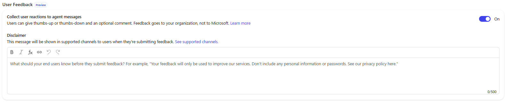

3. Se l'impostazione è stata modificata, selezionare **Save** e poi **Publish**.

### Aggiungere l'agente a Teams

1. Nell'**Agente Demand IT** selezionare **Channels** e poi **Teams and Microsoft 365 Copilot**.
2. Selezionare **See agent in Teams**. Si apre Teams (nel browser o nell'app) con la scheda dell'agente.

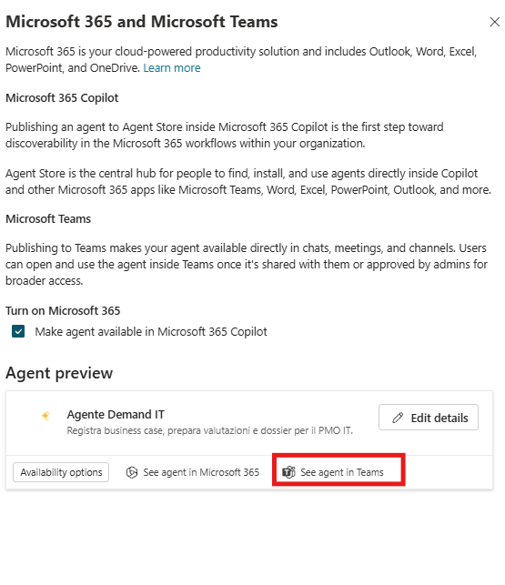

3. Selezionare **Add**. L'agente si installa nel proprio Teams e si apre la chat. Nessun altro lo vede: non è condiviso.

### Lasciare reazioni con commento

1. Nella chat di Teams con l'Agente Demand IT fare alcune domande, ad esempio:

```text
Come si calcola il punteggio di una proposta?
```

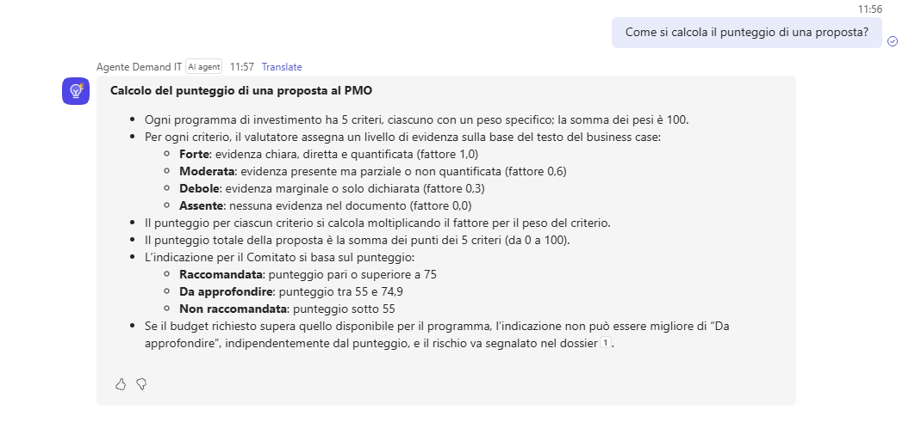

```text
Cosa succede se il budget richiesto supera il budget del programma?
```

```text
Quali formati di business case accetta il PMO?
```

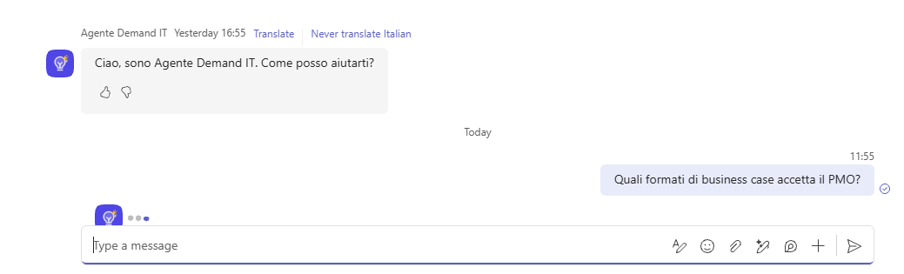

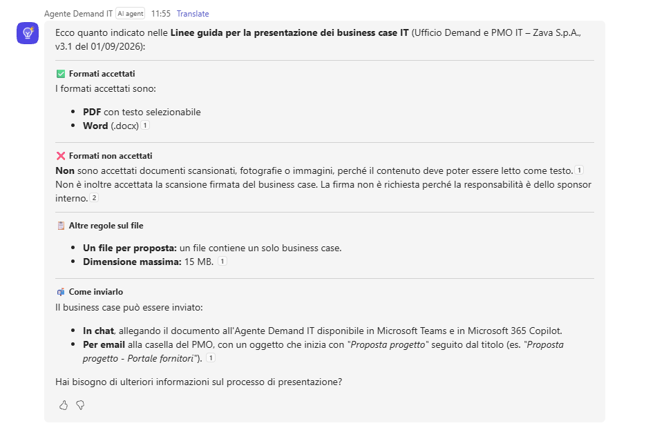

2. Passare con il mouse su una risposta: compaiono le icone **pollice su** e **pollice giù**. Selezionarne una: si apre una finestra in cui scrivere un commento. Scrivere il commento e inviarlo.

Esempi di commenti positivi:

```text
Chiara e precisa: il calcolo del punteggio è spiegato passo per passo.
```

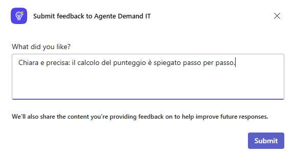

```text
Pertinente: la regola di budget è riportata con la soglia corretta.
```

Esempi di commenti negativi:

```text
Incompleta: non indica quale documento del PMO contiene la regola.
```

```text
Troppo lunga: per questa domanda bastavano due righe.
```

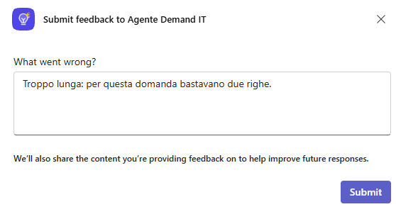

3. Ripetere finché non si sono lasciate tre o quattro reazioni con commento, sia positive sia negative.

### Leggere le reazioni in Copilot Studio

> [!NOTE]
> **Tempi di aggiornamento**
>
> Reazioni e commenti possono richiedere un po' di tempo prima di comparire (i dati si aggiornano ogni 15 minuti o più). Se non compaiono subito, proseguire con la sezione successiva e tornare qui alla fine del lab.

1. In Copilot Studio aprire l'Agente Demand IT e selezionare la scheda **Monitor**.

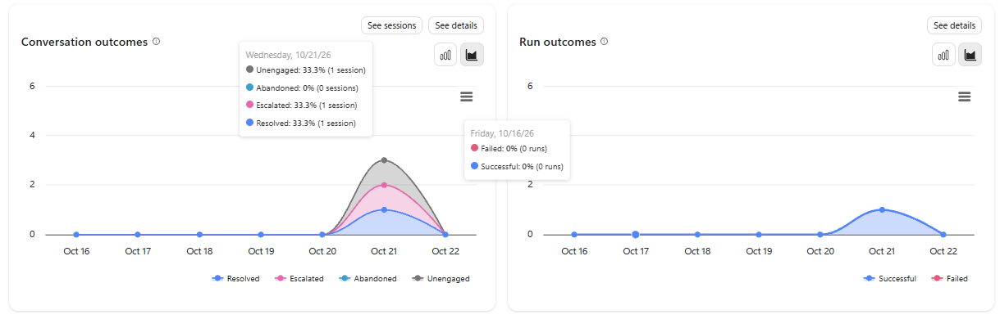

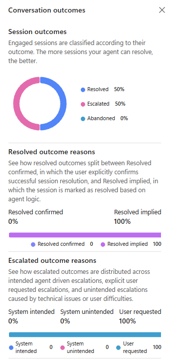

2. Scorrere fino alla sezione **Effectiveness**. Nel riquadro **Reactions** compare il numero di pollici su e pollici giù nel periodo selezionato.

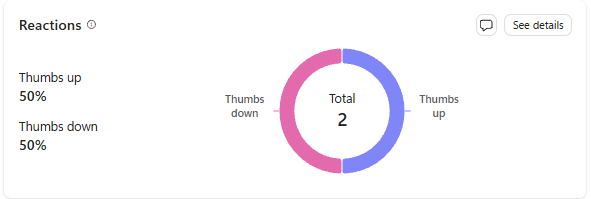

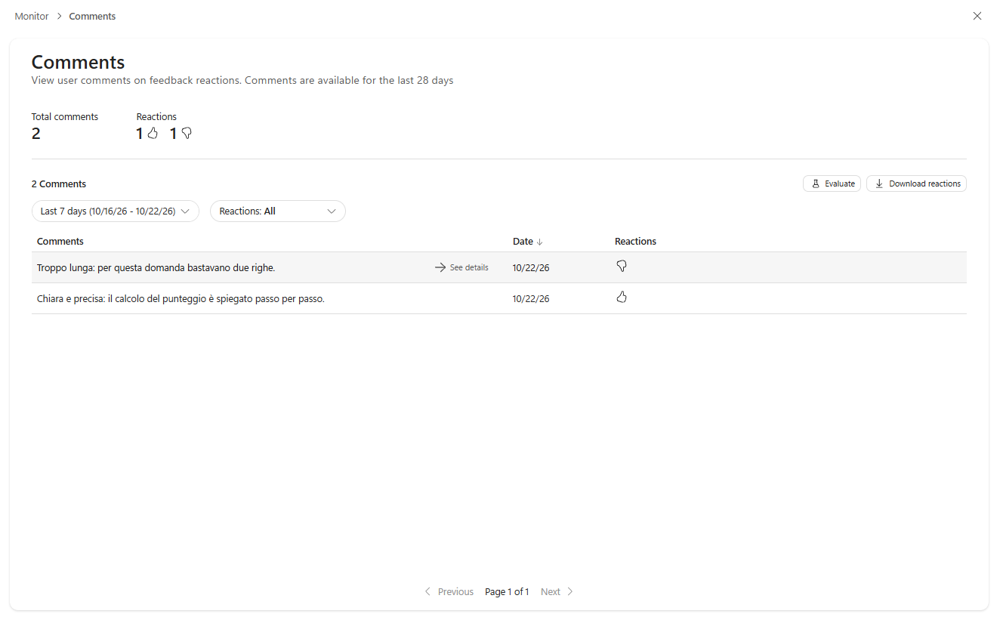

3. Aprire il dettaglio delle reazioni per leggere i commenti e la risposta dell'agente a cui ciascuno si riferisce.

> [!NOTE]
> **Testo delle conversazioni**
>
> Per vedere il testo delle conversazioni serve il ruolo di sicurezza **Bot Transcript Viewer** nell'ambiente.

> [!TIP]
> **Reazioni negative**
>
> Trattare ogni reazione negativa come un segnale da indagare, non come un punteggio. Riprodurre il caso nel pannello di test e, se rivela un problema reale, aggiungerlo come nuovo caso a un test set di S07.

## Topic "Approfondimento CSAT negativo"

Il questionario di fine conversazione (CSAT, da 1 a 5 stelle) dice quanto l'utente è soddisfatto, non perché. Un topic dedicato chiede il motivo con una adaptive card: verrà richiamato solo quando il voto è basso.

### Creare il topic

1. Nell'**Agente Demand IT** aprire la scheda **Topics**, selezionare **+ Add a topic** e poi **From blank**.

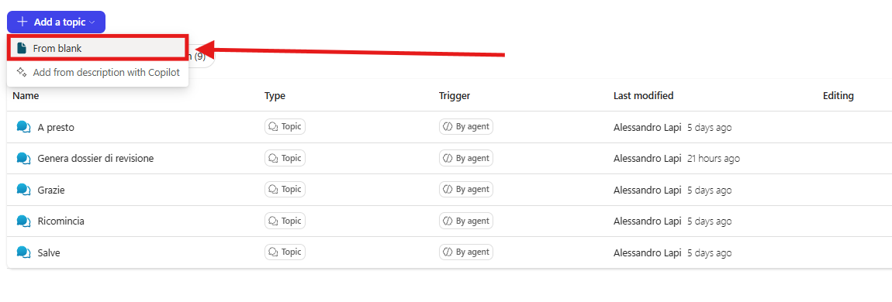

2. Selezionare il nome del topic in alto e rinominarlo:

```
Approfondimento CSAT negativo
```

3. Nel nodo **Trigger** selezionare l'icona **Change trigger** (le due frecce) e scegliere **It's redirected to**. Il topic partirà solo quando un altro topic lo richiama con **Go to another topic**.

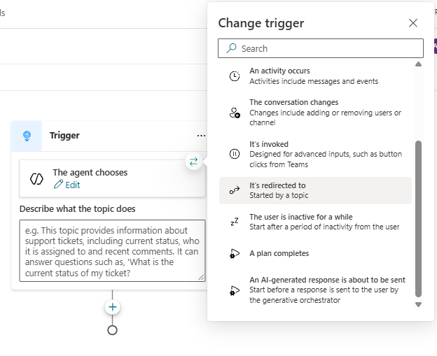

### Aggiungere la card

1. Sotto il trigger selezionare l'icona **+** e scegliere **Ask with adaptive card**.
2. Selezionare il nodo: si apre il pannello **Adaptive Card Node properties**. Selezionare **Edit adaptive card**.
3. Si apre l'**Adaptive Card Designer**. Fare clic nel **Card payload editor**, selezionare tutto il contenuto (Ctrl+A su Windows, Cmd+A su Mac), cancellarlo e incollare:

```json
{
  "$schema": "https://adaptivecards.io/schemas/adaptive-card.json",
  "type": "AdaptiveCard",
  "version": "1.5",
  "body": [
    {
      "type": "TextBlock",
      "text": "Ci aiuti a migliorare?",
      "weight": "Bolder",
      "size": "Medium",
      "wrap": true
    },
    {
      "type": "TextBlock",
      "text": "Che cosa non ha funzionato in questa conversazione?",
      "wrap": true
    },
    {
      "type": "Input.ChoiceSet",
      "id": "motivoId",
      "label": "Motivo",
      "style": "expanded",
      "isRequired": true,
      "errorMessage": "Seleziona un motivo.",
      "choices": [
        { "title": "La valutazione non mi convince", "value": "Valutazione" },
        { "title": "I dati del PMO non erano aggiornati", "value": "Dati" },
        { "title": "Il documento non è stato letto correttamente", "value": "Documento" },
        { "title": "Non ho capito come procedere", "value": "Processo" },
        { "title": "Lentezza o errori tecnici", "value": "Tecnico" },
        { "title": "Altro", "value": "Altro" }
      ]
    },
    {
      "type": "Input.Text",
      "id": "noteId",
      "label": "Commento",
      "placeholder": "Commento facoltativo",
      "isMultiline": true,
      "maxLength": 1000
    }
  ],
  "actions": [
    {
      "type": "Action.Submit",
      "title": "Invia"
    }
  ]
}
```

4. Nella **Card Preview** compaiono il titolo, l'elenco dei motivi e il campo del commento. Selezionare **Save**.

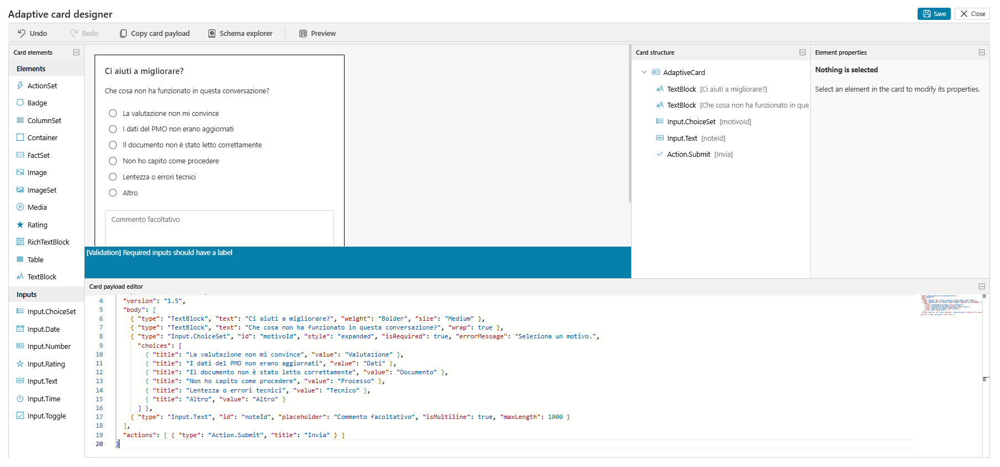

5. Chiudere il pannello **Adaptive Card Node properties** con **X**.
6. Nel canvas, in fondo al nodo della card, compaiono le variabili di output `motivoId` e `noteId`: contengono il motivo scelto e il commento.

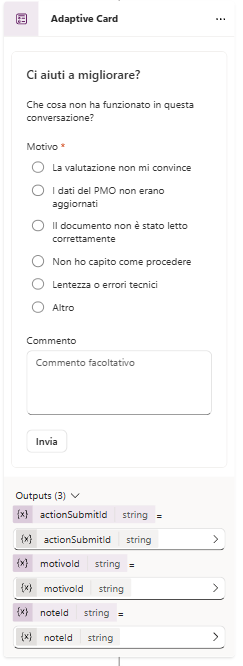

### Ringraziare e salvare

1. Sotto la card selezionare **+**, **Send a message** e inserire:

```text
Grazie, il tuo commento aiuta l'azienda a migliorare l'agente.
```

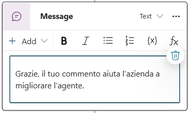

2. Selezionare **Save**.

## Collegamento al questionario di fine conversazione

Il topic esiste ma nessuno lo chiama. Va collegato al topic di sistema **End of Conversation** (o **Fine della Conversazione**), subito dopo la domanda CSAT, con una condizione sul voto.

### Salvare il voto in una variabile

1. In **Topics** selezionare il filtro **System** e aprire **End of Conversation**.
2. Individuare il nodo della domanda CSAT (la domanda con le stelle).
3. Sopra il nodo CSAT selezionare **+**, **Variable management**, **Set a variable value**.
4. In **Set variable** selezionare **Create a new variable**. Selezionare la variabile appena creata e, nel pannello **Variable properties**, rinominarla:

```
VarCSATRating
```

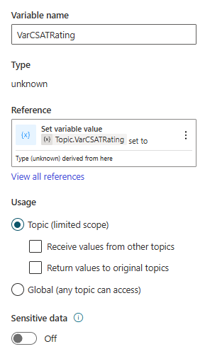

5. Nel campo **To value** inserire `0`: è una variabile numerica che conterrà il voto.

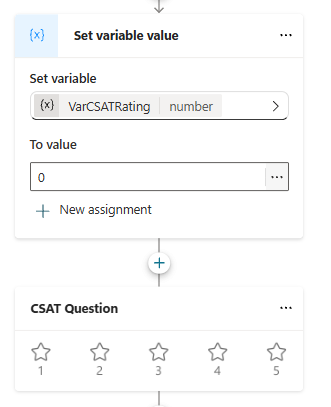

6. Nel nodo CSAT selezionare **...** e poi **Properties**. Nel campo della variabile in cui salvare la risposta inserire:

```
Topic.VarCSATRating
```

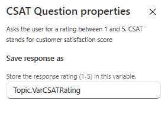

### Aggiungere la condizione

1. Sotto il nodo CSAT selezionare **+** e **Add a condition**.
2. Nella condizione selezionare la variabile **VarCSATRating**, l'operatore **is greater than or equal to** e come valore:

```
3
```

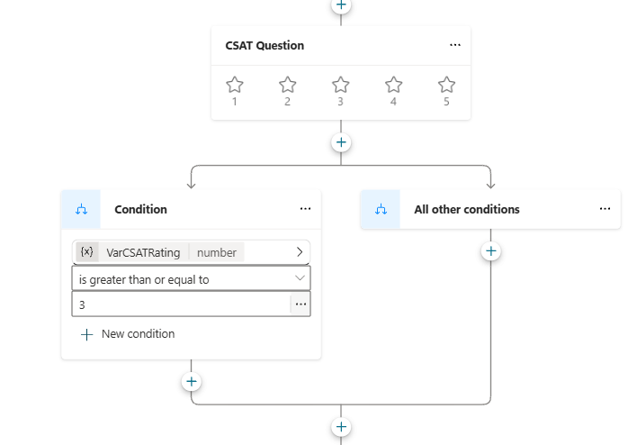

Con 3, 4 o 5 stelle la conversazione segue questo ramo e prosegue come prima. Con 1 o 2 stelle passa al ramo **All other conditions**.

3. Nel ramo **All other conditions** selezionare **+**, **Topic management**, **Go to another topic** e scegliere **Approfondimento CSAT negativo**.

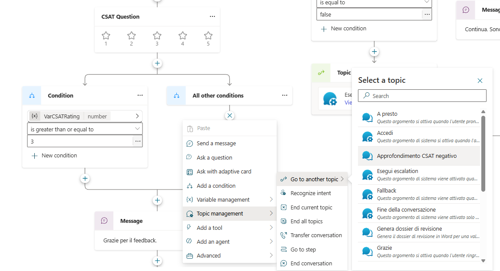

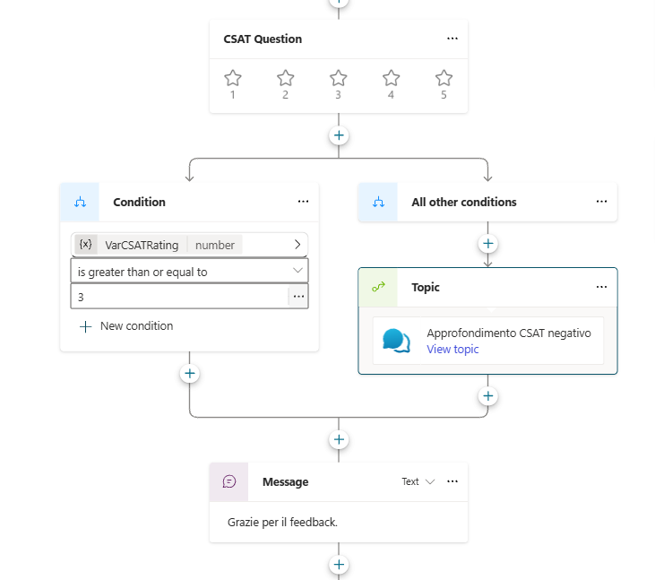

4. Selezionare **Save**.

## Testare l'agente

Il percorso si prova nel pannello di test: con un voto basso deve comparire la card di approfondimento, con un voto alto no.

1. Nel pannello di test selezionare **New test session** e fare una domanda qualsiasi, ad esempio:

```text
Che formato hanno i codici delle proposte?
```

2. Per avviare il topic **End of Conversation** inserire:

```text
fine conversazione
```

3. Rispondere **Yes** alla domanda sulla chiusura e **Yes** alla domanda se la richiesta è stata soddisfatta.

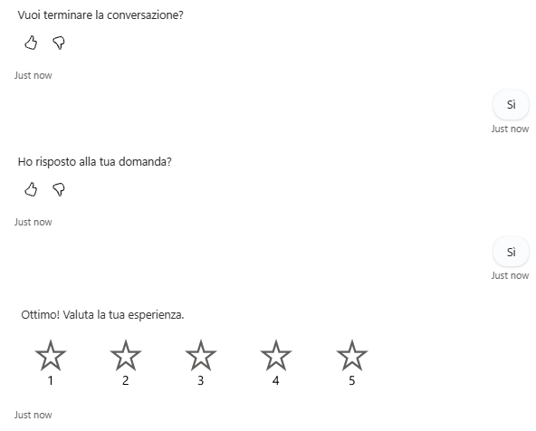

4. Alla domanda CSAT selezionare **1** o **2** stelle: compare la card **Ci aiuti a migliorare?**.

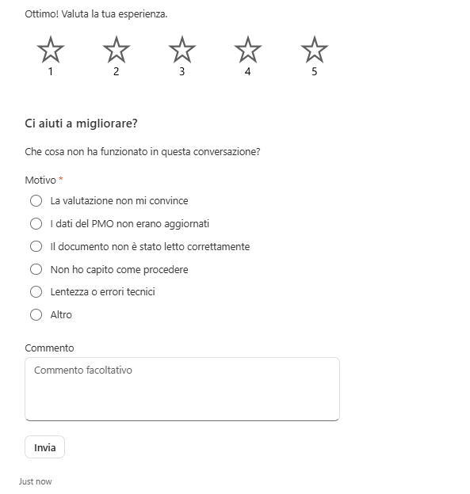

5. Scegliere un motivo e scrivere un commento, ad esempio:

```text
La valutazione assegna Debole a un criterio che il documento copre con numeri precisi.
```

```text
Il programma proposto non era quello indicato nel business case.
```

6. Selezionare **Invia**: compare il messaggio di ringraziamento e **End of Conversation** riprende con la domanda finale. Rispondere **No**.
7. Ripetere il test con **4** o **5** stelle: la card non deve comparire.

> [!IMPORTANT]
> **Lab Completato**
>
> L'Agente Demand IT ora raccoglie le reazioni degli utenti da Teams e, quando il voto CSAT è basso, chiede il motivo con una adaptive card. Con questo lab il percorso della standard harness è completo. Verificare che:
>
> 1. le reazioni con commento lasciate da Teams siano visibili in **Monitor**, sezione **Effectiveness**;
> 2. un voto CSAT di 1 o 2 stelle apra la card di approfondimento e un voto di 4 o 5 no.
>
> In questo lab si è visto:
>
> - quale domanda risolvono valutazioni, reazioni e questionario CSAT;
> - come raccogliere reazioni da un canale pubblicato e leggerle in Copilot Studio;
> - come personalizzare un topic di sistema e reindirizzare a un topic dedicato con una adaptive card.
