# Lab 01 - Environment Setup

Previous: Start | [Back to GitHub Harness](../index.md) | [Next: Lab 02](../02-knowledge-sources/README.md)

<!-- icon: clock-countdown --> **Tempo stimato:** ~75 minuti · <!-- icon: github-logo f-github --> **Harness:** GitHub Copilot

## Scenario

Zava vuole un unico assistente per i servizi interni: l'help desk IT di primo livello, che risponde ai problemi più comuni (password, VPN) e apre un ticket quando non basta; gli annunci di lavoro, che prepara e invia per conto di chi li richiede; la richiesta di un nuovo dispositivo aziendale, verificata sulla lista dei dispositivi. Nei lab di questa sezione si costruisce un solo agente, l'**Assistente Zava GH**, aggiungendo un pezzo per lab.

Prima di costruire serve un posto in cui lavorare. In questo lab si prepara tutto ciò che l'agente userà nei lab successivi, senza ancora crearlo. In particolare verranno svolte le seguenti attività:

- Ottenere un account Microsoft 365 e la trial di Copilot Studio.
- Preparare un ambiente dedicato al corso e abilitare la pubblicazione degli agenti.
- Verificare in Copilot Studio la nuova esperienza e l'ambiente selezionato.
- Creare il sito SharePoint **Zava Help Desk** con la cartella **Knowledge Base** e la lista **Dispositivi**.
- Creare in Power Apps il publisher **CSM Solutions (GitHub)** e la solution **Help Desk Zava (GitHub)**, che conterrà l'agente.

Persone, indirizzi, dispositivi e documenti di Zava sono fittizi, inventati per il corso.

> [!TIP]
> **Chi ha già svolto la Standard Harness**
>
> Se si segue il corso in aula, l'istruttore fornisce account e ambiente con i crediti già assegnati: partire dalla sezione *Verificare nuova esperienza e ambiente*. Chi ha completato il [Lab 01 della Standard Harness](../../standard-harness/01-environment-setup/README.md) può riusare account, trial e gruppo **AgentCreators**, ma deve leggere comunque la sezione sull'ambiente: il Developer Plan non è più una scelta adatta.

::: details <!-- icon: lightbulb f-instructions --> Perché questa scelta
- **Un ambiente dedicato, con Dataverse e crediti.** Nella GitHub Copilot harness anche le prove in **Preview** consumano Copilot Credits, che vengono addebitati all'ambiente: un ambiente del corso separato da quello predefinito tiene sotto controllo costi e componenti.
- **La solution prima dell'agente.** Nella GitHub Copilot harness la solution dell'agente si sceglie una volta sola, prima del primo salvataggio, e poi non si cambia più: publisher e solution vanno creati adesso, prima di aprire la scheda **Build**.
- **Power Apps, nello stesso ambiente di Copilot Studio.** Solution e publisher appartengono a un ambiente, non a un'applicazione. Power Apps e Copilot Studio hanno ciascuno il proprio selettore di ambiente: il controllo prima di creare è ciò che rende la solution visibile al primo salvataggio dell'agente.
- **Mai nella solution Default.** La solution Default non si può esportare, il suo publisher non si può cambiare e mescola i componenti di tutti i maker. Una solution propria si esporta, si versiona e si importa in altri ambienti.
- **Un publisher dedicato alla GitHub Copilot harness.** Il prefisso `csg` compare nei nomi tecnici (ad esempio lo schema name `csg_assistentezavagh`) e distingue questi componenti da quelli della Standard Harness, che usa il publisher **CSM Solutions** con prefisso `csm`. Lo stesso publisher sarà riusato dal caso pratico della [sezione Advanced](../../../advanced/github-harness/index.md), con valori delle scelte che partono da `770000000`.
- **Documenti e dati dove il team li mantiene.** Playbook, SLA e lista dei dispositivi vivono in SharePoint, dove il team IT li aggiorna: l'agente li leggerà sempre nella versione corrente, nel rispetto dei permessi di chi chiede.
:::

## Che cosa si costruisce

Lo schema mostra i passi del lab, nell'ordine, e dove si trova ciò che ognuno crea: è l'ambiente in cui si lavorerà in tutti i lab successivi.


## Prerequisiti

Per svolgere questo lab occorre avere:

1. un indirizzo email aziendale o scolastico (gli indirizzi personali, come @outlook.com o @gmail.com, non sono supportati);
2. accesso a internet e un browser (consigliati Edge, Chrome o Firefox);
3. familiarità con Microsoft 365;
4. (opzionale) una carta di credito o un altro metodo di pagamento, in caso di acquisto di licenze a pagamento.

> [!IMPORTANT]
> **Copilot Credits**
>
> Gli agenti della GitHub Copilot harness usano la fatturazione a consumo in **Copilot Credits**: creazione in linguaggio naturale, **Preview** e valutazioni consumano crediti già durante lo sviluppo, anche se l'agente non viene mai pubblicato. Prima di iniziare verificare con l'amministratore che l'ambiente del corso abbia crediti disponibili.

## Account e trial di Copilot Studio

Per accedere a Copilot Studio serve un tenant Microsoft 365 con la licenza appropriata. Si può usare un account esistente oppure procurarsene uno con i passi seguenti.

### Ottenere un Microsoft 365 Account

1. Andare su [Microsoft 365 Business Plans and Pricing Page](https://www.microsoft.com/microsoft-365/business/microsoft-365-plans-and-pricing).
2. Selezionare l'opzione meno costosa per iniziare, **Microsoft 365 Business Basic**, premere **Try for free** e compilare il form guidato con le informazioni per l'account e il metodo di pagamento.


3. Una volta ottenuto l'account, eseguire il login.

> [!NOTE]
> **Licenza Microsoft 365 Copilot**
>
> Per pubblicare agenti in **Microsoft 365 Copilot Chat** o collegarli ai dati aziendali (come **SharePoint, OneDrive o Dataverse**) è indispensabile una licenza **Microsoft 365 Copilot**. È un componente aggiuntivo (_add-on_): per i dettagli consultare il [sito](https://www.microsoft.com/microsoft-365/copilot#plans) dedicato alle opzioni di licenza.

### Iniziare la Copilot Studio Trial

1. Navigare su [aka.ms/TryCopilotStudio](https://aka.ms/TryCopilotStudio).


2. Inserire le informazioni dell'account creato e premere **Next**.


3. Una volta riconosciuto l'account, selezionare **Sign In**.

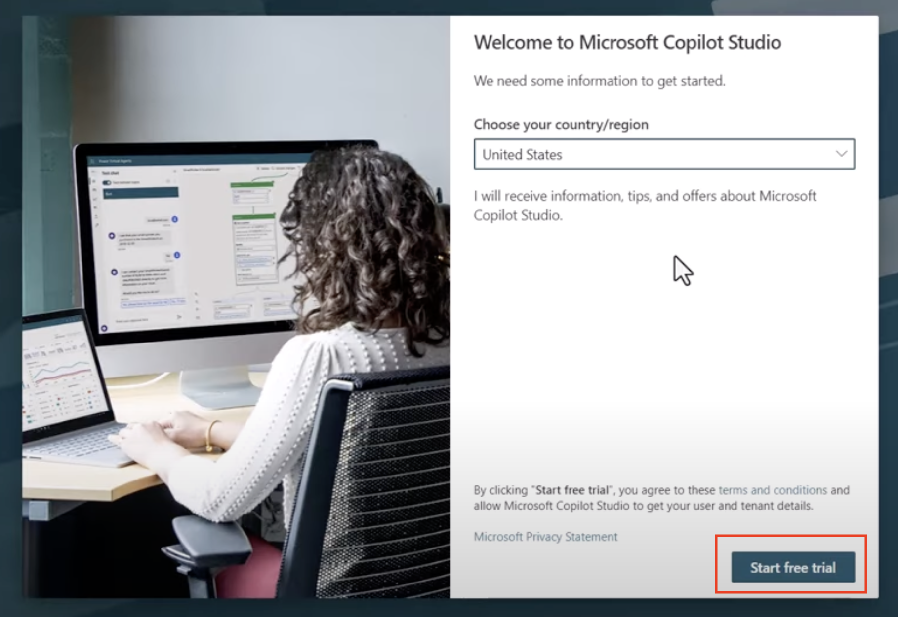

4. Premere **Start Free Trial**.

> [!NOTE]
> **Durata della prova**
>
> La versione di prova gratuita offre tutte le funzionalità di Copilot Studio e si può estendere a incrementi di 30 giorni (fino a un massimo di 90 giorni di runtime dell'agente). Se l'amministratore del tenant ha disattivato la registrazione self-service, verrà visualizzato un errore: in tal caso contattare l'amministratore Microsoft 365 per riattivarla.

## Ambiente del corso

Una best practice nello sviluppo di agenti è lavorare in un ambiente diverso da quello predefinito. Nella GitHub Copilot harness l'ambiente deve avere anche un database Dataverse e Copilot Credits disponibili.

### Creare un nuovo Developer Environment

1. Andare su [Power Apps Developer Plan website](https://aka.ms/PowerAppsDevPlan).

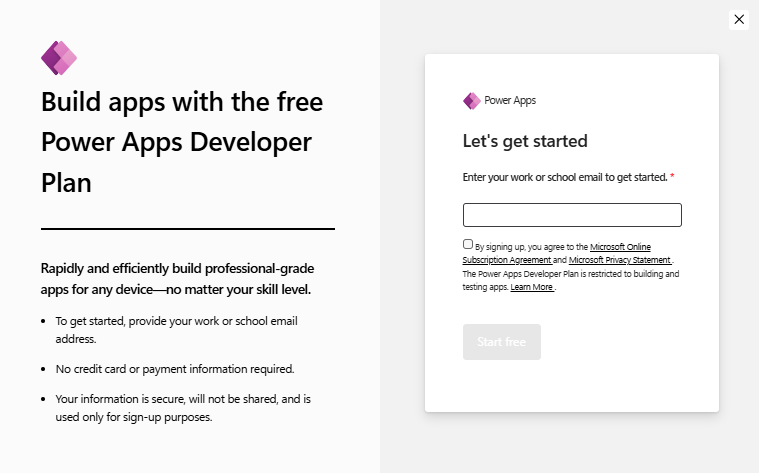

2. Inserire l'**email address**, spuntare la **checkbox** e selezionare **Start free**.
3. Dopo il login per il Developer Plan si apre [Power Apps](https://make.powerapps.com/): usare questo nuovo ambiente per tutti i lab.

> [!WARNING]
> **Developer Plan in dismissione**
>
> Gli ambienti Developer non gestiti, compresi quelli creati con il Power Apps Developer Plan, sono deprecati: dal 15 novembre 2026 l'iscrizione al Developer Plan non crea più un ambiente, dal 15 dicembre 2026 gli ambienti esistenti vengono sospesi e dal 15 gennaio 2027 eliminati (i Managed Environments non sono interessati). Se il Developer Plan non crea l'ambiente, creare un [ambiente di prova](https://learn.microsoft.com/power-platform/admin/trial-environments) con database Dataverse oppure chiedere all'amministratore un ambiente gestito o sandbox dedicato al corso, con Copilot Credits disponibili. Vedere [Important changes (deprecations) coming in Power Platform](https://learn.microsoft.com/power-platform/important-changes-coming#deprecation-of-unmanaged-developer-environments-and-the-power-apps-developer-plan).

> [!NOTE]
> **Account dell'organizzazione**
>
> Con un account esistente dell'organizzazione di lavoro è possibile che l'amministratore IT abbia disattivato la registrazione. In tal caso contattare l'amministratore oppure creare un tenant di test come indicato in *Ottenere un Microsoft 365 Account*.

### Abilitare la pubblicazione con la Copilot Studio Trial

Con la trial la pubblicazione degli agenti non è consentita per impostazione predefinita: va assegnato il ruolo **Copilot Studio Authors** a un **gruppo di sicurezza** che include gli utenti autorizzati, dal **Power Platform admin center**.

1. Andare sull'[Admin Center](https://admin.cloud.microsoft/).
2. Nella sezione **Teams & groups** selezionare **Active teams & groups**.


3. Andare su **Security groups**, premere **Add a security group**, chiamarlo `AgentCreators` e premere **Next**.

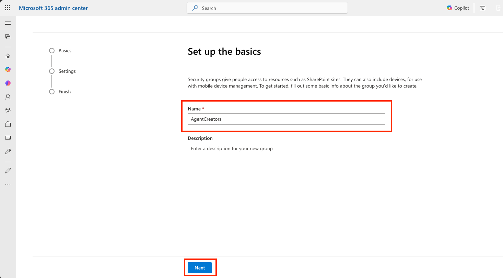

4. Verificare i dati inseriti e premere **Create group**, poi cercare il gruppo appena creato.

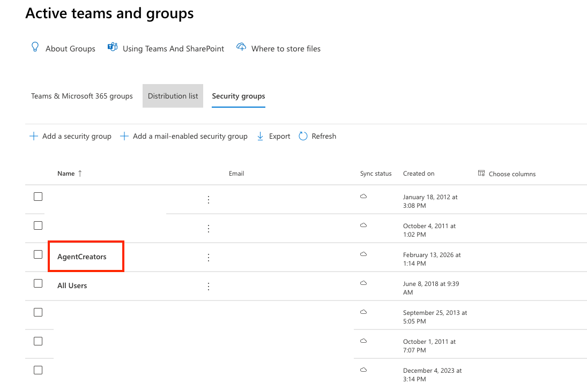

5. Andare nella sezione **Members** e premere **View all and manage members**.


6. Premere **Add members**, cercare il proprio account e aggiungersi come membro.
7. Andare sul [Power Platform admin center](https://admin.powerplatform.microsoft.com/).
8. Dalla schermata **Home** andare su **Manage** e poi **Tenant settings**.

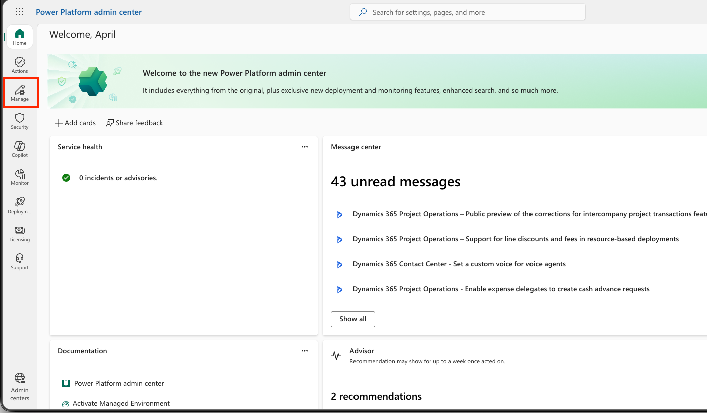

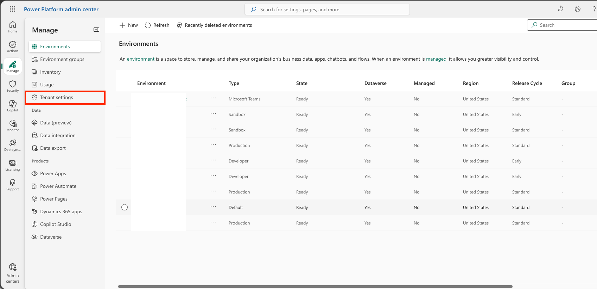

9. Selezionare **Copilot Studio Authors**, cambiare da **All Users** al gruppo `AgentCreators`, premere **Done** e poi **Save**.

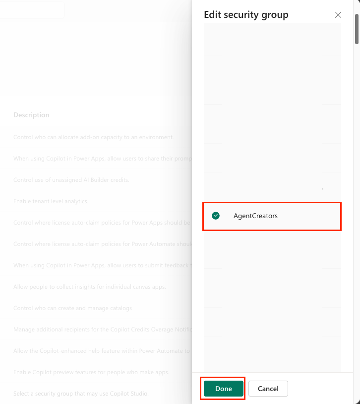

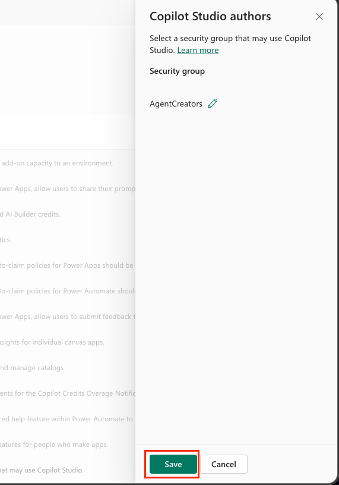

### Verificare nuova esperienza e ambiente

In Copilot Studio convivono più harness: è la nuova esperienza a mostrare nella home i componenti della GitHub Copilot harness. Controllare l'ambiente evita di creare l'agente nel posto sbagliato, un errore che non si corregge dopo il primo salvataggio.

1. Aprire [Copilot Studio](https://copilotstudio.microsoft.com/).
2. In alto a destra verificare che l'interruttore **New experience** sia attivo. La home mostra le schede **Agent**, **Workflow** e **App (preview)** con l'indicazione **GitHub Copilot**, e la casella di descrizione con l'etichetta **Uses Copilot Credits**.

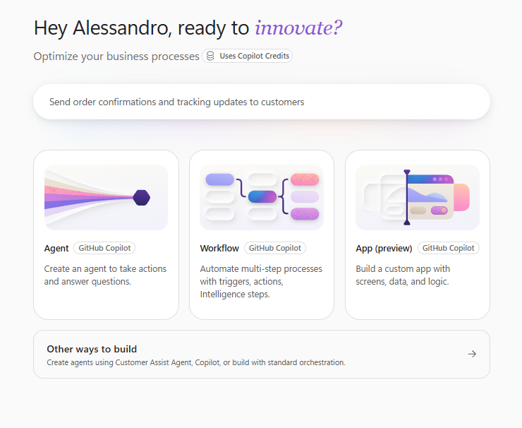

3. Espandere la barra laterale e controllare in basso il **selettore di ambiente**: deve indicare l'ambiente del corso. Se non è così, selezionarlo.

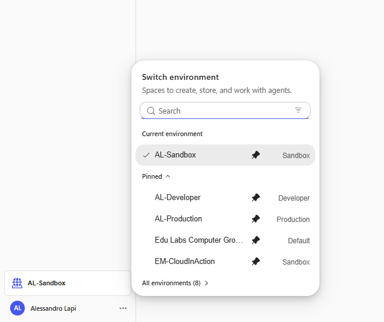

4. Annotare il nome dell'ambiente e il suo ID, cioè la sequenza dopo `/environments/` nell'indirizzo della pagina (ad esempio `https://copilotstudio.microsoft.com/environments/<ID-ambiente>/...`): servirà per controllare che Power Apps sia nello stesso ambiente.

> [!TIP]
> **Controllare l'ambiente prima di ogni lab**
>
> Se qualcosa che ci si aspetta non c'è (ad esempio la solution al primo salvataggio dell'agente), la causa più frequente è l'ambiente sbagliato. Il selettore di Copilot Studio e quello di Power Apps sono indipendenti.

> [!NOTE]
> **Crediti esauriti**
>
> Se in **Preview** compare un messaggio che dice che servono crediti per continuare, l'ambiente non ha Copilot Credits disponibili. L'amministratore li assegna dal Power Platform admin center (**Licensing**, **Copilot Studio**, **Manage Copilot Credits**). Vedere [Enforcement policy for agents consuming Copilot Credits](https://learn.microsoft.com/microsoft-copilot-studio/agents-experience/enforcement-policy-credits).

## Sito SharePoint "Zava Help Desk"

La documentazione che il team IT aggiorna spesso resta dove il team la mantiene: un sito SharePoint. Nel Lab 02 il sito diventa una fonte di conoscenza dell'agente; nello stesso sito vive la lista dei dispositivi che il workflow del Lab 05 consulterà.

> [!NOTE]
> **Screenshot**
>
> Alcuni screenshot di questa sezione vengono da una versione precedente del corso e mostrano nomi e dati diversi (sito, cartella, lista e colonne): i comandi sono gli stessi, usare sempre i valori indicati nel testo.

### Creare il sito

1. Aprire [Microsoft 365](https://m365.cloud.microsoft/), selezionare **Apps** e poi **SharePoint**.
2. Selezionare **Create site**, poi **Team site**, il modello **Standard team** e **Use template**.

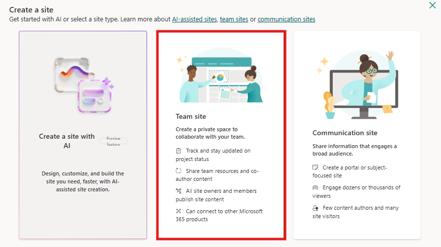

3. Compilare i dettagli e selezionare **Next**, poi **Create site** e **Finish**:

| Campo | Valore |
| --- | --- |
| Site name | `Zava Help Desk - Vostro Nome` |
| Site description | `Copilot Studio Masterclass` |
| Site address | `ZavaHelpDesk` |
| Admin | il proprio account |

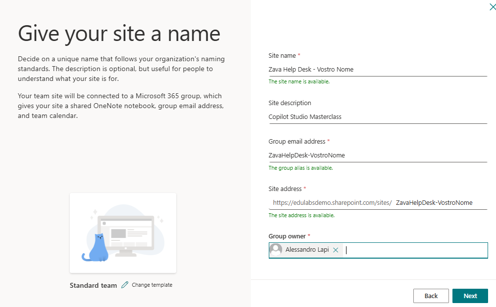

4. Annotare l'indirizzo del sito, ad esempio `https://<tenant>.sharepoint.com/sites/ZavaHelpDesk`: servirà nei Lab 02 e 05.

> [!NOTE]
> **Interfaccia di SharePoint**
>
> L'interfaccia di SharePoint cambia spesso. Se non compare **Create site**, cercare il comando per creare un sito nella home di SharePoint (ad esempio sotto **Build**, **Site**).

### Cartella "Knowledge Base" e documenti

I documenti operativi dell'Help Desk (il playbook, gli SLA e l'esempio di incident report) vanno in una cartella dedicata del sito. La KB sul reset della password e le tre versioni della guida VPN, invece, non vanno qui: nel Lab 02 si caricano direttamente nell'agente come file.

1. Nel sito **Zava Help Desk** aprire **Documents**.
2. Selezionare **Create or upload**, poi **Folder**, inserire il nome e selezionare **Create**:

```
Knowledge Base
```

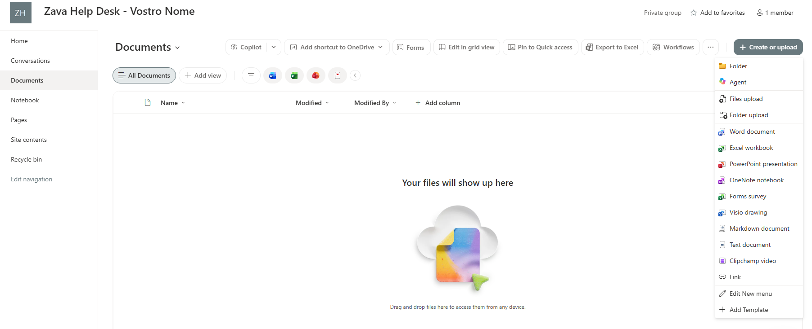

3. Aprire la cartella, selezionare **Upload**, poi **Files**, e caricare i seguenti file, da scaricare prima sul proprio computer:

   - [`Zava_Help_Desk_Playbook.docx`](../../../resources/fondamentali/02-knowledge-sources/Zava_Help_Desk_Playbook.docx)
   - [`Zava_Help_Desk_SLA.docx`](../../../resources/fondamentali/02-knowledge-sources/Zava_Help_Desk_SLA.docx)
   - [`Zava_Incident_Report_Template_Example.docx`](../../../resources/fondamentali/02-knowledge-sources/Zava_Incident_Report_Template_Example.docx)

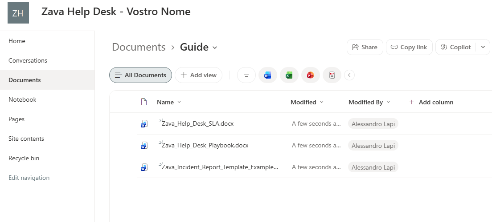

4. Compilare la colonna **Title** dei tre documenti con titoli descrittivi: `Playbook Help Desk Zava`, `SLA Help Desk Zava` e `Modello ed esempio di incident report Zava`. Il titolo aiuta l'agente a scegliere che cosa leggere all'interno del sito.

### Lista "Dispositivi"

La lista dice quali dispositivi aziendali (laptop, desktop, smartphone) esistono in inventario e in che stato si trovano. Nel Lab 05 il workflow la leggerà per decidere se il dispositivo richiesto è disponibile, esaurito o fuori catalogo. Il file CSV contiene anche lo schema della lista, così nomi e tipi delle colonne sono già quelli che il workflow si aspetta.

1. Tornare alla home del sito **Zava Help Desk**.
2. Selezionare **New**, **List**, **From CSV** e caricare [`Devices-CSM.csv`](../../../resources/fondamentali/05-device-request-agent-flows/Devices-CSM.csv).

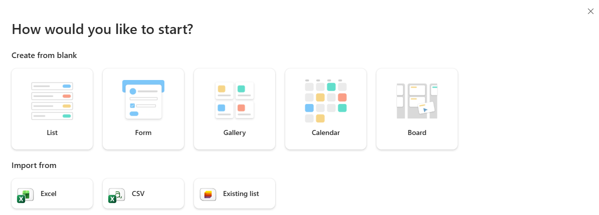

3. Nella schermata **Customize** controllare i tipi di colonna proposti senza cambiarli e selezionare **Next**.

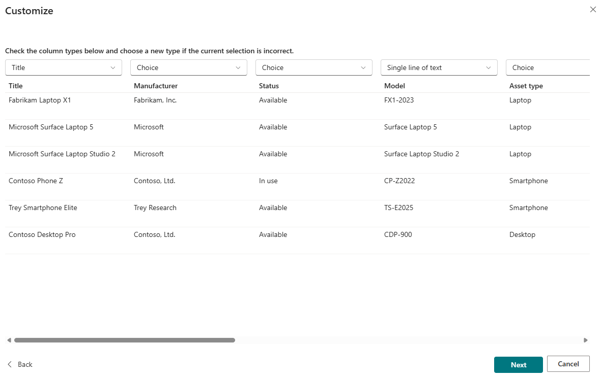

4. Inserire il nome della lista e selezionare **Create**:

```
Dispositivi
```

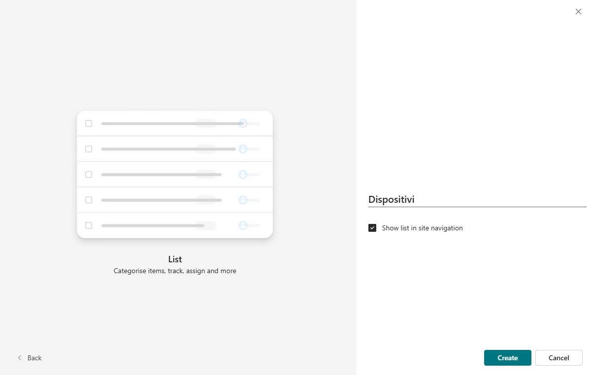

5. Controllare che la lista contenga 6 dispositivi con le colonne **Title**, **Manufacturer**, **Status**, **Model**, **Asset type**, **Color**, **Serial number**, **Purchase date**, **Purchase price** e **Order #**, e che il **Contoso Phone Z** abbia **Status** `In use` mentre gli altri cinque sono `Available`.

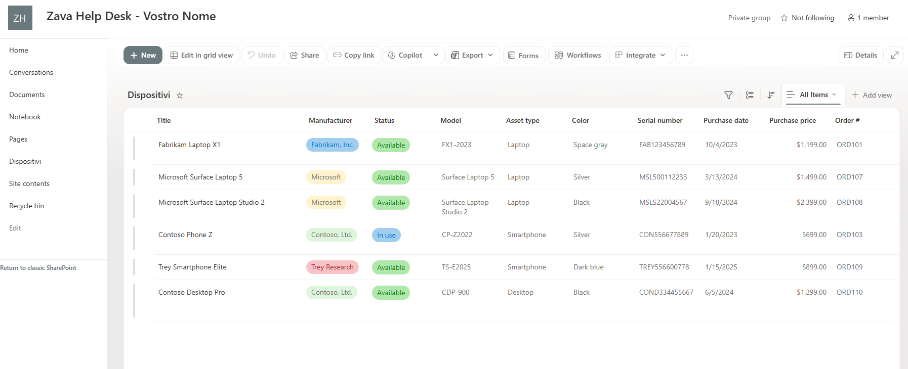

> [!IMPORTANT]
> **Valori in inglese**
>
> Lo schema crea **Status**, **Manufacturer**, **Asset type** e **Color** come colonne di scelta: il workflow del Lab 05 confronta i valori in inglese (`Available`, `In use`, `Laptop`, `Desktop`, `Smartphone`), quindi non tradurli e non rinominare le colonne.

## Publisher e solution

L'Assistente Zava GH un giorno dovrà passare dall'ambiente del corso a un ambiente di test e poi di produzione. In Power Platform questo viaggio si fa con una **solution**, il pacchetto che contiene l'agente e tutto ciò che gli serve (workflow, riferimenti alle connessioni, variabili d'ambiente). Ogni solution ha un **publisher**, che con il suo prefisso identifica chi ha creato i componenti. Publisher e solution si creano in **Power Apps**: Copilot Studio li legge dall'ambiente.

> [!NOTE]
> **Solution unmanaged e managed**
>
> Una solution **unmanaged** si usa in sviluppo: si possono aggiungere, modificare e rimuovere componenti. Una solution **managed** si importa in test e produzione ed è bloccata. In questo corso si lavora sempre in una solution unmanaged. Per creare publisher e solution servono i permessi adatti: chi ha creato l'ambiente è amministratore di sistema e li ha già; in un ambiente fornito da altri, chiederli all'amministratore.

### Aprire Power Apps nell'ambiente giusto

1. In una nuova scheda del browser aprire Power Apps:

```
https://make.powerapps.com
```

2. Prima di qualsiasi altra operazione controllare il selettore di ambiente in alto a destra: deve indicare l'ambiente del corso annotato in Copilot Studio. Se indica un altro ambiente, selezionare quello del corso.
3. Confrontare l'ID: nell'indirizzo di Power Apps (`https://make.powerapps.com/environments/<ID-ambiente>/...`) deve essere identico a quello annotato in Copilot Studio. In alternativa, selezionare l'icona **Settings** (ingranaggio) e poi **Session details**, dove compare l'**Environment ID**.

> [!WARNING]
> **Ambienti con nomi simili**
>
> Due ambienti possono avere nomi simili: il confronto affidabile è sull'ID. Se publisher e solution nascono nell'ambiente sbagliato, la solution **Help Desk Zava (GitHub)** non compare nel campo **Solution** quando si salva l'agente nel Lab 02, e l'agente finisce in una solution di sistema che non si può più cambiare.

4. Nel riquadro di navigazione a sinistra selezionare **Solutions** (se non è visibile, cercarlo sotto **More**).
5. Premere **+ New solution**.


> [!NOTE]
> **Scorciatoia da Copilot Studio**
>
> In Copilot Studio il menu con i tre puntini (**…**) in fondo alla barra laterale, **Solutions**, apre **Solution Explorer** già nell'ambiente selezionato. Le operazioni sono le stesse; in questo corso si usa Power Apps come riferimento, e con la scorciatoia l'ambiente va controllato comunque.
>
> 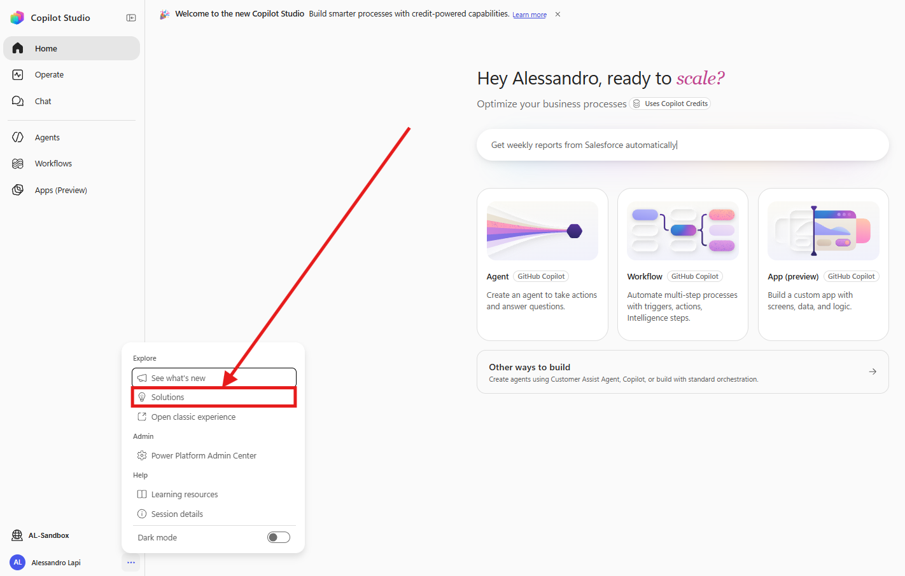

### Creare il publisher

Il prefisso del publisher viene aggiunto ai nomi tecnici di tutto ciò che si crea nelle sue solution e non si può cambiare per i componenti già creati: va deciso adesso.

1. Nel pannello **New solution** selezionare **+ New publisher**.

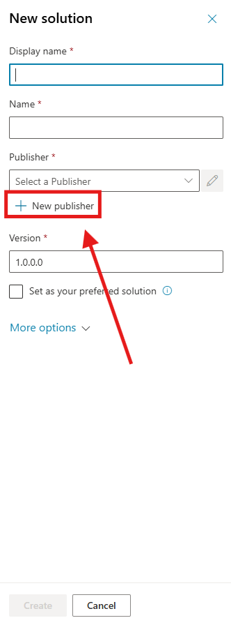

2. Nella scheda **Properties** compilare i dettagli del publisher:

| Campo | Valore |
| --- | --- |
| Display name | `CSM Solutions (GitHub)` |
| Name | `CSMSolutionsGitHub` |
| Description | `Copilot Studio Masterclass` |
| Prefix | `csg` |
| Choice value prefix | `77000` |

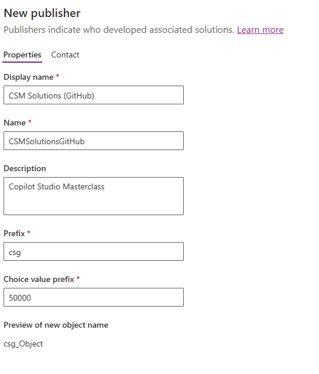

> [!NOTE]
> **Nomi nello screenshot**
>
> Lo screenshot mostra i valori della Standard Harness (**CSM Solutions**, prefisso `csm`): usare quelli della tabella.

3. Premere **Save**. Il pannello **New solution** si riapre con il publisher appena creato selezionato.

> [!IMPORTANT]
> **Publisher già presente**
>
> Se il publisher **CSM Solutions (GitHub)** esiste già nell'ambiente, selezionarlo dall'elenco invece di crearne uno nuovo. Non usare il publisher **CSM Solutions** della Standard Harness: ha prefisso `csm`.

### Creare la solution

1. Con il publisher **CSM Solutions (GitHub)** selezionato, compilare **Display name**:

```
Help Desk Zava (GitHub)
```

2. Compilare **Name**:

```
HelpDeskZavaGitHub
```

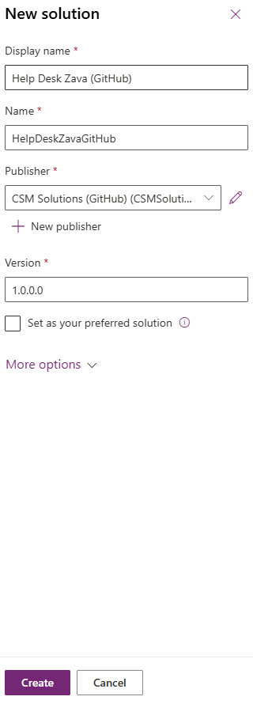

3. Lasciare il [**Version**](https://learn.microsoft.com/power-apps/maker/data-platform/update-solutions#understanding-version-numbers-for-updates) predefinito `1.0.0.0`.
4. Selezionare la casella **Set as your preferred solution**.
5. Lasciare vuoti i campi di **More options** e premere **Create**.
6. Selezionare la freccia indietro per tornare all'elenco **Solutions**: la **Current preferred solution** è **Help Desk Zava (GitHub)**.

> [!NOTE]
> **Nome visualizzato e nome univoco**
>
> Lo screenshot mostra i nomi di una versione precedente del corso: usare **Help Desk Zava (GitHub)** e `HelpDeskZavaGitHub`. Il campo **Name** accetta solo lettere, numeri e trattini bassi e non si può più cambiare dopo il salvataggio: per questo il nome visualizzato contiene le parentesi, il nome univoco no. La solution preferita è un'impostazione per utente: ogni maker che lavora sullo stesso agente deve impostare la stessa.

## Verificare l'ambiente

1. In Copilot Studio l'interruttore **New experience** è attivo e il selettore di ambiente indica l'ambiente del corso, di cui sono annotati nome e ID.
2. Nel Power Platform admin center l'impostazione **Copilot Studio Authors** usa il gruppo `AgentCreators`, di cui si è membri.
3. Il sito **Zava Help Desk** contiene la cartella **Knowledge Base** con playbook, SLA ed esempio di incident report, e la lista **Dispositivi** con 6 dispositivi, di cui 5 `Available`.
4. In Power Apps, nello stesso ambiente (stesso ID), la solution **Help Desk Zava (GitHub)** compare con publisher **CSM Solutions (GitHub)**, prefisso `csg`, ed è la solution preferita.
5. La solution è ancora vuota e nella pagina **Agents** di Copilot Studio non c'è nessun nuovo agente: si crea nel Lab 02.

> [!IMPORTANT]
> **Lab Completato**
>
> L'ambiente di lavoro è pronto per l'Assistente Zava GH. In questo lab si è visto:
>
> - come ottenere un tenant Microsoft 365 e la trial di Copilot Studio, e quale ambiente usare al posto del Developer Plan;
> - come abilitare la pubblicazione con il ruolo **Copilot Studio Authors**;
> - come riconoscere la nuova esperienza di Copilot Studio e controllare l'ambiente selezionato;
> - come preparare in SharePoint i documenti dell'Help Desk e la lista dei dispositivi;
> - perché nella GitHub Copilot harness publisher e solution si creano in Power Apps, nello stesso ambiente, prima dell'agente.
