# Lab 05 - Automating with Workflows

[Previous: Lab 04](../04-adding-skills/README.md) | [Back to GitHub Harness](../index.md)

<!-- icon: clock-countdown --> **Tempo stimato:** ~90 minuti · <!-- icon: github-logo f-github --> **Harness:** GitHub Copilot

## Scenario

I dispositivi aziendali di Zava (laptop, desktop, smartphone) sono censiti nella lista SharePoint **Dispositivi** del sito **Zava Help Desk**, con stato, produttore, modello e dati di acquisto. Oggi chi ha bisogno di un nuovo dispositivo deve chiedere quali sono disponibili e poi scrivere al proprio responsabile: l'IT vuole che tutto avvenga in chat, con una richiesta che arriva al responsabile già completa e solo se il dispositivo si può davvero assegnare.

Nel [Lab 05](../../standard-harness/05-device-request-agent-flows/README.md) della standard harness lo scenario è risolto con due topic, una adaptive card e un **agent flow**. Qui l'**Assistente Zava GH** guida la conversazione con la skill `richiesta-dispositivo` e passa la richiesta confermata a un **workflow**, **Invia richiesta dispositivo**, che rilegge la lista e segue sempre uno di tre percorsi:

| Percorso | Che cosa fa il workflow | Esito restituito all'agente |
| --- | --- | --- |
| Dispositivo disponibile (`Status` uguale a `Available`) | Invia la richiesta al responsabile via email | `DISPONIBILE` |
| Dispositivo non disponibile (ad esempio `In use`) | Non invia nulla | `ESAURITO` |
| Dispositivo non presente nella lista | Non invia nulla | `NON_IN_CATALOGO` |

In tutti e tre i casi il workflow restituisce anche il modello (`ModelValue`), che l'agente cita nella risposta. Il nome di chi richiede lo prende l'agente dal profilo Microsoft 365 con **Get my profile (V2)**, lo strumento del Lab 03. In particolare verranno svolte le seguenti attività:

- Controllare i nomi interni delle colonne della lista **Dispositivi**.
- Creare il workflow **Invia richiesta dispositivo** con trigger da agente, una lettura della lista, due condizioni e tre risposte all'agente.
- Pubblicare il workflow e aggiungerlo come strumento, insieme allo strumento di lettura **Leggi dispositivi**.
- Caricare la skill `richiesta-dispositivo` e aggiornare le istruzioni.
- Provare i tre percorsi dall'agente e ispezionare le esecuzioni del workflow.

::: details <!-- icon: lightbulb f-instructions --> Perché questa scelta
- **Giudizio all'agente, regole al workflow.** Capire quale tipo di dispositivo serve, mostrare le opzioni, raccogliere i requisiti e ottenere la conferma è lavoro di giudizio: lo fanno l'agente e la skill. Controllare lo stato del dispositivo e inviare la richiesta sono regole fisse: le esegue il workflow, che con lo stesso input produce sempre lo stesso risultato.
- **Workflow invece di agent flow.** Nella GitHub Copilot harness le automazioni sono **workflow**: oggetti autonomi in Copilot Studio, con un designer proprio, un **Health Center** che segnala gli errori, il test dei singoli nodi e la scheda **Activity** per ispezionare le esecuzioni. Un workflow pubblicato può essere usato come strumento da qualsiasi agente dell'ambiente.
- **Un contratto esplicito.** Il trigger **When an agent calls the workflow** definisce gli input, con nome e descrizione; il nodo **Respond to the agent** definisce gli output. Ogni percorso risponde con gli stessi output, così l'agente riceve sempre la stessa forma.
- **Un esito codificato.** Il workflow restituisce un codice (`DISPONIBILE`, `ESAURITO`, `NON_IN_CATALOGO`); le istruzioni dell'agente decidono come comunicarlo. I fatti vengono dal workflow, le parole dall'agente.
- **Due controlli dello stato, per due ragioni.** Per mostrare le opzioni la skill legge solo i dispositivi `Available` con lo strumento **Leggi dispositivi**. Il workflow però rilegge l'elemento al momento dell'invio: nel frattempo qualcuno può aver preso lo stesso dispositivo, e una richiesta per un dispositivo non più disponibile non deve arrivare al responsabile.
- **L'ID dell'elemento, non il nome.** La skill associa ogni opzione all'ID dell'elemento SharePoint e lo passa al workflow come `sharepointItemId`: un identificatore non è ambiguo, mentre il nome di un modello può essere scritto in più modi.
- **Il richiedente da una fonte affidabile.** Il nome di chi richiede arriva da **Get my profile (V2)**: non viene chiesto in chat e non si può dichiarare di essere un'altra persona.
- **Limiti da conoscere.** Il workflow deve rispondere all'agente entro 100 secondi, con la risposta asincrona disattivata, e deve essere pubblicato per comparire tra gli strumenti. Ogni azione eseguita consuma capacità di Copilot Studio.
:::

## Che cosa si costruisce

Lo schema mostra il workflow **Invia richiesta dispositivo** alla fine del lab: una lettura della lista, due condizioni e tre risposte all'agente con lo stesso contratto; solo il percorso del dispositivo disponibile invia l'email al responsabile.


## Prerequisiti

Per svolgere questo lab occorre avere:

- completato il [Lab 04](../04-adding-skills/README.md): l'agente **Assistente Zava GH** con gli strumenti **Get my profile (V2)** e **Invia guida via email**, le skill `supporto-tecnico`, `apertura-ticket` e `guida-passo-passo` e le istruzioni che terminano con le sezioni **# Strumenti ed email** e **# Procedure**;
- il sito SharePoint **Zava Help Desk - Vostro Nome** (indirizzo `ZavaHelpDesk`) con la lista **Dispositivi**, creata nel [Lab 01](../01-environment-setup/README.md);
- la skill [`richiesta-dispositivo/SKILL.md`](../../../resources/fondamentali/github-harness/05-automating-with-workflows/richiesta-dispositivo/SKILL.md), che nel Lab 04 non è stata caricata;
- una casella Outlook del tenant di laboratorio: il workflow invierà email reali al proprio indirizzo.

> [!WARNING]
> **Managed Environment**
>
> Se si usa un ambiente esistente della propria organizzazione, verificare che non sia un **Managed Environment** con restrizioni: aggiungere workflow come strumenti potrebbe essere bloccato.

## Lista Dispositivi - nomi interni

Il workflow cercherà il dispositivo per ID e ne leggerà stato, produttore e modello. La lista è stata creata nel Lab 01 da un CSV che contiene anche lo schema, quindi i nomi interni dovrebbero essere già quelli giusti; prima di scrivere filtri ed espressioni conviene comunque controllarli, perché SharePoint assegna il nome interno alla creazione della colonna e non lo cambia più, anche se si rinomina la colonna.

1. Aprire il sito **Zava Help Desk - Vostro Nome** e la lista **Dispositivi**. Controllare che contenga sei dispositivi e che **Contoso Phone Z** abbia **Status** uguale a `In use`.

2. Nella vista della lista selezionare **+ Add column** e poi **Show/hide columns**, selezionare **ID** e applicare: la colonna **ID** mostra l'ID di ogni elemento.

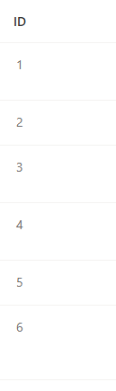

3. Annotare l'ID di **Microsoft Surface Laptop 5** e quello di **Contoso Phone Z**: è l'ID dell'elemento SharePoint che la skill passerà al workflow, e serve nei test.

4. Aprire **List settings**, selezionare la colonna **Asset type** e leggere il parametro `Field=AssetType` nell'indirizzo della pagina. Ripetere per **Status** (`Field=Status`) e **Model** (`Field=Model`).

| Nome visualizzato | Nome interno atteso | Tipo |
| --- | --- | --- |
| Title | `Title` | Testo |
| Manufacturer | `Manufacturer` | Scelta |
| Status | `Status` | Scelta: `Available`, `Reserved`, `In use`, `In repair`, `Retired` |
| Model | `Model` | Testo |
| Asset type | `AssetType` | Scelta: `Smartphone`, `Laptop`, `Desktop` |
| Color | `Color` | Scelta |
| Order # | `OrderNumber` | Testo |

> [!IMPORTANT]
> **Nomi interni e colonne di scelta**
>
> **Asset type** ha nome interno `AssetType`, senza spazio. Le colonne di scelta restituiscono un oggetto con la proprietà `Value`: per questo le espressioni del workflow leggono `?['Status']?['Value']` e non `?['Status']`. I valori delle scelte sono in inglese: non tradurli. Se la lista è stata creata in un altro modo e i nomi interni sono diversi, usare i propri nel workflow e negli strumenti.

## Workflow - Invia richiesta dispositivo

### Creare il workflow e definire il contratto

Il contratto viene prima della logica: gli input dicono all'agente che cosa deve passare, gli output che cosa riceverà. I nomi e le descrizioni degli input sono quelli che la skill `richiesta-dispositivo` usa al passaggio di invio.

1. Nella barra laterale di Copilot Studio selezionare **Workflows**, poi **New workflow**. Il designer si apre con un nodo **Start** con trigger **Manual**.

> [!NOTE]
> **Il designer dei workflow**
>
> Il designer ha a sinistra il nome e lo stato del workflow e la tavolozza dei nodi; al centro le schede **Build**, **Activity** e **Monitor** e la tela; a destra i comandi (annulla, ripristina, cronologia delle versioni, salva, prova, problemi, pubblica) e il pannello di configurazione del nodo selezionato.

2. Rinominare il workflow:

```text
Invia richiesta dispositivo
```

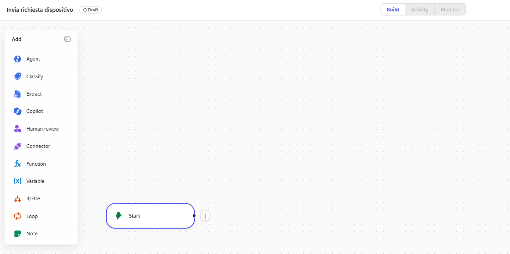

3. Selezionare il nodo **Start** e cambiare il **Trigger type** in **When an agent calls the workflow**. Sulla tela il nodo può comparire come **When an agent calls the flow**: è lo stesso trigger.

4. Con **Add an input** aggiungere tre input di tipo testo, ciascuno con la sua descrizione:

| Nome | Descrizione |
| --- | --- |
| `sharepointItemId` | `ID numerico dell'elemento della lista SharePoint Dispositivi corrispondente al dispositivo scelto dall'utente` |
| `additionalComment` | `Requisiti aggiuntivi indicati dall'utente (ad esempio RAM, memoria, accessori). Se non ce ne sono, il testo Nessun requisito aggiuntivo` |
| `requestorName` | `Nome visualizzato di chi fa la richiesta, come restituito da Get my profile (V2)` |

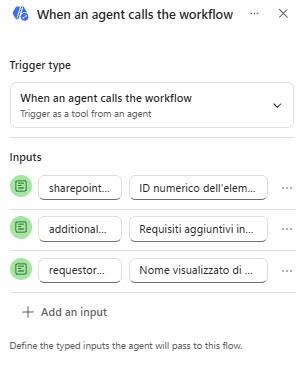

Il workflow copia `requestorName` e `additionalComment` nell'email così come li riceve: da dove prendere i valori lo dicono le descrizioni degli input, la skill e le istruzioni dell'agente.

### Cercare il dispositivo nell'inventario

Una sola lettura della lista, filtrata sull'ID e limitata a un elemento, basta a distinguere i casi: se non torna nulla l'ID non corrisponde a nessun dispositivo, altrimenti si guarda lo stato.

1. Selezionare **+** (**Add a step**) dopo il trigger. Nel riquadro **Add** cercare `Get items` e scegliere l'azione **Get items** di SharePoint. Rinominarla:

```text
Cerca dispositivo
```

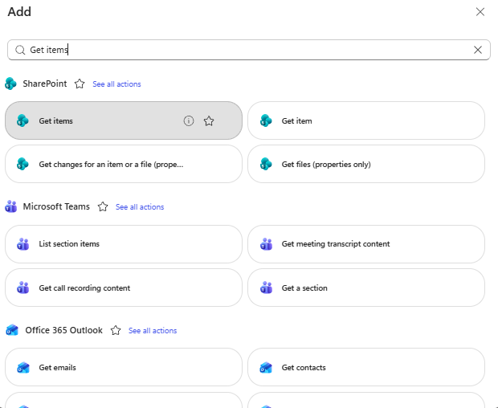

2. Impostare **Site Address** sul sito **Zava Help Desk - Vostro Nome** e **List Name** su **Dispositivi**.

3. Con **Show all**, nel campo **Filter Query** scrivere `ID eq ` e inserire il contenuto dinamico `sharepointItemId` del trigger (pulsante fulmine **Insert dynamic content**, oppure digitare `/`). Il risultato ha questa forma, dove `sharepointItemId` è il contenuto dinamico e non il testo, senza apici perché `ID` è un numero:

```text
ID eq sharepointItemId
```

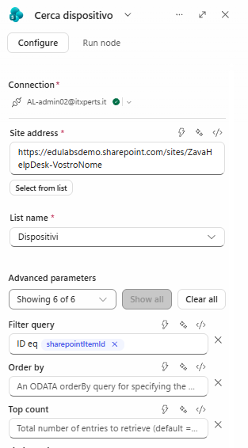

4. Nel campo **Top Count** scrivere `1`.

5. Provare solo questo nodo: nel pannello di **Cerca dispositivo** selezionare il pulsante di avvio (**Test**), scrivere nel campo `sharepointItemId` l'ID di **Contoso Phone Z** annotato prima e selezionare **Run test**. Nell'output c'è un elemento con **Model** `CP-Z2022` e **Status** con **Value** `In use`.

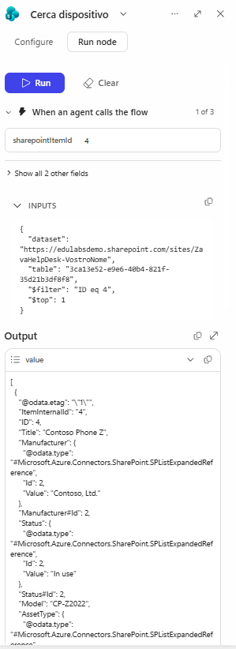

> [!TIP]
> **Test di un nodo**
>
> Il test di un nodo esegue solo quell'azione, senza pubblicare il workflow e senza eseguire il resto. Se si riceve un errore sul filtro, ricontrollare i nomi interni della lista. Con un valore non numerico, ad esempio una lettera, il filtro `ID eq` produce un errore: la skill passa sempre l'ID numerico dell'elemento.

### Primo bivio: il dispositivo è in inventario?

Una lista vuota non è un errore: è uno dei tre percorsi previsti, e la decisione si prende nel workflow con una condizione. Nel ramo **Else** il workflow risponde subito all'agente con l'esito `NON_IN_CATALOGO`.

1. Dalla tavolozza dei nodi trascinare il nodo condizionale (**If** / **Else**) dopo **Cerca dispositivo** e rinominarlo `Dispositivo in inventario`.

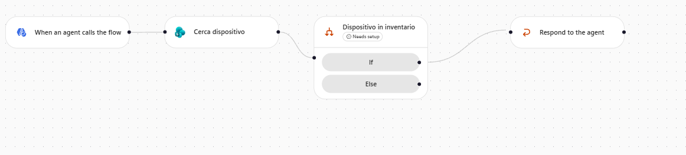

> [!NOTE]
> **Nome del nodo condizione**
>
> Learn indica che il designer offre strumenti predefiniti per cicli e ramificazioni, ma non documenta l'etichetta esatta del nodo condizione né quella degli operatori. Se il nodo ha un nome diverso, cercarlo nel riquadro **Add**.

2. Selezionare il ramo **If** e, in **Property**, inserire l'espressione:

```text
length(body('Cerca_dispositivo')?['value'])
```

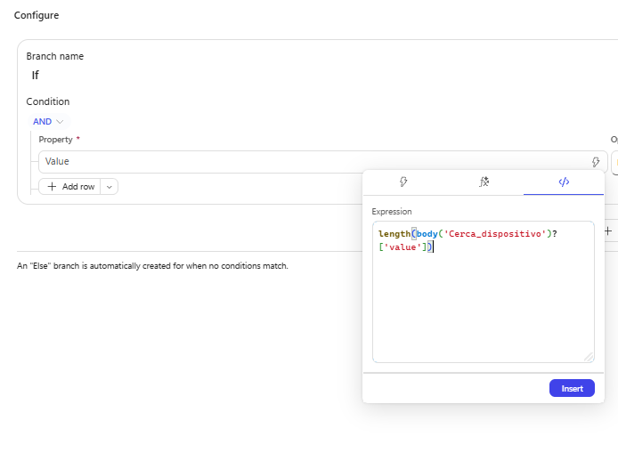

3. Impostare **Operator** su **Greater** e **Value** su `0`.

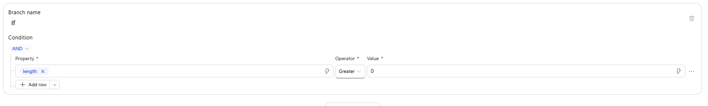

> [!TIP]
> **Nome dell'azione nelle espressioni**
>
> L'espressione richiama l'azione con il suo nome, con gli spazi sostituiti da trattini bassi: `Cerca dispositivo` diventa `Cerca_dispositivo`. Se l'azione non è stata rinominata, usare `Get_items`. Un nome sbagliato compare in rosso nel nodo e nell'**Health Center**.

4. Nel campo **Branch name** rinominare il ramo **If** in `In Catalogo`.

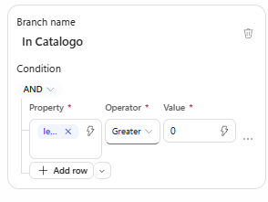

5. Nel ramo **Else** selezionare **+** e scegliere **Respond to the agent**. Con **Add an output** creare due output di testo:

| Output | Valore |
| --- | --- |
| `esito` | `NON_IN_CATALOGO` |
| `ModelValue` | `Nessun dispositivo` |

### Secondo bivio: il dispositivo è disponibile?

Se il dispositivo esiste, resta da guardare lo stato. Solo nel percorso "disponibile" il workflow invia la richiesta al responsabile; nel percorso "esaurito" risponde senza inviare nulla, così nessuno riceve richieste che non possono essere evase.

1. Nel ramo **In Catalogo** di **Dispositivo in inventario** aggiungere un secondo nodo condizionale, `Dispositivo disponibile`, e configurarne il ramo **If**:

- **Branch name**: `Disponibile`;
- **Property**: l'espressione `first(body('Cerca_dispositivo')?['value'])?['Status']?['Value']`;
- **Operator**: **Equals**;
- **Value**: `Available`.

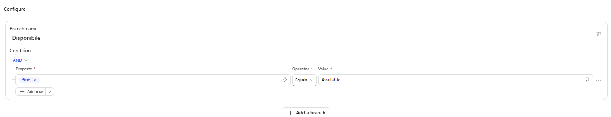

2. Nel ramo **Disponibile** selezionare **+**, cercare `send an email` e scegliere **Send an email** di **Office 365 Outlook**. Rinominarlo `Avvisa responsabile`, creare la connessione se richiesto e impostare:

- **To**: il proprio indirizzo (in produzione sarebbe la casella del responsabile di chi richiede);
- **Subject**: `Richiesta nuovo dispositivo da ` seguito dal contenuto dinamico `requestorName`;
- **Body**:

```text
Ciao,

nuova richiesta di dispositivo.

Richiesta inviata da:
Produttore:
Modello:
Collegamento all'elemento:
Requisiti aggiuntivi:

Email automatica inviata dal workflow Invia richiesta dispositivo.
```

3. Completare il corpo posizionando il cursore dopo ogni etichetta e aggiungendo uno spazio:

- dopo `Richiesta inviata da:` il contenuto dinamico `requestorName` del trigger;
- dopo `Produttore:` l'espressione `first(body('Cerca_dispositivo')?['value'])?['Manufacturer']?['Value']`;
- dopo `Modello:` l'espressione `first(body('Cerca_dispositivo')?['value'])?['Model']`;
- dopo `Collegamento all'elemento:` l'espressione `first(body('Cerca_dispositivo')?['value'])?['{Link}']`;
- dopo `Requisiti aggiuntivi:` il contenuto dinamico `additionalComment` del trigger.

> [!NOTE]
> **Collegamento in chiaro**
>
> Il collegamento all'elemento compare nell'email come testo semplice. Nella standard harness il Lab 05 lo trasforma in un collegamento cliccabile con l'editor HTML del corpo; qui l'indirizzo in chiaro basta per il laboratorio.

4. Dopo **Avvisa responsabile** aggiungere **Respond to the agent** con gli stessi due output:

| Output | Valore |
| --- | --- |
| `esito` | `DISPONIBILE` |
| `ModelValue` | l'espressione `first(body('Cerca_dispositivo')?['value'])?['Model']` |

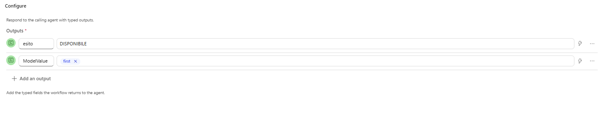

5. Nel ramo **Else** di **Dispositivo disponibile** aggiungere **Respond to the agent**:

| Output | Valore |
| --- | --- |
| `esito` | `ESAURITO` |
| `ModelValue` | l'espressione `first(body('Cerca_dispositivo')?['value'])?['Model']` |

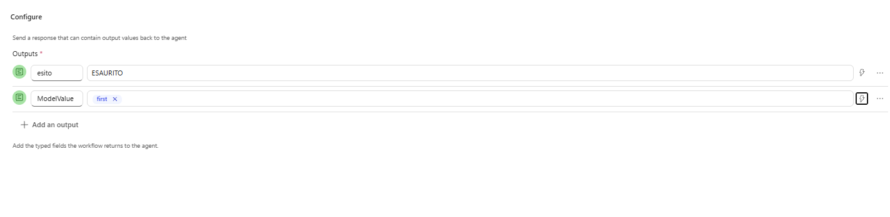

> [!IMPORTANT]
> **Lo stesso contratto in ogni percorso**
>
> I tre nodi **Respond to the agent** devono avere gli stessi output, con gli stessi nomi e tipi: l'agente riceve sempre lo stesso contratto, qualunque percorso sia stato seguito. `ModelValue` ha esattamente questo nome perché è quello che la skill `richiesta-dispositivo` cita nella conferma.

### Salvare, controllare e pubblicare

Un workflow con errori non si pubblica, e un workflow non pubblicato non compare tra gli strumenti dell'agente. Prima della pubblicazione si controlla anche che la risposta all'agente sia sincrona: l'agente aspetta l'esito per rispondere all'utente.

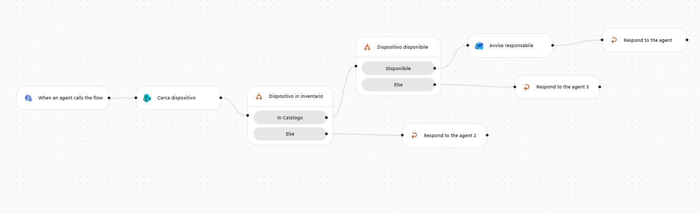

1. In ciascun nodo **Respond to the agent** aprire le impostazioni e verificare che **Asynchronous response**, nella sezione **Networking**, sia disattivato.

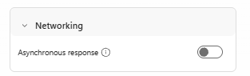

2. Selezionare l'icona **Save**. Se l'**Health Center** segnala problemi, risolverli: di solito un campo obbligatorio vuoto o un'espressione con il nome dell'azione sbagliato.

3. Selezionare **Publish**. Lo stato del workflow passa a **Published**.

> [!NOTE]
> **Tempo di risposta**
>
> Il workflow deve rispondere all'agente entro 100 secondi. Questo impiega pochi secondi; con liste grandi o servizi lenti conviene filtrare sul server e restituire solo i dati necessari ([Add a workflow as a tool to an agent](https://learn.microsoft.com/microsoft-copilot-studio/workflows-experience/flow-agent)).

## Tool - Invia richiesta dispositivo e Leggi dispositivi

La skill usa due strumenti: **Leggi dispositivi**, per mostrare all'utente i dispositivi disponibili, e il workflow, per inviare la richiesta. Il workflow pubblicato diventa uno strumento dell'agente: la sua descrizione dice all'orchestratore quando usarlo e come interpretare gli esiti.

1. Aprire l'agente **Assistente Zava GH**, scheda **Build**.

2. Selezionare **Tools** e, nella finestra **Add a tool**, il filtro **Workflows**. Scegliere **Invia richiesta dispositivo** e selezionare **Add**. Compaiono solo i workflow pubblicati con il trigger da agente e il nodo **Respond to the agent**.

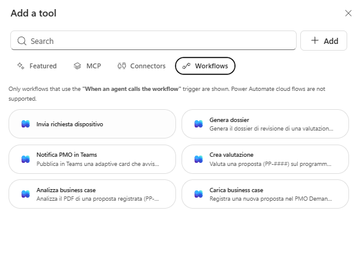

3. Aprire lo strumento. Nel pannello **Workflow details**, scheda **Details**, controllare input e output e scrivere la descrizione:

```text
Registra la richiesta di un dispositivo aziendale della lista SharePoint Dispositivi. Riceve l'ID dell'elemento scelto (sharepointItemId), i requisiti aggiuntivi (additionalComment) e il nome di chi richiede (requestorName, da Get my profile (V2)). Rilegge l'elemento e restituisce un esito: DISPONIBILE (richiesta inviata al responsabile), ESAURITO (dispositivo non più disponibile, nessuna richiesta inviata) o NON_IN_CATALOGO (nessun dispositivo con quell'ID, nessuna richiesta inviata), più il modello nel campo ModelValue. Usalo solo quando la skill richiesta-dispositivo lo indica, dopo che l'utente ha confermato dispositivo e requisiti.
```

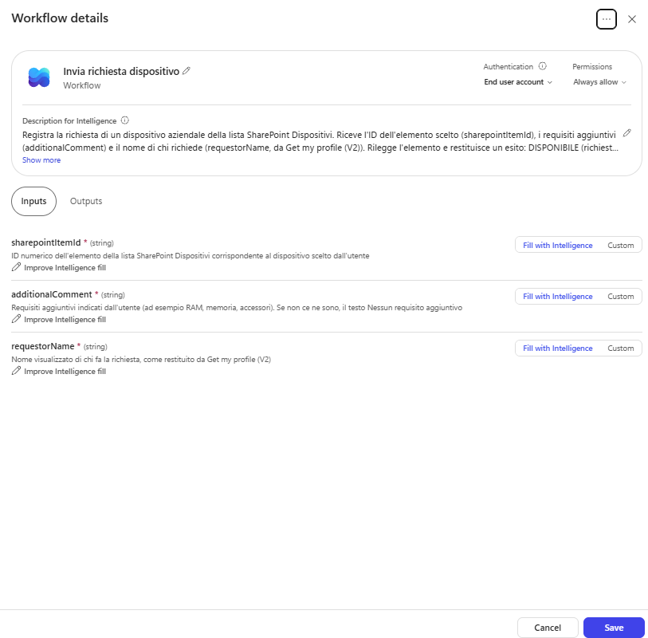

4. Selezionare **Save**.

5. Aggiungere lo strumento di lettura: selezionare di nuovo **Tools**, filtro **Connectors**, cercare `Get items` e scegliere l'azione **Get items** di **SharePoint**. Creare o selezionare la connessione e selezionare **Add**.

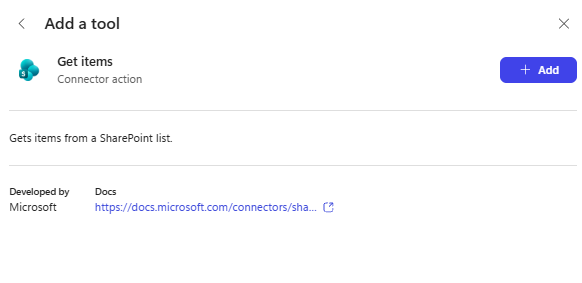

6. Aprire lo strumento. Nella finestra **Tool details** selezionare l'icona a forma di matita accanto al nome e rinominarlo con il nome con cui lo cita la skill:

```text
Leggi dispositivi
```

7. Nel campo **Description for Intelligence** scrivere:

```text
Legge i dispositivi aziendali dalla lista SharePoint Dispositivi di Zava e li restituisce con ID, produttore, modello, colore, tipo e stato. Usalo per mostrare i dispositivi disponibili del tipo richiesto (Laptop, Desktop o Smartphone). Nel parametro Filter Query usa i nomi interni delle colonne, ad esempio Status eq 'Available' and AssetType eq 'Laptop'. Non modifica la lista e non invia richieste.
```

8. Aprire la scheda **Inputs** e impostare:

| Input | Compilazione | Valore |
| --- | --- | --- |
| Site Address | Custom | il sito **Zava Help Desk - Vostro Nome** |
| List Name | Custom | **Dispositivi** |
| Filter Query | Fill with Intelligence | |
| Top Count | Custom | `20` |

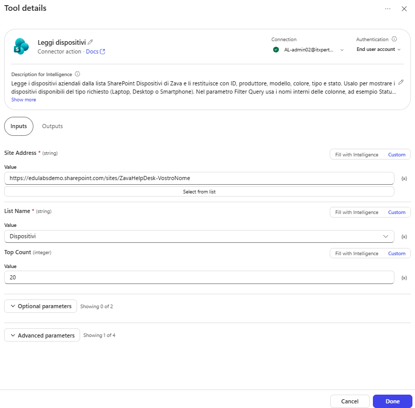

9. Controllare che **Authentication** indichi **End user account** e selezionare **Done** e poi **Save**.

> [!NOTE]
> **Parametri dello strumento**
>
> Come nel Lab 03, Learn non documenta le etichette dei singoli campi della finestra **Tool details**: questa guida usa quelle dell'interfaccia al momento della stesura. I parametri **Filter Query** e **Top Count** sono documentati nel [riferimento del connettore SharePoint](https://learn.microsoft.com/connectors/sharepointonline/). Se **Site Address** o **List Name** non accettano un valore fisso, lasciarli come **Fill with Intelligence** e scrivere indirizzo del sito e nome della lista nella descrizione.

> [!TIP]
> **Creare un workflow dall'agente**
>
> Un workflow si può creare anche partendo dall'agente: nella finestra **Add a tool** selezionare **Add** accanto alla barra di ricerca e poi **Workflow**. Il workflow creato compare comunque nella pagina **Workflows** ed è disponibile per gli altri agenti.

## Skill - richiesta-dispositivo

La skill `richiesta-dispositivo` descrive la conversazione: tipo di dispositivo, tabella delle opzioni, scelta, requisiti, riepilogo con conferma e invio. Dei tre esiti del workflow la skill conosce solo la conferma con `ModelValue`; spiegare gli altri due è compito delle istruzioni, perché valgono per ogni uso del workflow.

1. Scaricare [`richiesta-dispositivo/SKILL.md`](../../../resources/fondamentali/github-harness/05-automating-with-workflows/richiesta-dispositivo/SKILL.md).

2. Nella scheda **Build**, nel pannello dei componenti, selezionare **Skills** (o **+** accanto a **Skills**); nella finestra **Add skill** selezionare **Upload a skill**, trascinare il file e confermare, come nel Lab 04.

3. Selezionare la skill e rileggerne le istruzioni.

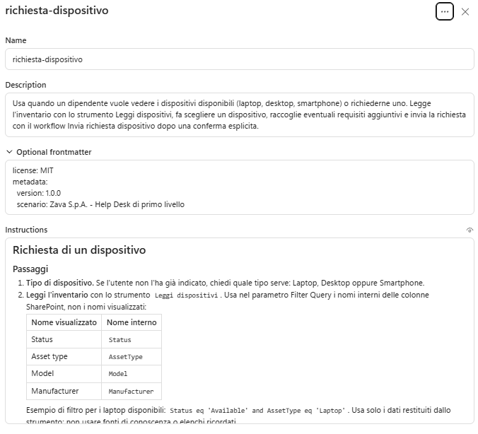

Notare in particolare:

- il filtro di esempio sui nomi interni (`Status eq 'Available' and AssetType eq 'Laptop'`), uguale a quello della descrizione di **Leggi dispositivi**;
- la tabella delle opzioni con produttore, modello e colore, e l'ID SharePoint associato a ogni lettera;
- la domanda sui requisiti, con il testo fisso `Nessun requisito aggiuntivo`;
- riepilogo e conferma prima dell'invio, e annullamento senza chiamare il workflow;
- la lettura del nome con **Get my profile (V2)** e i tre input del workflow, `sharepointItemId`, `additionalComment` e `requestorName`, gli stessi del trigger;
- la chiamata al workflow una sola volta per conferma.

4. Selezionare **Save**.

5. Nel riquadro **Instructions** aggiungere in fondo alla sezione **# Procedure** del Lab 04 una quarta riga:

```text
- Per vedere i dispositivi disponibili o richiedere un dispositivo aziendale (laptop, desktop o smartphone), attività che rientra nei tuoi compiti, segui la skill richiesta-dispositivo. Comunica l'esito dello strumento Invia richiesta dispositivo: DISPONIBILE significa che la richiesta è stata inviata al responsabile; ESAURITO che il dispositivo non è più disponibile e non è stata inviata nessuna richiesta, quindi proponi di sceglierne un altro; NON_IN_CATALOGO che il dispositivo non è nella lista e non è stata inviata nessuna richiesta. Non dire mai che una richiesta è stata inviata se l'esito non è DISPONIBILE.
```

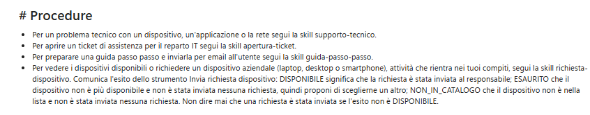

Non serve una nuova sezione: le tre righe del Lab 04 restano come sono, e la nuova riga allarga ai dispositivi il perimetro della sezione **# Ruolo e ambito** del Lab 02, scritta per il supporto IT.

6. Selezionare **Save**.

> [!TIP]
> **Il nome del richiedente**
>
> Il nome del richiedente non è un'informazione da chiedere in chat: la skill lo recupera con **Get my profile (V2)**, e la regola sull'uso di quello strumento ("quando una skill indica esplicitamente di usarlo") è già nella sua descrizione. Le regole sull'invio di email del Lab 03 (**# Strumenti ed email**) riguardano lo strumento **Invia guida via email** dell'agente: l'email di questo workflow parte invece dal workflow, solo dopo la conferma della skill, e in laboratorio arriva al proprio indirizzo.

## Testing

Ogni prova mette alla prova una parte diversa: il percorso `DISPONIBILE` dalla conversazione completa, la lettura dell'inventario che nasconde i dispositivi in uso, due comportamenti della skill (limite dell'inventario, annullamento) e i percorsi `ESAURITO` e `NON_IN_CATALOGO`, che una conversazione normale non raggiunge perché la skill mostra solo dispositivi disponibili. All'inizio di ogni prova selezionare **New chat** in **Preview**, con **End user preview** disattivato.

> [!TIP]
> **Stima dei crediti**
>
> Come nei Lab 02-04, alla fine di ogni prova annotare la stima dei Copilot Credits mostrata da **Preview** nella tabella qui sotto. Confrontare la prova 1 (lettura dell'inventario, profilo, workflow ed email) con le prove 3 e 4, in cui il workflow non viene chiamato. Learn non specifica se la stima di **Preview** comprende anche le azioni eseguite dal workflow.

| Prova | Scenario | Crediti stimati |
| --- | --- | --- |
| 05-1 | Laptop disponibile, workflow ed email | |
| 05-2 | Contoso Phone Z non offerto | |
| 05-3 | Tablet, fuori inventario | |
| 05-4 | Annullamento | |
| 05-5 | Esito ESAURITO, strumento chiamato direttamente | |
| 05-6 | Esito NON_IN_CATALOGO, strumento chiamato direttamente | |

### Dispositivo disponibile

1. Scrivere:

```text
Mi serve un laptop
```

Nella traccia compare **Leggi dispositivi** con un filtro come `Status eq 'Available' and AssetType eq 'Laptop'`. L'agente mostra una tabella con tre opzioni, A, B e C, con produttore, modello e colore: **Fabrikam Laptop X1** (FX1-2023, Space gray), **Microsoft Surface Laptop 5** (Silver) e **Microsoft Surface Laptop Studio 2** (Black).

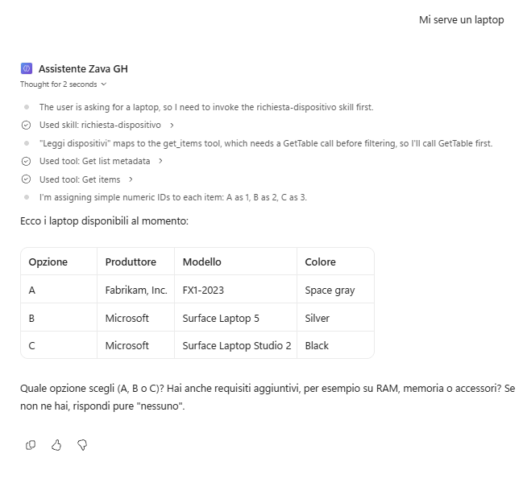

2. Rispondere `B`. L'agente chiede se ci sono requisiti aggiuntivi: rispondere `Almeno 16 GB di RAM`.

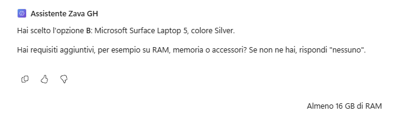

3. L'agente mostra dispositivo e requisiti e chiede se procedere. Rispondere `Sì, procedi` e consentire le connessioni se compare **Permission required**.

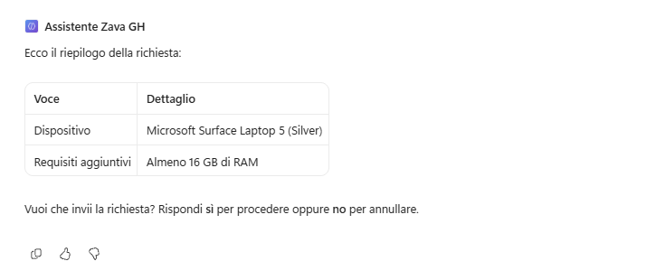

4. Nella traccia compaiono **Get my profile (V2)** e poi la chiamata a **Invia richiesta dispositivo** con `sharepointItemId` uguale all'ID di Surface Laptop 5 annotato prima, `additionalComment` uguale a `Almeno 16 GB di RAM` e `requestorName` uguale al proprio nome visualizzato; l'output ha `esito` uguale a `DISPONIBILE` e `ModelValue` uguale a `Surface Laptop 5`.

5. L'agente conferma la richiesta citando il modello e spiega che il responsabile la esaminerà. Controllare la propria casella: l'email riporta nome, produttore `Microsoft`, modello, collegamento all'elemento e `Almeno 16 GB di RAM`.

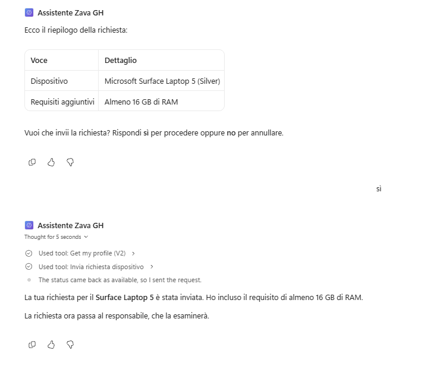

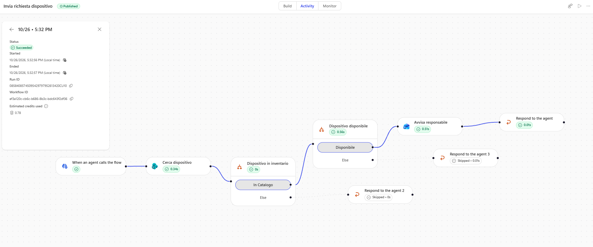

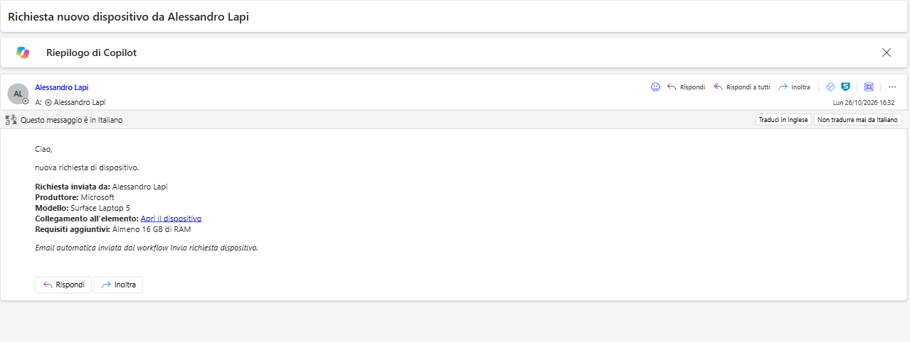

### Dispositivo in uso

1. Scrivere:

```text
Vorrei il Contoso Phone Z
```

L'agente capisce che serve uno smartphone e legge i dispositivi `Available` di tipo `Smartphone`: la tabella contiene solo **Trey Smartphone Elite** (TS-E2025, Dark blue), perché **Contoso Phone Z** ha `Status` uguale a `In use`. Se si chiede di nuovo il Contoso, l'agente non lo offre e non chiama il workflow. Annullare la richiesta.

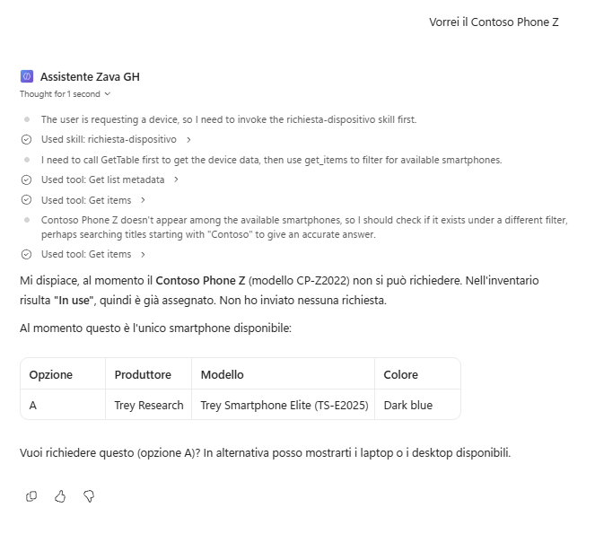

### Fuori inventario

1. Scrivere:

```text
Mi serve un tablet
```

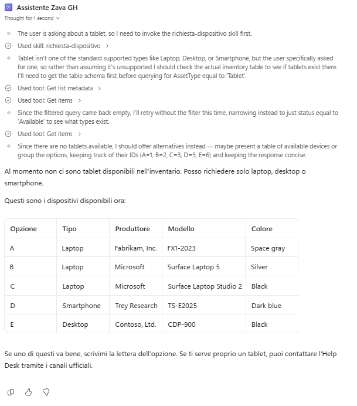

L'agente chiede di scegliere tra Laptop, Desktop e Smartphone, i tipi che la skill conosce, e non inventa un elenco di tablet: nella traccia non c'è nessuna chiamata a **Invia richiesta dispositivo**.

### Annullamento

1. Scrivere `Mi serve un desktop`, scegliere l'opzione proposta e rispondere `Nessuno` alla domanda sui requisiti.

2. Alla richiesta di conferma rispondere `No, annulla`: l'agente conferma l'annullamento e nella traccia non c'è nessuna chiamata a **Invia richiesta dispositivo**.

### Esiti ESAURITO e NON_IN_CATALOGO

I due percorsi senza invio si provano chiamando lo strumento direttamente, come nel Lab 04 si è caricata una skill per nome: è una tecnica di verifica in **Preview**, non una richiesta da utente finale.

1. In una nuova chat scrivere, sostituendo `<ID>` con l'ID di **Contoso Phone Z** annotato prima:

```text
Prova del workflow: chiama lo strumento Invia richiesta dispositivo con sharepointItemId <ID>, additionalComment Nessun requisito aggiuntivo e requestorName Prova laboratorio, poi riporta l'esito.
```

Nella traccia l'output ha `esito` uguale a `ESAURITO` e `ModelValue` uguale a `CP-Z2022`; l'agente spiega che il dispositivo non è disponibile e che non è stata inviata nessuna richiesta. Non arriva nessuna email.

2. In una nuova chat ripetere la stessa richiesta con `sharepointItemId` uguale a `999`: l'output ha `esito` uguale a `NON_IN_CATALOGO` e `ModelValue` uguale a `Nessun dispositivo`, e l'agente spiega che il dispositivo non è nella lista.

### Ispezionare le esecuzioni

Ogni esecuzione del workflow lascia una traccia, nodo per nodo, con input e output. È il primo posto in cui guardare quando un'email non arriva o l'esito non è quello atteso: insieme alla traccia dell'agente dà le due metà della stessa chiamata, che cosa ha passato l'agente e che cosa è successo dentro il workflow.

1. Aprire **Workflows**, poi **Invia richiesta dispositivo**, scheda **Activity**. L'elenco mostra le esecuzioni con il loro stato (ad esempio **Succeeded** o **Failed**) e si può filtrare.

2. Selezionare l'esecuzione della prova 1: sulla tela ogni nodo mostra gli input ricevuti e gli output prodotti. Controllare i valori di `sharepointItemId`, `additionalComment` e `requestorName` ricevuti dal trigger, il filtro ricevuto da **Cerca dispositivo**, i rami seguiti e gli output di **Respond to the agent**.

3. Aprire le esecuzioni delle prove 5 e 6: il percorso è diverso e il nodo **Avvisa responsabile** non è stato eseguito.

4. Per riprodurre un caso, aprire il nodo **Cerca dispositivo**, selezionare **Test** e scegliere un'esecuzione in **Load values from previous run**: i dati di quell'esecuzione vengono caricati negli input del nodo.

> [!NOTE]
> **Consumo dei workflow**
>
> Le azioni dei workflow consumano capacità di Copilot Studio. Gli amministratori vedono le azioni usate da ogni workflow nel [Power Platform admin center](https://admin.powerplatform.microsoft.com/), in **Licensing**, **Copilot Studio**. Quando la capacità prepagata dell'ambiente è esaurita, le nuove esecuzioni vengono bloccate.

> [!IMPORTANT]
> **Lab Completato**
>
> L'**Assistente Zava GH** ora mostra i dispositivi disponibili e passa la richiesta confermata al workflow **Invia richiesta dispositivo**, che la invia al responsabile solo se il dispositivo è ancora disponibile. In questo lab si è visto:
>
> - come dividere il lavoro tra agente (giudizio) e workflow (regole fisse);
> - come definire il contratto agente-workflow con input descritti e output uguali in ogni percorso;
> - come leggere una lista SharePoint con un filtro sui nomi interni, leggere il valore di una colonna di scelta e decidere con le condizioni;
> - come provare un singolo nodo, pubblicare un workflow, aggiungerlo come strumento e ispezionarne le esecuzioni;
> - come una skill e un workflow collaborano: la conversazione alla skill, il controllo finale e l'invio al workflow;
> - come far compilare all'agente gli input del workflow da una fonte affidabile, il profilo, invece di chiederli.
