# Fondamentali · GitHub Harness

[← Home del corso](../../../README.md)

Nella GitHub Harness si costruisce un solo agente, l'**Assistente Zava GH**, con la GitHub Copilot harness di Copilot Studio: istruzioni, fonti di conoscenza, strumenti, skill e workflow, aggiunti un pezzo per lab. È lo stesso help desk di Zava della [Standard Harness](../standard-harness/index.md), costruito con un modello diverso: invece di disegnare il percorso della conversazione si descrivono obiettivi, capacità e limiti, e il runtime decide i passi. Parti dal Lab 01 e prosegui in ordine.

## Prerequisiti <!-- icon: list-checks f-instructions -->

- Un account Microsoft 365 aziendale o scolastico
- Accesso a Copilot Studio, con la nuova esperienza attiva
- Un ambiente dedicato al corso con un database Dataverse e Copilot Credits disponibili
- Accesso a SharePoint per il sito con i documenti dell'Help Desk e la lista dei dispositivi

> [!IMPORTANT]
> **Copilot Credits già durante lo sviluppo**
>
> Gli agenti della GitHub Copilot harness usano la fatturazione a consumo: creazione in linguaggio naturale, **Preview** e valutazioni consumano crediti anche se l'agente non viene mai pubblicato. Completare tutti i lab dei Fundamentals GitHub Harness consuma circa **1.000 Copilot Credits**. Prima di iniziare verificare con l'amministratore che l'ambiente del corso abbia crediti disponibili.

## Lab <!-- icon: flask f-instructions -->

| # | Lab | Argomento | Tempo |
|---|-----|-----------|-------|
| 01 | [Environment Setup](./01-environment-setup/README.md) | <!-- icon: tray f-platform --> Ambiente e solution | 75 min |
| 02 | [Agent and Knowledge Sources](./02-knowledge-sources/README.md) | <!-- icon: books f-knowledge --> Istruzioni e conoscenza | 90 min |
| 03 | [Adding Tools](./03-adding-tools/README.md) | <!-- icon: wrench f-tools --> Strumenti e memoria | 75 min |
| 04 | [Adding Skills](./04-adding-skills/README.md) | <!-- icon: puzzle-piece f-tools --> Skill | 75 min |
| 05 | [Automating with Workflows](./05-automating-with-workflows/README.md) | <!-- icon: tree-view f-tools --> Workflow | 90 min |

## Concetti chiave <!-- icon: lightbulb f-instructions -->

### Harness e orchestrazione

Il **modello** fornisce ragionamento e generazione; la **harness** è il runtime tra il modello e la configurazione dell'agente: decide quando chiamare il modello, che cosa mandargli e quali strumenti eseguire.

Per questo le istruzioni e le descrizioni di fonti e strumenti contano più dei percorsi disegnati. La GitHub Copilot harness è la scelta giusta per problemi ampi che non si possono mappare del tutto in anticipo, come interrogare un modello dati complesso con molti campi sconosciuti.

> [!NOTE]
> **Una scelta fatta alla creazione**
>
> La harness si sceglie quando si crea l'agente: un agente GitHub Copilot non si trasferisce nella standard harness, e viceversa. Il nome indica la tecnologia di orchestrazione: non è il servizio GitHub Copilot, non richiede un abbonamento GitHub e i dati degli agenti non vengono inviati a quel servizio. Vedere [Harnesses in Copilot Studio](https://learn.microsoft.com/microsoft-copilot-studio/harnesses-overview).

### I blocchi dell'agente

Ogni comportamento ha un posto giusto: conviene scegliere il componente più piccolo che lo rende affidabile, verificabile e sicuro dentro il ciclo.

| Componente | A che cosa serve | Nell'Assistente Zava GH | Lab |
| --- | --- | --- | --- |
| <!-- icon: clipboard-text f-instructions --> **Istruzioni** | Ciò che vale in ogni conversazione: ruolo, perimetro, tono, regole di sicurezza | Rispondere solo dalle fonti, non chiedere mai credenziali | 02 |
| <!-- icon: books f-knowledge --> **Conoscenza** | Fatti da cercare e citare: file, siti web, SharePoint | KB sul reset della password, guide VPN, playbook e SLA | 02 |
| <!-- icon: wrench f-tools --> **Strumenti** | Azioni e dati in tempo reale: connettori, server MCP, workflow | Leggere il profilo di chi scrive, inviare un annuncio per email | 03 |
| <!-- icon: stack f-tools --> **Memoria** (anteprima) | Contesto per utente che resta tra una sessione e l'altra | Dispositivo e reparto preferito, mai credenziali | 03 |
| <!-- icon: puzzle-piece f-tools --> **Skill** | Procedure caricate solo quando servono | Supporto tecnico, apertura di un ticket, annuncio di lavoro | 04 |
| <!-- icon: tree-view f-tools --> **Workflow** | Passi deterministici, usati dall'agente come strumento | Richiesta di un dispositivo verificata sulla lista **Dispositivi** | 05 |
| <!-- icon: cpu f-ai-engine --> **Modello** | Il motore di ragionamento, scelto nella scheda **Build** | Modello predefinito | 02 |

> [!TIP]
> **Istruzioni o skill?**
>
> Le istruzioni guidano il comportamento ma non aggiungono capacità, e si caricano a ogni turno. Prima di aggiungere una regola, chiedersi se l'agente ha la conoscenza, lo strumento o la skill per applicarla, e se vale in ogni conversazione: se vale solo a volte, il suo posto è una skill.

### Skill

Una skill è fatta di istruzioni e risorse caricate a richiesta: nel contesto restano sempre solo il nome e la descrizione di `SKILL.md`, che servono a instradare la richiesta. Si sceglie una skill per tenere leggibili le istruzioni dell'agente, per usare il contesto solo quando lo scenario lo richiede e, in alcuni casi, per migliorare l'accuratezza: un prompt grande sempre attivo fa pesare a ogni turno indicazioni irrilevanti. Si costruiscono nel [Lab 04](./04-adding-skills/README.md).

### Conoscenza da SharePoint

Con le fonti SharePoint l'orchestratore recupera solo la conoscenza che serve: la aggiunge il [Lab 02](./02-knowledge-sources/README.md), e i permessi di chi scrive continuano a valere.

### Agent Sandbox

Quando il ragionamento non basta, l'orchestratore scrive ed esegue script in uno spazio di lavoro Linux/Python isolato. È il posto giusto per l'esecuzione deterministica: calcoli, generazione di file, parsing, grafici e validazioni che il modello non deve improvvisare.

### Dai flow ai workflow

I workflow nascono dall'avvicinare automazione deterministica e agenti. Scegliere fra un agente e un workflow dipende da quale quota del processo è nota prima dell'esecuzione: i workflow calzano dove inizio e fine sono noti e la variabilità sta nei singoli passi. Un workflow può chiamare agenti, e un agente può chiamare workflow: è il caso dell'Assistente Zava GH nel [Lab 05](./05-automating-with-workflows/README.md).

### Copilot Credits

Nella GitHub Copilot harness la fatturazione inizia quando si inizia a costruire, non quando si pubblica: tutto il ciclo di vita consuma crediti, mentre la standard harness fattura solo dopo la pubblicazione.

- **Che cosa consuma**: i token del modello, gli strumenti (inclusa la conoscenza) e la harness stessa, durante la creazione in linguaggio naturale, la **Preview**, le valutazioni e poi ogni uso dell'agente pubblicato.
- **A chi si addebita**: all'ambiente in cui l'agente gira, non alle singole persone; l'uso non è incluso nella licenza Microsoft 365 Copilot.
- **Dove si vede**: in **Preview** c'è una stima dei crediti della sessione, la cronologia (**History**) ne riporta il valore per ogni conversazione e la scheda **Monitor** mostra il totale definitivo.
- **Quando finiscono**: l'agente smette di rispondere e i maker non possono più usare **Preview** finché non tornano crediti disponibili. Vedere [Overview of usage-based billing](https://learn.microsoft.com/microsoft-copilot-studio/agents-experience/billing-credit-overview).

### Standard harness e GitHub Copilot harness

| Esigenza | Standard harness | GitHub Copilot harness |
| --- | --- | --- |
| Percorso di conversazione controllato | Topic con nodi, condizioni e variabili | Skill caricate quando la richiesta corrisponde alla descrizione |
| Generazione guidata di testo | Prompt tool | Skill e istruzioni |
| Automazione deterministica | Agent flow | Workflow |
| Versioni multiple di un documento | File group con istruzioni | File separati, descrizioni e regole nelle istruzioni |
| Solo risposte dalle fonti | Impostazioni per disattivare web e conoscenza generale | Fonti aggiunte, **Search all websites** spento e istruzioni |
| Test interattivo | Pannello **Test** | Scheda **Preview** con la traccia del ragionamento |
| Fatturazione | Dopo la pubblicazione | Dalla prima prova, in Copilot Credits |

Per processi brevi e sempre uguali, come un bot che raccoglie gli stessi dati di un ticket nello stesso ordine, la standard harness è la scelta più proporzionata. L'Assistente Zava GH combina invece documenti diversi, il profilo di chi scrive, email, procedure e un workflow, con richieste che cambiano da persona a persona: è il lavoro per cui la GitHub Copilot harness giustifica il suo costo. Vedere [Compare Copilot Studio agent harnesses](https://learn.microsoft.com/microsoft-copilot-studio/guidance/choose-harness).
