# Lab 02 - Knowledge Sources

[Previous: Lab 01](../01-environment-setup/README.md) | [Back to Standard Harness](../index.md) | [Next: Lab 03](../03-ticket-agent-topics/README.md)

<!-- icon: clock-countdown --> **Tempo stimato:** ~45 minuti · <!-- icon: toolbox f-standard --> **Harness:** standard

## Scenario

L'agente **IT Support** creato nel Lab 01 risponde con le sue istruzioni e con un sito pubblico di Microsoft, ma l'Help Desk di Zava ha procedure proprie: un playbook, gli SLA del servizio, un modello di incident report, un articolo per il reset della password di Microsoft 365 e tre versioni della guida alla VPN ZavaSecure. Un agente che risponde con informazioni generiche trovate sul web rischia di suggerire procedure non conformi.

In questo lab l'agente impara a rispondere con i documenti di Zava, usando tre tipi di fonte di conoscenza: un documento caricato direttamente, un **file group** che raccoglie le versioni della guida VPN con istruzioni per scegliere la più recente, e un sito **SharePoint** con la documentazione dell'Help Desk.

## Che cosa si costruisce

Lo schema mostra le fonti di conoscenza dell'agente **IT Support** alla fine del lab, con i documenti di ciascuna: le tre aggiunte in questo lab e il sito pubblico del Lab 01. La descrizione di ogni fonte aiuta l'agente a scegliere quella giusta; con **Use general knowledge** e **Use information from the Web** disattivati l'agente risponde solo con queste fonti e le cita nelle references.


## Prerequisiti

Per svolgere questo lab occorre avere:

- completato il Lab 01 (agente **IT Support** nel proprio developer environment);
- accesso a SharePoint con il proprio account aziendale o scolastico.

### Creazione Sito SharePoint

Questo Lab affronta varie tipologie di Knowledge Base fra cui SharePoint, perciò è necessario creare un sito SharePoint seguendo questi step:

1. Andare su [Microsoft 365](https://m365.cloud.microsoft/), accedere con il proprio account aziendale/scolastico, premere su `Apps` e selezionare `All Apps`.

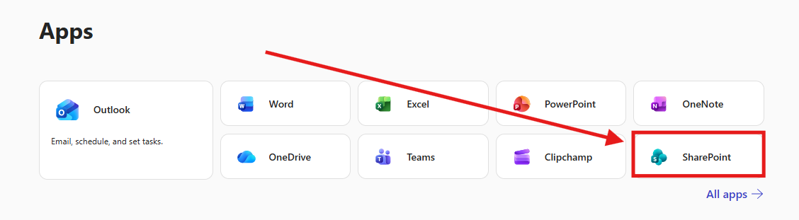

2. Selezionare `SharePoint`, successivamente premere su `Create Site` -> `Team Site` -> `From Microsoft` -> `Standard Team`-> `Use Template`.

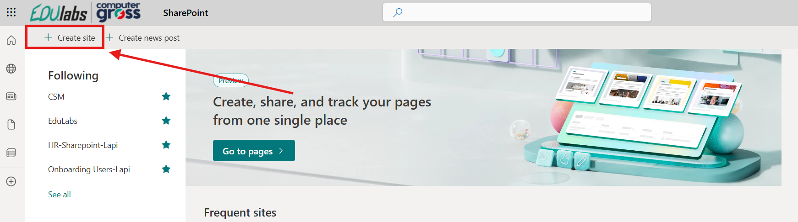

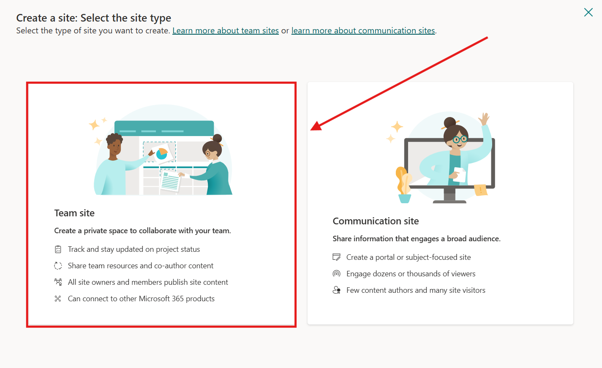

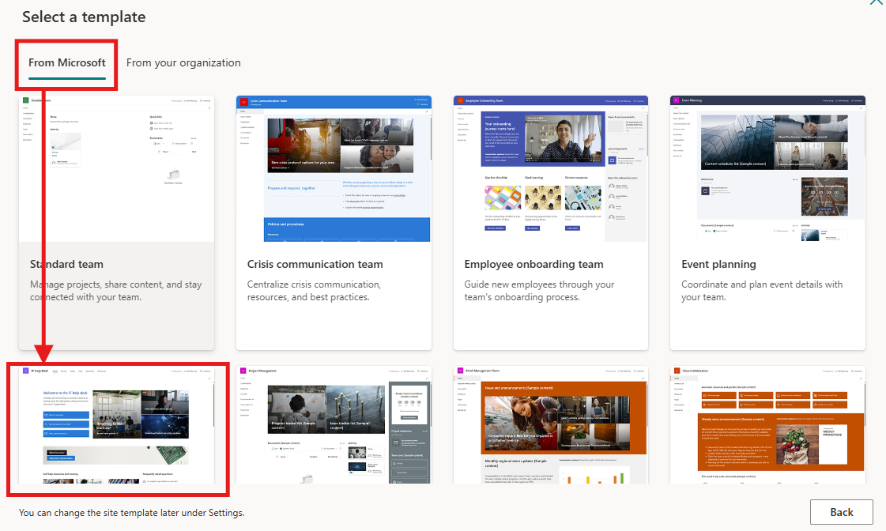

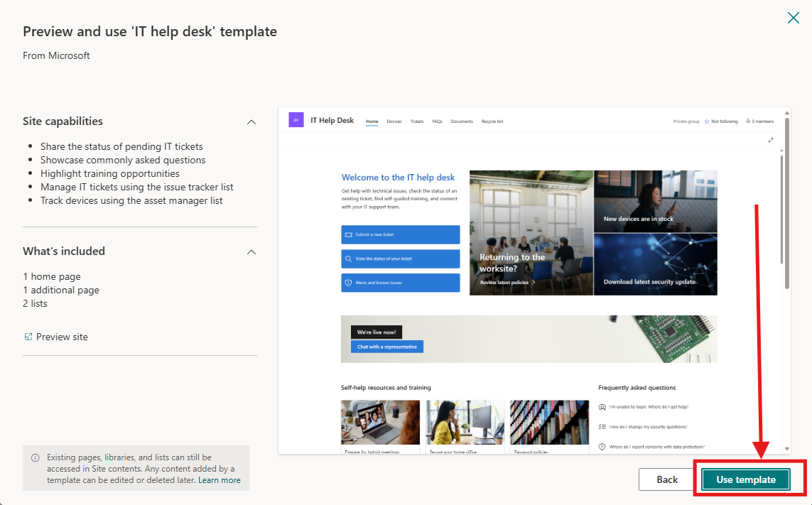

3. Ora aggiungere i dettagli del sito SharePoint elencati qui sotto e premere su `Next`.

| Field            | Value                      |
| ---------------- | -------------------------- |
| Site name        | Help Desk CSM-Vostro Nome  |
| Site description | Copilot Studio Masterclass |
| Site address     | HelpDeskCSM                |

4. Andare avanti premendo su `Create site` e `Finish`, senza aggiungere altro.

5. Andare in `Documents`, premere `+ Upload` e selezionare i seguenti file, da scaricare prima sul proprio computer:

   - [`Zava_Help_Desk_Playbook.docx`](../../../resources/fondamentali/02-knowledge-sources/Zava_Help_Desk_Playbook.docx)
   - [`Zava_Incident_Report_Template_Example.docx`](../../../resources/fondamentali/02-knowledge-sources/Zava_Incident_Report_Template_Example.docx)
   - [`Zava_Help_Desk_SLA.docx`](../../../resources/fondamentali/02-knowledge-sources/Zava_Help_Desk_SLA.docx)

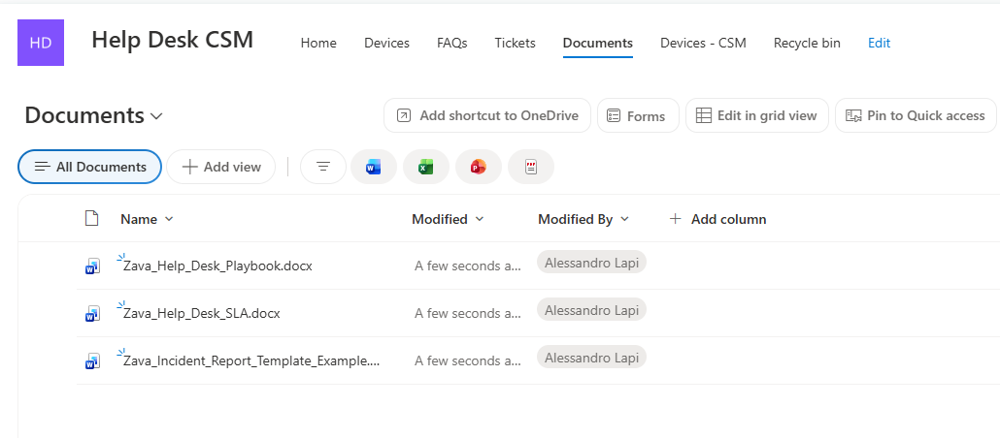

## Upload di Documenti come KB

1. Dalla schermata `Home` di Copilot Studio selezionare `Agents`.

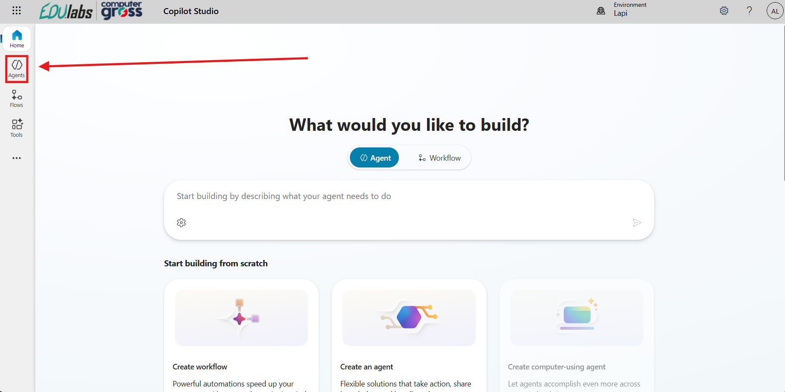

2. Cercare l'agente **IT Support** creato nel Lab 01 e aprire la pagina di configurazione.

3. Selezionare `Knowledge` nel menu in alto adiacente al Nome dell'Agente.

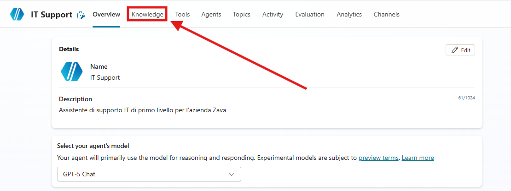

4. Premere su `+Add knowledge`.

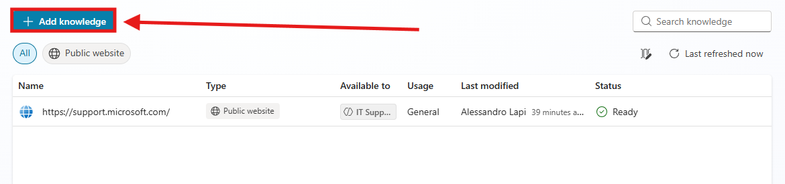

5. Una volta premuto apparirà una schermata per aggiungere all'agente fonti di conoscenza.

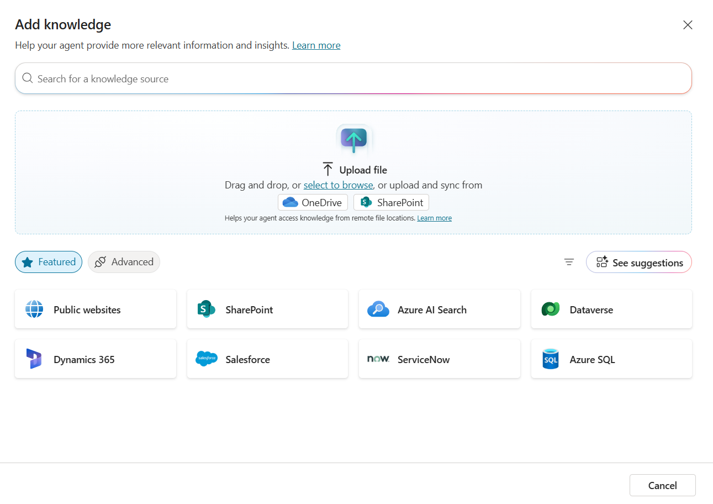

> [!NOTE]
> **Limiti delle fonti**
>
> La dimensione massima dei file da caricare è 512 MB e il numero massimo di URL per siti pubblici è 4. Per le altre specifiche tecniche consultare [Quotas and limits - Microsoft Copilot Studio | Microsoft Learn](https://learn.microsoft.com/en-us/microsoft-copilot-studio/requirements-quotas)

6. Premere su `Upload`: verrà aperta una finestra del File Explorer, nella quale selezionare il seguente documento:

   - [`Zava_KB_Reset_M365_Password.docx`](../../../resources/fondamentali/02-knowledge-sources/Zava_KB_Reset_M365_Password.docx)

> [!NOTE]
> **Dataverse search**
>
> Gli agenti di Copilot Studio richiedono la [Dataverse search](https://learn.microsoft.com/en-us/microsoft-copilot-studio/knowledge-add-file-upload) per utilizzare questa fonte di conoscenza. Se non è possibile aggiungere file a un agente, chiedere all’amministratore di attivare la `Dataverse search` nell'`Environment`.

7. Modificare la `Description` con il seguente testo:

```
Usa questa Knowledge quando un Utente vuole resettare la Password.
```

8. Per evitare che l'agente riporti informazioni trovate sul web, e quindi procedure non conformi all'azienda, è necessario disattivare la Web Search.

9. Andare sui Settings.

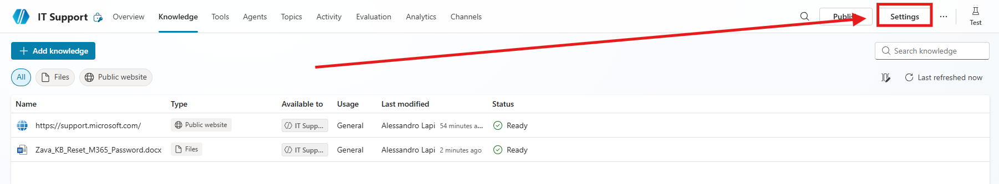

10. Nella sezione Generative AI cercare il paragrafo Knowledge, disattivare **Use general knowledge** e **Use information from the Web** e salvare le impostazioni.

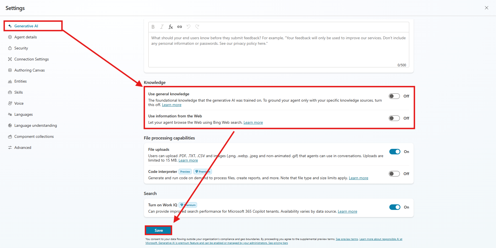

> [!TIP]
> **Solo le fonti di Zava**
>
> Disattivare la General Knowledge e la Web Search permette all'agente di concentrarsi solo sui dati forniti, limitando così il rischio di allucinazioni.

11. Testare l'aggiunta della knowledge dalla chat di `Test`: premere su `start a new session` e incollare la seguente domanda:

```
Come posso resettare la Password?
```

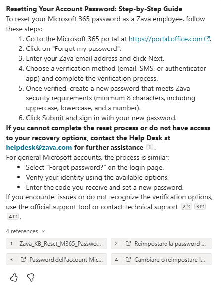

12. Notare come l'agente ha utilizzato il documento e lo ha riportato nelle references della risposta data.

## Files Group come KB

1. Selezionare `Knowledge` nel menu in alto adiacente al Nome dell'Agente, premere su `+Add knowledge`.

2. Una volta premuto apparirà la schermata per aggiungere all'agente fonti di conoscenza: premere `Upload` e selezionare questi file:

   - [`Zava_Guida_VPN_v1.docx`](../../../resources/fondamentali/02-knowledge-sources/Zava_Guida_VPN_v1.docx)
   - [`Zava_Guida_VPN_v2.docx`](../../../resources/fondamentali/02-knowledge-sources/Zava_Guida_VPN_v2.docx)
   - [`Zava_Guida_VPN_v3.docx`](../../../resources/fondamentali/02-knowledge-sources/Zava_Guida_VPN_v3.docx)

3. Al posto di premere su **Add to agent** selezionare **Upload as a group**.

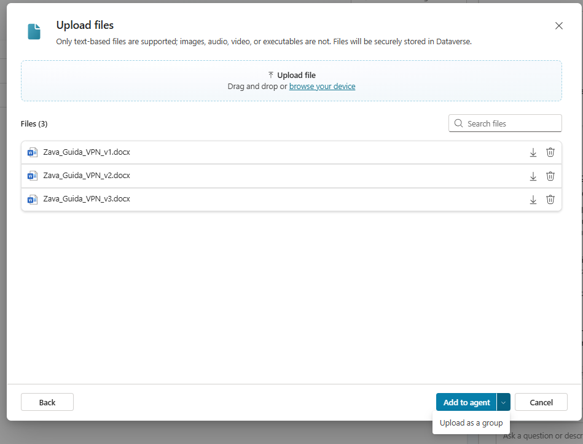

> [!NOTE]
> **Limiti dei file group**
>
> Per i limiti e le altre informazioni sui file group consultare la [documentazione](https://learn.microsoft.com/en-us/microsoft-copilot-studio/knowledge-file-group).

4. Successivamente modificare il `Name` e la `Description` con:

```
VPN Guide
```

```
Contiene le guide di installazione e utilizzo per la VPN ZavaSecure. Utilizza la versione più aggiornata (v3), a meno che non sia richiesta una versione diversa.
```

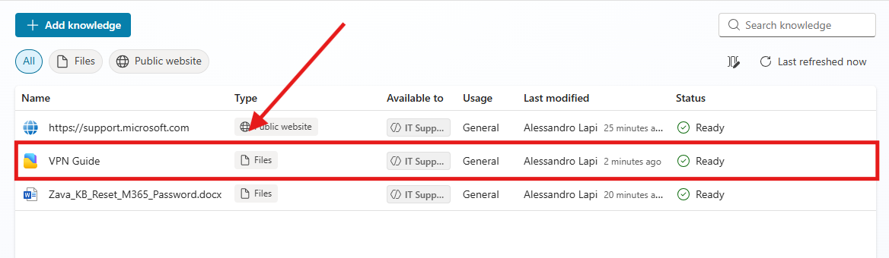

5. Aspettare che il file group diventi **Ready** e aprirlo per modificarne i dettagli.

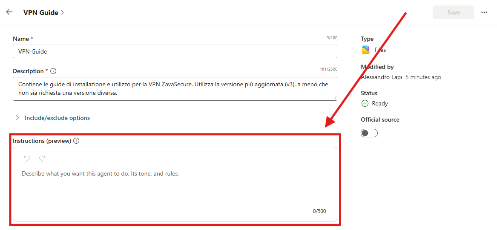

6. Aggiungere le `Instructions`:

```
I documenti sono denominati `Zava_Guida_"topic"_vX`, dove X indica la versione (più basso = più vecchio). **Utilizza sempre la versione più recente disponibile** per fornire le istruzioni. Non utilizzare versioni precedenti **a meno che l’utente non lo richieda esplicitamente**. Verifica il numero di versione e l’argomento prima di rispondere e specifica all’utente se stai utilizzando la guida più aggiornata disponibile.
```

7. Salvare il file group.

8. Testare l'aggiunta della knowledge dalla chat di `Test`: premere su `start a new session` e incollare la seguente domanda:

```
Come configuro la VPN secondo la guida del 2022?
```

## Sito SharePoint come KB

1. Selezionare `Knowledge` nel menu in alto adiacente al Nome dell'Agente.


2. Premere su `+Add knowledge`.

> [!NOTE]
> **Autenticazione dell'utente**
>
> Alcune fonti di conoscenza, come SharePoint e Dataverse, richiedono l'autenticazione dell'utente. Questo significa che l'agente farà riferimento, nelle sue risposte, solo ai dati che l'utente è autorizzato a visualizzare.

3. Selezionare `SharePoint`.

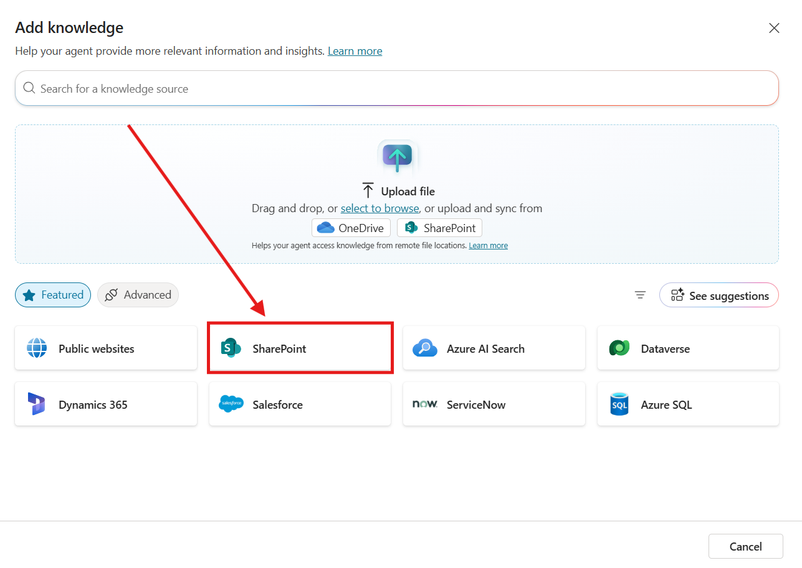

4. Premere su `Browse Item`.

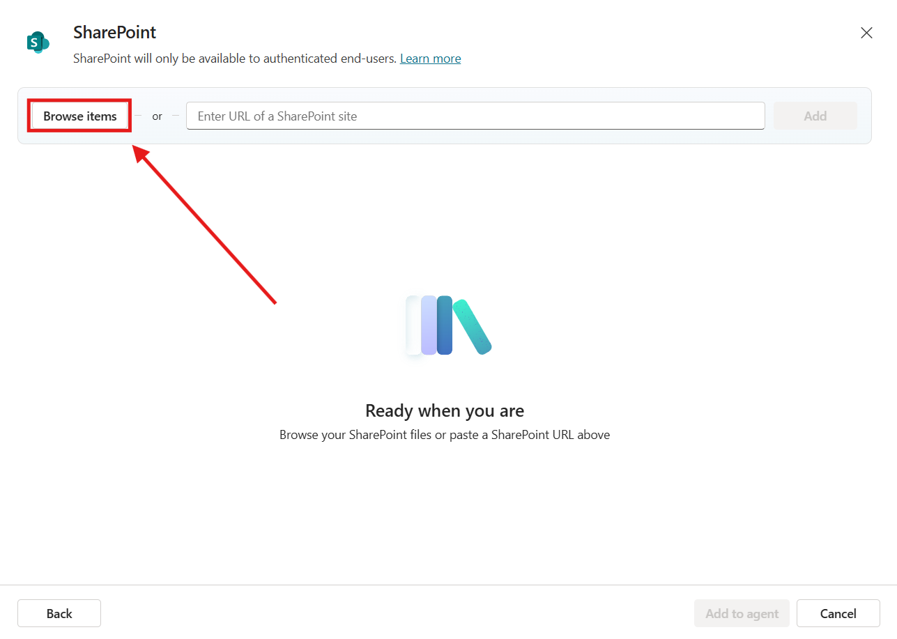

5. Cercare il sito SharePoint `Help Desk CSM`.

6. Selezionare `Documents` e premere `Confirm Selection`.

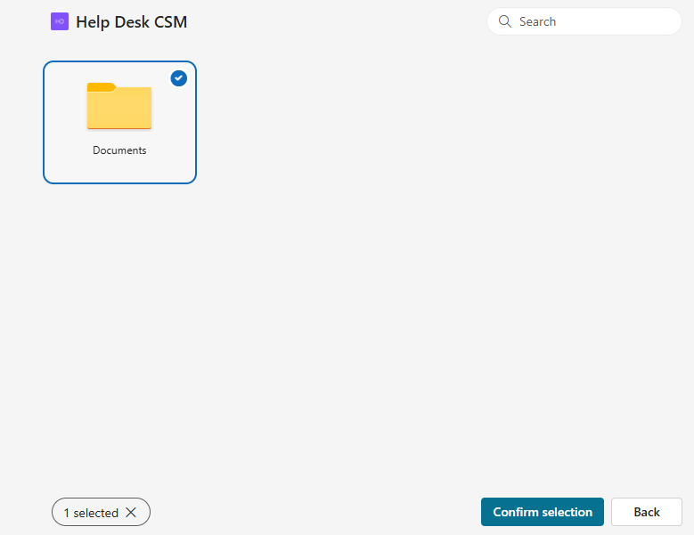

7. Aggiornare la descrizione della knowledge con la seguente:

```
Documentazione essenziale e risorse per supportare la gestione dei servizi IT e l’assistenza agli utenti finali.
```

> [!TIP]
> **Descrizione della fonte**
>
> L'aggiunta di una descrizione aiuta l'agente a identificare meglio quale fonte utilizzare in base alla richiesta posta dall'utente.

8. Testare l'aggiunta della knowledge dalla chat di `Test`: premere su `start a new session` e incollare la seguente domanda:

```
Quali sono gli orari standard rispetto alla disponibilità del supporto di emergenza?
```

> [!NOTE]
> **Approfondire le fonti di conoscenza**
>
> Per ulteriori informazioni sulle fonti di conoscenza consultare la [documentazione](https://learn.microsoft.com/en-us/microsoft-copilot-studio/knowledge-copilot-studio).

> [!IMPORTANT]
> **Lab Completato**
>
> L'agente **IT Support** ora risponde con la documentazione dell'Help Desk di Zava. In questo lab si è visto:
>
> - come creare un sito SharePoint e caricarvi i documenti dell'Help Desk;
> - come aggiungere un documento come fonte di conoscenza e descriverlo;
> - perché disattivare la conoscenza generale e la ricerca sul web;
> - come raggruppare più versioni di un documento in un file group con istruzioni proprie;
> - come usare un sito SharePoint come fonte, con le autorizzazioni dell'utente.

