# Lab 03 - Ticket Agent Topics

[Previous: Lab 02](../02-knowledge-sources/README.md) | [Back to Standard Harness](../index.md) | [Next: Lab 04](../04-job-posting-tools/README.md)

<!-- icon: clock-countdown --> **Tempo stimato:** ~60 minuti · <!-- icon: toolbox f-standard --> **Harness:** standard

## Scenario

All'Help Desk di Zava arrivano ogni giorno segnalazioni simili: un problema hardware, un'applicazione che non parte, la rete che non funziona. Per queste richieste il reparto IT vuole risposte standard, sempre uguali e conformi alle procedure, non suggerimenti generati di volta in volta. Quando serve un intervento, l'utente deve poter aprire un ticket fornendo tutti i dati necessari.

In questo lab si crea un nuovo agente, **Help Desk**, che lavora con i **topic**: un primo topic guida l'utente nella scelta del tipo di problema e risponde con i passaggi di troubleshooting, un secondo raccoglie i dati del ticket con una **adaptive card** e ne mostra il riepilogo.

## Che cosa si costruisce

Lo schema mostra i topic dell'agente **Help Desk** e le richieste che li avviano: l'agente sceglie il topic in base alla descrizione del suo trigger. Lo schema di ogni topic, nodo per nodo, si trova all'inizio della sezione che lo crea.


## Prerequisiti

Per svolgere questo lab occorre avere:

- completato il Lab 01 (developer environment e solution `CSMFirstAgent` come preferred solution).

## Creazione Agente Ticket

Questo laboratorio ha l’obiettivo di guidare alla creazione del primo Topic utilizzando un nuovo agente, per avere un maggiore controllo sul comportamento.

Nel corso del laboratorio viene creato un agente vuoto, privo di connettori, azioni o fonti esterne. L’agente si basa unicamente sulle istruzioni fornite e sui Topic.

1. Dalla home page di [Copilot Studio](https://copilotstudio.microsoft.com/) premere **Agents**.


2. Nella schermata **Agents** è possibile visualizzare la lista completa degli agenti creati nell'environment; proseguire premendo **Create blank agent**.

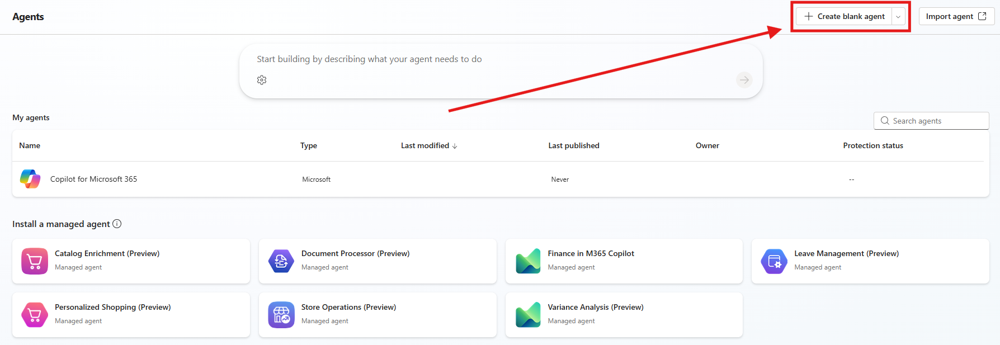

3. Copilot Studio procederà con la creazione dell'agente vuoto: per effettuare modifiche aspettare il seguente messaggio:

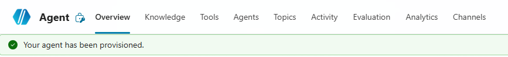

### Dettagli e Istruzioni

Inserire alcuni dettagli all'agente e delle istruzioni molto basilari, il focus di questo Lab è lavorare con i Topic per gestire flussi di conversazione.

- Name: `Help Desk`
- Description: 

```
Un Help Desk Agent fornisce supporto tecnico di primo livello agli utenti identificando e risolvendo problematiche Hardware, Software e di rete.
```

- Instructions:

```
## Obiettivo

L’Help Desk Agent fornisce supporto tecnico di primo livello utilizzando esclusivamente i Topic predefiniti disponibili.

## Limitazioni

- Non improvvisare soluzioni tecniche.
- Non fornire supporto al di fuori delle categorie disponibili.
```


## Creazione del Primo Topic

Il topic da costruire, come apparirà nel canvas alla fine della sezione: le risposte sono messaggi scritti nel topic, sempre uguali, non generati dall'agente.


1. Nel menù dell'Agente premere su `Topics`.

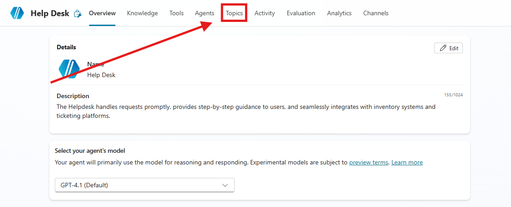

2. Premere `Add a topic` e successivamente `From blank`.

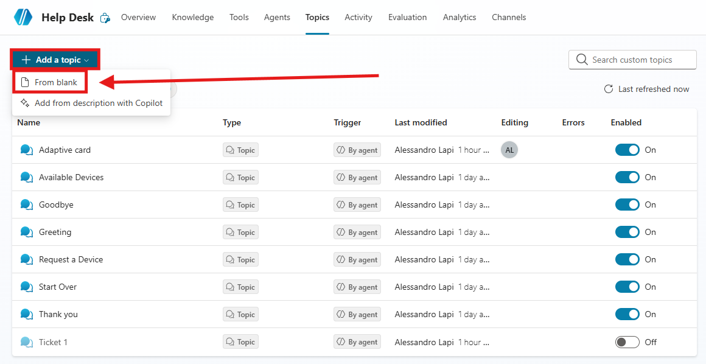

3. Per prima cosa cambiare il nome del `Topic`, selezionando `Untitled` in alto a sinistra e inserendo il seguente nome:

```
First Topic - Supporto Tecnico
```

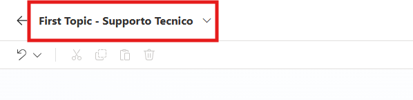

4. Ora aggiungere il `trigger` con la seguente descrizione:

```
Questo topic gestisce le richieste di assistenza relative a problematiche tecniche segnalate dagli utenti durante l’utilizzo di strumenti, applicazioni o servizi aziendali.
```

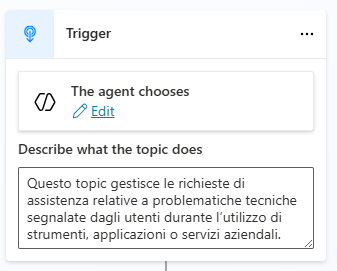


5. Sotto al `Trigger` premere su `+Add Node`.

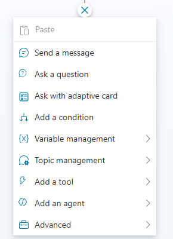

6. Selezionare `Ask a question` e inserire nel corpo il seguente messaggio:

```
Salve User.DisplayName ,
potresti identificare la tipologia di problema?
```

7. Aggiungere *User.DisplayName* premendo il simbolo `{x}`.

> [!NOTE]
> **Variabili**
>
> In questo lab vengono citate e utilizzate le variabili di Copilot Studio. Per maggiori informazioni sul funzionamento, sui tipi e sulla creazione delle variabili consultare la [documentazione](https://learn.microsoft.com/en-us/microsoft-copilot-studio/authoring-variables?tabs=webApp).

8. Su Identify selezionare `Multiple choice options`.

9. Inserire nuove opzioni di risposta:

- `Hardware Issues`
- `Software Issues`
- `Network Issues`

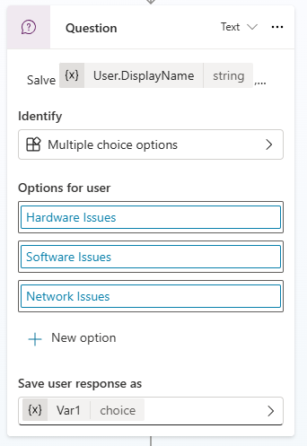

10. Modificare il nome della variabile del nodo. Per fare ciò premere sulla variabile.

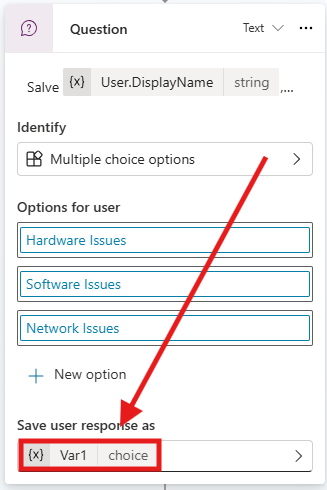

11. Nelle Variable Properties modificare il nome in `Issue` e fare caso alle varie impostazioni della variabile.

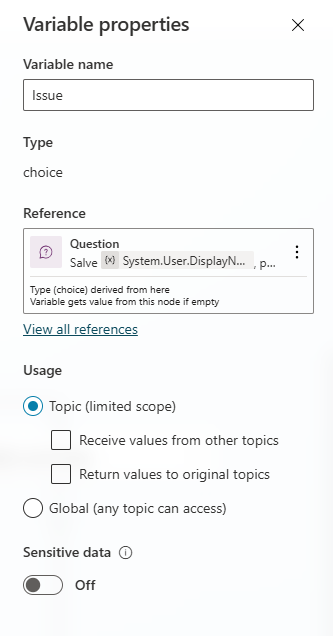

12. Notare come Copilot Studio crea in automatico le `Conditions` per ogni caso possibile.

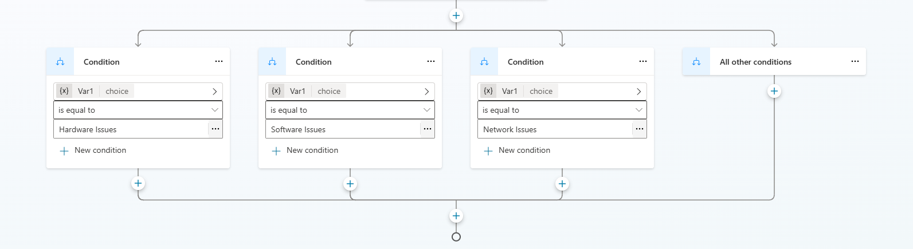

13. Sotto ogni opzione premere `Add a node` e selezionare `Send a message`.
14. Sotto a `Hardware Issues` inserire:

```
🔧 Problema Hardware rilevato. Segui questi passaggi di troubleshooting:

1. Controlla che tutti i cavi siano collegati correttamente. 
2. Riavvia il dispositivo. 
3. Controlla eventuali segni di surriscaldamento o rumori anomali.
4. Scollega e ricollega le periferiche esterne (mouse, tastiera, monitor).
5. Prova con un altro cavo di alimentazione o adattatore.
6. Verifica che RAM o disco siano installati correttamente.
7. Esegui la diagnostica hardware (se disponibile).
```

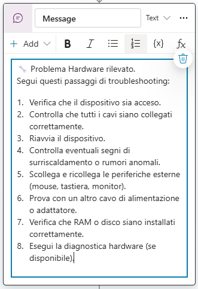

15. Ripetere il processo per le altre opzioni con i seguenti messaggi:

- Software:

```
💻 Problema Software rilevato.
Segui questi passaggi di troubleshooting:

1. Chiudi e riapri l’applicazione.
2. Riavvia il computer.
3. Verifica la presenza di aggiornamenti software.
4. Disinstalla e reinstalla l’applicazione.
5. Controlla i requisiti di sistema.
6. Verifica eventuali messaggi di errore.
7. Aggiorna i driver del dispositivo.
8. Esegui una scansione antivirus/malware.
```

- Network:

```
🌐 Problema di Rete rilevato.
Segui questi passaggi di troubleshooting:

1. Controlla che il cavo di rete sia collegato.
2. Riavvia il router o il modem.
3. Verifica che il Wi-Fi sia attivo.
4. Controlla la configurazione IP (ipconfig).
5. Testa la connessione con il comando ping.
6. Svuota la cache DNS.
7. Disattiva temporaneamente la VPN.
8. Controlla le impostazioni del firewall.
```

> [!NOTE]
> **Perché un topic strutturato**
>
> L’utilizzo di topic strutturati per la gestione delle conversazioni consente di garantire risposte standardizzate, coerenti e conformi alle policy IT aziendali.
> A differenza delle risposte generative del modello AI, l’approccio deterministico riduce il rischio di suggerimenti non accurati o non autorizzati.

16. Premere `Add node` sotto `All other conditions`.

17. Selezionare `Topic Management`, `Go to another topic` e infine `Escalate`.

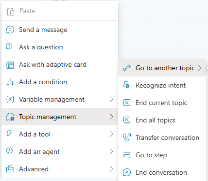

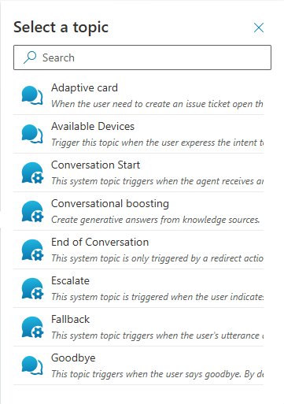

18. Alla chiusura delle conditions premere `Add node`.

19. Selezionare `Topic Management` e `End current topic`.

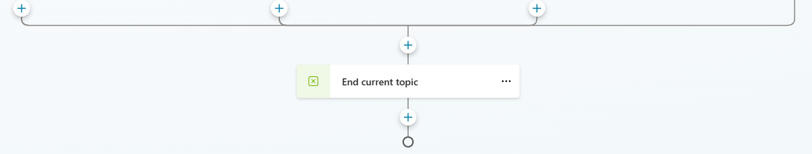

20. Salvare il `Topic` e aprire la finestra di test.

> [!TIP]
> **Nuova sessione di test**
>
> Ricordarsi di premere su `start a new session`: così la chat di test si aggiorna con le ultime modifiche fatte all'agente.

21. Inserire la seguente richiesta:

```
Ho un problema tecnico
```

22. Continuare il dialogo con l'agente e vederne il funzionamento.

## Creazione del Topic con Adaptive Card

Il secondo topic, come apparirà nel canvas alla fine della sezione: una sola scheda raccoglie tutti i dati del ticket, invece di una domanda per ogni campo.


1. Andare su [Copilot Studio](https://copilotstudio.microsoft.com/), nella sezione `Agents` selezionare l'agente `Help Desk`. Nel menù dell'Agente premere su `Topics`.


2. Premere `Add a topic` e successivamente `From blank`.


3. Per prima cosa cambiare il nome del `Topic`, selezionando `Untitled` in alto a sinistra e inserendo il seguente nome:

```
Ticket Card
```

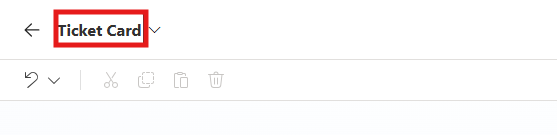

4. Ora aggiungere il `trigger` con la seguente descrizione:

```
Questo Topic guida gli utenti verso la creazione di un ticket di supporto per il reparto IT.
```

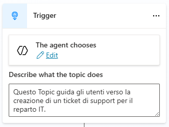

5. Premere su `Add Node` (l'icona + sotto a trigger) e selezionare `Ask with adaptive card`.

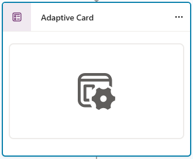

> [!TIP]
> **Adaptive Card Designer**
>
> Le adaptive card si possono personalizzare direttamente da Copilot Studio o con strumenti esterni come il [Designer Adaptive Cards](https://adaptivecards.io/designer/).

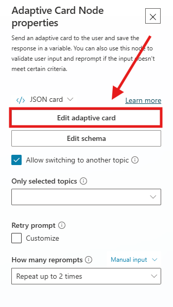

6. Aprire i dettagli dell'adaptive card e premere **Edit adaptive card**.

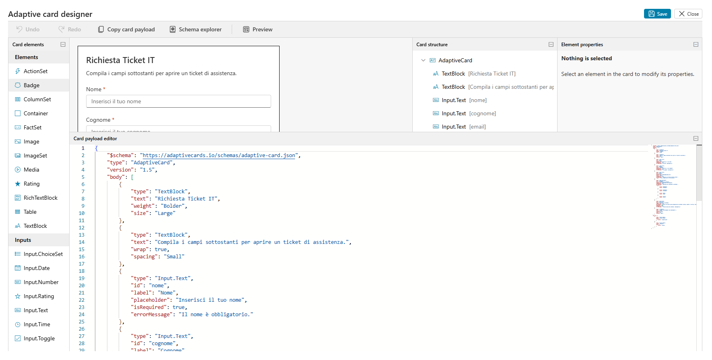

7. Si aprirà l'Adaptive Card Designer.

L’**Adaptive Card Designer** consente di progettare una scheda e visualizzarne il design in tempo reale.

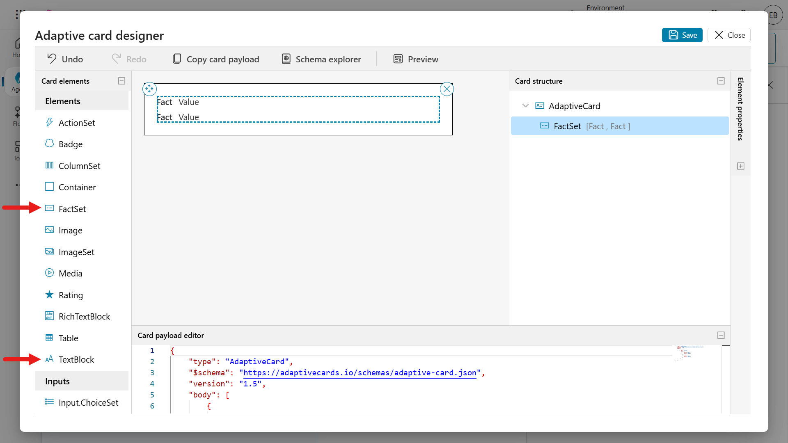

Trascinando gli elementi della scheda **TextBlock** e **FactSet** nell’area di creazione, ovvero il visualizzatore della scheda, si noterà che la struttura della scheda e l’editor del payload si aggiornano automaticamente con l’aggiunta dei due elementi. È possibile aggiornare direttamente sia l’editor del payload della scheda sia il riquadro delle proprietà degli elementi.

Selezionando **Preview** è possibile visualizzare la scheda con larghezze diverse.

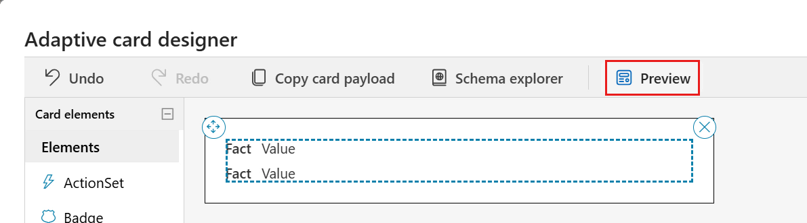

Verrà caricata l’anteprima, nella quale saranno mostrati diversi output della scheda in base alla larghezza.

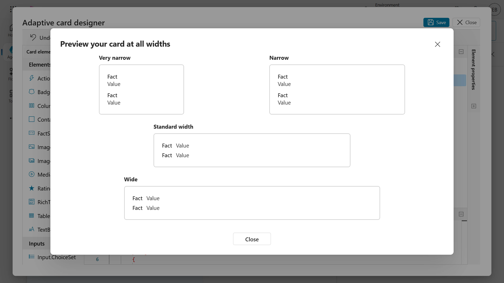

Per uscire dall’anteprima, selezionare l’icona **X** e utilizzare il comando **Undo** nel designer per rimuovere i due elementi della scheda precedentemente aggiunti.

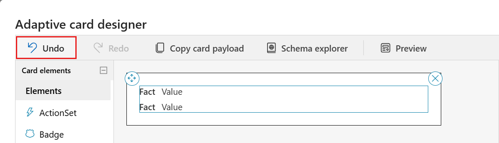


8. Accedere all’editor del **Card payload** e selezionare tutte le righe utilizzando la combinazione di tasti **Ctrl + A** su Windows oppure **Command + A** su Mac, quindi eliminare le righe selezionate. Successivamente, incollare il codice **JSON**.

```
{
    "$schema": "https://adaptivecards.io/schemas/adaptive-card.json",
    "type": "AdaptiveCard",
    "version": "1.5",
    "body": [
        {
            "type": "TextBlock",
            "text": "Richiesta Ticket IT",
            "weight": "Bolder",
            "size": "Large"
        },
        {
            "type": "TextBlock",
            "text": "Compila i campi sottostanti per aprire un ticket di assistenza.",
            "wrap": true,
            "spacing": "Small"
        },
        {
            "type": "Input.Text",
            "id": "nome",
            "label": "Nome",
            "placeholder": "Inserisci il tuo nome",
            "isRequired": true,
            "errorMessage": "Il nome è obbligatorio."
        },
        {
            "type": "Input.Text",
            "id": "cognome",
            "label": "Cognome",
            "placeholder": "Inserisci il tuo cognome",
            "isRequired": true,
            "errorMessage": "Il cognome è obbligatorio."
        },
        {
            "type": "Input.Text",
            "id": "email",
            "label": "Email",
            "placeholder": "esempio@azienda.com",
            "style": "Email",
            "isRequired": true,
            "errorMessage": "Inserisci un indirizzo email valido.",
            "regex": "^[\\w.+-]+@([\\w-]+\\.)+[\\w-]{2,}$"
        },
        {
            "type": "Input.ChoiceSet",
            "id": "tipologia",
            "label": "Tipologia di problema",
            "placeholder": "Seleziona una tipologia",
            "isRequired": true,
            "errorMessage": "Seleziona una tipologia di problema.",
            "choices": [
                {
                    "title": "Hardware",
                    "value": "Hardware"
                },
                {
                    "title": "Software",
                    "value": "Software"
                },
                {
                    "title": "Rete",
                    "value": "Rete"
                },
                {
                    "title": "Altro",
                    "value": "Altro"
                }
            ]
        },
        {
            "type": "Input.Text",
            "id": "descrizione",
            "label": "Descrivi il problema",
            "isMultiline": true,
            "placeholder": "Fornisci una descrizione dettagliata del problema (sintomi, quando si verifica, eventuali messaggi di errore, ecc.)",
            "maxLength": 2000,
            "isRequired": true,
            "errorMessage": "La descrizione del problema è obbligatoria."
        },
        {
            "type": "TextBlock",
            "text": "I campi contrassegnati sono obbligatori.",
            "size": "Small",
            "isSubtle": true,
            "wrap": true,
            "spacing": "Small"
        }
    ],
    "actions": [
        {
            "type": "Action.Submit",
            "title": "Invia ticket",
            "data": {
                "action": "submitTicket"
            }
        },
        {
            "type": "Action.Submit",
            "title": "Annulla",
            "data": {
                "action": "cancel"
            }
        }
    ]
}
```

9. L'adaptive card verrà visualizzata in questo modo:

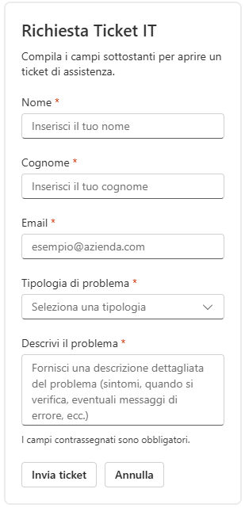

10. Sotto l'adaptive card premere `Add node` e selezionare `Send a message`.

11. Dentro il messaggio scrivere il seguente testo:

```
Il seguente Ticket è stato inviato al Reparto IT
```

12. Sempre all'interno del messaggio premere `+ Add`.

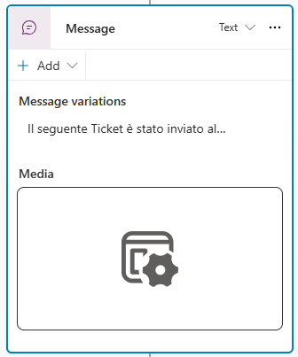

13. Selezionare `Adaptive card` e nella schermata di modifica passare da JSON a **Formula** card.

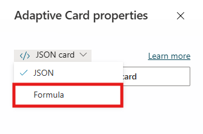

> [!NOTE]
> **Variabili nella card**
>
> In una adaptive card scritta in JSON non è possibile inserire variabili: per questo si usa la Formula card, scritta in [Power Fx](https://learn.microsoft.com/it-it/power-platform/power-fx/overview).

14. Incollare la seguente card:

```
{ type: "AdaptiveCard", body: [ { type: "TextBlock", size: "Medium", weight: "Bolder", text: "Riepilogo dati inseriti" }, { type: "FactSet", facts: [ { title: "Nome", value: Text(Topic.nome) }, { title: "Cognome", value: Text(Topic.cognome) }, { title: "Email", value: Text(Topic.email) }, { title: "Tipologia di problema", value: Text(Topic.tipologia) }, { title: "Descrizione", value: Text(Topic.descrizione) } ] } ], '$schema': "http://adaptivecards.io/schemas/adaptive-card.json", version: "1.5" }
```

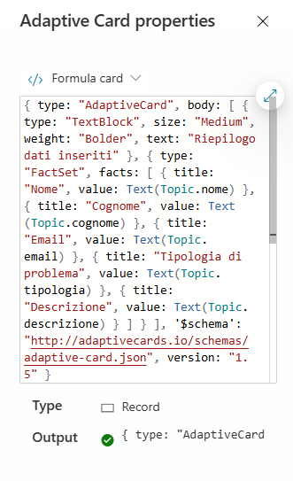

15. Dopo aver salvato il Topic premere il tasto Test e inserire la seguente richiesta:

```
Voglio aprire un ticket
```

16. Continuare il dialogo con l'agente e verificare il funzionamento del Topic.

> [!TIP]
> **Se si attiva il topic sbagliato**
>
> Se l'agente porta al topic errato, è possibile disattivare il primo topic creato con l'interruttore nella sezione Topics.

> [!IMPORTANT]
> **Lab Completato**
>
> L'agente **Help Desk** ora gestisce le richieste di supporto con conversazioni guidate. In questo lab si è visto:
>
> - come creare un agente vuoto con istruzioni essenziali;
> - come creare un topic con trigger, domanda a scelta multipla e condizioni;
> - come rinominare e usare le variabili di un topic;
> - come raccogliere dati con una adaptive card e mostrarne il riepilogo con una Formula card in Power Fx.

